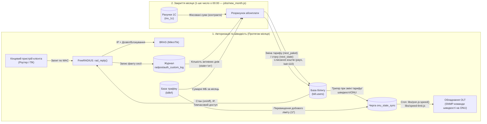
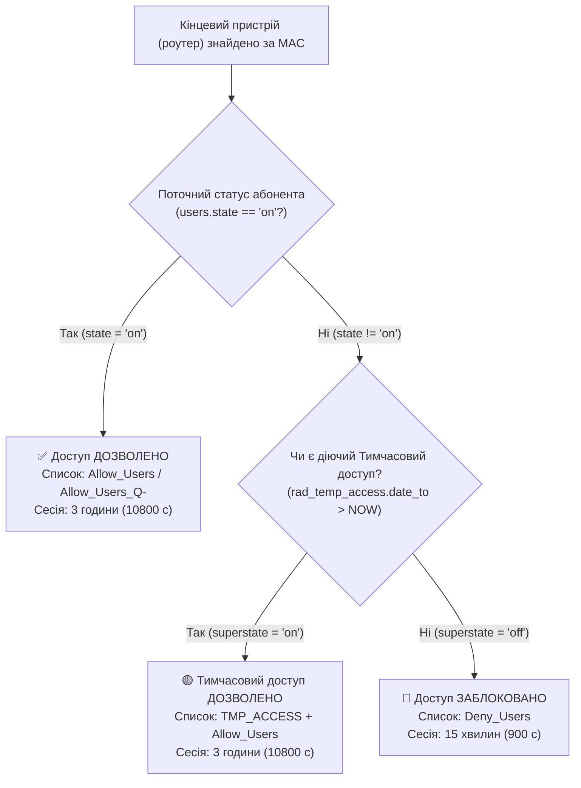
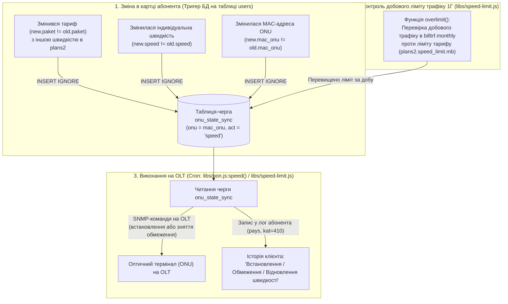
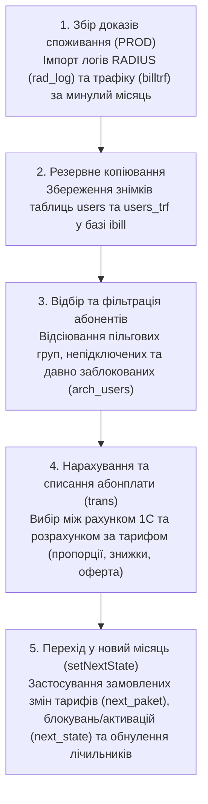
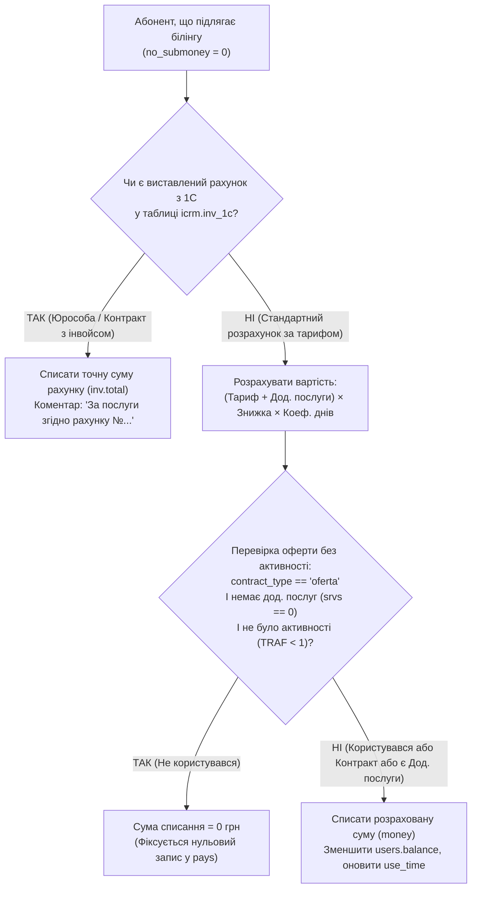

---
layout:
  width: wide
  outline:
    visible: false
---

# Бізнес-процеси авторизації абонентів (AAA), управління швидкістю та щомісячного нарахування абонентської плати

Цей документ описує логіку роботи взаємопов'язаних ключових процесів білінгової системи **iPort**:
1. **Мережева авторизація абонентів (AAA / FreeRADIUS)** на базі збереженої процедури `rad_reply($mac, $agent_remote_id)`.
2. **Управління швидкістю на рівні оптичного обладнання (OLT / ONU)** через тригер БД на таблиці `users`, чергу синхронізації `onu_state_sync` та фонові процеси [`libs/pon.js`](file:///c:/Projects/icrm/test-mysql/icrm-server/libs/pon.js) / [`libs/speed-limit.js`](file:///c:/Projects/icrm/test-mysql/icrm-server/libs/speed-limit.js).
3. **Закриття розрахункового періоду та нарахування абонентської плати** на базі регламентного завдання [`jobs/new_month.js`](file:///c:/Projects/icrm/test-mysql/icrm-server/jobs/new_month.js) та фінансового модуля [`libs/money.js`](file:///c:/Projects/icrm/test-mysql/icrm-server/libs/money.js).

Опис орієнтований передусім на **бізнес-логіку та правила обслуговування клієнтів**, пояснюючи, як технічні умови в коді трансформуються у реальні сценарії для абонента та фінансового обліку.

---

## Частина 1. Загальна архітектура: Авторизація, Швидкість та Білінг

У системі функції контролю доступу, обмеження швидкості та нарахування абонплати чітко розділені між вузлами інфраструктури, але працюють як єдиний цикл:

- **FreeRADIUS (`rad_reply`)** відповідає за **ідентифікацію кінцевого пристрою абонента** (роутера, ПК), видачу IP-адреси, перевірку дозволу на вихід в Інтернет (активний / заблокований / тимчасовий доступ) та **фіксацію кожної сесії** в журналі `radpostauth_custom_log`.
- **Оптичні комутатори OLT (через тригер БД та Cron)** відповідають за **фактичне обмеження швидкості** на порту абонентського термінала (ONU), включаючи зміну тарифної швидкості та шейпінг при перевищенні добового ліміту трафіку на гігабітних тарифах (1 Гбіт/с).
- **Щомісячний білінг ([`jobs/new_month.js`](file:///c:/Projects/icrm/test-mysql/icrm-server/jobs/new_month.js))** 1-го числа кожного місяця аналізує журнали авторизацій RADIUS (`radpostauth_custom_log`) та обсяг спожитого трафіку за минулий місяць, щоб визначити: **чи користувався клієнт послугою фактично**, скільки грошей списати з його балансу і чи потрібно перевести його на новий тариф або заблокувати.

---

## Частина 2. Бізнес-логіка мережевої авторизації (`rad_reply`)

Коли абонент вмикає своє кінцеве обладнання (Wi-Fi роутер, комп'ютер тощо), мережевий сервер доступу (BRAS MikroTik) звертається до RADIUS-сервера, який викликає процедуру `rad_reply`. Її завдання — впізнати пристрій клієнта, перевірити його право на доступ до Інтернету та повернути параметри сесії.

### 2.1. Крок 1: Ідентифікація виключно за кінцевим обладнанням (`MAC`)
- Авторизація в мережі відбувається **виключно за MAC-адресою кінцевого пристрою клієнта** (роутера або комп'ютера), яка записана в полі `users.mac`.
- Оптичний термінал (**ONU**, поле `mac_onu`) виступає лише середовищем передачі даних на фізичному/канальному рівні і **не бере участі в RADIUS-авторизації**.
- Система шукає запис у таблиці `bill.users`, де `u.mac = $mac`.
- **Ієрархія договорів (`id` та `mid`):** Якщо знайдений пристрій є додатковою точкою/пристроєм (`mid > 0`), процедура автоматично визначає ID головного договору (`u_id = IF(u.mid > 0, u.mid, u.id)`), щоб перевіряти спільні права (наприклад, послугу «Тимчасовий доступ», яка активується на головний договір).

### 2.2. Крок 2: Перевірка карантину та невідомих пристроїв
Перш ніж надавати доступ, система відсіює невідомі або вимкнені з обслуговування записи:
- **Умова:** MAC-адреса порожня, або пристрій не знайдено в базі (`ip IS NULL`), або абонент знаходиться у **технічній групі `grp = 1`** (група відключених/архівних або тестових записів).
- **Бізнес-результат:** Пристрою видається фіктивна IP-адреса `0.0.0.0` на 3 години (`Session-Timeout = 10800`). Доступ до мережі Інтернет у такого пристрою повністю відсутній, і в журнал успішних авторизацій він не записується.

### 2.3. Крок 3: Визначення стану доступу (Активний / Заблокований / Тимчасовий доступ)
Якщо клієнта знайдено і він має призначену IP-адресу, система перевіряє його поточний статус (`users.state`):

1. **Клієнт активний (`state = 'on'`):**
   - Абонент отримує свою реальну IP-адресу (`Framed-IP-Address`).
   - Тривалість сесії встановлюється на **3 години (`10800` сек)** — обладнання перепитуватиме RADIUS лише раз на 3 години.
   - Абонент додається до дозвільного списку файрволу MikroTik (`Allow_Users` або `Allow_Users_Q-`).

2. **Клієнт заблокований (`state <> 'on'`), але має «Тимчасовий доступ» (`rad_temp_access`):**
   - Коли у клієнта виникла заборгованість, оператор або сам клієнт (через особистий кабінет / IVR) може активувати послугу **«Тимчасовий доступ»** ([`libs/bill.js:231`](file:///c:/Projects/icrm/test-mysql/icrm-server/libs/bill.js#L231)), яка додає запис у таблицю `rad_temp_access` із часом закінчення дії `date_to`.
   - Навіть попри те, що в картці клієнта статус залишається `off`, процедура бачить активний запис у `rad_temp_access` (`superstate = 'on'`), **вмикає клієнту Інтернет** на 3 години (`10800` сек) і додатково позначає його на роутері адресним списком **`TMP_ACCESS`**.

3. **Клієнт заблокований (`state <> 'on'`) і не має тимчасового доступу:**
   - Абоненту все одно видається його IP-адреса (щоб працювала переадресація на інформаційну сторінку боржника / особистий кабінет та віддалена діагностика роутера), але його IP вноситься у чорний список файрволу **`Deny_Users`**, який блокує вихід в Інтернет.
   - **Коротка сесія для швидкого включення:** Тривалість сесії (`Session-Timeout`) скорочується до **15 хвилин (`900` сек)**. Завдяки цьому, щойно заблокований клієнт поповнить рахунок і його статус у білінгу зміниться на `'on'`, сесія оновиться автоматично щонайбільше за 15 хвилин (або миттєво через API `allowOnRouterImmediately`).
   - Додатково при зміні `users.state` тригер бази даних фіксує зміну стану в історії `user_state_log`.

### 2.4. Крок 4: Журналювання сесій для майбутнього білінгу
У кінці кожної авторизації (окрім групи `grp = 1`) виконується запис у таблицю **`radpostauth_custom_log`**:
- Фіксується `id` запису, `mid` головного договору, поточний статус `state`, `mac` роутера, `ip` та поточний час `time`.
- **Бізнес-призначення:** Ця таблиця є доказовою базою, яка фіксує, у які саме дні місяця роутер абонента виходив на зв'язок зі статусом `state = 'on'`. Саме ці дані читає скрипт нарахування абонплати 1-го числа.

---

## Частина 3. Управління швидкістю абонента (OLT, Тригер БД та Cron)

Для стандартних сучасних тарифів (**100 Мбіт/с** та **1 Гбіт/с**) RADIUS не створює шейперів на BRAS MikroTik (у `rad_reply` умова `speed NOT IN ('100000', '1000000')` пропускає атрибут `Mikrotik-Rate-Limit`). Натомість **фактичне керування швидкістю відбувається безпосередньо на оптичному обладнанні (OLT) для конкретного термінала абонента (`mac_onu`)**.

Цей механізм працює у двох випадках: **при зміні тарифу/швидкості/ONU** та **при перевищенні добового ліміту трафіку на тарифах 1 Гбіт/с**.

### 3.1. Реакція на зміну тарифу, швидкості або заміну ONU (Тригер на таблиці `users`)
На таблиці `bill.users` працює тригер при оновленні даних абонента (`BEFORE/AFTER UPDATE`):
1. **Зміна тарифу або індивідуальної швидкості:**
   - Якщо у клієнта змінилося поле індивідуальної швидкості (`new.speed <> old.speed`) або змінився тарифний план (`new.paket <> old.paket`), тригер порівнює швидкість старого тарифу (`v_old_plan_speed`) та нового тарифу (`v_new_plan_speed`) з таблиці `plans2`.
   - Якщо швидкість реально змінилася, тригер автоматично додає оптичний термінал абонента (та всі додаткові точки цього договору `id = new.id OR mid = new.id`, крім спецгрупи `grp = 36`) у таблицю черги **`onu_state_sync`** із дією `act = 'speed'`.
2. **Заміна обладнання (ONU) у клієнта:**
   - Якщо майстер замінив абоненту оптичний термінал і вписав новий `mac_onu` (`new.mac_onu <> old.mac_onu`), тригер також ставить нову ONU в чергу **`onu_state_sync`** (`act = 'speed'`), щоб на неї одразу застосувався правильний швидкісний профіль згідно з тарифом клієнта.

### 3.2. Тимчасове обмеження швидкості при перевищенні добового ліміту (Тарифи 1 Гбіт/с)
Гігабітні тарифи мають у таблиці `plans2` параметр добового чесного користування `speed_limit` (JSON вигляду `{"mb": <ліміт_МБ_на_день>, "speed": <знижена_швидкість>}`).
- Щогодини за розкладом (`cron.js`) запускається процес контролю швидкості ([`libs/speed-limit.js`](file:///c:/Projects/icrm/test-mysql/icrm-server/libs/speed-limit.js) / [`libs/pon.js:speed()`](file:///c:/Projects/icrm/test-mysql/icrm-server/libs/pon.js#L196)):
  1. **Виявлення перевищення (`overlimit`):** Скрипт перевіряє в базі `billtrf.monthly`, скільки мегабайтів абонент спожив за **поточну добу** (`today = YYYYMMDD`). Якщо добовий трафік перевищив поріг `speed_limit.mb`, `mac_onu` клієнта додається в чергу `onu_state_sync` (`act = 'speed'`).
  2. **Застосування обмеження на OLT:** При обробці черги `onu_state_sync` система бачить, що добовий трафік перевищує ліміт, відправляє команду на OLT для зниження швидкості порту ONU до рівня `limit.speed` (наприклад, зі 1000 Мбіт/с до 100 Мбіт/с), переводить запис у черзі в стан **`act = 'limited'`** і додає в історію клієнта (`pays`) запис:
     *«Обмеження швидкості X Мбіт/с в зв'язку з перевищенням ліміту трафіку Y Мбайт на день (ліміт Z Мб)»*.
  3. **Автоматичне відновлення швидкості наступної доби:** Оскільки запис із позначкою `act = 'limited'` залишається в таблиці `onu_state_sync`, після настання нової доби (00:00) добовий лічильник трафіку клієнта за новий день менший за ліміт. Наступний запуск крону бачить, що перевищення більше немає, **відправляє команду на OLT для повернення повної швидкості 1 Гбіт/с**, видаляє запис із `onu_state_sync` та логує:
     *«Відновлення швидкості 1000 Мбіт/с (обмеження трафіку знято)»*.

---

## Частина 4. Бізнес-логіка нарахування абонентської плати ([`jobs/new_month.js`](file:///c:/Projects/icrm/test-mysql/icrm-server/jobs/new_month.js))

Процедура переходу на новий місяць запускається автоматично **1-го числа кожного місяця о 00:00–01:00 ночі** (перевірка `cronGuard`: день = `01`, година = `00`) і виконує закриття **попереднього місяця** та підготовку станів на **поточний місяць**.

Весь процес складається з **5 послідовних бізнес-етапів**:

---

### Етап 1. Збір даних про фактичне користування послугою (`authRadTraffImport`)
Перед тим як списувати гроші за минулий місяць, система збирає об'єктивні показники активності кожного абонента:

1. **Ротація та агрегація журналів RADIUS (`radLogImport`):**
   - На обох серверах FreeRADIUS (`db.rad` та `db.radSecond`) таблиця `radpostauth_custom_log`, яку весь місяць наповнювала процедура `rad_reply`, перейменовується в архівну `rad_log.YYYYMM`, а замість неї створюється нова порожня таблиця для нового місяця.
   - Із архівних таблиць обох серверів вибираються всі авторизації кінцевого обладнання за минулий місяць, де абонент мав увімкнений доступ (**`state = 'on'`**).
   - Якщо абонент має кілька роутерів/точок (`mid > 0`), їхня активність об'єднується на головний договір (`IF(mid > 0, mid, id)`).
   - Для кожного абонента підраховується **кількість унікальних календарних днів (`size`)**, у які його роутер був онлайн із дозволеним доступом, та перелік цих чисел місяця (`days`). Результат зберігається в `bill.rad_log`.
2. **Імпорт спожитого трафіку (`traffImport`):**
   - Із бази статистики `db.traff` (`monthly`) береться сумарний вхідний та вихідний трафік абонента за минулий місяць, переводиться в мегабайти (`mb`) з округленням вгору та дописується в ту саму таблицю `bill.rad_log`.
3. **Критерій «Чи користувався абонент Інтернетом?» (`getData`):**
   - Система вважає, що абонент **фактично споживав послугу** у звітному місяці, якщо виконується хоча б одна з двох умов ([`jobs/new_month.js:99`](file:///c:/Projects/icrm/test-mysql/icrm-server/jobs/new_month.js#L99)):
     - Його роутер авторизувався зі статусом `'on'` **більше ніж в 1 календарний день** за місяць (`size > 1`);
     - **АБО** він сумарно завантажив **більше 900 МБ** трафіку (`mb > 900`).
   - Якщо ж абонент з'явився в мережі лише 1 день (або взагалі не з'являвся) і скачав менше 900 МБ — для цілей оферти вважається, що послугою він не користувався (`TRAF = 0`).

---

### Етап 2. Кому абонплата НЕ нараховується (Фільтрація абонентів `users`)
Скрипт бере список абонентів із представлення `new_month_users` та перевіряє, чи не було вже закрито цей місяць для клієнта (таблиця `arch_users`). Далі частина абонентів **звільняється від списання абонплати** (їм у `arch_users` записується код причини `no_submoney > 0`, а фінансові проведення пропускаються):

| Код `no_submoney` | Умова в системі | Бізнес-зміст правила |
| :---: | :--- | :--- |
| **`1`** | Група абонента (`user_grp.grp_property`) містить прапорець `'1'` | **Службові, технічні або безкоштовні групи** (співробітники, тестові включення, спецоб'єкти), для яких нарахування абонплати вимкнено на рівні групи. |
| **`2`** | Поле `start_day < 0` | **Клієнт ще на стадії первинного підключення.** Договір у системі вже створено, але майстри ще не підключили абонента або він ще не почав користуватися послугою. Гроші не списуються, і замовлений тариф не змінюється. |
| **`3`** | Тариф `paket !== 61`, статус `state === 'off'`, а дата блокування `state_date` менша за початок звітного місяця + 3 години (`time1 + 10800`) | **Абонент був заблокований увесь місяць.** Якщо клієнта відключили ще до початку минулого місяця (або в перші 3 години 1-го числа) і він так і простояв у статусі `off` увесь місяць — абонплата йому не нараховується. *(Виняток становить спеціальний тариф `paket = 61`, який обслуговується навіть у заблокованому стані).* |

Усі інші абоненти отримують у архіві позначку `no_submoney = 0` і переходять до фінансового розрахунку.

---

### Етап 3. Як розраховується сума списання (`trans` та [`libs/money.js`](file:///c:/Projects/icrm/test-mysql/icrm-server/libs/money.js))

Для кожного активного абонента система визначає суму до списання (`P.got_money`) за одним із **двох сценаріїв**:

#### Сценарій А: Нарахування за рахунком 1С (`inv_1c`)
- Якщо для договору абонента в базі `icrm.inv_1c` за цей місяць є сформований бухгалтерський рахунок (зазвичай це **юридичні особи, ФОП або контрактні абоненти**), білінг **не рахує** вартість за тарифом самостійно.
- Списується рівно та сума, яка вказана в рахунку 1С (`inv.total`), із коментарем: *«За послуги згідно рахунку `<doc_num>`»*.

#### Сценарій Б: Стандартний розрахунок за тарифним планом та додатковими послугами
Якщо рахунку в 1С немає, викликається функція [`bill()`](file:///c:/Projects/icrm/test-mysql/icrm-server/libs/money.js#L35-L42):

1. **Базова повна вартість місяця (`total`):**
   $$\text{total} = \text{Ціна тарифу (plans2.price)} + \text{Сума додаткових послуг (srvs)}$$
   - *Додаткові послуги (`users.srvs`):* зберігаються у вигляді бітової маски (наприклад, реальна IP-адреса, телебачення, оренда обладнання). Функція розшифровує підключені біти за довідником `srvs` і додає їхню вартість до тарифу.
2. **Врахування індивідуальної знижки (`d`):**
   - Якщо у клієнта є відсоткова знижка (`users.discount`), розраховується коефіцієнт оплати:
     $$d = \frac{100 - \text{discount}}{100}$$
3. **Пропорційний розрахунок за неповний місяць (`k` — поле `start_day`):**
   - Якщо клієнт підключився, розблокувався або змінив тариф не з 1-го числа, у нього в полі `users.start_day` записаний день місяця, з якого він почав споживати послугу (наприклад, `15`).
   - Система рахує частку місяця за формулою з базою у 31 день:
     $$k = \text{round}\left(\frac{32 - \text{start\_day}}{31}, 2\right)$$
   - Якщо клієнт користувався послугою з початку місяця (`start_day = 0`), то $k = 1$ (повна вартість).
4. **Підсумкова сума за формулою (`money`):**
   $$\text{money} = \text{round}(\text{total} \times d \times k, 2)$$

#### Важливе бізнес-правило для абонентів на публічній оферті («Не користувався — не платиш»)
Після розрахунку суми `money` система перевіряє, чи був абонент реально в мережі ([`jobs/new_month.js:224`](file:///c:/Projects/icrm/test-mysql/icrm-server/jobs/new_month.js#L224)):
- Якщо виконуються **одночасно 3 умови**:
  1. Тип договору клієнта — **публічна оферта** (`contract_type === 'oferta'`);
  2. У клієнта **немає платних додаткових послуг** (`srvs === 0`);
  3. За минулий місяць у клієнта **не було активності** за даними RADIUS та трафіку (`total_mb < 1`, тобто менше 2 днів авторизацій роутера і менше 900 МБ трафіку) —
- **Тоді сума списання примусово встановлюється в `0 грн`!**
- *Чому це важливо для бізнесу:* Клієнти на оферті (передоплаті), які поїхали у відпустку або вимкнули роутер і не користувалися Інтернетом весь місяць, не заганяються в борг за основний інтернет-тариф. Натомість **контрактним абонентам** (`contract_type !== 'oferta'`) або тим, у кого підключені **додаткові послуги** (`srvs > 0`, наприклад, статична IP-адреса чи ТБ), абонплата нараховується незалежно від того, чи вмикали вони роутер.

#### Проведення списання в базі даних:
- У картці клієнта (`users`):
  - Скидається день початку споживання на новий місяць (`start_day = 0`, щоб наступний місяць рахувався повністю);
  - Поточний баланс зберігається як стартовий (`balance_start = balance`);
  - З балансу списується розрахована сума (`balance = balance - got_money`);
  - Якщо списання було ненульовим (`got_money !== 0`), оновлюється час останнього користування `use_time`.
- В історії платежів (`pays`):
  - Створюється запис зі знаком «мінус» (`cash = -got_money`), типом `type = 10` та категорією **`category = 110`** (Основне списання абонплати), датований останніми секундами минулого місяця (`time_last`).
  - У поле `coment` записується детальна розшифровка для клієнта (тариф, знижка, день початку споживання, коефіцієнт), а в `reason` — машиночитаний JSON із мегабайтами, кодом тарифу та коефіцієнтом.

---

### Етап 4. Застосування запланованих змін на новий місяць (`setNextState`)

Протягом попереднього місяця абоненти (через особистий кабінет) або оператори (через CRM) могли запланувати зміни, які мають набути чинності з 1-го числа нового місяця:
- **`next_paket`** — замовлений новий тарифний план з наступного місяця;
- **`next_state`** — заплановане блокування (`'off'`) або розблокування (`'on'`) з наступного місяця.

Після того, як абонплату за минулий місяць вже списано, функція `setNextState` обробляє всі головні договори (`mid = 0`, `grp <> 1`), де є заплановані зміни:

1. **Якщо заплановано відключення (`next_state === 'off'`):**
   - Абонент та всі його додаткові пристрої (`id = row.id OR mid = row.id`) переводяться у стан **`state = 'off'`**.
   - Фіксується дата блокування кінцем попереднього місяця (`state_date = time_last`), а заплановані прапорці `next_paket` та `next_state` очищуються.
2. **Якщо заплановано зміну тарифу (`next_paket > 0`) та/або увімкнення (`next_state === 'on'`):**
   - Система розраховує **вартість нового місяця (`cost`)** з урахуванням нового тарифу та поточних додаткових послуг (`srvs`).
   - **Перевірка платоспроможності (Фінансовий бар'єр):** Система перевіряє, чи достатньо на балансі абонента (вже після списання абонплати за минулий місяць!) коштів для оплати нового місяця:
     $$\text{balance} \ge \text{cost}$$
   - **Якщо коштів ДОСТАТНЬО:**
     - Абоненту (та його дочірнім записам `mid`) встановлюється новий тариф (`paket = next_paket`);
     - *Примітка:* зміна `users.paket` автоматично запускає тригер БД, який додає `mac_onu` абонента в чергу `onu_state_sync`, після чого Cron змінює швидкість на OLT;
     - Оновлюється поріг відключення (`limit_balance = cost`);
     - Якщо було замовлено `next_state = 'on'`, статус змінюється на активний (`state = 'on'`);
     - Поля `next_paket` та `next_state` скидаються.
   - **Якщо коштів НЕ ВИСТАЧАЄ (або тариф не знайдено):**
     - **Зміна тарифу та розблокування СКАСОВУЮТЬСЯ!** Клієнт залишається на старому тарифі та в поточному стані.
     - Поля `next_paket` та `next_state` обнуляються, щоб спроба не повторювалася.
     - В історію абонента (`pays`, `type = 50`, `category = 410`) записується системне повідомлення про причину відмови: *«Не вистачає коштів для активації пакет:... стан:...»*.

---

### Етап 5. Завершення переходу
Останнім кроком скрипт обнуляє поточні лічильники трафіку в оперативній таблиці `users_trf` (`in1..in4 = 0`, `out1..out4 = 0`), щоб облік трафіку в новому місяці почався з чистого аркуша, і закриває з'єднання з базою даних.

---

## Частина 5. Підсумкова таблиця бізнес-сценаріїв для швидкої довідки

| Ситуація з абонентом | Авторизація (`rad_reply`) та Швидкість (OLT) | Що відбувається 1-го числа (`new_month.js`) |
| :--- | :--- | :--- |
| **Звичайний активний клієнт (`state = 'on'`), користується Інтернетом** | Роутер авторизується за MAC, отримує свою IP, список `Allow_Users` / `Allow_Users_Q-`, сесію на 3 год. Щодня логується в `radpostauth_custom_log`. Швидкість виставлена на порту ONU на OLT. | Бачить `size > 1` або `mb > 900` у `rad_log`. Списується повна абонплата за минулий місяць (`category = 110`). |
| **Клієнт на тарифi 1 Гбіт/с перевищив добовий ліміт трафіку** | Авторизація роутера не переривається, але Cron (`libs/speed-limit.js`) додає `mac_onu` в `onu_state_sync` і знижує швидкість на OLT до кінця поточної доби. Після 00:00 швидкість 1 Гбіт/с відновлюється автоматично. | На розрахунок місячної абонплати добові обмеження швидкості не впливають — списується стандартна вартість тарифу. |
| **Клієнт на оферті (`oferta`), статус `on`, але весь місяць роутер був вимкнений (у від'їзді)** | Авторизацій роутера немає (або була лише в 1 день і `< 900` МБ), додаткових послуг немає (`srvs = 0`). | Запис про закриття місяця створюється, але **списується `0 грн`** (баланс не зменшується). |
| **Контрактний клієнт або клієнт із виставленим рахунком 1С (`inv_1c`)** | Авторизується за стандартними правилами свого статусу `state`. | Незалежно від трафіку списується сума згідно з рахунком 1С (`inv.total`) або повна абонплата за тарифом. |
| **Клієнт підключився в середині місяця (напр., 20-го числа, `start_day = 20`)** | При записі `mac_onu` тригер БД ставить ONU в `onu_state_sync` для налаштування швидкості на OLT. Роутер авторизується штатно (`state = 'on'`). | 1-го числа списується **пропорційна сума** лише за фактичні дні $(32 - 20) / 31 \approx 39\%$ тарифу, після чого `start_day` скидається в `0`. |
| **Клієнт заблокований за борг (`state = 'off'`) у середині місяця** | Роутер отримує IP, але потрапляє в чорний список `Deny_Users` (Інтернету немає). Сесія коротка — 15 хв (`900` с) для швидкого підхоплення оплати. | Оскільки на початку місяця він ще був активний і мав трафік/авторизації, за цей місяць абонплата спишеться. А от у *наступному* місяці (якщо так і залишиться `off`) спрацює правило `no_submoney = 3` і нарахувань більше не буде. |
| **Заблокований клієнт (`state = 'off'`), якому увімкнули «Тимчасовий доступ»** | Попри `state = 'off'`, процедура бачить запис у `rad_temp_access`, видає Інтернет (`Allow_Users` + `TMP_ACCESS`) на 3 год до закінчення `date_to`. | У `radpostauth_custom_log` при цьому записується фактичний `state = 'off'`, але спожитий трафік (`mb > 900`) за цей час буде враховано при закритті місяця. |
| **Клієнт замовив перехід на інший тариф з 1-го числа (`next_paket > 0`)** | До кінця місяця працює на старому тарифі та старій швидкості. | 1-го числа спочатку списується абонплата за минулий місяць. Якщо після цього залишку на балансі вистачає на вартість нового тарифу — `users.paket` змінюється, тригер БД ставить `mac_onu` в `onu_state_sync`, і Cron оновлює швидкість на OLT. |
