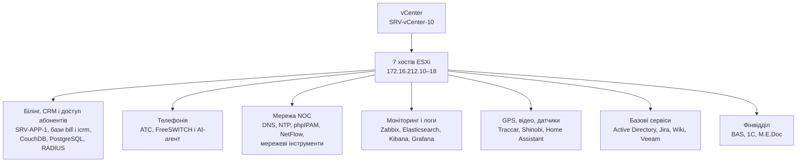
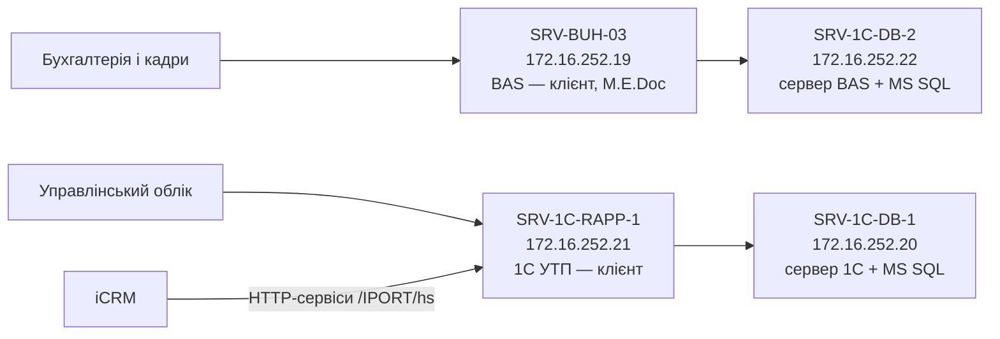

# Сервери і віртуальні машини

Де фізично працюють наші системи: хости VMware, віртуальні машини на них,
їхні адреси і програми фінвідділу.

Майже всі сервери компанії — віртуальні машини (VM) в одному кластері VMware.
Ним керує vCenter. Сім фізичних серверів (хостів) тримають 57 VM.

## Хости

Фізичні сервери VMware ESXi.

| Хост | Обладнання | Процесори | Частота, МГц | Памʼять | Мережеві карти | VM |
|---|---|---|---|---|---|---|
| `172.16.212.10` | Supermicro Super Server | 1 × AMD EPYC 7401P, 24 ядра | 2000 | 64 ГБ | 4 | 1 |
| `172.16.212.11` | HPE ProLiant DL360 Gen10 | 2 × Intel Xeon Gold 6152, по 22 ядра | 2095 | 256 ГБ | 6 | 3 |
| `172.16.212.14` | HPE ProLiant DL360 Gen10 | 2 × Intel Xeon Gold 6126, по 12 ядер | 2593 | 256 ГБ | 6 | 13 |
| `172.16.212.15` | HP ProLiant DL360 Gen9 | 2 × Intel Xeon E5-2697 v4, по 18 ядер | 2297 | 256 ГБ | 6 | 13 |
| `172.16.212.16` | Supermicro AS-1014S-WTRT | 1 × AMD EPYC 7402P, 24 ядра | 2800 | 64 ГБ | 4 | 1 |
| `172.16.212.17` | Supermicro AS-1014S-WTRT | 1 × AMD EPYC 7302P, 16 ядер | 3000 | 64 ГБ | 4 | 11 |
| `172.16.212.18` | Supermicro AS-1014S-WTRT | 1 × AMD EPYC 7402P, 24 ядра | 2800 | 64 ГБ | 4 | 15 |

Хост `172.16.212.10` тримає лише бухгалтерський сервер, `172.16.212.11` — сервери 1С і BAS,
`172.16.212.16` — відеоспостереження. Решта VM розподілені між `172.16.212.14`, `172.16.212.15`, `172.16.212.17` і `172.16.212.18`.

## Віртуальні машини

| VM | DNS-імʼя | Примітка | Хост | IP |
|---|---|---|---|---|
| `ACS-01` | `acs-1` |  | `172.16.212.14` | `172.16.254.32` |
| `ACS-2` | `acs-2` |  | `172.16.212.15` | `192.168.254.32` |
| `CHR-DUDE-SSD` | `MT-DUDE.iport.net.ua` |  | `172.16.212.15` | `172.16.254.254` |
| `SRV-1C-DB-1` | `SRV-1C-DB-1.ad.iport` |  | `172.16.212.11` | `172.16.252.20` |
| `SRV-1C-DB-2` | `SRV-1C-DB-2.ad.iport` |  | `172.16.212.11` | `172.16.252.22` |
| `SRV-1C-RAPP-1` | `SRV-1C-RAPP-1.ad.iport` |  | `172.16.212.11` | `172.16.252.21` |
| `SRV-APP-1` | `SRV-APP-1` |  | `172.16.212.18` | `172.16.252.51` |
| `SRV-APP-DEV-1` | `srv-app-dev-1` |  | `172.16.212.15` | `172.16.252.53` |
| `SRV-BILL-CORE-1` |  |  | `172.16.212.17` |  |
| `SRV-BUH-03` | `SRV-BUH-02` |  | `172.16.212.10` | `172.16.252.19` |
| `SRV-COUCHDB-1` | `srv-couchdb-1` |  | `172.16.212.17` | `172.16.252.57` |
| `SRV-DB-APP-1` | `srv-db-app-1` |  | `172.16.212.17` | `172.16.252.40` |
| `SRV-DB-BILL-M-1` | `srv-db-bill-m-1` |  | `172.16.212.17` | `172.16.252.200` |
| `SRV-DB-BILL-S-1` | `srv-db-bill-s-1` |  | `172.16.212.18` | `172.16.252.204` |
| `SRV-DC-1` | `SRV-DC-1.ad.iport` |  | `172.16.212.17` | `172.16.252.4` |
| `SRV-DC-2` | `SRV-DC-2.ad.iport` |  | `172.16.212.18` | `172.16.252.5` |
| `SRV-ELK-1` | `srv-elk-1` |  | `172.16.212.14` | `172.16.254.16` |
| `SRV-FLEET-1` | `srv-fleet-1` |  | `172.16.212.14` | `172.16.254.21` |
| `SRV-FREESWITCH-1` | `srv-freeswitch-1` |  | `172.16.212.17` | `172.16.252.30` |
| `SRV-GRAFANA-1` | `srv-grafana-1` |  | `172.16.212.15` | `172.16.254.56` |
| `SRV-HA-1` | `homeassistant` |  | `172.16.212.14` | `172.16.254.85` |
| `SRV-HA-FKS` | `homeassistant` |  | `172.16.212.14` | `172.16.254.90` |
| `SRV-JIRA-01` | `SRV-JIRA` |  | `172.16.212.18` | `91.226.253.21` |
| `SRV-KIBANA-1` | `srv-kibana-1` |  | `172.16.212.14` | `172.16.254.20` |
| `SRV-LDAP-1` | `srv-ldap-1` |  | `172.16.212.14` | `172.16.254.35` |
| `SRV-MGMT-ANSIBLE-1` | `srv-mgmt-ansible-1` |  | `172.16.212.14` | `172.16.254.86` |
| `SRV-MGMT-IP-1` | `srv-mgmt-ip-1` |  | `172.16.212.15` | `172.16.254.82` |
| `SRV-MGMT-NS-1` | `srv-mgmt-ns-1` |  | `172.16.212.14` | `172.16.254.200` |
| `SRV-MGMT-NS-2` | `srv-mgmt-ns-2` |  | `172.16.212.15` | `192.168.254.200` |
| `SRV-MGMT-WIN` | `SRV-MGMT-WIN` |  | `172.16.212.18` | `172.16.254.80` |
| `SRV-MGMT-WIN-1` | `SRV-MGMT-ACS-1.ad.iport` |  | `172.16.212.15` | `172.16.254.83` |
| `SRV-NET-APP-1` | `srv-net-app-1` |  | `172.16.212.14` | `172.16.254.81` |
| `SRV-NET-APP-2` | `srv-net-app-2` |  | `172.16.212.15` | `172.16.254.84` |
| `SRV-NETFLOW-1` | `srv-netflow-1` |  | `172.16.212.17` | `172.16.250.49` |
| `SRV-NS-1` | `srv-ns-1` |  | `172.16.212.18` | `172.16.255.200` |
| `SRV-NS-2` | `srv-ns-2` |  | `172.16.212.17` | `192.168.255.200` |
| `SRV-NTP-1` | `SRV-NTP-1.mgmt.iport` |  | `172.16.212.18` | `172.16.250.13` |
| `SRV-NTP-2-1` | `SRV-NTP-2.mgmt.iport` |  | `172.16.212.18` | `192.168.250.13` |
| `SRV-PBX-01` | `freepbx.sangoma.local` |  | `172.16.212.18` | `91.226.253.29` |
| `SRV-POSTGRESQL-1` | `srv-postgresql-1` |  | `172.16.212.17` | `172.16.252.42` |
| `SRV-PROXY-1` | `srv-proxy-1` |  | `172.16.212.18` | `172.16.255.22` |
| `SRV-RADIUS-1` | `srv-radius-1` |  | `172.16.212.17` | `172.16.250.41` |
| `SRV-RADIUS-2` | `srv-radius-2` |  | `172.16.212.18` | `192.168.250.41` |
| `SRV-RSB-MGMT-1` | `srv-rsb-mgmt-1` |  | `172.16.212.14` | `172.16.254.40` |
| `SRV-SHINOBI-02` | `srv-shinobi-02` |  | `172.16.212.16` | `172.16.253.42` |
| `SRV-TRACCAR-1-1` | `srv-traccar-1` |  | `172.16.212.15` | `172.16.252.88` |
| `SRV-vCenter-10` | `localhost` | VMware vCenter Server Appliance | `172.16.212.18` | `172.16.229.10` |
| `SRV-VEEAM-01` | `SRV-VEEAM-1.ad.iport` |  | `172.16.212.18` | `172.16.252.90` |
| `SRV-VPROXY-15` | `SRV-VPROXY-15.ad.iport` |  | `172.16.212.15` | `172.16.252.73` |
| `SRV-VPROXY-17` | `SRV-VPROXY-17.ad.iport` |  | `172.16.212.17` | `172.16.252.74` |
| `SRV-VPROXY-18` | `SRV-VPROXY-18.ad.iport` |  | `172.16.212.18` | `172.16.252.72` |
| `SRV-WIKI-1` | `srv-wiki-1` |  | `172.16.212.18` | `172.16.252.92` |
| `SRV-ZBX-DB-1` | `srv-zbx-db-1` |  | `172.16.212.14` | `172.16.254.26` |
| `SRV-ZBX-DB-2` | `srv-zbx-db-2` |  | `172.16.212.15` | `fe80::250:56ff:fea4:3323` |
| `SRV-ZBX-NODE-1` | `srv-zbx-node-1` |  | `172.16.212.14` | `172.16.254.24` |
| `SRV-ZBX-NODE-2` | `srv-zbx-node-2` |  | `172.16.212.15` | `192.168.254.25` |
| `SRV-ZBX-PROXY-0-1` | `srv-zproxy-m-1` |  | `172.16.212.15` | `172.16.254.30` |

## VM за призначенням

Ті самі VM, згруповані за тим, що на них працює.

### Білінг, CRM і доступ абонентів

| VM | IP | Хост | Що це |
|---|---|---|---|
| `SRV-RADIUS-1` | `172.16.250.41` | `172.16.212.17` | RADIUS + MySQL `radius` — доступ абонентів до мережі |
| `SRV-DB-APP-1` | `172.16.252.40` | `172.16.212.17` | MySQL: `icrm`, `fin`, `ibill`, `iot` |
| `SRV-POSTGRESQL-1` | `172.16.252.42` | `172.16.212.17` | PostgreSQL (планується міграція з SRV-APP-DEV-1) |
| `SRV-APP-1` | `172.16.252.51` | `172.16.212.18` | Головний застосунковий сервер: iCRM, iERP, sender, iauth, платіжний шлюз, fin (усі під pm2) |
| `SRV-APP-DEV-1` | `172.16.252.53` | `172.16.212.15` | PostgreSQL (`auth`, `ierp`) і iERP. Попри «DEV» у назві — **робочий сервер** |
| `SRV-COUCHDB-1` | `172.16.252.57` | `172.16.212.17` | CouchDB: `network`, `pon-new`, `jira`, `timesheets`, `messages` |
| `SRV-DB-BILL-M-1` | `172.16.252.200` | `172.16.212.17` | MySQL `bill`: дані iCRM у схемі NoDeny, основна |
| `SRV-DB-BILL-S-1` | `172.16.252.204` | `172.16.212.18` | MySQL `bill`: репліка тільки на читання |
| `SRV-RADIUS-2` | `192.168.250.41` | `172.16.212.18` | Друга VM RADIUS  |
| `SRV-BILL-CORE-1` | — | `172.16.212.17` | web view nodeny |
| `SRV-NETFLOW-1` | `172.16.250.49` | `172.16.212.17` | NetFlow — облік трафіку, MySQL `billtrf` |
| `SRV-NS-1` | `172.16.255.200` | `172.16.212.18` | DNS — які зони |
| `SRV-NS-2` | `192.168.255.200` | `172.16.212.17` | DNS , друга VM |

### Телефонія

| VM | IP | Хост | Що це |
|---|---|---|---|
| `SRV-PBX-01` | `91.226.253.29` (`172.16.252.29` - внутрішній) | `172.16.212.18` | FreePBX (Asterisk) — АТС |
| `SRV-FREESWITCH-1` | `172.16.252.30` | `172.16.212.17` | FreeSWITCH і [AI-агент](../systems/sandra-ai/README.md) (pm2 `sandra-agent`) |

### Мережа (NOC)

| VM | IP | Хост | Що це |
|---|---|---|---|
| `SRV-NTP-1` | `172.16.250.13` | `172.16.212.18` | NTP — точний час |
| `ACS-01` | `172.16.254.32` | `172.16.212.14` | ACS доступ до мережевого обладнення |
| `SRV-RSB-MGMT-1` | `172.16.254.40` | `172.16.212.14` | наразі не використовується |
| `SRV-MGMT-WIN` | `172.16.254.80` | `172.16.212.18` | наразі не використовується |
| `SRV-NET-APP-1` | `172.16.254.81` | `172.16.212.14` | Мережеві інструменти на PHP  (портал NOC, api/network, api/pon) + MySQL `logger_api` |
| `SRV-MGMT-IP-1` | `172.16.254.82` | `172.16.212.15` | phpIPAM — облік IP-адрес |
| `SRV-MGMT-WIN-1` | `172.16.254.83` | `172.16.212.15` | Windows машина для доступу до ACS) |
| `SRV-NET-APP-2` | `172.16.254.84` | `172.16.212.15` | MQTT-брокер керування АВР (`avr/cmd`, `avr/event`) |
| `SRV-MGMT-ANSIBLE-1` | `172.16.254.86` | `172.16.212.14` | наразі не використовується |
| `SRV-MGMT-NS-1` | `172.16.254.200` | `172.16.212.14` | BIND DNS, зона `mgmt.iport` |
| `CHR-DUDE-SSD` | `172.16.254.254` | `172.16.212.15` | MikroTik CHR з The Dude |
| `SRV-PROXY-1` | `172.16.255.22` | `172.16.212.18` | Заглушка для сайтів, що заборонені законодавством |
| `SRV-NTP-2-1` | `192.168.250.13` | `172.16.212.18` | NTP — точний час |
| `ACS-2` | `192.168.254.32` | `172.16.212.15` | ACS  доступ до мережевого обладнення  |
| `SRV-MGMT-NS-2` | `192.168.254.200` | `172.16.212.15` | BIND DNS `mgmt.iport`|

### Моніторинг і логи

| VM | IP | Хост | Що це |
|---|---|---|---|
| `SRV-ELK-1` | `172.16.254.16` | `172.16.212.14` | Elasticsearch (`:9200`) — логи з обладнення |
| `SRV-KIBANA-1` | `172.16.254.20` | `172.16.212.14` | Kibana — web-view для перегляд логів з Elasticsearch |
| `SRV-FLEET-1` | `172.16.254.21` | `172.16.212.14` | Elastic Fleet для збору логів |
| `SRV-ZBX-NODE-1` | `172.16.254.24` | `172.16.212.14` | Zabbix — сервер, веб і API (`zabbix.mgmt.iport`) |
| `SRV-ZBX-DB-1` | `172.16.254.26` | `172.16.212.14` | База Zabbix |
| `SRV-ZBX-PROXY-0-1` | `172.16.254.30` | `172.16.212.15` | Zabbix proxy для серверного обладнення і бекбону|
| `SRV-GRAFANA-1` | `172.16.254.56` | `172.16.212.15` | Grafana — графіки |
| `SRV-ZBX-NODE-2` | `192.168.254.25` | `172.16.212.15` | Zabbix — сервер, веб і API (`zabbix.mgmt.iport`) |
| `SRV-ZBX-DB-2` | `192.168.254.26` | `172.16.212.15` | База Zabbix |

### GPS, відео, датчики

| VM | IP | Хост | Що це |
|---|---|---|---|
| `SRV-TRACCAR-1-1` | `172.16.252.88` | `172.16.212.15` | Traccar — GPS авто бригад + своя MySQL. Використовує [i-map](../systems/imap/README.md) |
| `SRV-SHINOBI-02` | `172.16.253.42` | `172.16.212.16` | Shinobi — відеоспостереження |
| `SRV-HA-1` | `172.16.254.85` | `172.16.212.14` | Home Assistant + MQTT-брокер датчиків |

### Базові сервіси

| VM | IP | Хост | Що це |
|---|---|---|---|
| `SRV-JIRA-01` | `91.226.253.21` | `172.16.212.18` | Jira (`jira.iport.net.ua`) |
| `SRV-vCenter-10` | `172.16.229.10` | `172.16.212.18` | VMware vCenter — керування всіма хостами |
| `SRV-DC-1` | `172.16.252.4` | `172.16.212.17` | Контролер домену Active Directory `ad.iport` |
| `SRV-DC-2` | `172.16.252.5` | `172.16.212.18` | Контролер домену `ad.iport`, другий |
| `SRV-VPROXY-18` | `172.16.252.72` | `172.16.212.18` | Veeam proxy для хоста `.18`  |
| `SRV-VPROXY-15` | `172.16.252.73` | `172.16.212.15` | Veeam proxy для хоста `.15`  |
| `SRV-VPROXY-17` | `172.16.252.74` | `172.16.212.17` | Veeam proxy для хоста `.17`  |
| `SRV-VEEAM-01` | `172.16.252.90` | `172.16.212.18` | Veeam — резервні копії VM |
| `SRV-WIKI-1` | `172.16.252.92` | `172.16.212.18` | Wiki |
| `SRV-LDAP-1` | `172.16.254.35` | `172.16.212.14` | наразі не використувається|

### Фінвідділ

| VM | IP | Хост | Що це |
|---|---|---|---|
| `SRV-BUH-03` | `172.16.252.19` | `172.16.212.10` | Клієнтська частина BAS Бухгалтерія і BAS ЗУП, M.E.Doc (серверна версія) |
| `SRV-1C-DB-1` | `172.16.252.20` | `172.16.212.11` | Сервер 1С x64 + MS SQL 2012: управлінський облік |
| `SRV-1C-RAPP-1` | `172.16.252.21` | `172.16.212.11` | Клієнтська частина 1С УТП + HTTP-сервіси `/IPORT/hs`, які викликає iCRM |
| `SRV-1C-DB-2` | `172.16.252.22` | `172.16.212.11` | Сервер BAS x64 + MS SQL 2012: бухгалтерські бази, ЗУП |

## Програми фінвідділу

Бухгалтерія і управлінський облік працюють на чотирьох VM. У кожної програми є
клієнтська частина, з якою працюють люди, і серверна, де лежать бази.

| Програма | Для чого | Де стоїть |
|---|---|---|
| BAS Бухгалтерія, ред. 2.1 + FlyDoc 1.1.3.21 | бухгалтерський облік | клієнт — `SRV-BUH-03` (`172.16.252.19`), сервер — `SRV-1C-DB-2` (`172.16.252.22`) |
| BAS ЗУП, ред. 3.0 | зарплата і кадровий облік | клієнт — `SRV-BUH-03` (`172.16.252.19`), сервер — `SRV-1C-DB-2` (`172.16.252.22`) |
| Сервер BAS x64 | сервер для баз BAS | `SRV-1C-DB-2` (`172.16.252.22`) |
| M.E.Doc, серверна версія | звітність і документообіг | `SRV-BUH-03` (`172.16.252.19`), папка `E:\Medoc\Medoc_2SRV` |
| 1С Управління торговим підприємством для України, ред. 1.2 | управлінський облік | клієнт — `SRV-1C-RAPP-1` (`172.16.252.21`), сервер — `SRV-1C-DB-1` (`172.16.252.20`) |
| Сервер 1С x64 | сервер для баз 1С | `SRV-1C-DB-1` (`172.16.252.20`) |
| MS SQL Server 2012 x64 | бази BAS: бухгалтерія і ЗУП | `SRV-1C-DB-2` (`172.16.252.22`) |
| MS SQL Server 2012 x64 | база 1С: управлінський облік | `SRV-1C-DB-1` (`172.16.252.20`) |

### Ліцензії

| Ліцензія | Робочих місць | Номер ліцензії |
|---|---|---|
| серверна x64 | — | `803707116` |
| клієнтська | 1 | `804599052` |
| клієнтська | 1 | `803772490` |
| клієнтська | 10 | `803675002` |

