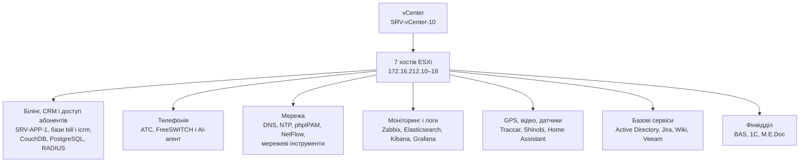
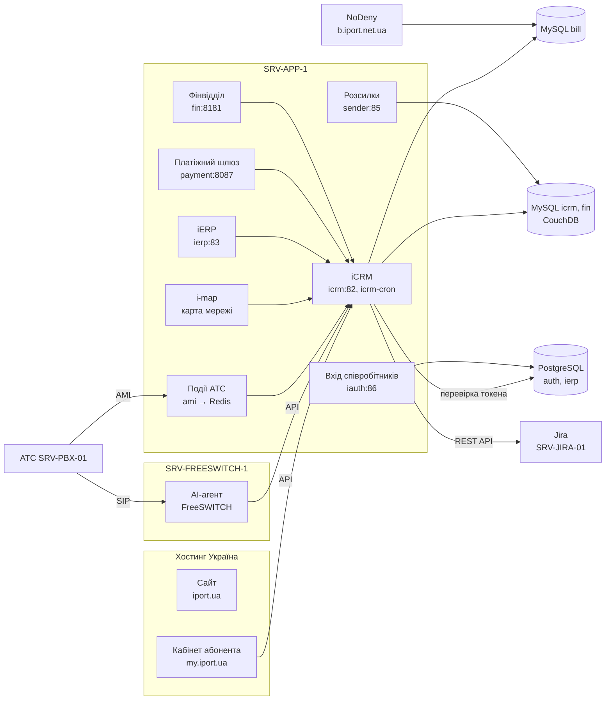

# Сервери і віртуальні машини

Де фізично працюють наші системи: хости VMware, віртуальні машини на них,
їхні адреси і програми фінвідділу.

Майже всі сервери компанії — віртуальні машини (VM) в одному кластері VMware.
Ним керує vCenter. Сім фізичних серверів (хостів) тримають 57 VM.



## Хости

Фізичні сервери VMware ESXi.

| Хост | Обладнання | Процесори | Частота, МГц | Памʼять | Мережеві карти | VM |
|---|---|---|---|---|---|---|
| `172.16.212.10` | Supermicro Super Server | 1 × AMD EPYC 7401P, 24 ядра | 2000 | 64 ГБ | 4 | 1 |
| `172.16.212.11` | HPE ProLiant DL360 Gen10 | 2 × Intel Xeon Gold 6152, по 22 ядра | 2095 | 256 ГБ | 6 | 3 |
| `172.16.212.14` | HPE ProLiant DL360 Gen10 | 2 × Intel Xeon Gold 6126, по 12 ядер | 2593 | 256 ГБ | 6 | 13 |
| `172.16.212.15` | HP ProLiant DL360 Gen9 | 2 × Intel Xeon E5-2697 v4, по 18 ядер | 2297 | 256 ГБ | 6 | 13 |
| `172.16.212.16` | Supermicro AS-1014S-WTRT | 1 × AMD EPYC 7402P, 24 ядра | 2800 | 64 ГБ | 4 | 1 |
| `172.16.212.17` | Supermicro AS-1014S-WTRT | 1 × AMD EPYC 7302P, 16 ядер | 3000 | 64 ГБ | 4 | 11 |
| `172.16.212.18` | Supermicro AS-1014S-WTRT | 1 × AMD EPYC 7402P, 24 ядра | 2800 | 64 ГБ | 4 | 15 |

Хост `172.16.212.10` тримає лише бухгалтерський сервер, `172.16.212.11` — сервери 1С і BAS,
`172.16.212.16` — відеоспостереження. Решта VM розподілені між `172.16.212.14`, `172.16.212.15`, `172.16.212.17` і `172.16.212.18`.

## Віртуальні машини

| VM | DNS-імʼя | Примітка | Хост | IP |
|---|---|---|---|---|
| `ACS-01` | `acs-1` |  | `172.16.212.14` | `172.16.254.32` |
| `ACS-2` | `acs-2` |  | `172.16.212.15` | `192.168.254.32` |
| `CHR-DUDE-SSD` | `MT-DUDE.iport.net.ua` |  | `172.16.212.15` | `172.16.254.254` |
| `SRV-1C-DB-1` | `SRV-1C-DB-1.ad.iport` |  | `172.16.212.11` | `172.16.252.20` |
| `SRV-1C-DB-2` | `SRV-1C-DB-2.ad.iport` |  | `172.16.212.11` | `172.16.252.22` |
| `SRV-1C-RAPP-1` | `SRV-1C-RAPP-1.ad.iport` |  | `172.16.212.11` | `172.16.252.21` |
| `SRV-APP-1` | `SRV-APP-1` |  | `172.16.212.18` | `172.16.252.51` |
| `SRV-APP-DEV-1` | `srv-app-dev-1` |  | `172.16.212.15` | `172.16.252.53` |
| `SRV-BILL-CORE-1` |  |  | `172.16.212.17` |  |
| `SRV-BUH-03` | `SRV-BUH-02` |  | `172.16.212.10` | `172.16.252.19` |
| `SRV-COUCHDB-1` | `srv-couchdb-1` |  | `172.16.212.17` | `172.16.252.57` |
| `SRV-DB-APP-1` | `srv-db-app-1` |  | `172.16.212.17` | `172.16.252.40` |
| `SRV-DB-BILL-M-1` | `srv-db-bill-m-1` |  | `172.16.212.17` | `172.16.252.200` |
| `SRV-DB-BILL-S-1` | `srv-db-bill-s-1` |  | `172.16.212.18` | `172.16.252.204` |
| `SRV-DC-1` | `SRV-DC-1.ad.iport` |  | `172.16.212.17` | `172.16.252.4` |
| `SRV-DC-2` | `SRV-DC-2.ad.iport` |  | `172.16.212.18` | `172.16.252.5` |
| `SRV-ELK-1` | `srv-elk-1` |  | `172.16.212.14` | `172.16.254.16` |
| `SRV-FLEET-1` | `srv-fleet-1` |  | `172.16.212.14` | `172.16.254.21` |
| `SRV-FREESWITCH-1` | `srv-freeswitch-1` |  | `172.16.212.17` | `172.16.252.30` |
| `SRV-GRAFANA-1` | `srv-grafana-1` |  | `172.16.212.15` | `172.16.254.56` |
| `SRV-HA-1` | `homeassistant` |  | `172.16.212.14` | `172.16.254.85` |
| `SRV-HA-FKS` | `homeassistant` |  | `172.16.212.14` | `172.16.254.90` |
| `SRV-JIRA-01` | `SRV-JIRA` |  | `172.16.212.18` | `91.226.253.21` |
| `SRV-KIBANA-1` | `srv-kibana-1` |  | `172.16.212.14` | `172.16.254.20` |
| `SRV-LDAP-1` | `srv-ldap-1` |  | `172.16.212.14` | `172.16.254.35` |
| `SRV-MGMT-ANSIBLE-1` | `srv-mgmt-ansible-1` |  | `172.16.212.14` | `172.16.254.86` |
| `SRV-MGMT-IP-1` | `srv-mgmt-ip-1` |  | `172.16.212.15` | `172.16.254.82` |
| `SRV-MGMT-NS-1` | `srv-mgmt-ns-1` |  | `172.16.212.14` | `172.16.254.200` |
| `SRV-MGMT-NS-2` | `srv-mgmt-ns-2` |  | `172.16.212.15` | `192.168.254.200` |
| `SRV-MGMT-WIN` | `SRV-MGMT-WIN` |  | `172.16.212.18` | `172.16.254.80` |
| `SRV-MGMT-WIN-1` | `SRV-MGMT-ACS-1.ad.iport` |  | `172.16.212.15` | `172.16.254.83` |
| `SRV-NET-APP-1` | `srv-net-app-1` |  | `172.16.212.14` | `172.16.254.81` |
| `SRV-NET-APP-2` | `srv-net-app-2` |  | `172.16.212.15` | `172.16.254.84` |
| `SRV-NETFLOW-1` | `srv-netflow-1` |  | `172.16.212.17` | `172.16.250.49` |
| `SRV-NS-1` | `srv-ns-1` |  | `172.16.212.18` | `172.16.255.200` |
| `SRV-NS-2` | `srv-ns-2` |  | `172.16.212.17` | `192.168.255.200` |
| `SRV-NTP-1` | `SRV-NTP-1.mgmt.iport` |  | `172.16.212.18` | `172.16.250.13` |
| `SRV-NTP-2-1` | `SRV-NTP-2.mgmt.iport` |  | `172.16.212.18` | `192.168.250.13` |
| `SRV-PBX-01` | `freepbx.sangoma.local` |  | `172.16.212.18` | `91.226.253.29`, `172.16.252.29` (внутрішній) |
| `SRV-POSTGRESQL-1` | `srv-postgresql-1` |  | `172.16.212.17` | `172.16.252.42` |
| `SRV-PROXY-1` | `srv-proxy-1` |  | `172.16.212.18` | `172.16.255.22` |
| `SRV-RADIUS-1` | `srv-radius-1` |  | `172.16.212.17` | `172.16.250.41` |
| `SRV-RADIUS-2` | `srv-radius-2` |  | `172.16.212.18` | `192.168.250.41` |
| `SRV-RSB-MGMT-1` | `srv-rsb-mgmt-1` |  | `172.16.212.14` | `172.16.254.40` |
| `SRV-SHINOBI-02` | `srv-shinobi-02` |  | `172.16.212.16` | `172.16.253.42` |
| `SRV-TRACCAR-1-1` | `srv-traccar-1` |  | `172.16.212.15` | `172.16.252.88` |
| `SRV-vCenter-10` | `localhost` | VMware vCenter Server Appliance | `172.16.212.18` | `172.16.229.10` |
| `SRV-VEEAM-01` | `SRV-VEEAM-1.ad.iport` |  | `172.16.212.18` | `172.16.252.90` |
| `SRV-VPROXY-15` | `SRV-VPROXY-15.ad.iport` |  | `172.16.212.15` | `172.16.252.73` |
| `SRV-VPROXY-17` | `SRV-VPROXY-17.ad.iport` |  | `172.16.212.17` | `172.16.252.74` |
| `SRV-VPROXY-18` | `SRV-VPROXY-18.ad.iport` |  | `172.16.212.18` | `172.16.252.72` |
| `SRV-WIKI-1` | `srv-wiki-1` |  | `172.16.212.18` | `172.16.252.92` |
| `SRV-ZBX-DB-1` | `srv-zbx-db-1` |  | `172.16.212.14` | `172.16.254.26` |
| `SRV-ZBX-DB-2` | `srv-zbx-db-2` |  | `172.16.212.15` | `fe80::250:56ff:fea4:3323` |
| `SRV-ZBX-NODE-1` | `srv-zbx-node-1` |  | `172.16.212.14` | `172.16.254.24` |
| `SRV-ZBX-NODE-2` | `srv-zbx-node-2` |  | `172.16.212.15` | `192.168.254.25` |
| `SRV-ZBX-PROXY-0-1` | `srv-zproxy-m-1` |  | `172.16.212.15` | `172.16.254.30` |

## VM за призначенням

Ті самі VM, згруповані за тим, що на них працює.

### Білінг, CRM і доступ абонентів

| VM | Що це |
|---|---|
| `SRV-RADIUS-1` | RADIUS + MySQL `radius` — доступ абонентів до мережі |
| `SRV-DB-APP-1` | MySQL: `icrm`, `fin`, `ibill`, `iot` |
| `SRV-POSTGRESQL-1` | PostgreSQL (планується міграція з SRV-APP-DEV-1) |
| `SRV-APP-1` | Головний застосунковий сервер: iCRM, iERP, sender, iauth, платіжний шлюз, fin (усі під pm2) |
| `SRV-APP-DEV-1` | PostgreSQL (`auth`, `ierp`): бази входу співробітників і iERP. Попри «DEV» у назві — **робочий сервер** |
| `SRV-COUCHDB-1` | CouchDB: `network`, `pon-new`, `jira`, `timesheets`, `messages` |
| `SRV-DB-BILL-M-1` | MySQL `bill`: дані iCRM у схемі NoDeny, основна |
| `SRV-DB-BILL-S-1` | MySQL `bill`: репліка тільки на читання |
| `SRV-RADIUS-2` | Друга VM RADIUS  |
| `SRV-BILL-CORE-1` | web view nodeny |
| `SRV-NETFLOW-1` | NetFlow — облік трафіку, MySQL `billtrf` |
| `SRV-NS-1` | DNS — які зони |
| `SRV-NS-2` | DNS , друга VM |


### Телефонія

| VM | Що це |
|---|---|
| `SRV-PBX-01` | FreePBX (Asterisk) — АТС |
| `SRV-FREESWITCH-1` | FreeSWITCH і [AI-агент](../systems/sandra-ai/README.md) (pm2 `sandra-agent`) |

### Мережа

| VM | Що це |
|---|---|
| `SRV-NTP-1` | NTP — точний час |
| `ACS-01` | ACS доступ до мережевого обладнення |
| `SRV-RSB-MGMT-1` | наразі не використовується |
| `SRV-MGMT-WIN` | наразі не використовується |
| `SRV-NET-APP-1` | Мережеві інструменти на PHP  (портал мережевого відділу, api/network, api/pon) + MySQL `logger_api` |
| `SRV-MGMT-IP-1` | phpIPAM — облік IP-адрес |
| `SRV-MGMT-WIN-1` | Windows машина для доступу до ACS) |
| `SRV-NET-APP-2` | MQTT-брокер керування АВР (`avr/cmd`, `avr/event`) і gen-ctrl-mqtt — автозапуск генераторів |
| `SRV-MGMT-ANSIBLE-1` | наразі не використовується |
| `SRV-MGMT-NS-1` | BIND DNS, зона `mgmt.iport` |
| `CHR-DUDE-SSD` | MikroTik CHR з The Dude |
| `SRV-PROXY-1` | Заглушка для сайтів, що заборонені законодавством |
| `SRV-NTP-2-1` | NTP — точний час |
| `ACS-2` | ACS  доступ до мережевого обладнення  |
| `SRV-MGMT-NS-2` | BIND DNS `mgmt.iport`|


### Моніторинг і логи

| VM | Що це |
|---|---|
| `SRV-ELK-1` | Elasticsearch (`:9200`) — логи з обладнення |
| `SRV-KIBANA-1` | Kibana — web-view для перегляд логів з Elasticsearch |
| `SRV-FLEET-1` | Elastic Fleet для збору логів |
| `SRV-ZBX-NODE-1` | Zabbix — сервер, веб і API (`zabbix.mgmt.iport`) |
| `SRV-ZBX-DB-1` | База Zabbix |
| `SRV-ZBX-PROXY-0-1` | Zabbix proxy для серверного обладнення і бекбону|
| `SRV-GRAFANA-1` | Grafana — графіки за даними Zabbix |
| `SRV-ZBX-NODE-2` | Zabbix — сервер, веб і API (`zabbix.mgmt.iport`) |
| `SRV-ZBX-DB-2` | База Zabbix |

### GPS, відео, датчики

| VM | Що це |
|---|---|
| `SRV-TRACCAR-1-1` | Traccar — GPS авто бригад + своя MySQL. Використовує [i-map](../systems/imap/README.md) |
| `SRV-SHINOBI-02` | Shinobi — відеоспостереження |
| `SRV-HA-1` | Home Assistant + MQTT-брокер датчиків |

### Базові сервіси

| VM | Що це |
|---|---|
| `SRV-JIRA-01` | Jira (`jira.iport.net.ua`) |
| `SRV-vCenter-10` | VMware vCenter — керування всіма хостами |
| `SRV-DC-1` | Контролер домену Active Directory `ad.iport` |
| `SRV-DC-2` | Контролер домену `ad.iport`, другий |
| `SRV-VPROXY-18` | Veeam proxy для хоста `172.16.212.18` |
| `SRV-VPROXY-15` | Veeam proxy для хоста `172.16.212.15` |
| `SRV-VPROXY-17` | Veeam proxy для хоста `172.16.212.17` |
| `SRV-VEEAM-01` | Veeam — резервні копії VM |
| `SRV-WIKI-1` | Wiki |
| `SRV-LDAP-1` | наразі не використувається|

### Фінвідділ

| VM | Що це |
|---|---|
| `SRV-BUH-03` | Клієнтська частина BAS Бухгалтерія і BAS ЗУП, M.E.Doc (серверна версія) |
| `SRV-1C-DB-1` | Сервер 1С x64 + MS SQL 2012: управлінський облік |
| `SRV-1C-RAPP-1` | Клієнтська частина 1С УТП + HTTP-сервіси `/IPORT/hs`, які викликає iCRM |
| `SRV-1C-DB-2` | Сервер BAS x64 + MS SQL 2012: бухгалтерські бази, ЗУП |

## Інформаційні системи

### Системи власної розробки

Системи, які розробляє компанія, працюють переважно на `SRV-APP-1` і `SRV-FREESWITCH-1`.
Бази даних, крім Redis на `SRV-APP-1`, лежать на окремих VM (див. «Білінг, CRM
і доступ абонентів» вище). Сайт і кабінет абонента — на зовнішньому хостингу.



#### iCRM і внутрішні сервіси

**VM:** `SRV-APP-1`

Головний сервер застосунків: iCRM і майже всі наші внутрішні сервіси. Кожен сервіс —
окремий процес під керуванням pm2, який перезапускає процес після збою. Ззовні частина
сервісів доступна через `a.iport.net.ua`: API iCRM, розсилки (порт `85`), вхід
співробітників (порт `86`).

| Застосунок | Що робить |
|---|---|
| `icrm:82` | iCRM — CRM і білінг: картка абонента, договори, тарифи, рахунки, заявки й наряди, звернення в Jira, історія дзвінків. Через нього з даними працюють кабінет абонента, i-map, iERP, AI-агент, платіжний шлюз і `fin` |
| i-map | [i-map](../systems/imap/README.md): карта й інформація про оптичну мережу. Муфти, опори, кабелі, спліттери та підключення абонентів на карті, схема муфти й розрахунок затухання, дані PON, повʼязані задачі Jira, табелі та маршрути бригад |
| `icrm-cron` | Задачі iCRM за розкладом: реєстри й виписки платежів, рахунки юрособам, звірки |
| `ierp:83` | [iERP](../systems/ierp/README.md): подорожні листи, облік пального й пробігу, наряди-допуски, обладнання. Віддає і API, і екрани |
| `sender:85` | [Розсилки](../systems/sender.md): повідомлення абонентам у Viber, а якщо Viber не доставив — SMS |
| `iauth:86` | Вхід співробітників у внутрішні системи: перевіряє логін, видає токен (JWT) і одноразові коди підтвердження. Токеном потім користуються iCRM, i-map та iERP |
| `payment:8087` | [Платіжний шлюз](../systems/payments/gate.md): приймає платежі від Приват24 і City24, перевіряє договір і зараховує платіж |
| `fin` | [Фінансовий модуль](../systems/payments/statements.md) для роботи фінансового відділу: рахунки й нарахування, платежі та банківські виписки |
| `ami` | Стежить за вхідними дзвінками на АТС і передає події в iCRM через Redis |

#### AI-агент

**VM:** `SRV-FREESWITCH-1`

Голосовий [AI-агент](../systems/sandra-ai/README.md) технічної підтримки. Виконує роль
першої лінії підтримки. Приймає вхідні дзвінки, спілкується з абонентом живою мовою
(Google Gemini Live), ідентифікує його, піднімає дані з iCRM, вирішує типові звернення та
за потреби переводить дзвінок на оператора, створює заявки в Jira; веде транскрипт і запис
розмов.

| Застосунок | Що робить |
|---|---|
| FreeSWITCH | приймає дзвінки від АТС, пише записи розмов |
| `sandra-agent` | сам AI-агент: розмова, Gemini, дії через iCRM |
| `recordings-server` | віддає записи й логи у вкладку «Записи AI» iCRM |
| `analyzer` | після дзвінка оцінює, чи вирішено питання, і закриває вирішені заявки |

#### Сайт і кабінет абонента

**Хостинг:** «Хостинг Україна» (`ukraine.com.ua`)

| | Адреса | Що це |
|---|---|---|
| Сайт | `iport.ua` | інформація про послуги, тарифи, зона покриття, заявка на підключення |
| [Кабінет абонента](../systems/customer.md) | `my.iport.ua` | баланс, поповнення, рахунки, трафік, профіль. Та сама програма, що й застосунок для Android |

Дані абонента кабінет бере з iCRM на `SRV-APP-1` (`a.iport.net.ua`).

Кабінет є також застосунком для Android —
[у Google Play](https://play.google.com/store/apps/details?id=ua.iport.mobile). У ньому
те саме, що й на `my.iport.ua`.

#### gen-ctrl-mqtt

**VM:** `SRV-NET-APP-2`

Автоматичний запуск генераторів на вузлах звʼязку. Стежить за зарядом батарей на вузлах:
коли заряд падає нижче порогу — запускає генератор, коли батареї заряджені — зупиняє його.

#### Мережеві інструменти

**VM:** `SRV-NET-APP-1`

PHP API, через яке інші системи працюють з мережею: опитування ОЛТ і дані ONU (рівні
сигналу), розблокування IP-адреси після оплати. Ним користується iCRM.

### Сторонні системи

#### Jira

**VM:** `SRV-JIRA-01`

Таск-трекер компанії (Jira Server): звернення абонентів, задачі на підключення й роботи
на мережі. Веб-інтерфейс — `http://jira.iport.net.ua:8080`, база — MySQL `iport_jiradb`
на тій самій VM.

##### Ліцензії

| Продукт | Версія | Користувачів | Тип ліцензії | Номер підтримки (SEN) |
|---|---|---|---|---|
| Jira Software | 7.5.2 | 25 | Commercial | `SEN-7140630` |
| Jira Core | 7.5.2 | 10 | — | `SEN-9641729` |

<details>
<summary>Ключі ліцензій</summary>

**Jira Software** (`SEN-7140630`)

```
<ключ ліцензії>
```

**Jira Core** (`SEN-9641729`)

```
<ключ ліцензії>
```

</details>

#### NoDeny

**VM:** `SRV-BILL-CORE-1`

NoDeny — програма білінгу. Використовують лише для окремих задач. Адреса —
[b.iport.net.ua](https://b.iport.net.ua).

#### Zabbix

**VM:** `SRV-ZBX-NODE-2`

Моніторинг мережі й обладнання: що на звʼязку, стан ДБЖ, рівні сигналу PON. Наші системи
(iCRM, i-map, iERP) беруть дані Zabbix через мережеві інструменти на `SRV-NET-APP-1`.

#### Traccar

**VM:** `SRV-TRACCAR-1-1`

GPS-моніторинг службових автомобілів, веб — `traccar.iport.net.ua`. Своя база MySQL на
тій самій VM. Позицію машини бригади на карті [i-map](../systems/imap/README.md) показує
через iCRM.

### Програми фінвідділу

Бухгалтерія і управлінський облік працюють на чотирьох VM. У кожної програми є
клієнтська частина, з якою працюють люди, і серверна, де лежать бази.

| № | Найменування | Розташування | Опис |
|---|---|---|---|
| 1 | BAS for accounting, edition 2.1 + FlyDoc 1.1.3.21 | `172.16.252.19` (клієнтська частина), `172.16.252.22` (серверна частина) | Бухгалтерський облік |
| 2 | BAS for payroll and HR management, edition 3.0 | `172.16.252.19` (клієнтська частина), `172.16.252.22` (серверна частина) | Заробітна плата та кадровий облік |
| 3 | BAS server x64 | `172.16.252.22` | Сервер BAS, ліцензія `803707116`, server 64 |
| 4 | Medoc (серверна версія) | `172.16.252.19` (`E:\Medoc\Medoc_2SRV`) | |
| 5 | 1С Управління торговим підприємством для України, ред. 1.2 | `172.16.252.21` (клієнтська частина), `172.16.252.20` (серверна частина) | Управлінський облік |
| 6 | 1C server x64 | `172.16.252.20` | Сервер 1C |
| 7 | MS SQL server 2012 x64 | `172.16.252.22` | Бухгалтерські бази, ЗУП |
| 8 | MS SQL server 2012 x64 | `172.16.252.20` | Управлінський облік |

#### Ліцензії

| Ліцензія | Робочих місць | Номер ліцензії |
|---|---|---|
| серверна x64 | — | `803707116` |
| клієнтська | 1 | `804599052` |
| клієнтська | 1 | `803772490` |
| клієнтська | 10 | `803675002` |

