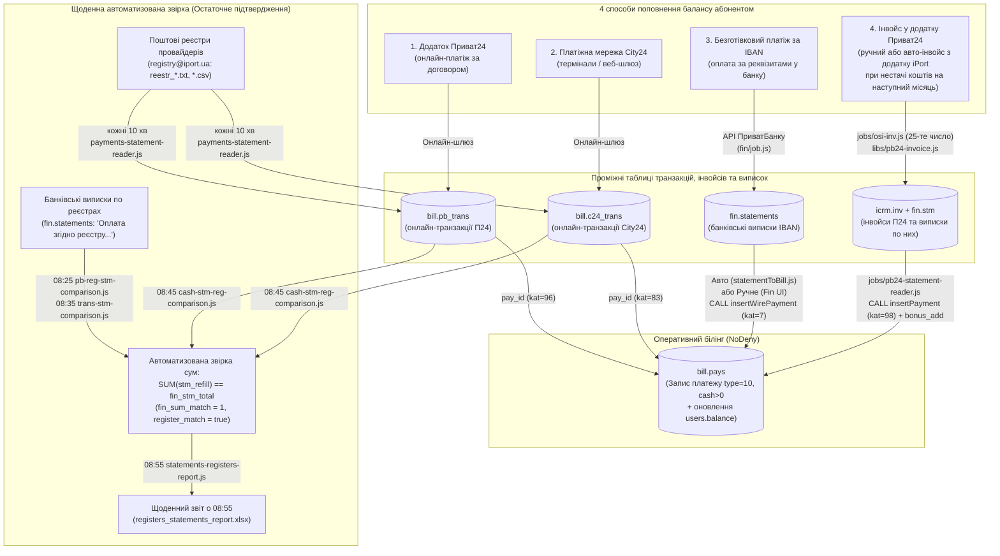
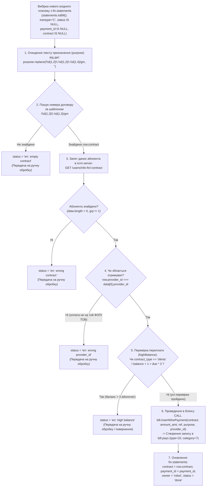
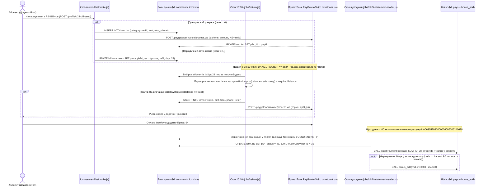
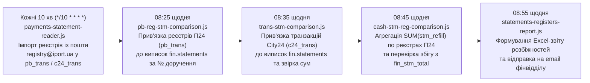

---
layout:
  width: wide
  outline:
    visible: false
---

# Платежі, способи поповнення балансу та щоденна фінансова звірка (`pays`)

Цей документ описує архітектуру приймання платежів від абонентів у системі **iPort** (`icrm-server`, фінансовий сервіс `fin` та клієнтський додаток `iport.account`), чотири основні способи поповнення балансу, а також регламентну процедуру щоденної автоматизованої звірки з реєстрами платіжних систем і банківськими виписками.

---

## 1. Загальна архітектура та принцип остаточного підтвердження платежів

У білінговій базі даних (`bill`) центральною таблицею обліку всіх фінансових операцій абонента є таблиця **`bill.pays`** (де записи з `type = 10` та `cash > 0` відповідають поповненням рахунку).

Коли абонент здійснює оплату через будь-який платіжний канал, система прагне якомога швидше зарахувати кошти на баланс картки абонента (`users.balance`), за потреби автоматично увімкнути доступ до мережі Інтернет (`users.state = 'on'`) та зафіксувати операцію в **`bill.pays`**.

> [!IMPORTANT]
> **Ключовий фінансовий принцип системи:**
> Поява запису про поповнення в таблиці **`bill.pays`** означає оперативне (технічне) проведення платежу в білінгу для надання послуги клієнту, проте **всі платежі, які потрапляють у таблицю `pays`, вважаються остаточно підтвердженими лише тоді, коли перевірена сума фактичної банківської виписки (`fin.statements`) по реєстру від провайдера платежів**.
> Для цього в системі щоденно виконується **автоматизована звірка** між трьома незалежними джерелами:
> 1. **Таблицями транзакцій білінгу** (`bill.pb_trans`, `bill.c24_trans` ↔ `bill.pays`);
> 2. **Офіційними реєстрами провайдерів платежів** (файли реєстрів ПриватБанку та City24, що надходять на пошту `registry@iport.ua`);
> 3. **Банківськими виписками за розрахунковими рахунками** (`fin.statements` / `fin.stm`, завантаженими через API ПриватБанку «Автоклієнт»).

### 1.1. Схема каналів поповнення та конвеєра підтвердження платежів



### 1.2. Зведена таблиця способів поповнення балансу

| № | Спосіб поповнення | Таблиця первинної фіксації | Категорія в `bill.pays` | Як потрапляє в `bill.pays` | Як відбувається остаточне підтвердження |
| :-: | :--- | :--- | :---: | :--- | :--- |
| **1** | **Додаток Приват24** (прямий пошук / редірект за договором) | `bill.pb_trans` | `96` | Миттєво при онлайн-оплаті через платіжний шлюз ПриватБанку (`pb_trans.pay_id = pays.id`). | Завантаження текстового реєстру `reestr_*.txt` з пошти → прив'язка до рядка виписки `fin.statements` за № платіжного доручення → перевірка `SUM(stm_refill) == fin_stm_total` (`fin_sum_match = 1`). |
| **2** | **Мережа City24** (термінали та онлайн-шлюз) | `bill.c24_trans` | `83` | Миттєво при проведенні транзакції шлюзом City24. | Завантаження CSV-реєстру з пошти → зіставлення `c24_trans.pay_id` із номером реєстру в кінці `fin.statements.purpose` → перевірка `cash == amount_amt` (`fin_sum_match = 1`). |
| **3** | **Безготівковий платіж** (за реквізитами IBAN та призначенням) | `fin.statements` | `7` | **Після фактичного надходження в банк:** автоматично роботом ([`statementToBill.js`](file:///c:/Projects/fin/utils/statementToBill.js)) або вручну оператором у веб-інтерфейсі проєкту `fin` через процедуру `insertWirePayment`. | Платіж створюється в `pays` безпосередньо на підставі вже проведеної банківської виписки `fin.statements` (`status = 'done'`, `payment_id = pays.id`). |
| **4** | **Інвойс у додатку Приват24** (з автогенерацією через додаток iPort) | `icrm.inv` та `fin.stm` | `98` | Після оплати інвойсу клієнтом і появи транзакції у банківській виписці `fin.stm` ([`jobs/pb24-statement-reader.js`](file:///c:/Projects/icrm/test-mysql/icrm-server/jobs/pb24-statement-reader.js)) через процедуру `insertPayment` (+ нарахування бонусу `bonus_add`). | Проводиться в `pays` виключно за фактом появи реальної банківської транзакції у виписці ПриватБанку (`fin.stm`) з прив'язкою `fin.stm.payment_id = pays.id` та `inv.p24_status`. |

---

## 2. Спосіб 1: Поповнення через додаток Приват24 (`bill.pb_trans`)

Цей спосіб використовується, коли абонент сплачує за послуги через стандартну форму прийому платежів у додатку або веб-версії **Приват24** за номером свого особового рахунку (договору `users.contract`).

### 2.1. Формування посилання та вибір отримувача (ФОП/ТОВ)
Абонент може перейти до оплати у Приват24 двома шляхами:
1. **Через коротке посилання редіректу `/pb/:contract`** ([`routes/pb24.js:4-11`](file:///c:/Projects/icrm/test-mysql/icrm-server/routes/pb24.js#L4-L11), яке також використовується у SMS/Viber-розсилках):
   - Сервер викликає збережену процедуру `CALL lp_check_account(?)` у базі `db.bro`.
   - Процедура визначає обслуговуючого провайдера (ФОП/ТОВ) для цього договору та повертає його токен мерчанта у Приват24 (`user.pb_token`).
   - Виконується HTTP-редірект на платіжну сторінку Приват24 з підставленим токеном отримувача та номером договору:
     ```text
     https://next.privat24.ua/payments/form/{"token":"<pb_token>","personalAccount":"<contract>"}
     ```
2. **Із особистого кабінету / мобільного додатку iPort** ([`iport.account/src/models/pays.js:25-31`](file:///c:/Projects/icrm/iport.account/src/models/pays.js#L25-L31) та [`libs/profile.js:199-204`](file:///c:/Projects/icrm/test-mysql/icrm-server/libs/profile.js#L199-L204)):
   - Додаток запитує реквізити поточного провайдера абонента через `GET /profile/provider-by-id` (`SELECT get_provider_by_contract(contract) provider_id ... LEFT JOIN plat_providers p`).
   - При натисканні кнопки **«Приват 24»** у розділі оплати ([`Bill.vue:22-29`](file:///c:/Projects/icrm/iport.account/src/pages/Bill.vue#L22-L29)) відкривається аналогічне посилання `https://next.privat24.ua/payments/form/...`.

### 2.2. Проведення онлайн-транзакції в `pb_trans` та `pays`
Коли абонент підтверджує оплату в додатку Приват24, платіжний шлюз банку звертається до білінгу:
- У таблиці **`bill.pb_trans`** створюється запис про онлайн-транзакцію:
  - `trans_id` — унікальний ID транзакції у шлюзі;
  - `pay_id` — посилання на створений запис у таблиці **`bill.pays`** (`pays.id`);
  - `date` — дата та час операції;
  - `provider_id` — ID отримувача (`plat_providers.id`);
  - `stm_ref` — банківський референс операції (наприклад, `0.0.5067374814.1`), за яким цю транзакцію наступного дня буде знайдено в текстовому реєстрі банку;
  - `req` — сирий JSON/XML-запит від банківського шлюзу.
- Одночасно в таблиці **`bill.pays`** створюється грошове поповнення (`type = 10`, `category = 96`, `cash > 0`), яке збільшує `users.balance` абонента.
- Поля реєстру (`stm_doc`, `stm_order_num`, `stm_refill`, `stm_total`) та поля банківської виписки (`fin_stm_pk`, `fin_stm_total`, `fin_sum_match`) у таблиці `pb_trans` на момент онлайн-оплати залишаються порожніми (`NULL`) — вони заповнюються під час щоденної автоматичної звірки (див. Розділ 6).

---

## 3. Спосіб 2: Поповнення через платіжну мережу City24 (`bill.c24_trans`)

Абоненти можуть поповнювати баланс готівкою у терміналах самообслуговування або онлайн через платіжну мережу **City24** (фінансові партнери — ТОВ «Свіфт Гарант» з кодом ЄДРПОУ `39859339` та ТОВ «ФК Фенікс» з кодом ЄДРПОУ `35075436`, див. [`fin/routes/turnovers.js:6`](file:///c:/Projects/fin/routes/turnovers.js#L6) та [`jobs/trans-stm-comparison.js:13`](file:///c:/Projects/icrm/test-mysql/icrm-server/jobs/trans-stm-comparison.js#L13)).

### 3.1. Фіксація транзакції в `c24_trans` та `pays`
1. Під час оплати термінал/шлюз City24 спочатку перевіряє існування договору абонента, а потім викликає метод поповнення.
2. У таблиці **`bill.c24_trans`** реєструється транзакція:
   - `id` — внутрішній первинний ключ;
   - `trans_id` — зовнішній ідентифікатор транзакції City24;
   - `pay_id` — ідентифікатор платежу/реєстрового переказу, який використовується для зв'язку з CSV-реєстром та призначенням банківської виписки;
   - `date` — дата та час проведення платежу;
   - `cash` — сума поповнення (грн);
   - `provider_id` — ID провайдера/ФОП.
3. У таблиці **`bill.pays`** створюється запис про поповнення балансу (`type = 10`, `category = 83`), і кошти стають доступними на `users.balance`.
4. Як і у випадку з Приват24, остаточне фінансове підтвердження транзакції у `c24_trans` (`fin_sum_match = 1`) відбувається після надходження CSV-реєстру від `server@city-24.com.ua` та звірки з банківською випискою у `fin.statements` (див. Розділ 6).

---

## 4. Спосіб 3: Безготівковий платіж за реквізитами (`fin.statements` у проєкті `fin`)

Цей спосіб охоплює прямі банківські перекази за реквізитами **IBAN** з будь-якого банку України (зокрема оплати від юридичних осіб, ФОП, через каси банків, Укрпошту або інші банківські додатки за довільними реквізитами).

Оскільки такі платежі не проходять через миттєвий онлайн-шлюз провайдера, вони потрапляють у білінг **`bill.pays` лише після фактичного зарахування коштів на розрахунковий рахунок у банку** та обробки банківської виписки в проєкті **`fin`** (`c:\Projects\fin`).

### 4.1. Відображення банківських реквізитів абоненту
У мобільному додатку та особистому кабінеті **iPort** ([`Wire.vue`](file:///c:/Projects/icrm/iport.account/src/components/Wire.vue), ендпоінти [`routes/profile/index.js:46`](file:///c:/Projects/icrm/test-mysql/icrm-server/routes/profile/index.js#L46) та [`routes/profile/pay.js:6-17`](file:///c:/Projects/icrm/test-mysql/icrm-server/routes/profile/pay.js#L6-L17)) абонент бачить розділ **«Банківський платіж»**:
- Система визначає закріпленого за абонентом постачальника послуг через функцію БД `get_provider_by_contract(contract)` і бере його реквізити з `plat_providers.iban_pb` (або `icrm.bank_accounts`):
  - **Отримувач** (`name`), **Код ЄДРПОУ/ІПН** (`code`), **Рахунок IBAN** (`iban`), **Банк** (`bank`).
  - **Призначення платежу** (`purpose`), куди автоматично підставляється номер договору клієнта (`{contract}`).
- Клієнт попереджається, що в призначенні платежу **обов'язково потрібно вказати номер договору** (у форматі `XXX.XXX`).

### 4.2. Завантаження банківських виписок у `fin.statements`
Регламентний скрипт [`fin/job.js`](file:///c:/Projects/fin/job.js) (або HTTP-виклик `GET /statement/loadAll` у [`fin/routes/statement.js:195-201`](file:///c:/Projects/fin/routes/statement.js#L195-L201)) виконує два послідовні кроки:
1. **`await statements.loadAll()`** ([`fin/models/statements.js:122-139`](file:///c:/Projects/fin/models/statements.js#L122-L139)):
   - Зчитує всі підключені банківські рахунки компаній/ФОП із таблиці `fin.accounts` разом із датою останньої синхронізації `MAX(postdate)`.
   - Через API ПриватБанку «Автоклієнт» (`https://acp.privatbank.ua/api/statements/transactions` у [`fin/models/p24.js:111-154`](file:///c:/Projects/fin/models/p24.js#L111-L154)) завантажує всі нові банківські проведення.
   - Зберігає їх у таблицю **`fin.statements`** (`INSERT IGNORE INTO statements`), нормалізуючи напрямок операції (`trantype = 'C'` — кредит/надходження коштів, `trantype = 'D'` — дебет/списання коштів) та оновлює поточні залишки на рахунках у таблиці `fin.balances`.
2. **`await toBill.run()`** ([`fin/utils/statementToBill.js`](file:///c:/Projects/fin/utils/statementToBill.js)) — запускає автоматичну процедуру рознесення нових надходжень у білінг.

---

### 4.3. Автоматична процедура рознесення платежів згідно з призначенням ([`fin/utils/statementToBill.js`](file:///c:/Projects/fin/utils/statementToBill.js))

Автоматичний робот (`owner = 'robot'`) обробляє нові вхідні банківські виписки в циклі `while (true)` по одному запису за раз:



#### Деталі етапів автоматичної процедури:
1. **Фільтрація виписок для автообробки ([`statements.toBill()`](file:///c:/Projects/fin/models/statements.js#L93-L121)):**
   Із таблиці `fin.statements` вибираються лише ті вхідні платежі (`trantype = 'C'`) за останні 2 доби (`postdate > NOW() - INTERVAL 2 DAY`), які ще не оброблені (`status IS NULL AND payment_id IS NULL AND contract IS NULL`) і надійшли на цільовий рахунок `debet_number = 'UA093052990000026007010139796'`, за винятком:
   - транзитів агрегаторів та реєстрових зарахувань (`purpose NOT LIKE '%25/01-03СГ%'`, `'%25/01-03ФК%'`, `'Оплата згiдно реєстру%'`, `'LIQPAY ID%'`, `credit_crf != 39626179` WayForPay);
   - внутрішніх фінансових операцій (`'Переказ надлишкових%'`, `'%Перерахування%власн%'`, `'Комiсiя%'`, `'Зарплата%'`, `'Возврат%'`);
   - рахунків ФОП/юросіб (`credit_number NOT LIKE '%02600%'`, окрім транзитного рахунку АТ «Укрпошта» `UA373052990000026002035025103`, платежі фізосіб з якого розносяться автоматично).
2. **Виділення номера договору з призначення платежу ([`statementToBill.js:31-34`](file:///c:/Projects/fin/utils/statementToBill.js#L31-L34)):**
   - Спочатку з тексту `row.purpose` видаляються всі дати формату `ДД.ММ.РРРР` / `ДД.ММ.РР` (`/\d{1,2}\.\d{1,2}\.\d{1,4}/gm`), щоб частина дати не була помилково розпізнана як номер договору.
   - Потім регулярним виразом `/\d{1,3}\.\d{1,3}/gm` шукається номер договору (наприклад, `256.365` або `30.90`). Якщо номер договору в тексті відсутній — генерується виняток `'err: empty contract'`.
3. **Валідація договору через `icrm-server` ([`statementToBill.js:35-38`](file:///c:/Projects/fin/utils/statementToBill.js#L35-L38) → [`libs/user.js:58-71`](file:///c:/Projects/icrm/test-mysql/icrm-server/libs/user.js#L58-L71)):**
   Робот звертається до `GET http://172.16.252.51:82/users/info-fin/:contract` і виконує три бізнес-перевірки:
   - **Існування договору:** якщо масив порожній (`grp != 1`) → помилка `'err: wrong contract <contract>'`.
   - **Відповідність отримувача (`provider_id`):** перевіряється, чи збігається компанія/ФОП банківського рахунку, куди надійшли гроші (`row.provider_id`), із провайдером, закріпленим за договором абонента (`get_provider_by_contract(contract)`). Якщо абонент помилково заплатив за реквізитами іншого ФОП/ТОВ → помилка `'err: wrong provider_id'`.
   - **Контроль надмірної переплати (`highBalance`):** для абонентів на публічній оферті (`contract_type === 'oferta'`) розраховується місячна вартість послуг `due`. Якщо поточний баланс клієнта вже перевищує тримісячну абонплату (`user.balance + 1 > due * 3`) → помилка `'err: high balance'`.
4. **Зарахування або фіксація помилки ([`statementToBill.js:39-45`](file:///c:/Projects/fin/utils/statementToBill.js#L39-L45)):**
   - Якщо всі перевірки успішні, викликається процедура `CALL insertWirePayment(contract, amount_amt, ref, purpose, provider_id)`, яка створює запис у **`bill.pays`** (`type = 10`, **`category = 7`**), поповнює баланс абонента і повертає `payment_id`. У `fin.statements` записується: `contract`, `payment_id`, `owner = 'robot'`, `status = 'done'`.
   - Якщо виникла будь-яка з помилок, платіж у `bill.pays` **не створюється**, а в `fin.statements.status` записується код помилки (`err: ...`), щоб бухгалтер/оператор опрацював його вручну.

---

### 4.4. Ручна процедура рознесення та повернення платежів у проєкті `fin`

Усі виписки, які не підлягають автообробці (наприклад, платежі від юридичних осіб/ФОП з рахунків `2600`) або зупинилися зі статусом `err: ...`, обробляються фінансовим оператором вручну у веб-інтерфейсі проєкту **`fin`** (вкладка **«Выписки»** — [`Fin.view.Statement`](file:///c:/Projects/fin/public/app/view/Statement.js) та [`Fin.controller.Statement`](file:///c:/Projects/fin/public/app/controller/Statement.js)).

#### Крок 1: Візуальна індикація та пошук необроблених виписок
- При завантаженні таблиці виписок (`POST /statement` у [`fin/routes/statement.js:74-193`](file:///c:/Projects/fin/routes/statement.js#L74-L193)) рядки підсвічуються кольором залежно від стану ([`view/Statement.js:34-47`](file:///c:/Projects/fin/public/app/view/Statement.js#L34-L47)):
  - `row-statement-approved` (зелений) — платіж успішно рознесено на договір (`contract` заповнений);
  - `row-statement-requested` (жовтий/червоний) — робот не зміг рознести платіж автоматично (`status` починається з `'err:'`); у колонці «Договор» замість номера договору виводиться причина помилки (`empty contract`, `wrong contract ...`, `wrong provider_id`, `high balance`);
  - `row-statement-return` / `row-statement-returned` — платіж передано на повернення (`refund:*`) або вже повернуто платнику (`refunded:*`).
- Додатково всі записи з помилками `err:*` та `refund:*` автоматично виводяться в окрему таблицю помилок на лівій панелі фільтрів ([`controller/Statement.js:225-229`](file:///c:/Projects/fin/public/app/controller/Statement.js#L225-L229)).

#### Крок 2: Ручне проведення платежу на договір абонента
1. Оператор викликає контекстне меню (правий клік) на рядку вхідної виписки, де ще немає `payment_id` та `contract`.
2. Метод [`bindDebetMenuComands`](file:///c:/Projects/fin/public/app/controller/Statement.js#L106-L121) перевіряє права користувача (`hasPaymentPermission`: право `'payments-all'` дозволяє розносити будь-які виписки, а `'payments-limited'` — лише платежі фізосіб не з рахунків `2600` або з Укрпошти) і відкриває модальне вікно **«Провести платеж»** ([`Fin.view.Payment`](file:///c:/Projects/fin/public/app/view/Payment.js), контролер [`Fin.view.PaymentController`](file:///c:/Projects/fin/public/app/view/PaymentController.js)).
3. У вікні відображаються Платник (`cntr_name`), Сума (`amount_amt`) та Призначення (`purpose`). Оператор читає текст призначення, знаходить або уточнює номер договору абонента, вводить його у поле **«Договор»** і натискає кнопку пошуку (`lookupContract` — [`PaymentController.js:5-43`](file:///c:/Projects/fin/public/app/view/PaymentController.js#L5-L43)):
   - Виконується запит `GET /bill/:contract` ([`fin/routes/bill.js:7-16`](file:///c:/Projects/fin/routes/bill.js#L7-L16)), який звертається до `icrm-server` (`/users/info-fin/:contract`).
   - Якщо абонента знайдено, у вікні виводиться його **ПІБ та поточний баланс** (`rows[0].fio + ' : ' + rows[0].balance`).
   - Система перевіряє: чи збігається `provider_id` виписки з `provider_id` абонента і чи немає прапорця `highBalance`:
     - **Якщо все вірно:** кнопка **«Провести платеж»** активується (`createBtn.enable()`). Якщо абонент наразі заблокований (`state != 'on'`), автоматично з'являється і вмикається чекбокс **«разблокировать»**.
     - **Якщо провайдер не збігається або `highBalance == true`:** кнопка проведення блокується, і червоним кольором виводиться попередження: *«Неправильні реквізити. ПОВЕРНЕННЯ ПЛАТЕЖУ !!!»* або *«Занадто високий баланс ... ПОВЕРНЕННЯ ПЛАТЕЖУ !!!»*.
4. При натисканні **«Провести платеж»** (`register` — [`PaymentController.js:45-82`](file:///c:/Projects/fin/public/app/view/PaymentController.js#L45-L82)):
   - Відправляється `POST /bill` ([`fin/routes/bill.js:28-39`](file:///c:/Projects/fin/routes/bill.js#L28-L39)), який викликає в базі білінгу процедуру:
     ```sql
     CALL insertWirePayment(contract, amount, ref, comment, providerId)
     ```
     Процедура створює запис у таблиці **`bill.pays`** (`type = 10`, `category = 7`), поповнює `users.balance` і повертає створений `payment_id`.
   - Відправляється `PUT /statement/` ([`fin/routes/statement.js:62-72`](file:///c:/Projects/fin/routes/statement.js#L62-L72)), який оновлює рядок у `fin.statements`:
     ```sql
     UPDATE statements SET contract = ?, payment_id = ?, owner = ?, status = 'done' WHERE ref = ?
     ```
     де в поле `owner` записується логін оператора (`req.user.name`).

#### Крок 3: Оформлення повернення помилкового безготівкового платежу
Якщо платіж неможливо зарахувати (невірний ФОП/ТОВ, неіснуючий договір або переплата), оператор натискає у вікні `Fin.view.Payment` кнопку **«Возврат платежа»** (`refund` — [`PaymentController.js:84-104`](file:///c:/Projects/fin/public/app/view/PaymentController.js#L84-L104)):
1. На першому кроці статус виписки змінюється з `err:<причина>` на `refund:<причина>`.
2. На другому кроці з контекстного меню відкривається вікно **«Повернути платіж»** ([`Fin.view.Refund`](file:///c:/Projects/fin/public/app/view/Refund.js)), де автоматично формується шаблон призначення повернення (наприклад, *«Повернення помилково перерахованих коштів зг. платежу № ... — немає договірних відносин»* або *«...за зареєстрованою заявою абонента»*).
3. При підтвердженні викликається `POST /statement/refund` ([`fin/routes/statement.js:46-60`](file:///c:/Projects/fin/routes/statement.js#L46-L60)) → [`p24.refund()`](file:///c:/Projects/fin/models/p24.js#L156-L192), який через API ПриватБанку (`https://acp.privatbank.ua/api/proxy/payment/create`) створює зворотний платіж на рахунок платника (`credit_number`) і переводить виписку в статус `refunded:<причина>`.

---

## 5. Спосіб 4: Інвойс у додатку Приват24 з автоматичним генеруванням через додаток iPort

Цей механізм дозволяє абоненту отримувати готові рахунки на оплату (інвойси) безпосередньо у свій мобільний додаток **Приват24** (із push-сповіщенням від банку) за фінансовим номером телефону, а також налаштувати **автоматичне виставлення такого інвойсу щомісяця**, якщо на балансі не вистачає коштів на наступний місяць.



### 5.1. Налаштування інвойсу та автогенерації в додатку iPort ([`P24Bill.vue`](file:///c:/Projects/icrm/iport.account/src/components/P24Bill.vue) та [`libs/profile.js:221-289`](file:///c:/Projects/icrm/test-mysql/icrm-server/libs/profile.js#L221-L289))
У додатку **iPort** абонент відкриває діалог керування рахунками Приват24 (`P24Bill.vue`):
1. **Завантаження параметрів та розрахунок бонусних сум (`GET /profile/p24-bill` → [`profile.pb24.settings`](file:///c:/Projects/icrm/test-mysql/icrm-server/libs/profile.js#L260-L288)):**
   - Система визначає очікувану місячну абонплату абонента `submoney` (якщо замовлено перехід на новий тариф `next_paket`, вартість рахується за новим тарифом через `money.due(...)`, інакше береться поточне `users_trf.submoney`).
   - Формуються варіанти суми поповнення (`refill`). Якщо абонплата менша за `1000 грн`, абоненту пропонуються 3 опції з прогресивним бонусом:
     - **На 1 місяць:** знижка/бонус **5%** (`[1, 0.05]`);
     - **На 2 місяці:** знижка/бонус **15%** (`[2, 0.15]`);
     - **На 3 місяці:** знижка/бонус **20%** (`[3, 0.20]`).
   - Для кожної опції масив `value: [refill, bonus]` містить:
     - `refill` (`amt`) — сума живих коштів, на яку виставляється інвойс у Приват24 (`total - bonus`);
     - `bonus` — сума бонусу (`Math.ceil(total * відсоток)`), яка буде додатково зарахована на баланс після оплати інвойсу.
2. **Вибір режиму виставлення рахунку (`POST /profile/p24-bill-send` → [`profile.pb24.send`](file:///c:/Projects/icrm/test-mysql/icrm-server/libs/profile.js#L243-L259)):**
   Абонент вказує свій 10-значний номер телефону, зареєстрований у Приват24, обирає суму поповнення та періодичність:
   - **Режим «Одноразово» (`recur = 0`):**
     - Негайно викликається метод [`p24.instant(mid, req.body)`](file:///c:/Projects/icrm/test-mysql/icrm-server/libs/pb24-invoice.js#L52-L60).
     - У таблиці **`icrm.inv`** створюється запис із категорією `'refill'`, сумою до сплати `amt = refill[0]` та повною сумою зарахування `total = refill[0] + refill[1]`.
     - Через шлюз ПриватБанку `https://irc.privatbank.ua/paygatews/invoice/process.ws` ([`libs/pb24-invoice.js:20-43`](file:///c:/Projects/icrm/test-mysql/icrm-server/libs/pb24-invoice.js#L20-L43)) клієнту надсилається інвойс із терміном дії **3 дні** (`invclosingdate: moment().add(3, 'days')`) та номером рахунку `NS = insertId`. Отриманий від банку ідентифікатор `payid` зберігається в `icrm.inv.p24_id`.
   - **Режим «Періодично» (`recur = 1` — автогенерація інвойсу):**
     - Налаштування зберігаються в таблиці **`bill.comments`** у JSON-полі **`props`** за ключем **`$.pb24_rec`**:
       ```json
       {
         "phone": "0671234567",
         "refill": [285, 15],
         "day": 25
       }
       ```
     - За замовчуванням встановлюється **25-те число місяця** (`day: 25`). Скасувати автогенерацію клієнт може в будь-який момент у додатку (`GET /profile/p24-recur-del` → [`profile.pb24.delRec`](file:///c:/Projects/icrm/test-mysql/icrm-server/libs/profile.js#L222-L231)).

### 5.2. Автоматичне генерування інвойсу при нестачі коштів на наступний місяць ([`jobs/osi-inv.js`](file:///c:/Projects/icrm/test-mysql/icrm-server/jobs/osi-inv.js))
Щодня о **10:10** планувальник [`cron.js:55`](file:///c:/Projects/icrm/test-mysql/icrm-server/cron.js#L55) запускає фонове завдання **`ICRM-INV-SENDER-AND-CHECKER`** ([`jobs/osi-inv.js`](file:///c:/Projects/icrm/test-mysql/icrm-server/jobs/osi-inv.js)), яке виконує дві функції:

1. **Генерація інвойсів при недостатності балансу (`send()` — [`jobs/osi-inv.js:85-106`](file:///c:/Projects/icrm/test-mysql/icrm-server/jobs/osi-inv.js#L85-L106)):**
   - Вибирає з бази всіх абонентів, у яких у `comments.props` налаштовано об'єкт `$.pb24_rec` і день генерації збігається з поточним числом місяця:
     ```sql
     WHERE props->>"$.pb24_rec" IS NOT NULL AND JSON_EXTRACT(props, '$.pb24_rec.day') = DAY(CURDATE())
     ```
   - Для кожного такого абонента розраховується **необхідний баланс на наступний місяць (`requiredBalance`)**:
     - Якщо у клієнта замовлено зміну тарифу на наступний місяць (`next_paket > 0`), `requiredBalance` дорівнює вартості нового тарифу з урахуванням додаткових послуг `srvs` та знижки `discount`: `money.due(row.next_price, 0, row.srvs, row.discount, 0, 0)`.
     - Інакше береться поріг відключення `row.limit_balance`.
   - Далі перевіряється, **чи вистачить абоненту коштів на наступний місяць** після того, як в кінці поточного місяця спишеться поточна абонплата `row.submoney`:
     ```javascript
     const isBelowRequiredBalance = (row.balance - row.submoney) < requiredBalance
     ```
   - Якщо коштів **не вистачає** (`isBelowRequiredBalance === true`), система автоматично викликає `p24.instant(row.id, props)` — реєструє рахунок у `icrm.inv` і виставляє інвойс у додаток Приват24 клієнта на обрану ним суму `props.refill`. Якщо ж на балансі вже достатньо коштів, інвойс цього місяця не турбує клієнта.

2. **Контроль неоплачених інвойсів через 3 дні (`checkInv()` — [`jobs/osi-inv.js:69-83`](file:///c:/Projects/icrm/test-mysql/icrm-server/jobs/osi-inv.js#L69-L83)):**
   - Перевіряє всі інвойси в `icrm.inv` (`category = 'refill'`, `p24_status IS NULL`), виставлені рівно 3 дні тому (`DATE(date) = CURDATE() - INTERVAL 3 DAY`).
   - Запитує актуальний статус рахунку в ПриватБанку (`p24.check(inv.p24_id)`). Якщо рахунок так і не був оплачений (`statusid !== 'S'`), він видаляється в Приват24 (`p24.del`) та з таблиці `icrm.inv`, а в CouchDB (`crm`) автоматично створюється задача (`issuetype: 11001`, батьківська задача `CRM.10393`) для операторів кол-центру, щоб зв'язатися з клієнтом.

### 5.3. Зарахування оплати інвойсу в `bill.pays` ([`jobs/pb24-statement-reader.js`](file:///c:/Projects/icrm/test-mysql/icrm-server/jobs/pb24-statement-reader.js) та [`libs/cash.js`](file:///c:/Projects/icrm/test-mysql/icrm-server/libs/cash.js))
Оплати за інвойсами Приват24 надходять на окремий рахунок `UA063052990000026006006240678` і обробляються щогодини (`0 * * * *`) завданням **`ICRM-PB-STATEMENT-READER`**:
1. Скрипт [`jobs/pb24-statement-reader.js`](file:///c:/Projects/icrm/test-mysql/icrm-server/jobs/pb24-statement-reader.js) завантажує банківські транзакції через API ПриватБанку (`https://acp.privatbank.ua/api/statements/transactions`) і зберігає нові записи в таблицю **`fin.stm`**.
2. Для кожної нової транзакції функція `checkInvoice()` шукає номер інвойсу в призначенні платежу `OSND` за регулярним виразом `/№([\S]+)/` і знаходить відповідний запис у `icrm.inv` (`WHERE p24_status IS NULL AND id = ?`).
3. У `icrm.inv.p24_status` записується JSON підтвердження `{"id": statement.ID, "sum": statement.SUM}`, а в `fin.stm` встановлюється `provider_id = 10`.
4. Якщо це інвойс на поповнення балансу (`inv.category === 'refill'`), викликається [`cash.insert(inv.mid, statement, inv)`](file:///c:/Projects/icrm/test-mysql/icrm-server/libs/cash.js#L14-L27):
   - Виконується збережена процедура білінгу:
     ```sql
     CALL insertPayment(inv.contract, stm.SUM, stm.ID, 98, null, @payId)
     ```
     яка створює підтверджений платіж у **`bill.pays`** із категорією **`98`** і повертає `@payId`.
   - Ідентифікатор створеного платежу `@payId` записується у `fin.stm.payment_id`.
   - Якщо фактично сплачена сума збігається з сумою інвойсу (`cash === inv.amt`) і за умовами інвойсу передбачено бонус (`inv.total > inv.amt`), абоненту додатково нараховується бонус процедурою `CALL bonus_add(mid, bonus)`.

---

## 6. Автоматизована щоденна звірка платежів, реєстрів та банківських виписок

Як наголошено в Розділі 1, онлайн-платежі (Приват24 `pb_trans`, City24 `c24_trans` тощо) потрапляють у таблицю `bill.pays` миттєво в момент ініціації платежу платіжною системою, щоб клієнт одразу отримав послугу. Проте **остаточним фінансовим підтвердженням кожного платежу в `pays` є перевірка того, що кошти за цим платежем увійшли до офіційного реєстру провайдера платежів і фактично надійшли на розрахунковий рахунок у банку (`fin.statements`) у повній відповідності до суми реєстру**.

Для цього у [`cron.js`](file:///c:/Projects/icrm/test-mysql/icrm-server/cron.js#L42-L52) налаштовано щоденний автоматизований конвеєр звірки, який контролюється системою моніторингу **Zabbix**:



### 6.1. Етап 1: Автоматичне читання реєстрів від платіжних провайдерів (кожні 10 хвилин)
- **Завдання в `cron.js`:** `ICRM-PAYMENTS-STATEMENT-READER` (`*/10 * * * *`) — [`jobs/payments-statement-reader.js`](file:///c:/Projects/icrm/test-mysql/icrm-server/jobs/payments-statement-reader.js).
- **Принцип роботи:**
  Скрипт підключається по протоколу IMAP до скриньки `registry@iport.ua` (`mail.adm.tools`), знаходить непрочитані/невидалені листи з реєстрами від платіжних систем, парсить вкладені файли та записує реєстрові дані (`stm_*`) у відповідні таблиці транзакцій:
  1. **Реєстри ПриватБанку (`parseP24` — [`payments-statement-reader.js:73-95`](file:///c:/Projects/icrm/test-mysql/icrm-server/jobs/payments-statement-reader.js#L73-L95)):**
     - Відправник: `system.clients@pbank.com.ua`, файл вкладення: `reestr_<ЄДРПОУ>_<ID>.txt` (приклади збережені у каталозі [`pb_reg/`](file:///c:/Projects/icrm/test-mysql/icrm-server/pb_reg/reestr_45826772_3083793423.txt)).
     - Із шапки та підвалу текстового звіту витягуються:
       - `stm_date` — дата створення звіту;
       - `stm_order_num` та `stm_order_date` — номер і дата платіжного доручення (наприклад, `Платіжне доручення № @2PL793423 від 01.10.2026`);
       - `stm_total` — підсумкова сума «До перерахування» за всім реєстром.
     - Із табличної частини парситься кожен окремий платіж громадянина: референс документа `stm_ref` (напр., `0.0.5067374814.1`), особовий рахунок `stm_contract` та прийнята сума `stm_refill`.
     - Виконується оновлення запису в **`bill.pb_trans`** за точним збігом референсу `WHERE stm_ref = ?`.
  2. **Реєстри City24 (`parseC24` — [`payments-statement-reader.js:96-126`](file:///c:/Projects/icrm/test-mysql/icrm-server/jobs/payments-statement-reader.js#L96-L126)):**
     - Відправник: `server@city-24.com.ua`, CSV-файл вкладення у кодуванні `win1251`.
     - Із теми листа витягується номер документа `stm_doc_num` (`Doc # ...`), з останнього рядка CSV — загальна сума `stm_total`, а з рядків — дата операції `stm_order_date`, ID платежу `stm_trans_id`, договір `stm_contract` та сума `stm_refill`.
     - Оновлюється таблиця **`bill.c24_trans`** за умовою `WHERE pay_id = ?`.
  3. Після успішного оновлення БД оброблений лист позначається прапорцем `\Deleted` у поштовій скриньці.

### 6.2. Етап 2: Зіставлення реєстрів ПриватБанку з банківськими виписками (щодня о 08:25)
- **Завдання в `cron.js`:** `ICRM-PB-REG-STM-COMPARISON` (`25 8 * * *`) — [`jobs/pb-reg-stm-comparison.js`](file:///c:/Projects/icrm/test-mysql/icrm-server/jobs/pb-reg-stm-comparison.js).
- **Принцип роботи:**
  1. Вибирає з `bill.pb_trans` усі унікальні номери та дати платіжних доручень (`stm_order_num`, `stm_order_date`), які вже надійшли в реєстрах (`stm_order_num IS NOT NULL`), але ще не прив'язані до банківської виписки (`fin_stm_pk IS NULL`).
  2. Формує перелік точних призначень банківських платежів за шаблоном ПриватБанку:
     ```text
     "Оплата згiдно реєстру № <stm_order_num> вiд <YYYYMMDD>"
     ```
  3. Шукає ці рядки у таблиці **`fin.statements`** (`SELECT number, amount_amt, postdate, pk, RIGHT(purpose, 8) as order_date FROM statements WHERE purpose IN (...)`).
  4. Для всіх знайдених виписок оновлює відповідні транзакції в **`bill.pb_trans`**, записуючи фактичну суму банківського зарахування `fin_stm_total = amount_amt`, дату виписки `fin_stm_date = postdate` та первинний ключ виписки `fin_stm_pk = pk`.

### 6.3. Етап 3: Зіставлення та перевірка сум City24 з банківськими виписками (щодня о 08:35)
- **Завдання в `cron.js`:** `ICRM-REGISTERS-COMPARISON` (`35 8 * * *`) — [`jobs/trans-stm-comparison.js`](file:///c:/Projects/icrm/test-mysql/icrm-server/jobs/trans-stm-comparison.js).
- **Принцип роботи:**
  1. Завантажує незвірені записи з `bill.c24_trans` (`WHERE fin_stm_pk IS NULL`) та банківські виписки з `fin.statements` від фінансових компаній City24 (`credit_crf IN ('39859339', '35075436')` за договорами `25/01-03СГ` та `25/01-03ФК`, де `register_match IS NULL OR register_match = 0`).
  2. Із кінця тексту призначення кожної банківської виписки (наприклад, `"...в т. ч. ПДВ,3828534438170229"`) регулярним виразом `/,\s*(\d+)\s*$/` виділяється ідентифікатор `pay_id`.
  3. При збігу `c24_trans.pay_id === statement.pay_id` скрипт перевіряє точну рівність суми:
     ```javascript
     const sumMatch = Number(statement.amount_amt).toFixed(2) === Number(trans.cash).toFixed(2)
     ```
  4. У `bill.c24_trans` записуються `fin_stm_total`, `fin_stm_date`, `fin_stm_pk` та результат перевірки суми **`fin_sum_match`** (`true` / `false`), а в `fin.statements` встановлюється `register_match = true`.

### 6.4. Етап 4: Агрегована перевірка суми виписки по реєстру ПриватБанку (щодня о 08:45)
- **Завдання в `cron.js`:** `ICRM-CASH-STM-REG-COMPARISON` (`45 8 * * *`) — [`jobs/cash-stm-reg-comparison.js`](file:///c:/Projects/icrm/test-mysql/icrm-server/jobs/cash-stm-reg-comparison.js).
- **Принцип роботи:**
  Оскільки один банківський платіж ПриватБанку за реєстром (`fin_stm_pk`) об'єднує сотні або тисячі індивідуальних поповнень абонентів у `pb_trans` (і відповідних записів у `pays`), система виконує математичну звірку загальної суми:
  1. Вибирає з `bill.pb_trans` усі записи, де вже прив'язана банківська виписка (`fin_stm_total IS NOT NULL`), але прапорець збігу суми ще не встановлений (`fin_sum_match IS NULL OR fin_sum_match = 0`).
  2. Групує всі транзакції в розрізі ключа банківської виписки `fin_stm_pk` та обчислює **суму всіх індивідуальних поповнень за реєстром**:
     $$\text{cashSum} = \sum \text{stm\_refill}$$
  3. Порівнює обчислену суму транзакцій реєстру із фактичною сумою банківської виписки `fin_stm_total` з точністю до копійки:
     $$\text{reg.match} = \left(\text{cashSum.toFixed(2)} === \text{reg.fin\_stm\_total.toFixed(2)}\right)$$
  4. Проставляє у кожному рядку `bill.pb_trans` поле **`fin_sum_match = true`** (платіж остаточно підтверджено!) або **`false`** (виявлено розбіжність).
  5. Якщо за якоюсь випискою сума не зійшлася (`reg.match == 0`), у таблиці **`fin.statements`** для відповідного `pk` додатково виставляється прапорець `register_match = false`.

### 6.5. Етап 5: Щоденний контрольний звіт по реєстрах та виписках (щодня о 08:55)
- **Завдання в `cron.js`:** `ICRM-STM-REGISTERS-REPORT` (`55 8 * * *`) — [`jobs/statements-registers-report.js`](file:///c:/Projects/icrm/test-mysql/icrm-server/jobs/statements-registers-report.js).
- **Принцип роботи:**
  Після завершення всіх звірок скрипт перевіряє таблиці транзакцій платіжних систем (`pb_trans`, `c24_trans`, `ep_trans`) за трьома контрольними критеріями:
  1. **«Реєстр без виписки» (`fin_stm_pk IS NULL AND stm_doc IS NOT NULL`):** реєстр від платіжної системи надійшов на пошту, але відповідне зарахування коштів у банківській виписці `fin.statements` відсутнє.
  2. **«Транзакція без реєстру» (`stm_doc IS NULL`):** онлайн-платіж був проведений у білінгу (`pays`), але провайдер платежів не включив його у свій реєстр.
  3. **«Не правильна сума» (`fin_sum_match IS FALSE`):** сума проведених транзакцій у реєстрі не дорівнює фактичній сумі коштів, що надійшли за банківською випискою `fin_stm_total`.
- **Результат звірки:**
  - Якщо всі три вибірки порожні — на пошту відповідальних осіб (`income@iport.net.ua` та ін.) надсилається лист-підтвердження:
    *«Всі транзакції мають реєстри, всі реєстри мають відповідні виписки, всі суми збігаються»* — це означає, що **всі проведені платежі в таблиці `pays` є 100% фінансово підтвердженими**.
  - Якщо знайдено хоча б одну розбіжність — автоматично генерується Excel-звіт `registers_statements_report_<DD-MM-YYYY>.xlsx` із трьома відповідними вкладками та надсилається фінансовому відділу для негайного розслідування.
