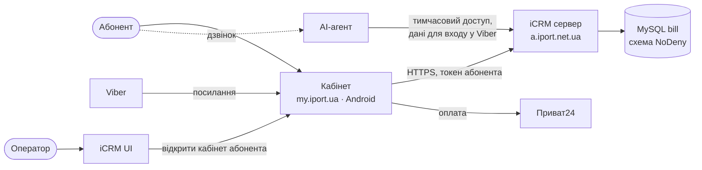
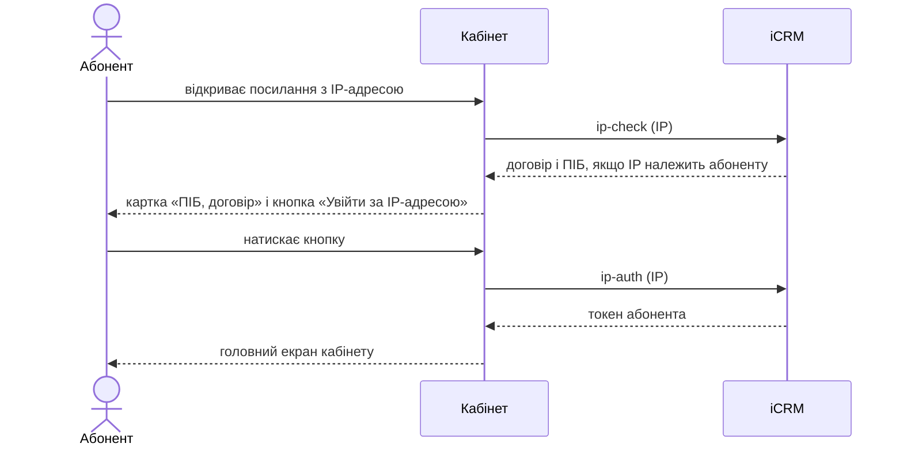
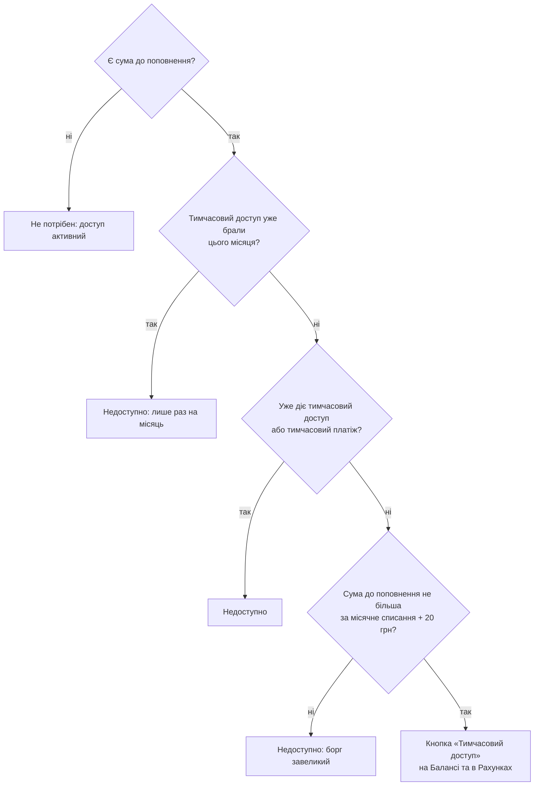
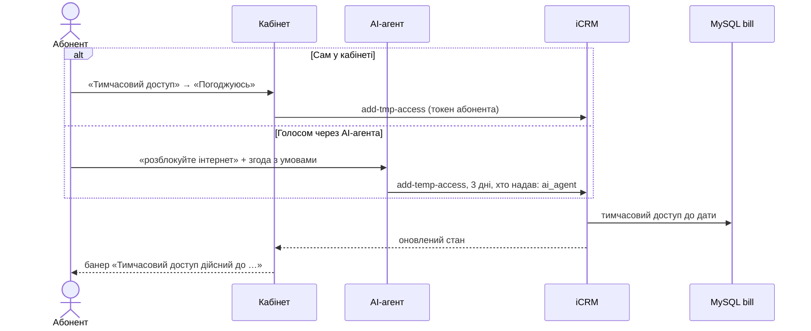
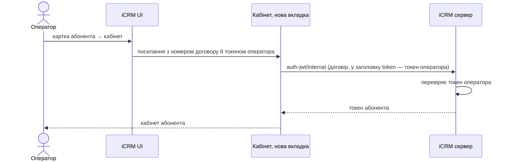

# Сайт і особистий кабінет

Що абонент може зробити сам, без дзвінка в підтримку, і як це влаштовано.

| | |
|---|---|
| Сайт | `iport.ua` — інформація про послуги та заявка на підключення |
| Кабінет | `my.iport.ua` у браузері та застосунок для Android (`ua.iport.mobile`, Google Play) — один код, репозиторій `iport.account` |
| Сервер | iCRM (`https://a.iport.net.ua`): усі дані кабінету та всі дії абонента проходять через нього |
| Дані | MySQL-база `bill` (схема NoDeny), з якою працює iCRM |

## Коротко

| Що потрібно абоненту | Де |
|---|---|
| Дізнатися баланс і коли наступне списання | Кабінет → Баланс |
| Відновити інтернет, коли закінчилися гроші | Кабінет → Тимчасовий доступ, або голосом через AI-агента |
| Поповнити рахунок | Кабінет → Баланс → Поповнити рахунок |
| Змінити тариф | Кабінет → Баланс |
| Призупинити інтернет на час відпустки | Кабінет → Баланс |
| Переглянути платежі й трафік | Кабінет → Платежі, Трафік |

---

## Абонент

### Дізнатися про послуги й подати заявку на підключення

На сайті `iport.ua`: тарифи й акції, зона покриття, умови підключення,
публічний договір, способи оплати, перевірка швидкості, FAQ. Окремо послуги
для бізнесу: хмарна телефонія, корпоративні мережі, дата-центр,
GPS-моніторинг, контроль доступу, ІТ-аутсорсинг.

Заявку можна залишити у формі на сайті, через віджет зворотного дзвінка або
в чаті.

### Увійти в кабінет

| Спосіб | Коли зручно |
|---|---|
| Договір + пароль | Звичайний вхід |
| Договір + одноразовий код на телефон або пошту | Пароль забули |
| Одним кліком із домашньої мережі | Абонент удома, у нашій мережі — див. нижче |
| Посилання з Viber | Посилання з повідомлення входить без пароля й одразу відкриває потрібний розділ |

**Технічно**

- Після входу сервер видає JWT абонента. Кабінет зберігає його в IndexedDB
  (localforage, ключ `auth`) і надсилає в заголовку `auth` з кожним запитом.
- Якщо токен недійсний, сервер відповідає **404** (а не 401). Кабінет на це
  видаляє токен і повертає на сторінку входу.
- Пароль хешується MD5 у браузері ще до відправки.
- Одноразовий код привʼязується до пристрою: кабінет визначає «відбиток»
  браузера (FingerprintJS, `visitorId`) і передає його разом із запитом коду.
- Ендпоїнти: `POST /auth-jwt` (пароль), `GET /auth-jwt/get-otp-profile/…` →
  `POST /auth-jwt/check-otp-profile` (код), `GET /auth-jwt/viber/:token` (Viber).

### Увійти одним кліком із домашньої мережі

Абонент відкриває посилання на кабінет, у якому вже є IP-адреса його
підключення. Кабінет питає iCRM, чий це договір. Якщо IP належить
абоненту, на сторінці входу зʼявляється картка з його ПІБ і номером договору
та кнопка **«Увійти за IP-адресою»**. Один клік — і абонент у кабінеті, без
пароля й коду.

**Технічно**

- Посилання має вигляд `https://my.iport.ua/#/<IP>`. Маршрут `/:ip` у
  `src/router/routes.js` викликає `checkIP`, а потім відкриває сторінку входу.
- `POST /auth-jwt/ip-check` з `{ip}` → у відповіді `contract` і `fio`.
  `POST /auth-jwt/ip-auth` з `{ip}` → JWT абонента.
- **IP-адресу передає сам кабінет у тілі запиту.** Чи звіряє сервер її з
  реальною адресою, з якої прийшов запит, у коді кабінету не видно.
- Код: `src/models/user.js` (`checkIP`, `loginByIP`), `src/pages/Login.vue`.

### Перевірити стан рахунку

Головний екран показує баланс, бонуси, тариф, абонплату й дату наступного
списання. Вгорі — банери, якщо є що повідомити:

- **червоний** — доступ заблоковано через нестачу коштів або призупинено, і
  скільки треба поповнити, щоб відновити;
- **помаранчевий** — діє тимчасовий доступ (до якої дати й години) або
  заплановано призупинення чи відновлення з наступного місяця.

### Відновити інтернет, коли закінчилися гроші — тимчасовий доступ

Якщо доступ заблоковано за борг, абонент може сам увімкнути інтернет **на 3
дні**, а за цей час поповнити рахунок.

Умови, з якими абонент погоджується кнопкою «Погоджуюсь»:

- інтернет вмикається одразу;
- абонплата за поточний місяць нараховується повністю;
- рахунок треба поповнити до кінця 3 днів, інакше доступ знову заблокується.

**Коли кнопка «Тимчасовий доступ» доступна:**

**Два способи отримати тимчасовий доступ:**

1. **Сам у кабінеті** — Баланс → «Поповнити рахунок» → «Тимчасовий доступ»,
   або Рахунки → «Тимчасовий доступ».
2. **Голосом через AI-агента** — абонент телефонує й просить розблокувати.
   AI-агент перевіряє ті самі умови й спершу пропонує зробити це самому в
   кабінеті: надсилає у Viber дані для входу. Якщо абонент просить
   розблокувати одразу, AI-агент зачитує умови, отримує згоду й вмикає доступ
   сам. Без згоди з умовами не вмикає — створює заявку на спеціаліста.

Після ввімкнення AI-агент радить перезавантажити роутер — так інтернет
відновлюється швидше.

**Технічно**

- Кабінет: `GET /profile/add-tmp-access` з токеном абонента, після чого
  перезавантажує дані абонента й платежі. Код — `src/models/pays.js`
  (`tmp_access`), діалог з умовами — `src/components/PayTemp.vue`.
- AI-агент: `GET /users/add-temp-access/<mid>/3/ai_agent` з сервісним
  токеном. Останній сегмент записує, хто надав доступ. Код —
  `sandra-ai/tools.js` (`grant_temp_access`).
- Умови в кабінеті перевіряються за полями з `/profile/user-info`:
  `refill` (сума до поповнення), `due` (місячне списання),
  `temp_access_date` (до коли діє тимчасовий доступ; за ним же визначається
  «вже брали цього місяця»), `temp_pays`, `promise_pays`.
- Для AI-агента iCRM віддає готове рішення: `tmp_access_allowed` і причину
  відмови `tmp_access_denied_reason` (`taken_this_month`, `balance`).

### Поповнити рахунок

Кнопка «Поповнити рахунок» на Балансі. Набір способів залежить від
провайдера (юрособи), з яким укладено договір:

- **Приват24** — відкриває форму оплати Приват24 з уже підставленим номером
  договору.
- **Рахунок Приват24 на телефон** — кабінет виставляє рахунок на номер
  абонента, а абонент підтверджує в Приват24. Разово або щомісяця, з днем
  списання з 10 по 25 число.
- **Банківський переказ** — реквізити й готове призначення платежу з номером
  договору. Кабінет попереджає: переказ іде до 5 банківських днів, платежі
  зараховуються в робочі дні з 9:00 до 16:30, тому за поточний місяць краще
  платити до 25 числа.
- **Юрособи** замість цього отримують рахунок у PDF за період.

Як платіж доходить до рахунку в iCRM — див. архітектуру, процес «Оплата».

**Технічно**

- Які способи показувати, вирішують прапорці з `/profile/user-info`
  (`props.wire`, `props.pb24_bill`) і тип договору (юрособа чи ні).
- Форма Приват24 — `next.privat24.ua` з токеном провайдера (`pb_token`).
- Рахунок на телефон: `/profile/p24-bill`, `/profile/p24-bill-send`,
  скасування — `/profile/p24-bill-del/:id`, `/profile/p24-recur-del`.
- PDF для юросіб: `/profile/inv-period`, `/profile/inv-pdf/:id`.

### Змінити тариф

Абонент обирає тариф зі списку з цінами. Новий тариф діє з 1-го числа
наступного місяця. До того на екрані видно «Замовлено зміну тарифу з …», і
замовлення можна скасувати.

**Технічно**

`POST /profile/price-change` з командою `next_paket:change`, скасування —
`next_paket:reset`. Заплановані зміни приходять у полі `future` даних абонента.

### Призупинити інтернет

Наприклад, на час відпустки. Можна призупинити негайно або з наступного
місяця і так само відновити. Заплановану зміну видно помаранчевим банером, її
можна скасувати. Перед підтвердженням кабінет попереджає, що абонплата за
поточний місяць нараховується повністю.

**Технічно**

Негайно — `state:lock` / `state:unlock`, з наступного місяця —
`next_state:lock` / `next_state:unlock`, скасування — `next_state:cancel`.

### Переглянути платежі й трафік

Історія платежів по роках. Графіки трафіку по днях і по місяцях.

### Читати сповіщення

Розділ «Сповіщення» — оголошення провайдера в кабінеті. Прочитане можна
закрити.

### Користуватися кабінетом без інтернету

Без мережі кабінет усе одно відкривається й показує останні відомі дані:
профіль, провайдера та контакти. Решта розділів потребує мережі.

**Технічно**

Service worker (Workbox) кешує сам застосунок. Відповіді `user-info`,
`provider-by-id` і `contacts` зберігаються в IndexedDB і віддаються звідти,
коли мережі немає (`src/boot/http.js`).

### Змінити свої дані

У профілі абонент змінює пошту й пароль. Нову пошту треба підтвердити
одноразовим кодом.

---

## Оператор

### Побачити кабінет очима абонента

У картці абонента в iCRM є кнопка, що відкриває його кабінет у новій вкладці
— без пароля абонента. Оператор бачить і може робити те саме, що абонент, тож
може підказати по телефону, де що натиснути.

**Технічно**

- iCRM UI (`icrm-ui.2`, `src/components/UserDetails.vue`, `openProfile`)
  бере власний JWT оператора з `localStorage` (`pgjwt`) і відкриває
  `https://my.iport.ua/#/redirect/<договір>/<токен оператора>`
  (адреса кабінету — змінна `VUE_APP_CABINET`).
- Кабінет при старті (`src/boot/main.js`) бачить, що адреса починається з
  `/#/redirect`, і викликає `impersonateAuth` (`src/models/user.js`):
  видаляє збережений токен і робить `POST /auth-jwt/internal` з `{contract}`
  і заголовком `token`.
- Сервер перевіряє токен оператора й видає звичайний JWT абонента, який
  кабінет зберігає так само, як після звичайного входу.
- Наслідки: токен оператора лишається в історії браузера (у частині адреси
  після `#`, тому на сервер і в логи nginx він не потрапляє), а сесія
  абонента лишається в браузері оператора, доки не натиснути «Вийти».

---

## Керівництво

### Примусово оновити застосунок або вивести користувачів

Застосунок щогодини повідомляє серверу свою версію й дані пристрою. У
відповідь сервер може вимагати оновлення через Google Play або вивести
користувача з кабінету. Тобто стару або скомпрометовану версію можна
прибрати, не чекаючи, поки абоненти оновляться самі.

**Технічно**

`POST /profile/ping-android` раз на годину (версія застосунку, пристрій,
відбиток). Відповідь `update` запускає Google Play In-App Update, `logout` —
вихід із кабінету з перезавантаженням.

### Переводити користувачів вебу в застосунок

Веб-версія показує банер «Встановіть застосунок з Google Play». Коли його
показувати, вирішує сервер (`POST /profile/check-platform`).

---

## Технічно, коротко

| | |
|---|---|
| Стек | Vue 3 + Quasar 2, Android через Capacitor 6; веб і застосунок — один код |
| Стан | реактивні модулі `src/models/*`, без Vuex/Pinia; токен і кеш — IndexedDB (localforage) |
| Версія | 0.0.53 (`package.json` і `src-capacitor/package.json` тримати однаковими) |
| Збірка | `quasar build -m pwa` → `dist/pwa`; `quasar build -m capacitor -T android` |
| Викладка |  вручну: `dist/pwa`  `my.iport.ua` |
