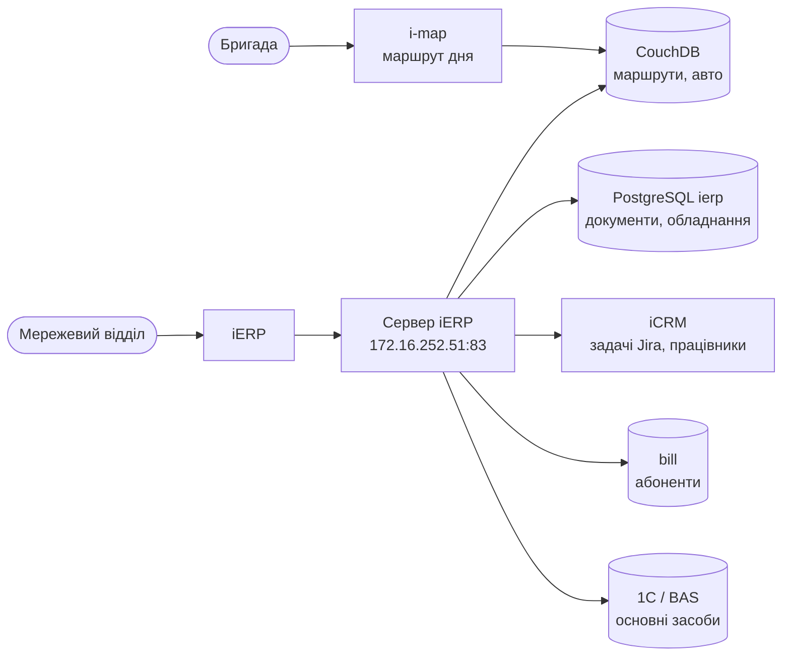
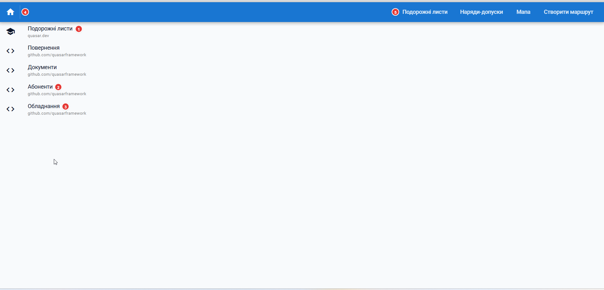
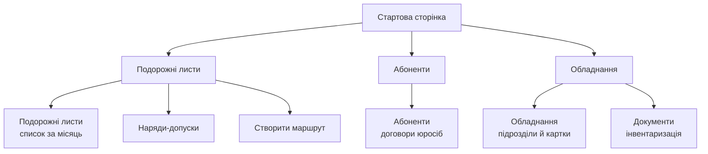

# iERP — облік мережевого відділу

iERP — внутрішній застосунок для офісу. Тут перевіряють і проводять
**подорожні листи** бригад, рахують пальне, оформлюють **наряди-допуски**,
ведуть облік **обладнання** на вузлах і звіряють його з основними засобами в
1С (BAS), а також правлять договори **абонентів** юридичних осіб.

Бригада веде робочий день і маршрут у [i-map](../imap/timesheet.md) на
телефоні. iERP забирає ці маршрути й перетворює їх на документи з номером,
друкованою формою і звітом за місяць.

| | |
|---|---|
| Адреса | `http://172.16.252.51:83` |
| Хто користується | мережевий відділ |
| Пристрої | ПК в офісі, браузер |
| Працює з | CouchDB (маршрути бригад), PostgreSQL (документи, обладнання), iCRM (задачі Jira, працівники), база `bill` (абоненти), 1С / BAS (основні засоби), мережеві інструменти `tools.mgmt.iport` (стан обладнання) |
| Репозиторії | `ierp-ui` (екрани), `ierp-server` (сервер) |

## Меню

На стартовій сторінці три розділи. Розділ відкриває свої вкладки у верхній
смузі, а картки й документи відкриваються там же окремими вкладками з
хрестиком.

| № | Елемент | Що робить |
|:-:|---|---|
| **1** | Подорожні листи | подорожні листи, наряди-допуски, створення маршруту |
| **2** | Абоненти | договори юридичних осіб |
| **3** | Обладнання | обладнання й інвентаризація |
| **4** | Додому | повернутися на стартову сторінку з будь-якого екрана |
| **5** | Вкладки | вкладки відкритого розділу; картки й документи додаються сюди окремими вкладками |

Розділи «Повернення» і «Документи» на стартовій сторінці в роботі не
використовуються.

## Коротко

| Що | Де описано |
|---|---|
| Перевірити й провести подорожній лист, порахувати пальне, звіт в Excel | [route-lists.md](route-lists.md) |
| Створити маршрут за бригаду, яка не вела його в i-map | [track-create.md](track-create.md) |
| Наряди-допуски: за задачами Jira, додаткові номери, друк | [work-permits.md](work-permits.md) |
| Абоненти: тариф, група, стан, ліміт, пошти договору | [subscribers.md](subscribers.md) |
| Обладнання: підрозділи, картка, звʼязок з 1С і моніторингом, Excel | [equipment.md](equipment.md) |
| Інвентаризація обладнання на вузлі | [inventory.md](inventory.md) |
| Як влаштовано: сервер, вхід, оновлення, публікація | [technical.md](technical.md) |
| Де лежать дані: документи, маршрути, обладнання | [data.md](data.md) |
| Як рахується пальне і залишок у баку | [fuel.md](fuel.md) |
| Звʼязки з iCRM, Jira, 1С, мережевими інструментами, базою `bill` | [integrations.md](integrations.md) |

## Хто що робить

| Роль | Що робить в iERP |
|---|---|
| **Мережевий відділ** | усю роботу в iERP: перевіряє одометр і заправки, рахує залишок пального, проводить і друкує подорожні листи, вивантажує звіт за місяць; оформлює наряди-допуски; править договори абонентів; веде обладнання, привʼязує його до основних засобів 1С і проводить інвентаризацію |
| **Монтажник / бригада** | в iERP не працює: веде маршрут в i-map, а в iERP потрапляє його результат |

Ролей і прав в iERP немає: кожен, хто увійшов, бачить усі три розділи.

## Вхід

Окремого екрана входу в iERP немає, і сторінка входу iauth для нього не
використовується. Працівник бере свій токен з іншої нашої системи і вносить
його в браузер вручну, через інструменти розробника (DevTools). Це роблять один
раз — далі браузер памʼятає токен.

1. Відкрити `http://172.16.252.51:83`.
2. F12 → вкладка **Console**.
3. Ввести `localStorage.setItem("jwt", "<токен>")` і натиснути Enter.
4. Оновити сторінку.

Те саме можна зробити у вкладці **Application** → **Local Storage** →
`http://172.16.252.51:83`: додати ключ `jwt` зі значенням токена.

Без токена сторінка відкривається, але списки порожні, а сервер відповідає
«Not allowed user». Токен вносять окремо в кожному браузері й на кожному
компʼютері, і знову — якщо дані браузера очистили.
