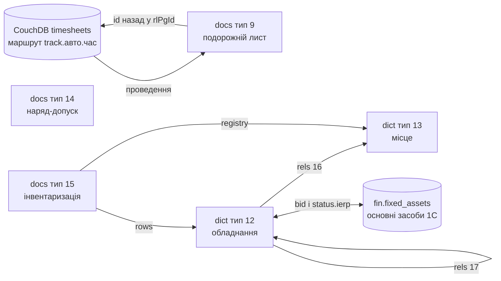

# Дані iERP

Де лежить усе, що показують і змінюють екрани iERP. Коротко: маршрути бригад
живуть у CouchDB разом з i-map, проведені листи, наряди, обладнання й
інвентаризації — у PostgreSQL `ierp`, основні засоби — у таблиці 1С на
MySQL, абоненти — у базі `bill` iCRM.

Назад до [iERP](README.md) · [Як влаштовано](technical.md).

## Хто чим володіє

| Дані | Головне джерело | Хто ще пише |
|---|---|---|
| Маршрут бригади за день | CouchDB `timesheets`, документ `track.…` | i-map (бригада), iERP (створення, правки, пальне, номери документів) |
| Довідник авто, адреси АЗС | CouchDB `timesheets`, документи `availableCars`, `destinations` | вручну  |
| Подорожній лист з номером | PostgreSQL `docs`, тип `9` | лише iERP |
| Наряд-допуск | PostgreSQL `docs`, тип `14` | лише iERP |
| Обладнання, місця зберігання | PostgreSQL `dict`, `rels` | лише iERP |
| Інвентаризація | PostgreSQL `docs` тип `15` + `rows` | лише iERP |
| Основні засоби | MySQL `fin.fixed_assets` на `172.16.252.40` | 1С / BAS ; iERP пише лише привʼязку |
| Працівники, табель | MySQL iCRM (`users`, `timesheet`) | iCRM |
| Договори абонентів | MySQL `bill` (`users`, `phones`) | iCRM, iERP (екран «Абоненти») |
| Координати вузлів | CouchDB `backbone` | i-map |



## Маршрут бригади в CouchDB

База `timesheets` на `172.16.252.57:5984`, спільна з i-map. Один документ —
один маршрут машини за день.

| Поле | Що в ньому |
|---|---|
| `_id` | `track.<id авто>.<час кінця маршруту в секундах>`; з нього ж береться дата рядка у списку листів |
| `parent` | `timesheet.<ключ Jira водія>.<РРРРММДД>` — день у табелі водія |
| `category` | `track` |
| `owner`, `assistant` | ключі Jira водія і напарника |
| `car` | id авто з `availableCars` |
| `odo` | `{start, finish}` — одометр дня |
| `path[]` | зупинки: `jira`, `region`, `street` / `summary`, `order`, `status {start, finish}` — час приїзду й виїзду, `fuel {odo, fuels[]}` — заправка на зупинці АЗС |
| `refill[]` | заправки дня: `fuel` (вид), `liters`, `odo`, `full` (до повного), `dayend`, `time` |
| `rl[]` | перелік для друку: задача з регіоном і вулицею або довільний опис. Зʼявляється, коли маршрут збережено в картці листа |
| `time` | `{start, finish}` робочого дня, якщо бригада його закрила в i-map |
| `tank` | `<паливо>_start`, `<паливо>_finish` — залишок у баку на початок і кінець дня; пише розрахунок пального |
| `rlPgId` | id подорожнього листа в PostgreSQL |
| `wpPgId`, `permit` | наряд, колись оформлений у картці листа: id в PostgreSQL і сам наряд. Зараз наряди оформлюють окремо, нові маршрути цих полів не мають |

Список за місяць іде через вид `route/by-date-car` з ключем
`РРРРММ.<id авто>…` ❓ (сам вид лежить у базі, не в коді iERP).

Приклад документа маршруту (значення умовні, порожні й службові поля прибрано):

```json
{
  "_id": "track.10.1791220022",
  "parent": "timesheet.ivanov_ii.20261005",
  "category": "track",
  "owner": "ivanov_ii",
  "assistant": "petrenko_pp",
  "car": 10,
  "odo": { "start": 163857, "finish": 163994 },
  "time": { "start": 1791189000000, "finish": 1791217800000 },
  "path": [
    { "order": 1, "jira": "NET-95772", "region": "Кулажинці", "street": "вул. Перемоги",
      "status": { "start": 1791190800000, "finish": 1791194400000 } },
    { "order": 2, "summary": "АЗС", "address": "м. Бориспіль, …",
      "status": { "start": 1791196200000, "finish": 1791196800000 },
      "fuel": { "odo": 163870, "fuels": [ { "type": "petrol", "liters": 31.42, "fullTank": true, "dayend": false } ] } }
  ],
  "refill": [
    { "fuel": "petrol", "liters": 31.42, "odo": 163870, "full": true, "dayend": false, "time": 1791196800000 }
  ],
  "rl": [
    { "jira": "NET-95772", "region": "Кулажинці", "street": "вул. Перемоги" },
    { "description": "Офіс" }
  ],
  "tank": { "petrol_start": 32.27, "petrol_finish": 21.54 },
  "rlPgId": 1234
}
```

Час — у мілісекундах, крім `_id`, де кінець маршруту записаний у секундах.

### Службові документи `timesheets`

| `_id` | Що в ньому |
|---|---|
| `availableCars` | автопарк, поле `cars[]`: `id`, `name`, `name_readable`, `plate_num`, `engine_type`, `engine_volume`, `production_year`, `fuels[]` — вид пального (`type`, `name`, `category`), обʼєм бака `capacity`, норма `consumption[0].val` у л/км |
| `destinations` | `destinations` — напрямки, `azsAddr` — типові адреси АЗС |

## PostgreSQL `ierp`

`172.16.252.53:5432`, база `ierp`, схема `public`. Схема універсальна: усі
документи — у двох таблицях, усі довідники — в одній.

| Таблиця | Колонки, які використовує код | Призначення |
|---|---|---|
| `docs` | `id`, `num`, `type`, `date`, `owner`, `data`, `raw`, `print`, `delta`, `locked` | шапка будь-якого документа |
| `rows` | `id`, `doc_id`, `dict_id`, `data`, `ord` | рядки документа |
| `dict` | `id`, `type`, `data` | усі довідники |
| `rels` | `id`, `mid`, `rel` | звʼязки між записами `dict`: `id` — дочірній, `mid` — батьківський |
| `registry` | `doc_id`, `tbl`, `val` | знімки звʼязків до зміни — для відкату інвентаризації |
| `metadata` | `id`, `name`, `type`, `data` | назви типів документів і довідників |
| `lbl` | | мітки; віддаються екранам при старті |

Номер документа (`num`) присвоює сама база при вставці, код його лише читає
❓ (послідовність чи тригер — у коді не видно).

### Документи

| `type` | Що це | Що де лежить |
|---|---|---|
| `9` | подорожній лист | `raw.origin` — копія маршруту на момент проведення, `raw.print` — поля картки (мета, час, водій, відповідальний), `print` — готові дані друкованої форми, `delta` — ручні правки одометра й пального, `locked` — замок |
| `14` | наряд-допуск | усе в `raw`: `date`, `workDate`, `workTime`, `places[]`, `tools`, `zip`, `instrument`, `actors`; у додаткового номера — `raw.parent` |
| `15` | інвентаризація | `data.div` — місце; рядки `rows` з `dict_id` обладнання і `data.available`, `data.mid` |

### Довідники

| `dict.type` | Що це | Поля `data` |
|---|---|---|
| `12` | обладнання | `name`, `inv_num`, `zab_id`, `bid` (id основного засобу 1С), `holder`, `comment` |
| `13` | місце зберігання | `name`, `imap_id`, `zab_id` |

| `dict.id` | Що це |
|---|---|
| `6435` | список цілей поїздки (масив рядків) |
| `6445` | список суб-цілей |
| `6273` | місце «Видалення», куди інвентаризація переносить відсутнє |

### Обладнання

| `rels.rel` | Сенс |
|---|---|
| `16` | обладнання → місце зберігання |
| `17` | модуль → обладнання, у яке він вставлений |

Кореневий список бере лише обладнання без звʼязку `17`; вкладені йдуть
окремим переліком і показуються під своїм обладнанням.

## MySQL

| База і таблиця | Сервер | Доступ iERP | Для чого |
|---|---|---|---|
| iCRM `users` | `172.16.252.40` | читання | працівники; `role = 'worker,'` — водії й утримувачі; `jira_key`, `name_ukr`, `short_name` |
| iCRM `timesheet` | `172.16.252.40` | читання | найближчий робочий день керівника для дати наряду |
| iCRM `log` | `172.16.252.40` | **запис** | журнал змін з екрана «Абоненти» |
| iCRM `map_objects` | `172.16.252.40` | читання | запасні координати вузлів |
| `fin.fixed_assets` | `172.16.252.40` | **запис** поля `status` | основні засоби з 1С: зрізи за `period`; `status.ierp` — id картки iERP |
| `bill.users`, `bill.phones` | `172.16.252.200` | **запис** | договори і пошти абонентів |
| `bill.plans2`, `bill.user_grp` | `172.16.252.200` | читання | тарифи і групи |
| `bill.regions` | `172.16.252.204` (копія) | читання | перелік регіонів для полів «Регіон» |

`fin.fixed_assets` зберігає не поточний стан, а **зрізи за періодами**: майже
всі запити беруть останній `period`. Привʼязка до iERP у новому зрізі
спочатку порожня — як вона переноситься, див.
[integrations.md](integrations.md#1с--bas).
