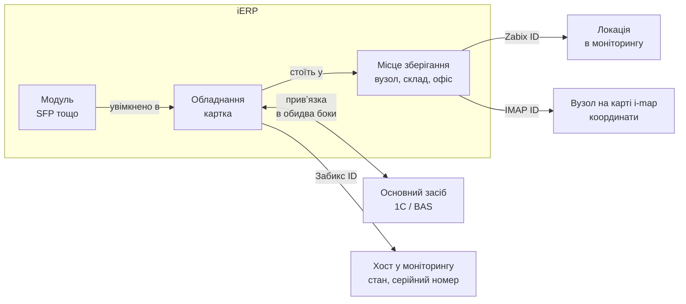
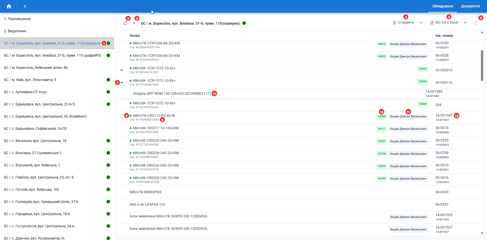
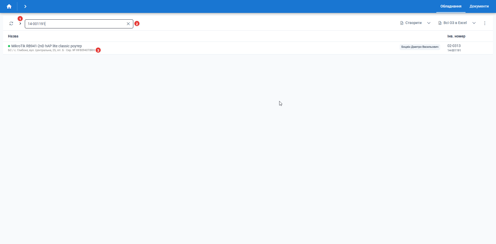
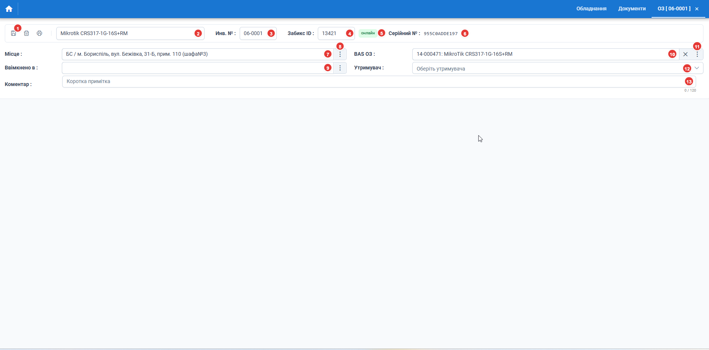
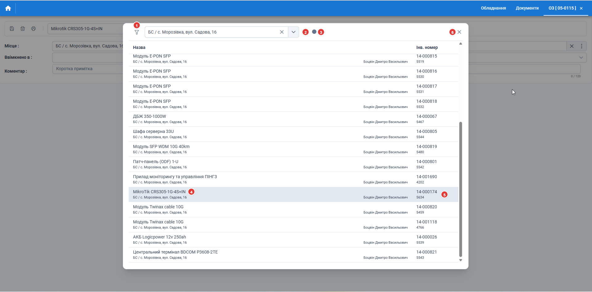
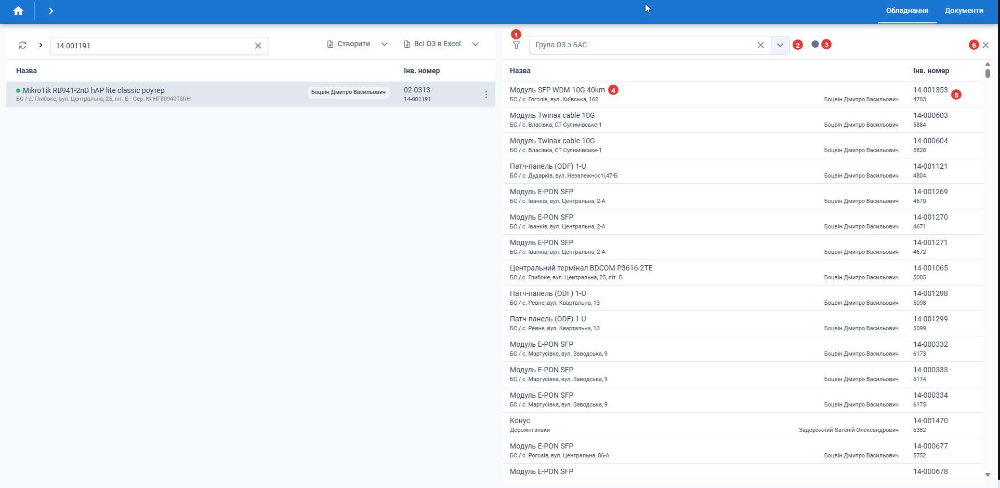
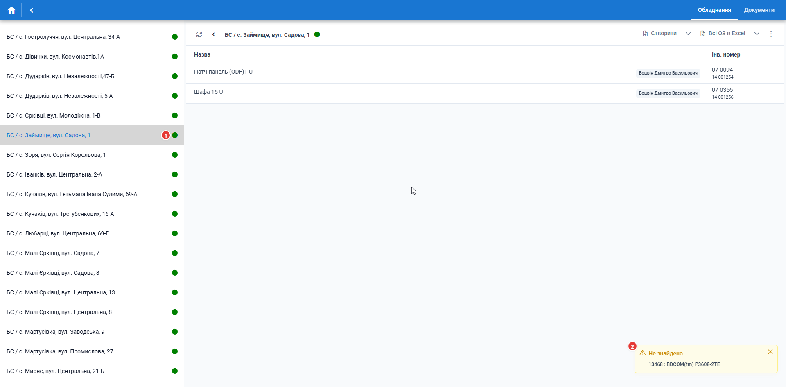
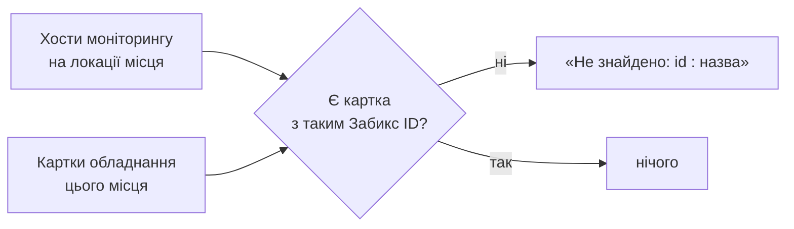
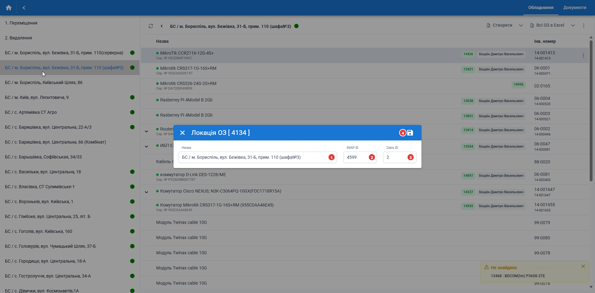

# Обладнання

Облік обладнання на вузлах, складах, в офісах і машинах: що де стоїть, у
що увімкнене, хто за нього відповідає, якому основному засобу в 1С (BAS)
відповідає і чи є з ним звʼязок просто зараз.

Екран тримає разом три обліки:

| Облік | Що дає | Де живе |
|---|---|---|
| **iERP** | назва, власний інвентарний номер, місце, «увімкнено в», утримувач, коментар | PostgreSQL `ierp` |
| **1С / BAS** | основний засіб: інвентарний номер з бухгалтерії, власник, група | таблиця основних засобів у MySQL `172.16.252.40` |
| **Моніторинг** | на звʼязку чи ні, серійний номер, локація хоста | мережеві інструменти `tools.mgmt.iport`,  дані Zabbix  |

Назад до [iERP](README.md).

| Історія | Хто |
|---|---|
| Подивитися обладнання вузла і його стан | мережевий відділ |
| Знайти обладнання по всіх місцях | мережевий відділ |
| Додати або змінити картку обладнання | мережевий відділ |
| Перенести обладнання або вставити модуль у комутатор | мережевий відділ |
| Привʼязати обладнання до основного засобу 1С | мережевий відділ |
| Знайти основні засоби 1С без обладнання | мережевий відділ |
| Помітити обладнання, якого немає в обліку | мережевий відділ |
| Вести перелік місць зберігання | мережевий відділ |
| Вивантажити всі основні засоби в Excel | мережевий відділ |

Розділ **«Обладнання»** → вкладка **«Обладнання»**. Інвентаризація — на
сусідній вкладці, див. [inventory.md](inventory.md).



---

### Подивитися обладнання вузла і його стан

**Мережевий відділ.** Зліва — перелік місць зберігання. Інженер обирає вузол, і в
таблиці лишається тільки його обладнання. Кольорова крапка біля назви — стан
у моніторингу просто зараз. Стрілка зліва від рядка розкриває вкладені
модулі — наприклад, SFP у комутаторі. Подвійне натискання відкриває картку
обладнання окремою вкладкою.



| № | Елемент | Що показує |
|:-:|---|---|
| **1** | Місце зліва | вузол, склад, офіс або машина; зелена крапка — у місця вказано локацію в моніторингу |
| **2** | Оновити | перечитує обладнання, місця й основні засоби з 1С |
| **3** | Стрілка біля оновлення | згортає ліву панель і вмикає пошук по всіх місцях |
| **4** | Створити | нова картка обладнання («ОЗ») або нова інвентаризація |
| **5** | Всі ОЗ в Excel | вивантаження — див. нижче |
| **6** | Три крапки в шапці | відкрити поруч перелік основних засобів 1С |
| **7** | Стрілка в рядку | розкрити вкладені модулі |
| **8** | Крапка біля назви | зелена — на звʼязку, червона — немає звʼязку, сіра — стан невідомий |
| **9** | Сірий рядок під назвою | серійний номер з моніторингу (а в режимі пошуку — ще й місце) |
| **10** | Тег з числом | Забикс ID: зелений — хост у моніторингу на цій самій локації, **червоний** — на іншій |
| **11** | Тег з іменем | власник основного засобу в 1С |
| **12** | Інв. номер | згори власний номер iERP, знизу дрібним — номер з 1С |
| **13** | Вкладений модуль | показується під обладнанням, у яке вставлений |

Якщо в картці є коментар, він показується курсивом під назвою; утримувач —
блакитним тегом під власником. Три крапки зʼявляються в кінці рядка, коли рядок
вибрано: меню «Редагувати» відкриває картку.

Червоний тег Забикс ID означає, що в моніторингу цей хост числиться на іншій
локації: обладнання переїхало, а облік не оновили (або навпаки).

**Технічно**

Обладнання — `GET /equipment/ls`: записи `dict` типу `12` з місцем (звʼязок
`rels.rel = 16`) і кількістю вкладених (`rel = 17`), окремо — вкладені, і до
кожного — основний засіб за `data.bid`. Місця — `GET /dicts/13`. Стан і
серійні номери — `GET /equipment/zab`: сервер забирає
`http://tools.mgmt.iport/api/network/phpipam/getLocations.php?getStatusIcmp=1`
і повертає локації та хости (id, локація, модель, серійний номер, стан).
Обладнання зіставляється з хостом за полем «Забикс ID». Усе це вантажиться
одразу при відкритті iERP, ще до переходу в розділ. Детальніше — у
[data.md](data.md#обладнання) та [integrations.md](integrations.md#мережеві-інструменти).

| Де в коді | Що робить |
|---|---|
| `ierp-ui/src/pages/equipment/equipment.js` → `reload()` (рядок 78) | обладнання, місця, 1С; викликається при завантаженні модуля |
| там же → `ZAB` (рядок 89) | хости моніторингу і пошук за Забикс ID |
| `ierp-ui/src/pages/equipment/List.vue` → `filteredParents` (рядок 127) | що показати: місце або пошук |
| `ierp-server/models/equipment.js` → `ls()` (рядок 110), `zab()` (рядок 28) | дані для списку |

```js
// ierp-ui/src/pages/equipment/equipment.js — модуль вантажить дані одразу при імпорті
const reload = async function(section = 'all') {
  if (['all', 'divs'].includes(section)) ae.get(`/dicts/13`).then(({data}) => divs.value = data)  // місця
  if (section === 'all') ae.get('/equipment/ls').then(({data}) => {
    items.value = data[0]          // кореневе обладнання
    sfp.value = data[1]            // вкладені модулі
  })
  if (section === 'all') BAS.reload()     // основні засоби 1С
}
const ZAB = {
  hosts: ref([]),
  byId: computed(() => new Map(ZAB.hosts.value.map(_ => [_.id, _]))),
  active(id) { return ZAB.byId.value.get(parseInt(id)) },    // хост за Забикс ID картки
  reload() { ae.get(`/equipment/zab`).then(({data}) => { ZAB.locations.value = data.locations; ZAB.hosts.value = data.hosts }) }
}
reload()
ZAB.reload()
```

```js
// ierp-server/models/equipment.js, zab() — перетворення відповіді скрипта
for (const row of data) {
  const loc_id = parseInt(row.location_id)
  locations.push({id: loc_id, name: row.location})
  for (const host of row.hosts) {
    const up = host.status === null || host.status === undefined ? null : host.status === '1'
    hosts.push({id: parseInt(host.hostid), location: loc_id, name: host.model || host.host, sn: host.sn, up})
  }
}
```

Колір тегу Забикс ID: `_a.location === eq.div.value.data.zab_id ? 'success' : 'danger'` — локація хоста порівнюється з «Zabix ID» вибраного місця.

---

### Знайти обладнання по всіх місцях

**Мережевий відділ.** Стрілка біля кнопки оновлення згортає ліву
панель — таблиця показує все обладнання, а вгорі зʼявляється пошук. Шукає за
назвою, власним номером і номером з 1С, власником, утримувачем, коментарем і
серійним номером, **включно з вкладеними модулями**: пошук за серійним номером
SFP знайде і сам модуль, і комутатор, у який він вставлений.



| № | Елемент | Що робить |
|:-:|---|---|
| **1** | Стрілка | повертає ліву панель з місцями |
| **2** | Пошук | назва, номери, власник, утримувач, коментар, серійний номер |
| **3** | Результат | під назвою — місце зберігання і серійний номер |

**Технічно**

```js
// ierp-ui/src/pages/equipment/List.vue — пошук
const parentMatches = (p, q) => {
  q = q.toLowerCase()
  const name = (p.data?.name || '').toLowerCase()
  const inv = (p.data?.inv_num || '').toLowerCase()       // власний номер
  const invBas = (p.bas?.inv || '').toLowerCase()         // номер з 1С — окремо
  const owner = (p.bas?.owner || '').toLowerCase()
  const holder = (p.data?.holder || '').toLowerCase()
  const comment = (p.data?.comment || '').toLowerCase()
  const sn = serialOf(p)                                  // серійний номер з моніторингу
  if (name.includes(q) || inv.includes(q) || invBas.includes(q) || owner.includes(q) ||
      holder.includes(q) || comment.includes(q) || sn.includes(q)) return true
  return childrenOf(p).some(c => childMatches(c, q))      // збіг у вкладеному модулі
}
```

Пошук іде по даних, уже завантажених у браузер; на сервер запитів немає.

---

### Додати або змінити картку обладнання

**Мережевий відділ.** Нова картка — кнопка «Створити» → «ОЗ» (місцем одразу
стає вибраний зліва вузол). Наявна — подвійне натискання на рядку або
«Редагувати» в меню рядка. Змінені поля підсвічуються зеленим, доки їх не
збережено дискетою.



| № | Поле | Що в ньому |
|:-:|---|---|
| **1** | Зберегти | записати зміни |
| **2** | Назва | найменування обладнання |
| **3** | Инв. № | власний інвентарний номер |
| **4** | Забикс ID | номер хоста в моніторингу |
| **5** | Стан | підставляється сам: «онлайн», «немає звʼязку» або «стан невідомий» |
| **6** | Серійний № | підставляється сам з моніторингу |
| **7** | Місце | місце зберігання |
| **8** | Три крапки | вибір місця зі списку з пошуком |
| **9** | Ввімкнено в | обладнання, у яке вставлений цей модуль; три крапки поруч — вибір, хрестик (зʼявляється, коли поле заповнене) знімає привʼязку |
| **10** | BAS ОЗ | основний засіб з 1С: інвентарний номер і назва; хрестик знімає привʼязку |
| **11** | Три крапки | вибір основного засобу з 1С — див. нижче |
| **12** | Утримувач | відповідальний працівник |
| **13** | Коментар | коротка примітка, до 120 символів |

**Технічно**

`GET /equipment/item/:id`, збереження — `POST /equipment/modify/:id`
(`0` — нова картка). Сервер пише лише змінені поля в `dict.data`, місце — у
`rels` з `rel = 16`, «увімкнено в» — `rel = 17`. Утримувачі — працівники iCRM
з роллю `worker` (`GET /track-list/all-names`).

```js
// ierp-ui/src/pages/equipment/Item.js, save() — на сервер ідуть лише змінені поля
const payload = {}
for (const key of Object.keys(origin)) {
  if (origin[key] !== data[key]) payload[key] = ['zab_id'].includes(key) ? parseInt(data[key]) : data[key]
}
if (Object.keys(payload).length === 0) return
ae.post(`/equipment/modify/${id.value}`, payload)
```

```js
// ierp-server/models/equipment.js, modify() — нова картка (id = 0)
const oz = {name: req.body.name, bid: req.body.bid, inv_num: req.body.inv_num, zab_id: req.body.zab_id}
const _id = await conn.one(`insert into dict (data, type) values ($1, 12) returning id`, [oz]).then(_ => _.id)
await conn.none(`insert into rels (id, mid, rel) values ($1, $2, $3)`, [_id, req.body.did, 16])   // місце
await icrm.query(`update fin.fixed_assets set status = JSON_SET(ifnull(status, '{}'), '$.ierp', ?) where id = ?`,
  [_id, req.body.bid])                                                                              // привʼязка 1С
```

Коментар обрізається на сервері до 120 символів (`COMMENT_LIMIT`), так само як і в полі на екрані.

---

### Перенести обладнання або вставити модуль у комутатор

**Мережевий відділ.** Обладнання переїхало — у картці змінюють поле «Місце» і
зберігають. Модуль вставили в комутатор — у полі «Ввімкнено в» обирають
комутатор (у списку — обладнання того самого місця) і зберігають. Модуль
після цього зникає з кореня списку й показується під комутатором.

**Технічно**

Зміна місця перезаписує звʼязок `rel = 16`, «увімкнено в» — `rel = 17`.
Історія переміщень не зберігається — лише поточний стан.

```js
// ierp-server/models/equipment.js, modify() — наявна картка
if (req.body.did) {                         // місце
  await conn.none(`delete from rels where id = $1 and rel = 16 `, [id])
  await conn.none(`insert into rels (id, mid, rel) values ($1, $2, $3) `, [id, req.body.did, 16])
}
if (req.body.hasOwnProperty('mid')) {       // «увімкнено в»; null — зняти
  await conn.none(`delete from rels where id = $1 and rel = 17 `, [id])
  if (req.body.mid) await conn.none(`insert into rels (id, mid, rel) values ($1, $2, $3) `, [id, req.body.mid, 17])
}
```

У виборі «Ввімкнено в» показується лише кореневе обладнання того самого місця (`EqSelector.js`, фільтр `i.mid === did`).

---

### Привʼязати обладнання до основного засобу 1С

**Мережевий відділ.** Розділ «Обладнання» → подвійне натискання на рядку обладнання
(або три крапки в рядку → «Редагувати») відкриває картку. Праворуч у картці
поле «BAS ОЗ», а в кінці поля — кнопка з трьома крапками. Вона відкриває
перелік основних засобів з 1С. Подвійне натискання вибирає засіб: у картку
підставляється його інвентарний номер (власний номер замінюється номером з
1С), а якщо назва порожня — і назва. Після збереження привʼязка видна з обох
боків: у списку обладнання — номер з 1С і власник, у переліку 1С — id картки
iERP. Хрестик у полі знімає привʼязку.



| № | Елемент | Що робить |
|:-:|---|---|
| **1** | Лійка | перемикає пошук: за групою основних засобів або за назвою й початком інвентарного номера |
| **2** | Поле пошуку | група («БС / …», майданчик) або назва / номер |
| **3** | Кружечок | показувати **лише непривʼязані** основні засоби |
| **4** | Рядок | назва, під нею група; праворуч — власник. Подвійне натискання вибирає засіб |
| **5** | Інв. номер | номер з 1С, під ним — id картки iERP, якщо засіб уже привʼязаний |
| **6** | Хрестик | закрити без вибору |

**Технічно**

Перелік — `GET /bas-equipment/ls/:date`: останній період основних засобів 1С,
без записів «Електронно-комунікаційна мережа…». Дата в запиті сервером не
використовується. Привʼязка двостороння: у картці iERP — `data.bid` (id засобу
в 1С), у 1С — `status.ierp` (id картки). Як це влаштовано і як переноситься
між періодами 1С — у [integrations.md](integrations.md#1с--bas).

```js
// ierp-server/models/equipment.js, modify() — зміна привʼязки
if (req.body.hasOwnProperty('bid')) {
  // зняти старе посилання в останньому періоді, де воно було
  const period = await icrm.one(`select max(period) period from fin.fixed_assets where status->>'$.ierp' = ?`, [id])
  if (period) await icrm.query(
    `update fin.fixed_assets set status = JSON_REMOVE(status, '$.ierp') where period = ? and status->>'$.ierp' = ?`, [period, id])
  // поставити нове в останньому періоді вибраного засобу
  if (req.body.bid) {
    const p = await icrm.one(`select max(period) period from fin.fixed_assets where id = ?`, [req.body.bid])
    await icrm.query(
      `update fin.fixed_assets set status = JSON_SET(ifnull(status, '{}'), '$.ierp', ?) where id = ? and period = ?`,
      [id, req.body.bid, p])
  }
}
```

```js
// ierp-ui/src/pages/equipment/equipment.js — фільтр «лише непривʼязані» і пошук
items: computed(() => BAS.items.value.filter(_ => {
  const shouldFilterIerp = BAS.prefilter.state.value ? !_.status?.ierp : true    // кружечок
  const nameFilter = BAS.prefilter.name.value?.trim().toLowerCase()
  const shouldFilterName = nameFilter
    ? (_.name?.toLowerCase().indexOf(nameFilter) > -1 || (_.inv?.toLowerCase() || '').startsWith(nameFilter))
    : true
  return shouldFilterIerp && shouldFilterName
}))
```

---

### Знайти основні засоби 1С без обладнання

**Мережевий відділ.** Три крапки в правому куті шапки списку відкривають поруч
перелік основних засобів з 1С — той самий, що й у картці. Кружечок залишає
лише ті засоби, до яких ще не привʼязано жодної картки. Це перелік того, що в
бухгалтерії є, а фізично в обліку iERP ще не знайдене.



Елементи ті самі, що й у вікні вибору з картки: **[1]** лійка, **[2]** пошук,
**[3]** лише непривʼязані, **[4]** рядок засобу, **[5]** інвентарний номер і id
картки iERP, **[6]** закрити панель.

---

### Помітити обладнання, якого немає в обліку

**Мережевий відділ.** Коли обрано місце з локацією в моніторингу, застосунок
звіряє хости моніторингу на цій локації з картками обладнання цього місця.
Для кожного хоста без картки внизу праворуч зʼявляється попередження «Не
знайдено» з номером і назвою хоста. Кожен хост показується один раз, доки не
обрано інше місце.



| № | Елемент | Що показує |
|:-:|---|---|
| **1** | Місце з зеленою крапкою | для нього вказано локацію в моніторингу, тож звірка працює |
| **2** | «Не знайдено» | номер і назва хоста, якого немає в картках; хрестик закриває |

Це означає: обладнання реально стоїть і моніториться, але в обліку його
немає. Треба створити картку й вказати в ній Забикс ID.



**Технічно**

```js
// ierp-ui/src/pages/equipment/List.vue
const warned = new Set()
const checkUnlinked = async function () {
  const zab_id = eq.div.value?.data?.zab_id
  if (!zab_id || !nav.drawer.value) return                     // лише з відкритою лівою панеллю
  if (!eq.ZAB.hosts.value.length || !eq.items.value.length) return
  const mon = eq.ZAB.hosts.value
    .filter(_ => _.location === zab_id)                         // хости локації місця
    .filter(_ => !filteredAll.value.find(i => _.id == i.data?.zab_id))   // без картки
  for (const m of mon) {
    if (warned.has(m.id)) continue
    warned.add(m.id)
    nav.toasts.value = { severity: 'warn', summary: 'Не знайдено', detail: `${m.id} : ${m.name}` }
    await new Promise(r => setTimeout(r, 150))
  }
}
watch(eq.div, () => { eq.sel.value = null; warned.clear(); checkUnlinked() })   // нове місце — нові попередження
watch([eq.ZAB.hosts, eq.items, nav.drawer], checkUnlinked)
```

Сповіщення без `life`, тому не зникає саме.

---

### Вести перелік місць зберігання

**Мережевий відділ.** Права кнопка миші на місці зліва відкриває меню «Змінити ·
Створити · Видалити». У формі місця — назва, IMAP ID і Zabix ID.



| № | Поле | Навіщо |
|:-:|---|---|
| **1** | Назва | обовʼязкова |
| **2** | IMAP ID | id вузла на карті i-map — з нього беруться координати у вивантаженні Excel |
| **3** | Zabix ID | id локації в моніторингу — вмикає зелені й червоні теги та попередження «Не знайдено» |
| **4** | Зберегти | записати місце; хрестик ліворуч закриває форму без змін |

Місце, у якому є обладнання, видалити не можна: застосунок покаже, що саме в
ньому лежить.

Особливі місця: **«Видалення»** — сюди інвентаризація переносить те, чого не
знайшли на вузлі; **«Переміщення»** і **ЕКМ** — службові. Усі три не
потрапляють у вивантаження Excel.

**Технічно**

Місця — `dict` типу `13` з полями `name`, `imap_id`, `zab_id`; збереження —
`POST /dict`, видалення — `GET /dict-del/:id`. Якщо на запис є звʼязки в
`rels`, сервер відповідає `401` з переліком, і екран показує діалог із ним.

```js
// ierp-server/models/dict.js, del()
const parentOf = await conn.query(`SELECT r.id, d.data->>'name' name FROM public.rels r
                                   left join dict d on r.id = d.id where mid = $1`, [req.params.id])
if (parentOf.length > 0) {
  res.status(401).json(parentOf)        // що лежить у цьому місці
} else {
  await conn.none(`delete from rels where id = $1`, [req.params.id])
  await conn.none(`delete from dict where id = $1`, [req.params.id])
}
```

```js
// ierp-ui/src/pages/equipment/ListLeft.vue, doChange() — порожні IMAP ID і Zabix ID зберігаються як null
if (!(editing.data.name?.trim().length > 0)) return warn.value = 'Поле [Назва] має бути заповненим'
if (!String(editing.data.imap_id ?? '').trim()) editing.data.imap_id = null
if (!String(editing.data.zab_id ?? '').trim()) editing.data.zab_id = null
dict.change(editing)      // POST /dict
```

---

### Вивантажити всі основні засоби в Excel

**Мережевий відділ.** Кнопка «Всі ОЗ в Excel» формує файл
`equipment-РРРР-ММ-ДД.xlsx`. Стрілка поруч з нею відкриває меню з
поясненням, що потрапляє у файл.

| Колонка | Що в ній |
|---|---|
| Місце зберігання | назва місця |
| IMAP ID | вузол на карті |
| Широта, Довгота | координати вузла |
| Назва обладнання | з картки |
| Інвентарний номер | з 1С, а якщо привʼязки немає — власний |
| Префікс | перші дві цифри номера з дефісом (`14-`) — для фільтра |
| Інв. номер і назва обладнання, куди увімкнено | для вкладених модулів |

Вкладені модулі йдуть рядками під своїм обладнанням. Фільтри в шапці вже
увімкнені. Місця «Переміщення», «Видалення» та ЕКМ у файл не потрапляють.

**Технічно**

`GET /equipment/export-xlsx` (`models/equipment-export.js`). Координати — з
документа `node.<IMAP ID>` у CouchDB `backbone`. Якщо вузол з карти видалено,
вони беруться з `map_objects` бази iCRM.

```js
// ierp-server/models/equipment-export.js
// службові місця — не потрапляють у файл
const EXCLUDE_DIV = /^ *[0-9]*[.]? *(Переміщення|Видалення|ЕКМ)/i
// інв. номер BAS, якщо привʼязка є; інакше — власний
const inv = r => (r.bid && basById.get(String(r.bid))?.inv) || r.inv_num || ''
// 14-001688 -> '14-' — колонка «Префікс»
function invPrefix(val) {
  const m = /^(\d{2})-/.exec(String(val || '').trim())
  return m ? m[1] + '-' : '(без префікса)'
}
```

Координати з `backbone` читаються одним запитом `GET /backbone/_all_docs?include_docs=true` (таймаут 30 с); у `gps` бувають обидва формати — `{lat, lng}` і `{center: {lat, lng}, zoom}`.
