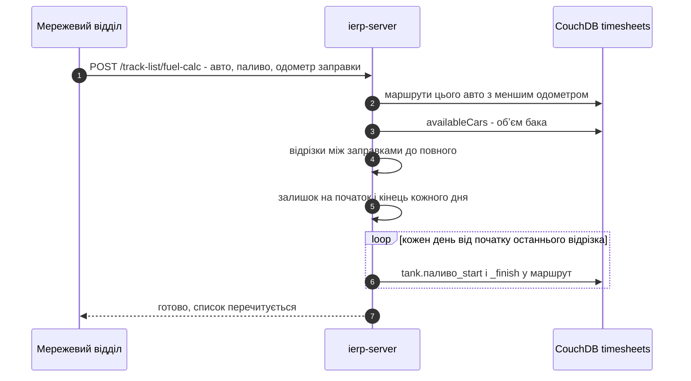

# Розрахунок пального

Як iERP рахує витрату пального і залишок у баку для подорожніх листів, де
стоять норми і як виправляють одометр, коли витрата не сходиться. Для
мережевого відділу й розробників. Кнопки на екрані описані в
[route-lists.md](route-lists.md#порахувати-залишок-пального-в-баку).

Назад до [iERP](README.md) · [Як влаштовано](technical.md).

## Чому не «витрата за день»

Літри відомі точно — з чека АЗС. Скільки лишилося в баку ввечері, ніхто не
міряє. Тому iERP рахує не день за днем, а **відрізками між двома заправками
до повного бака**. У мить заправки до повного бак точно повний — це опорна
точка, від якої можна рахувати.

> Витрата на відрізку = (літри заправки до повного в кінці відрізка + усі
> заправки не до повного всередині) / кілометри відрізка

За день буває кілька заправок (зранку й наприкінці зміни), тому розрахунок
працює з переліком заправок, а не з днями.

## Приклад

Машина з баком на 60 л, бензин.

| Одометр | Подія |
|---|---|
| 100 000 | заправка до повного |
| 100 300 | заправка 20 л, не до повного |
| 100 600 | заправка до повного, 45 л |

Відрізок 100 000 – 100 600: 600 км, пального пішло 45 + 20 = 65 л, тобто
10,83 л на 100 км.

| Одометр | Залишок у баку |
|---|---|
| 100 000 | 60 (повний) |
| 100 300 до заправки | 60 − 300 × 0,1083 = 27,5 |
| 100 300 після заправки | 27,5 + 20 = 47,5 |
| 100 600 до заправки | 47,5 − 300 × 0,1083 = 15,0 |
| 100 600 після заправки | 60 (повний) — і справді 15 + 45 = 60 |

День, коли машина проїхала з 100 100 до 100 250, отримає залишок 49,17 л на
початок і 32,92 л на кінець.

## Що робить перерахунок

Працівник мережевого відділу натискає синю кнопку заправки до повного у списку листів.



1. Береться кожен маршрут машини, у якого одометр на початок менший за
   одометр натиснутої заправки, і сортується за одометром.
2. Заправки потрібного палива збираються в один перелік. Якщо заправок до
   повного менше двох, розрахунок нічого не змінює (лише запис у лозі
   сервера).
3. Між кожними двома сусідніми заправками до повного рахується витрата на
   відрізку. Відрізки з хибним одометром (кінець не більший за початок)
   відкидаються.
4. Залишок у будь-якій точці: від найближчої попередньої заправки до повного
   (бак = обʼєм з довідника) віднімається витрата за нормою відрізка й
   додаються проміжні заправки. Для точок раніше першої заправки до повного
   рахується назад від неї. До першого й після останнього відрізка береться
   норма найближчого відрізка.
5. Залишок записується в маршрути **від початку останнього відрізка** і
   далі. Ранішні дні не перераховуються: для них нічого не змінилося.

## Що з цього видно на екрані

| Де | Що | Як рахується |
|---|---|---|
| Колонка «Бак, л / 100 км» | залишок на початок і кінець дня | з `tank` маршруту |
| Там же, після риски | витрата дня на 100 км | (початок − кінець + заправки дня) / пробіг дня |
| Друкована форма листа | залишок на виїзді й поверненні, заправка, фактична витрата | витрата = початок + заправки − кінець; лише перше паливо |
| Excel за місяць | ті самі числа + норма й відхилення | норма = пробіг × 10,5 / 100 |

Після розрахунку одометр і заправки в картці листа блокуються: їх зміна
зсунула б залишок по всіх наступних днях. Проводиться лист лише тоді, коли в
маршруті вже є пораховане пальне для одного виду палива.

## Де стоять норми

| Де | Значення | Для чого |
|---|---|---|
| CouchDB `availableCars` → `fuels[].consumption[0].val` | норма кожної машини, л/км | скрипт `odo-to-norm.js` (якщо норму не задано явно) |
| `ierp-server/models/fuel.js` | 0,105 л/км бензин, 0,086 — інші види | поле норми в даних друкованої форми (у шаблоні не друкується) |
| `ierp-server/models/rl-excel.js` | 10,5 л / 100 км для всіх машин | колонки «Норма» і «Відхилення» в Excel |

Зміна норми потребує правки всіх трьох місць.

## Виправлення одометра скриптами

Коли витрата на відрізках виходить вище норми, а літри з чека змінити не
можна, розробник може перерозподілити кілометри між днями. Робиться це
вручну, з консолі сервера, двома скриптами з `ierp-server/tasks/`.

| Скрипт | Що робить |
|---|---|
| `odo-to-norm.js` | лише читає CouchDB і готує план: як зсунути одометри заправок (межі відрізків), щоб витрата кожного відрізка стала нормою. Відрізок понад норму забирає кілометри в сусіднього, де є запас. Загальний пробіг, перший і останній одометр не змінюються, дні всередині відрізка стискаються або розтягуються пропорційно |
| `fix-odo.js` | застосовує план одночасно в CouchDB (`odo`, `refill[].odo`, `path[].fuel.odo`) і PostgreSQL (`raw.origin`, `print`, `delta`). Без `apply` лише показує зміни, з `apply` спершу пише резервну копію поруч із файлом плану. Повторний запуск безпечний |

```bash
node tasks/odo-to-norm.js car=32 out=tasks/odo.json   # план
node tasks/fix-odo.js tasks/odo.json car=32           # перевірка
node tasks/fix-odo.js tasks/odo.json car=32 apply     # застосувати
# далі перерахувати залишки: POST /track-list/fuel-calc
```

Пальне `fix-odo.js` свідомо не перераховує — після нього треба запустити
перерахунок з екрана або запитом. Поле `delta` подорожнього листа має
перевагу над `print` і в друкованій формі, і в Excel: виправлений одометр
потрапляє в обидва.

## Код

Розрахунок — `calc_fuel_consumption()` у `ierp-server/models/fuel.js` (рядок 152).
Викликається з `POST /track-list/fuel-calc` (`models/track-list.js` →
`calcFuelConsumption()`, рядок 239) з тілом `{car, fuel, odo}`.

### Вибірка і плаский перелік заправок

```js
couch.findDocuments('timesheets', {
  "selector": { "car": car, "odo.start": { "$lt": odo } },     // маршрути машини до натиснутої заправки
  "fields": [ "car", "odo.start", "odo.finish", "_id", "refill", "tank" ],
  "sort": [ { "odo.finish": "desc" } ]
}).then(async ({data}) => {
  const tankCapacity = (await carFuelSpec(car, fuel)).capacity   // обʼєм бака з availableCars

  const docs = data.docs
    .filter(_ => _.odo && _.odo.start >= 0 && _.odo.finish >= 0)
    .sort((a, b) => a.odo.finish - b.odo.finish)
    .map(_ => Object.assign(_, {
      refills: (_.refill || [])
        .filter(r => r.fuel === fuel && r.odo >= 0 && r.liters >= 0)
        .sort((x, y) => x.odo - y.odo)
    }))
  const events = docs.flatMap(doc => doc.refills.map(refill => ({doc, refill})))
  const fulls = events.filter(_ => _.refill.full)
  if (fulls.length < 2) return          // нема двох заправок до повного — нічого не рахуємо
  ...
})
```

### Відрізки і норма на кілометрі

```js
const segments = fulls.slice(1).map((to, i) => {
  const from = fulls[i]
  const l = to.refill.liters + events
    .filter(_ => _.refill.odo > from.refill.odo && _.refill.odo < to.refill.odo && !_.refill.full)
    .reduce((a, _) => a + _.refill.liters, 0)
  return {from: from.refill.odo, to: to.refill.odo, lkm: l / (to.refill.odo - from.refill.odo)}
}).filter(_ => _.to > _.from && _.lkm > 0)

// норма в точці: до першого відрізка і після останнього — найближчий
const rate = function(point) {
  const seg = segments.find(_ => point >= _.from && point < _.to)
    || (point < segments[0].from ? segments[0] : segments[segments.length - 1])
  return seg.lkm
}
// витрата між двома одометрами — частинами, у кожного відрізка своя норма
const consume = function(from, to) {
  if (!(to > from)) return 0
  const bounds = [...new Set(segments.flatMap(_ => [_.from, _.to]))]
    .filter(_ => _ > from && _ < to).sort((a, b) => a - b)
  let used = 0, point = from
  for (const next of [...bounds, to]) {
    used += (next - point) * rate(point)
    point = next
  }
  return used
}
```

### Залишок у баку на будь-якому одометрі

```js
const volumeAt = function(point) {
  const anchor = [...fulls].reverse().find(_ => _.refill.odo <= point)   // остання повна заправка до точки
  if (anchor) {
    let volume = tankCapacity, from = anchor.refill.odo
    for (const e of events.filter(_ => _.refill.odo > from && _.refill.odo <= point)) {
      volume -= consume(from, e.refill.odo)
      volume = e.refill.full ? tankCapacity : volume + e.refill.liters
      from = e.refill.odo
    }
    return volume - consume(from, point)
  }
  // раніше за першу повну заправку — рахуємо назад від неї
  let volume = tankCapacity - fulls[0].refill.liters, from = fulls[0].refill.odo
  for (const e of events.filter(_ => _.refill.odo > point && _.refill.odo < from).reverse()) {
    volume += consume(e.refill.odo, from) - e.refill.liters
    from = e.refill.odo
  }
  return volume + consume(point, from)
}
```

### Запис у маршрути

```js
const last = segments[segments.length - 1]
const route = docs.filter(_ => _.odo.finish >= last.from)     // від початку останнього відрізка
for (const row of route) {
  await apply(row, {
    [`${fuel}_start`]: roundToTwo(volumeAt(row.odo.start)),
    [`${fuel}_finish`]: roundToTwo(volumeAt(row.odo.finish))
  })
}
// apply(): прочитати маршрут, data.tank = Object.assign(data.tank || {}, tank), записати назад
```

### Що бачить список: `computeTank()`

```js
// ierp-server/models/fuel.js, рядок 134 — з {petrol_start, petrol_finish} у [{fuel, start, finish, lkm}]
computeTank (doc) {
  return Object.entries(Object.entries(doc.tank).reduce((a, [key, value]) => {
    const [fuel, period] = key.split("_")
    if (!a[fuel]) a[fuel] = {}
    a[fuel][period] = value
    return a
  }, {})).map(([f, v]) => {
    if (v.start >= 0 && v.finish) {
      const refill = doc.refill ? doc.refill.filter(_ => _.fuel === f).reduce((_a, _v) => _a += _v.liters, 0) : 0
      v.lkm = (v.start - v.finish + refill) / (doc.odo.finish - doc.odo.start)   // л/км дня
    }
    return {fuel: f, ...v}
  })
}
```

### Друкована форма: `createPDFObj()`

```js
// ierp-server/models/fuel.js, рядок 72 — скорочено
const tank = await Promise.all((prnt.tank || []).map(async el => {
  const norm_lkm = el.fuel === 'petrol' ? 0.105 : 0.086
  const refill = roundToTwo((doc.refill || []).filter(ref => ref.fuel === el.fuel).reduce((a, ref) => a + ref.liters, 0))
  el.refill = refill
  el.usage = roundToTwo(el.start + refill - el.finish)        // «Фактична витрата»
  el.norm = { usage: odo.total * norm_lkm, lkm: norm_lkm }
  return el
}))
// у друк іде лише tank[0] — перше паливо
```
