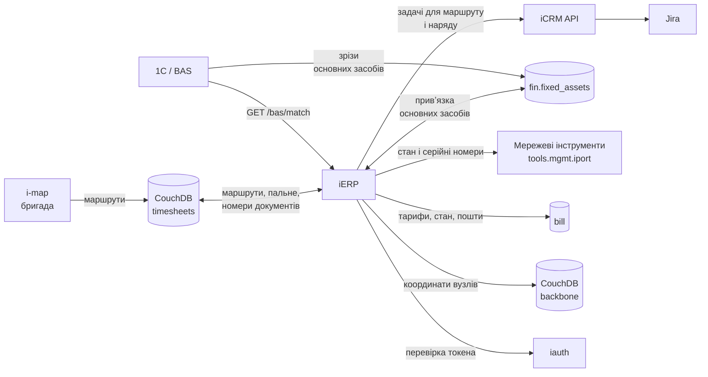
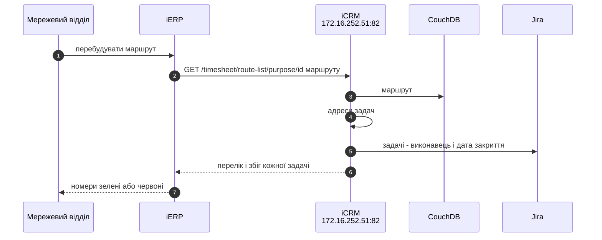
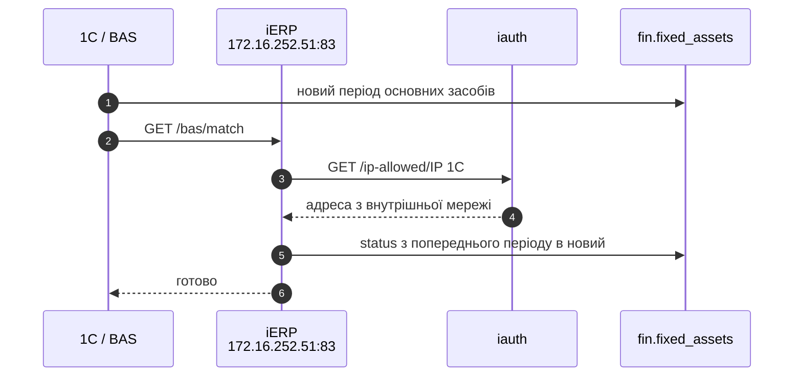

# Звʼязки iERP з іншими системами

Що iERP бере з інших систем і що в них пише. Для розробників і тих, хто
розбирається, чому на екрані щось не так.

Назад до [iERP](README.md) · [Як влаштовано](technical.md).

| Система | Напрямок | Що | Якщо не працює |
|---|---|---|---|
| CouchDB `timesheets` | читання і запис | маршрути бригад, авто, АЗС | список подорожніх листів порожній |
| iCRM API | читання | задачі Jira з адресами | маршрут не перебудовується, наряд не завантажує задачі |
| `fin.fixed_assets` | читання і запис привʼязки | основні засоби 1С | у списку обладнання немає номерів 1С, перелік 1С порожній |
| Мережеві інструменти `tools.mgmt.iport` | читання | стан і серійні номери хостів | немає крапок стану, тегів і «Не знайдено» |
| `bill` | читання і запис | договори абонентів | розділ «Абоненти» порожній |
| CouchDB `backbone` | читання | координати вузлів | в Excel обладнання координати з запасного джерела або порожні |
| iauth | перевірка | токен користувача, IP для 1С | усі запити — «Not allowed user» |

## i-map і CouchDB

Маршрут бригади — один і той самий документ для i-map і iERP (поля — у
[data.md](data.md#маршрут-бригади-в-couchdb)). i-map його створює і веде
протягом дня, iERP дописує в нього:

| Поле | Хто пише в iERP |
|---|---|
| `rl`, `odo`, `refill` | збереження маршруту в картці листа |
| `assistant` | проведення листа (напарник з картки) |
| `tank` | розрахунок пального |
| `rlPgId` | проведення листа |

Будь-яка зміна структури маршруту в i-map зачіпає iERP, і навпаки. Як маршрут
веде бригада — у [i-map: робочий день бригади](../imap/timesheet.md).

## iCRM і Jira

iERP не ходить у Jira сам — він питає iCRM (`172.16.252.51:82`), а iCRM
робить запит до Jira і дописує адреси задач.

| Запит iERP до iCRM | Навіщо | Що робить iCRM |
|---|---|---|
| `GET /timesheet/route-list/purpose/:docId` | перебудувати перелік маршруту | бере задачі маршруту, дописує адреси, у Jira перевіряє, чи закрив задачу цей водій саме в цей день |
| `GET /timesheet/route-list/single-purpose/:jira` | додати одну задачу в маршрут | адреса задачі |
| `GET /timesheet/route-list/permit-tasks/:owner/:date/:mode` | задачі для наряду | пошук у Jira, проєкт `NET`, виконавець = працівник: `todo` — статуси To Do, In Progress, Waiting з терміном на дату, `done` — Done, Closed, закриті в цю дату. Повертає задачу, мітки й регіон |
| `GET /timesheet/route-list/permit-task/:jira` | одна задача для наряду | мітки й регіон задачі |

Зелений номер задачі в маршруті означає, що в Jira задача закрита саме цим
водієм і саме в день маршруту. Червоний — що ні: задачу закрив хтось інший,
іншого дня або вона ще відкрита.

Адреса iCRM API — у `ierp-server/env.js`.

## 1С / BAS

Основні засоби з бухгалтерії лежать у таблиці `fin.fixed_assets` на MySQL
`172.16.252.40` — **зрізами за періодами**: кожен новий період — повний новий
набір записів .

Привʼязка обладнання до основного засобу — з двох боків:

| Бік | Де | Що |
|---|---|---|
| iERP | `dict.data.bid` картки обладнання | id основного засобу |
| 1С | `fin.fixed_assets.status` → `ierp` | id картки iERP |

Зміна привʼязки в картці обладнання знімає старе посилання в останньому
періоді, де воно було, і ставить нове в останньому періоді основного засобу.

### Новий період

У новому зрізі поле `status` порожнє — привʼязки ніби зникли. Щоб їх
перенести, 1С викликає `GET /bas/match`. Сервер бере два останні періоди і копіює `status` з попереднього в
новий для тих записів, де він ще порожній.

Доки цього не зроблено, у списку обладнання не видно номерів 1С, а в
переліку 1С — id карток iERP, хоча дані нікуди не поділися.

## Мережеві інструменти

Стан обладнання і серійні номери iERP бере одним запитом до скрипта на
старому сервері мережевих інструментів (PHP):
`http://tools.mgmt.iport/api/network/phpipam/getLocations.php?getStatusIcmp=1`.
Ні з phpIPAM, ні з Zabbix iERP напряму не працює.

Відповідь — локації з хостами: id хоста (`hostid`), модель або імʼя, серійний
номер, стан (`1` — на звʼязку).Хости й стан — із Zabbix (звідси `hostid` і назви полів
«Забикс ID»), а локації — з phpIPAM.

| Поле в iERP | Що з відповіді скрипта |
|---|---|
| «Забикс ID» картки обладнання | id хоста |
| «Zabix ID» місця зберігання | id локації |
| Крапка стану | стан хоста |
| Серійний номер | `sn` хоста |

Запит виконується один раз при відкритті iERP. Свіжий стан — після
оновлення сторінки.

## База `bill`

Розділ «Абоненти» читає й пише таблиці `users` і `phones` головної бази
`bill` (`172.16.252.200`) — тієї самої, з якою працює iCRM. Кожне збереження
спершу пишеться в журнал `log` бази iCRM. Детально — у
[subscribers.md](subscribers.md#зберегти-зміни).

Регіони для полів «Регіон» у подорожніх листах і нарядах беруться з
`bill.regions` на копії `172.16.252.204`.

