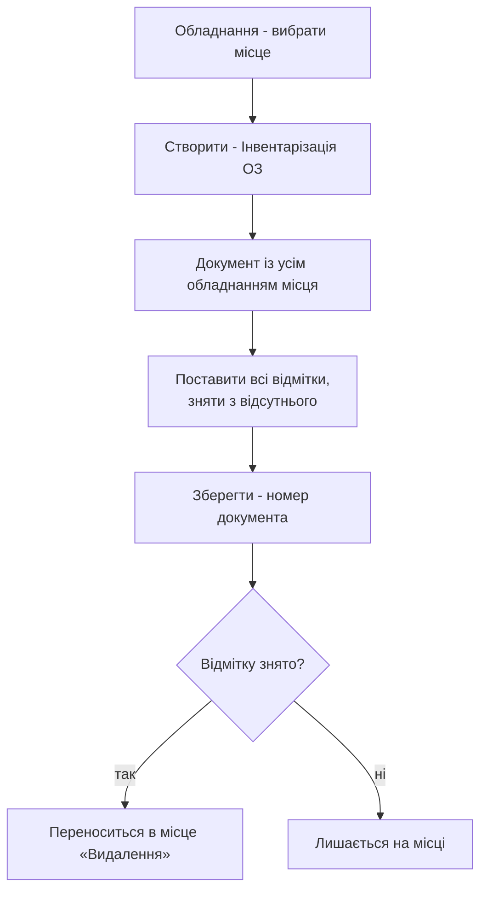

# Інвентаризація обладнання

Документ, яким фіксують, що з переліку обладнання місця фактично на місці.
Усе, чого не знайшли, після збереження переїжджає в службове місце
«Видалення». Документ можна перезберігати: якщо знайшли, відмітку
повертають — і обладнання повертається на своє місце.

Назад до [iERP](README.md) · [Обладнання](equipment.md).

| Історія | Хто |
|---|---|
| Провести інвентаризацію вузла | мережевий відділ |
| Повернути знайдене обладнання | мережевий відділ |
| Знайти документ інвентаризації | мережевий відділ |



---

### Провести інвентаризацію вузла

**Мережевий відділ.** Інженер на вузлі. На вкладці «Обладнання» обирає місце
зліва, далі «Створити» → «Інвентарізація ОЗ». Відкривається новий документ,
уже наповнений усім обладнанням цього місця, з модулями під своїм
обладнанням.

У новому документі відмітки «Наявність» порожні. Найпростіше спершу поставити
всі відмітки кнопкою з галочкою, а потім зняти відмітки з того, чого на
місці немає, і зберегти дискетою. Документ отримує номер; усе, з чого знято
відмітку, переноситься в «Видалення».

| Елемент | Що робить |
|---|---|
| Дискета | зберегти документ і перенести відсутнє в «Видалення» |
| Кошик | видалити документ, з підтвердженням |
| Номер і «від» | номер присвоюється при першому збереженні; дата й час документа |
| Місце | місце, по якому йде інвентаризація |
| Квадрат | зняти всі відмітки, з підтвердженням |
| Квадрат з галочкою | поставити всі відмітки, з підтвердженням |
| Автор | праворуч, хто створив документ |
| Інв. номер | власний номер, під ним дрібним — номер з 1С |
| Назва | вкладені модулі з відступом і тегом — номером обладнання, у яке вони вставлені |
| Наявність | відмітка «на місці» |

Переноситься лише те, з чого відмітку **явно знято**. Рядок, якого в новому
документі ніхто не торкався, залишиться на місці навіть з порожньою
відміткою.

**Технічно**

Документ — тип `15` у PostgreSQL: шапка в `docs` (`data.div` — місце), рядки в
`rows` з `data.available`. Наповнення — `GET /equipment/ls-div/:div`,
збереження — `POST /doc-update` (рядки щоразу перезаписуються повністю).
Після збереження спрацьовує обробник для типу `15`: обладнання з
`available = false` переноситься в місце «Видалення» (`dict.id = 6273`), а його
попереднє місце записується в таблицю `registry`. Детальніше — у
[data.md](data.md#документи).

| Де в коді | Що робить |
|---|---|
| `ierp-ui/src/pages/equipment/equipment.js` → `addOZdoc()` (рядок 141) | новий документ з вибраним місцем |
| `ierp-ui/src/pages/equipment/Doc.js` → `reload()`, `save()` | наповнення і збереження |
| `ierp-ui/src/pages/equipment/Doc.vue` → `checkAll()` (рядок 10) | поставити або зняти всі відмітки |
| `ierp-server/models/docs.js` → `update()` (рядок 55) | запис документа і рядків |
| `ierp-server/models/blogic.js` → `createRecoveryPoint()` (рядок 4) | перенос у «Видалення» і відкат |

```js
// ierp-ui/src/pages/equipment/equipment.js — новий документ одразу наповнюється
addOZdoc() {
  const name = meta.info.value.find(_ => _.id === 15)?.name + ` [ Новий ]`
  nav.openTab(`/eq-doc/0`, name).then(model => {
    model.div.value = div.value.id      // місце, вибране зліва
    model.reload()                      // GET /equipment/ls-div/<місце>
  })
}
```

```js
// ierp-ui/src/pages/equipment/Doc.js — збережений документ при відкритті
data.rows.forEach(row => { if (!row.data.hasOwnProperty('available')) row.data.available = true })
// тому рядок, якого ніхто не торкався, після повторного відкриття виглядає відміченим
```

```js
// ierp-server/models/docs.js, update() — скорочено
ret = await conn.one(insert(doc, null, 'docs') + ' RETURNING num, id, date')    // або update ... where id
await conn.none(`delete from rows where doc_id = ${ret.id}`)                     // рядки — щоразу заново
await conn.none(insert(req.body.rows, ['doc_id', 'dict_id', 'data', 'ord'], 'rows'))
await bl.invoke('update', req.body)                                              // обробник 'update-15'
```

---

### Повернути знайдене обладнання

**Мережевий відділ.** Пропажа знайшлася. Документ інвентаризації відкривають
знову, ставлять відмітку і зберігають. Обладнання повертається в те місце,
де воно було до інвентаризації: застосунок памʼятає це місце в самому
документі.

Видалення документа інвентаризації перенесене обладнання **не повертає** — воно
лишається в «Видаленні», і повертати його доведеться вручну в картці.

**Технічно**

При кожному збереженні обробник спершу відкатує попередній перенос за
записами `registry` цього документа, потім робить новий. Видалення
(`GET /doc-del/:id`) прибирає лише `docs` і `rows`, записи `registry` і звʼязки
лишаються як є.

```js
// ierp-server/models/blogic.js
const createRecoveryPoint = async function(id, mids) {
  // 1) відкотити попередній перенос цього документа
  const count = await conn.one(`select count(*) cnt from registry where doc_id = $1 and tbl = 'rels'`, [id])
  if (count > 0) {
    await conn.none(`update rels set mid = (h.val->>'mid')::int from (
      select val from registry where tbl = 'rels' and doc_id = $1
    ) h where rels.id = (h.val->>'id')::int and rels.rel = 16`, [id])
    await conn.none(`delete from registry where doc_id = $1 and tbl = 'rels'`, [id])
  }
  // 2) запамʼятати поточні місця відсутнього і перенести його в «Видалення» (6273)
  if (mids.length > 0) {
    await conn.none(`insert into registry (doc_id, tbl, val)
        select ${id} doc_id, 'rels' tbl, row_to_json(rels)::jsonb val from rels
        where id in (${mids.join(',')}) and rel = 16`)
    await conn.none(`update rels set mid = 6273 where id in (${mids.join(',')}) and rel = 16`)
  }
}
const methods = {
  'update-15': async function(doc) {
    const unav = doc.rows.filter(row => row.data.hasOwnProperty('available') && !row.data.available)
                         .map(row => row.dict_id)
    await createRecoveryPoint(doc.id, unav)
  }
}
```

---

### Знайти документ інвентаризації

**Мережевий відділ.** Вкладка «Документи» розділу «Обладнання» —
усі документи інвентаризації, від нових до старих: номер, дата, місце
зберігання, автор. Подвійне натискання відкриває документ окремою вкладкою.
Кнопка оновлення перечитує список.

**Технічно**

`GET /doc-list-simple/15` — документи типу `15`, від нових до старих.

```js
// ierp-ui/src/pages/equipment/equipment.js
const DOCS = {
  items: ref([]),
  load() { ae.get(`/doc-list-simple/${15}`).then(({data}) => DOCS.items.value = data) }
}
```
