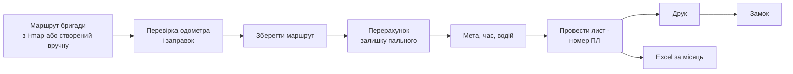
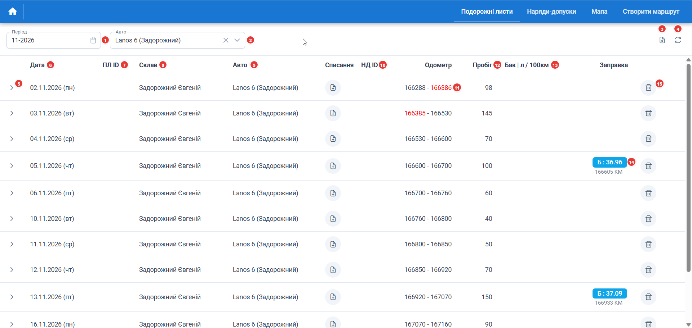
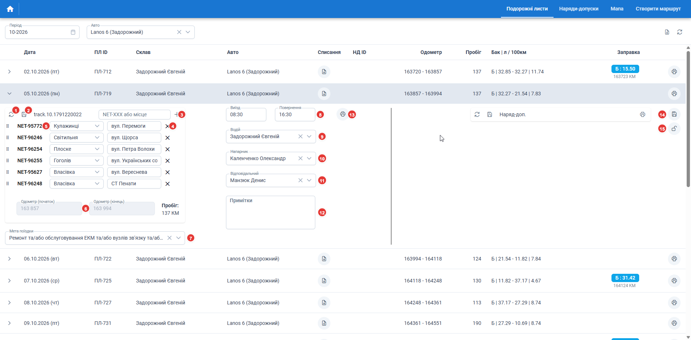
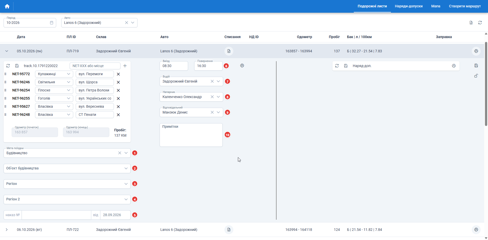
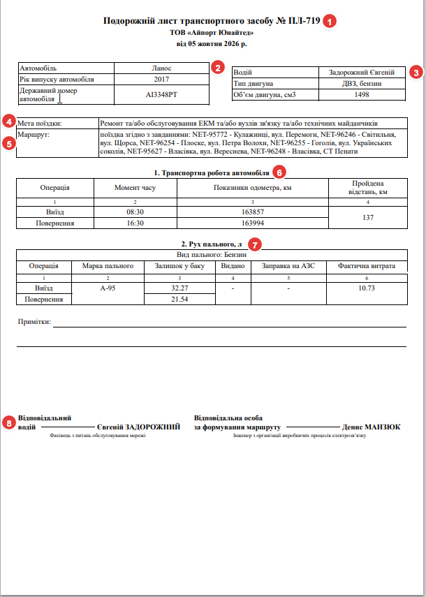
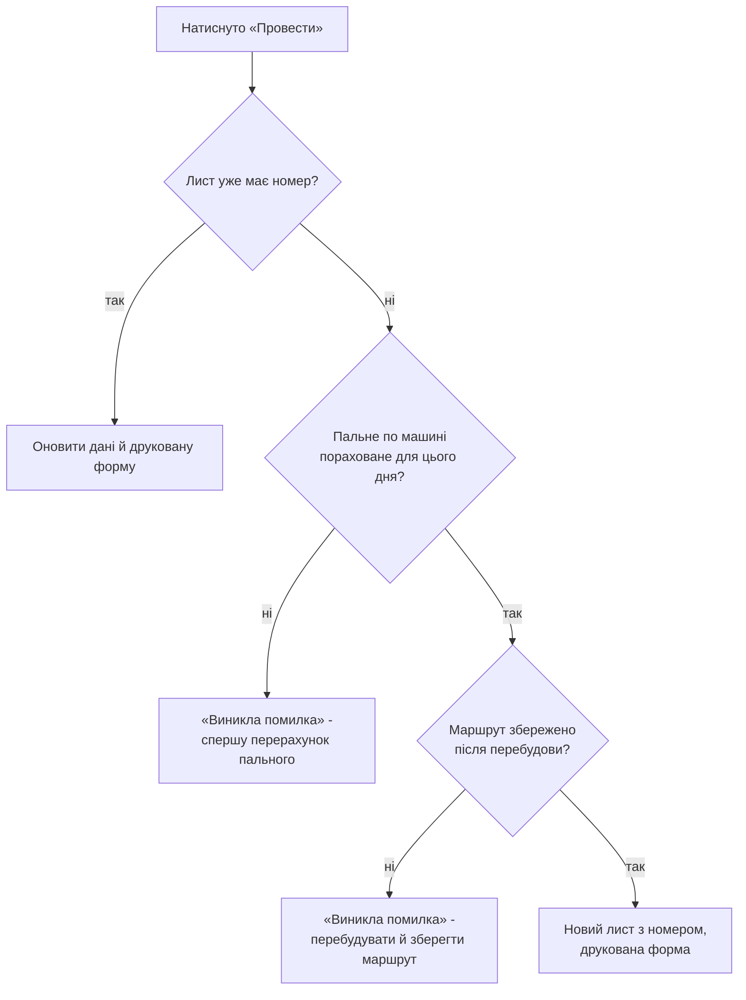
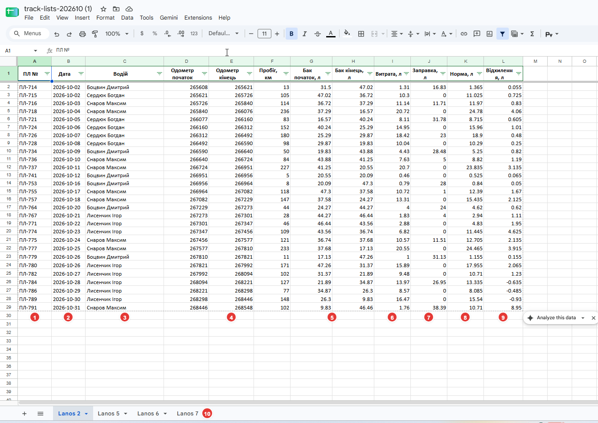

# Подорожні листи

Головний екран iERP. Тут видно всі маршрути бригад за місяць, які бригада
вела в [i-map](../imap/timesheet.md) або які створили в iERP вручну. Кожен
маршрут перевіряють, рахують пальне, проводять як подорожній лист із номером,
друкують і закривають від змін. Наприкінці місяця звідси ж вивантажують звіт
в Excel.

Назад до [iERP](README.md).

| Історія | Хто |
|---|---|
| Переглянути листи за місяць і знайти розриви одометра | мережевий відділ |
| Виправити маршрут, одометр і заправки | мережевий відділ |
| Порахувати залишок пального в баку | мережевий відділ |
| Заповнити мету поїздки, час і людей | мережевий відділ |
| Провести лист і надрукувати | мережевий відділ |
| Закрити лист від змін | мережевий відділ |
| Вивантажити звіт за місяць в Excel | мережевий відділ |
| Видалити зайвий маршрут | мережевий відділ |

Розділ **«Подорожні листи»** → вкладка **«Подорожні листи»**.



Порядок важливий: після перерахунку пального одометр і заправки в картці вже
не правляться, а провести лист без перерахунку не вийде.

---

### Переглянути листи за місяць і знайти розриви одометра

**Мережевий відділ.** Працівник обирає місяць — у таблиці зʼявляються всі маршрути
за цей місяць, по днях. Далі обирає автомобіль: список звужується до однієї
машини, і застосунок починає звіряти одометр між днями. Кінець одного дня має
дорівнювати початку наступного. Якщо ні — обидва числа стають червоними.



| № | Елемент | Що показує |
|:-:|---|---|
| **1** | Період | місяць, за який показати маршрути |
| **2** | Авто | одна машина; лише тоді вмикається перевірка одометра |
| **3** | Excel | звіт за місяць — див. нижче |
| **4** | Оновити | перечитати список |
| **5** | Стрілка | розкрити картку листа |
| **6** | Дата | день маршруту з днем тижня; субота й неділя — помаранчевим |
| **7** | ПЛ ID | номер проведеного листа; порожньо, якщо лист ще не проводили |
| **8** | Склав | хто вів маршрут (водій) |
| **9** | Авто | машина маршруту |
| **10** | НД ID | номер наряду-допуску, якщо його колись привʼязали до цього дня в картці листа |
| **11** | Одометр | початок - кінець дня; **червоним** — розрив із сусіднім днем |
| **12** | Пробіг | кілометри за день |
| **13** | Бак, л на 100 км | по кожному паливу: залишок на початок і кінець дня і витрата на 100 км. Порожньо, доки пальне не пораховане |
| **14** | Заправка | літри по кожній заправці дня, під ними — одометр заправки. **Синя кнопка** — заправка до повного бака |
| **15** | Кошик | видалити маршрут — див. нижче |

Коли лист проведено, на місці кошика зʼявляється кнопка друку.

Червоне число — сигнал, що день пропустили, ввели показник із помилкою або
машина їздила без листа. Без вибраного автомобіля в таблиці перемішані різні
машини, тому перевірка не вмикається.

**Технічно**

Маршрути беруться з CouchDB `timesheets` (вид `route/by-date-car`, ключ
`РРРРММ.авто`). Для тих, що вже проведені, сервер додає з PostgreSQL номер,
замок, друковану форму й номер наряду. Залишок у баку перераховується з полів
`tank` маршруту при кожному завантаженні. Запит —
`GET /track-list/get-documents/:period/:carId?`. Розриви одометра рахує сам
екран, на сервері вони ніде не зберігаються.

| Де в коді | Що робить |
|---|---|
| `ierp-ui/src/models/route-list.js` → `loadDocs()` (рядок 31) | запит за періодом і авто; викликається з `watch(date)` і `watch(car)` |
| `ierp-ui/src/pages/Docs.vue` → `odoMismatchMap` (рядок 300) | розриви одометра між сусідніми днями |
| `ierp-server/models/track-list.js` → `getTracklists()` (рядок 181) | вид CouchDB плюс дані з PostgreSQL |

```js
// ierp-ui/src/pages/Docs.vue — розриви одометра
const odoMismatchMap = computed(() => {
  if (!rl.car?.id) return {}            // авто не вибране — не звіряємо
  const rows = rl.tracksFiltered.value.slice().sort((a, b) => new Date(a.date) - new Date(b.date))
  const map = {}
  for (let i = 1; i < rows.length; i++) {
    const prev = rows[i - 1]
    const curr = rows[i]
    if (prev.odo?.finish !== curr.odo?.start) {
      if (!map[prev._id]) map[prev._id] = {}
      map[prev._id].finish = true          // червоний кінець попереднього дня
      if (!map[curr._id]) map[curr._id] = {}
      map[curr._id].start = true           // червоний початок наступного
    }
  }
  return map
})
```

```js
// ierp-server/models/track-list.js, getTracklists() — скорочено
couch.getView('timesheets', 'route', 'by-date-car', {
  startkey: `${req.params.period}.${req.params.carId ? req.params.carId : ''}`,
  endkey:   `${req.params.period}.${req.params.carId ? req.params.carId : ''}` + '￰',
  include_docs: true
})
// для кожного маршруту:
if (_.doc.wpPgId) _.doc.wpPgNum = /* select num from docs where id = wpPgId */
if (_.doc.rlPgId) {
  // select id, print as prnt, num, raw->'print' as print, locked from docs where id = rlPgId
  _.doc.print = pgData.print          // поля картки
  _.doc.locked = pgData.locked        // замок
  _.doc.num = pgData.num              // «ПЛ ID»
  _.doc.print_exists = !!pgData.prnt  // чи показувати кнопку друку
}
if (_.doc.tank) _.doc.tank = fuel.computeTank(_.doc)          // колонка «Бак | л / 100км»
_.doc.date = new Date(parseInt(_.doc._id.split('.')[2]) * 1000) // дата — з _id маршруту
```

Рядки сортуються за днем із `parent` (`timesheet.<водій>.<РРРРММДД>`), а в межах дня — за числом із номера ПЛ.

---

### Виправити маршрут, одометр і заправки

**Мережевий відділ.** Стрілка зліва розкриває рядок. Ліворуч — картка маршруту:
перелік задач і місць за день, одометр і заправки. Розкритим може бути лише
один рядок: відкриття наступного згортає попередній.



| № | Елемент | Що робить |
|:-:|---|---|
| **1** | Перебудувати маршрут | заново збирає перелік задач і адрес із маршруту бригади |
| **2** | Зберегти маршрут | записує перелік, одометр і заправки назад у маршрут бригади; перед записом показує, що саме змінилося |
| **3** | Поле «NET-XXX або місце» і плюс | `NET-12345` додасть задачу з регіоном і вулицею з Jira, будь-який інший текст — окремий рядок |
| **4** | Рядок маршруту | номер задачі, регіон і вулиця; рядки перетягуються за ручку зліва — порядок піде в друковану форму; хрестик прибирає рядок |
| **5** | Номер задачі | **зелений** — задачу закрив цей водій саме в цей день, **червоний** — ні; натискання відкриває задачу в Jira |
| **6** | Одометр (початок), Одометр (кінець), Пробіг | показники дня і різниця; сірі — уже не правляться (див. нижче) |
| **7** | Мета поїздки | див. «Заповнити мету поїздки» |
| **8** | Виїзд, Повернення | час у друкованій формі |
| **9** | Водій | |
| **10** | Напарник | |
| **11** | Відповідальний | |
| **12** | Примітки | |
| **13** | Друк | друкована форма листа |
| **14** | Провести лист | див. «Провести лист і надрукувати» |
| **15** | Замок | див. «Закрити лист від змін» |

Якщо того дня були заправки, під одометром для кожної є поля «Одометр АЗС»,
літри, «Повний бак» і «Кінець дня». Праворуч у картці — панель
«Наряд-доп.»; наряди тепер оформлюють окремо, на вкладці
[«Наряди-допуски»](work-permits.md).

Маршрут треба **хоча б раз перебудувати й зберегти** до проведення листа:
маршрут з i-map чи зі створення вручну приходить без переліку для друку, і
провести такий лист не вийде.

Одометр і заправки правляться, лише доки по машині не пораховане пальне і лист
не проведено. Далі ці поля сірі: від них залежить залишок у баку по всіх
наступних днях машини, і зміна одного дня зсунула б розрахунок.

**Технічно**

Перебудова — `GET /track-list/route/:id`: iERP питає iCRM, той бере задачі
маршруту, дописує адреси й перевіряє в Jira, ким і коли кожну задачу закрито
(див. [integrations.md](integrations.md#icrm-і-jira)). Збереження —
`POST /track-list/save/:id`: сервер записує в документ маршруту в CouchDB поле
`rl` (перелік для друку), `odo` і зміни в `refill[]`. Заправку шукає за часом і
видом пального й синхронно править її в зупинці АЗС (`path[].fuel`).

| Де в коді | Що робить |
|---|---|
| `ierp-ui/src/components/RouteDetails.vue` → `build()` (рядок 115), `parse()` (рядок 104) | перебудова: розбирає рядок від iCRM на задачі й місця |
| там же → `addDest()` (рядок 126) | додати задачу або місце |
| там же → `save()` (рядок 92) | показати, що змінилося, і зберегти |
| там же → `refillDisabled` (рядок 58) | коли одометр і заправки сірі |
| `ierp-server/models/track-list.js` → `save()` (рядок 82) | запис у CouchDB |

iCRM повертає маршрут одним рядком, і екран розбирає його сам:

```js
// ierp-ui/src/components/RouteDetails.vue
// "NET-95772 - Кулажинці, вул. Перемоги, \nNET-96246 - Світильня, вул. Щорса"
const parse = function(data) {
  return data.split(', \n').map(_ => {
    if (_.startsWith('NET')) {
      const [jira, descr] = _.split(' - ').map(_ => _?.trim())
      const [region, street] = descr ? descr.split(',').map(_ => _?.trim()) : [null, null]
      return {jira: jira.replace(',', ''), region, street}
    } else {
      return {description: _}            // не задача — довільне місце
    }
  })
}

// поля одометра й заправок блокуються, щойно є замок, номер ПЛ або пораховане пальне
const refillDisabled = computed(() => !!(props.doc.locked || props.doc.rlPgId || props.doc.tank))
```

```js
// ierp-server/models/track-list.js, save() — заправку зіставляють за часом і видом пального
const byKey = new Map((req.body.refill || []).map(_ => [`${_.time}.${_.fuel}`, _]))
const edits = (data.refill || []).map(r => ({
  r,
  inp: byKey.get(`${r.time}.${r.fuel}`),
  // зупинка АЗС у path[], з якої взялася ця заправка
  stops: (data.path || []).filter(p => p.fuel && (p.status?.finish === r.time || p.fuel.odo === r.odo))
})).filter(_ => _.inp)
// далі нові odo / liters / full / dayend пишуться і в refill[], і в path[].fuel
await couch.createDocument('timesheets', data, req.params.id)   // той самий _id — оновлення
```

---

### Порахувати залишок пального в баку

**Мережевий відділ.** Літри відомі з чеків, але бак між днями ніхто не міряє. Тому
залишок рахується від заправки до повного бака: у цю мить бак повний, і від
неї можна відняти витрату й додати наступні заправки.

У колонці «Заправка» кожна заправка до повного бака — синя кнопка. Працівник
натискає її на останній повній заправці, яку треба врахувати. Після
підтвердження «Перерахувати залишки в баку та витрати палива по вибраному
автомобілю?» застосунок рахує залишки на початок і кінець кожного дня й
оновлює таблицю.

Порахуються ті дні, що лежать між двома заправками до повного. Дні після
останньої повної заправки чекають наступної: поки її немає, залишок на них
порахувати нема з чого.

Як саме рахується витрата і залишок, з прикладом — у [fuel.md](fuel.md).

**Технічно**

`POST /track-list/fuel-calc` з авто, паливом і одометром натиснутої заправки.
Сервер бере всі маршрути машини з меншим одометром, будує відрізки між
заправками до повного і записує `tank.<паливо>_start` / `_finish` у кожен
маршрут від початку останнього відрізка. Потрібні щонайменше дві заправки до
повного, інакше розрахунок мовчки нічого не змінює (лише запис у лог сервера).

| Де в коді | Що робить |
|---|---|
| `ierp-ui/src/pages/Docs.vue` → `fuelCalc()` (рядок 340) | підтвердження |
| `ierp-ui/src/models/route-list.js` → `fuelCalc()` (рядок 96) | запит і перечитування списку |
| `ierp-server/models/fuel.js` → `calc_fuel_consumption()` (рядок 152) | сам розрахунок, детально — у [fuel.md](fuel.md#код) |

```js
// ierp-ui/src/models/route-list.js — у запит іде одометр натиснутої заправки
fuelCalc(doc, row) {
  ae.post(`/track-list/fuel-calc`, {car: doc.car, fuel: row.fuel, odo: row.odo}).then(({data}) => {
    loadDocs()
  })
}
```

Синя кнопка — це заправка з `r.full = true` (`Docs.vue`, колонка «Заправка»); звичайна заправка показується текстом і не натискається.

---

### Заповнити мету поїздки, час і людей

**Мережевий відділ.** У розкритій картці під маршрутом обирається мета поїздки, а
праворуч — час виїзду й повернення, водій, напарник, відповідальний і примітки.
Усе це піде в друковану форму.



| № | Поле | Що в ньому |
|:-:|---|---|
| **1** | Мета поїздки | зі списку; від вибору залежать поля нижче |
| **2** | Об'єкт будівництва | лише для «Будівництво»: грунтової ВОЛЗ, повітряної ВОЛЗ або ЕКМ |
| **3** | Регіон | для «Будівництво» і «Модернізація ЕКМ» |
| **4** | Регіон 2 | лише для «Будівництво» |
| **5** | Наказ № і дата | для «Будівництво» і «Модернізація ЕКМ» |
| **6** | Виїзд, Повернення | час у друкованій формі; якщо бригада не закривала день, типово 8:30 — 16:30 |
| **7** | Водій | підставляється з маршруту, можна замінити |
| **8** | Напарник | так само |
| **9** | Відповідальний | так само |
| **10** | Примітки | вільний текст |

Для мети «Виконання господарських завдань» під метою зʼявляється поле
«Суб-мета» — можна обрати кілька значень.

У друкованій формі регіон отримує префікс: «м.» для Борисполя, «селище» для
Баришівки, «с.» для решти.

**Технічно**

Список цілей і суб-цілей — записи `dict` з id `6435` і `6445` у PostgreSQL;
поля деталей задані в коді екрана (`ierp-ui/src/pages/Docs.vue`). Типові
значення для ще не проведеного листа дає `GET /track-list/expanded/:docId`:
авто з довідника, водій за маршрутом, відповідальний — працівник із ключем
Jira `dm`, час — з маршруту або 8:30 — 16:30.

```js
// ierp-ui/src/pages/Docs.vue — від мети залежать додаткові поля
const BUILD_PURPOSE = 'Будівництво'
const DETAILED_PURPOSES = ['Модернізація ЕКМ', BUILD_PURPOSE]
const BUILD_OBJECTS = ['грунтової ВОЛЗ', 'повітряної ВОЛЗ', 'ЕКМ']
const onPurposeChange = (data, val) => {
  if (val !== 'Виконання господарських завдань') data.print.subpurposes = []
  if (!DETAILED_PURPOSES.includes(val)) {
    delete data.print.details             // деталі лише для двох цілей
    return
  }
  if (!data.print.details) data.print.details = { region: null, orderNum: '', orderDate: '' }
  if (val !== BUILD_PURPOSE) {
    delete data.print.details.object      // об'єкт і другий регіон — лише будівництво
    delete data.print.details.region2
  }
}
```

```js
// ierp-server/models/track-list.js, getPrint() — типові значення ще не проведеного листа
print = {
  car: availableCars.find(car => car.id === doc.car),
  driver: driversNames.find(dr => dr.jira_key === doc.owner),
  responsible: driversNames.find(dr => dr.jira_key === 'dm'),
  time: doc.time
    ? {start: dayjs(doc.time.start), finish: dayjs(doc.time.finish)}
    : {start: dayjs(date, 'YYYYMMDD').hour(8).minute(30), finish: dayjs(date, 'YYYYMMDD').hour(16).minute(30)},
  ...
}
```

```js
// ierp-server/models/fuel.js — префікс регіону в друкованій формі
const regionLabel = function(region) {
  const regType = region.startsWith('Борис') ? 'м.' : region.startsWith('Бариш') ? 'селище' : 'с.'
  return `${regType} ${region}`
}
```

---

### Провести лист і надрукувати

**Мережевий відділ.** Кнопка-дискета праворуч від картки (**[14]** на знімку картки)
проводить лист. Лист
отримує номер (колонка «ПЛ ID»), з нього складається друкована форма, і в
рядку зʼявляється кнопка друку. Повторне натискання вже нічого нового не
створює — лише оновлює той самий лист і його друковану форму.

Друк відкриває форму «Подорожній лист транспортного засобу № …» в новому
вікні й одразу викликає друк браузера.





| № | Розділ форми | Звідки |
|:-:|---|---|
| **1** | Номер і дата листа | номер ПЛ, день маршруту |
| **2** | Автомобіль, рік, державний номер | довідник автопарку |
| **3** | Водій, тип і обʼєм двигуна | картка листа, довідник автопарку |
| **4** | Мета поїздки | мета з деталями й суб-цілями |
| **5** | Маршрут | «поїздка згідно з завданнями» — перелік, збережений у картці |
| **6** | Транспортна робота | виїзд і повернення: час, одометр, пройдена відстань |
| **7** | Рух пального | марка, залишок у баку на виїзді й поверненні, заправка, фактична витрата |
| **8** | Підписи | водій і відповідальна особа з посадами |

Форма містить **одне паливо** — перше з порахованих.

**Технічно**

`POST /track-list/insert/:doc`. Сервер записує напарника в маршрут, і якщо
листа ще немає — створює документ типу `9` у PostgreSQL (`raw.origin` — копія
маршруту, `raw.print` — поля картки), а його id пише назад у маршрут
(`rlPgId`). Документ створюється, лише коли в маршруті є пораховане пальне
(`tank`) для одного виду палива. Друкована форма складається з шаблону
`ierp-server/docs/track-list/route-order.01.html` і зберігається в колонці
`print`. Друк —
`GET /track-list/print/:docId`; ручні правки з колонки `delta` мають перевагу
над `print` (див. [fuel.md](fuel.md#виправлення-одометра-скриптами)).

| Де в коді | Що робить |
|---|---|
| `ierp-ui/src/models/route-list.js` → `save(row)` (рядок 128) | запит і повідомлення «Зміни збережено» або «Виникла помилка» |
| `ierp-server/models/track-list.js` → `insertTL()` (рядок 151) | проведення |
| `ierp-server/models/fuel.js` → `createTLRecord()` (рядок 62) | новий документ типу `9` |
| `ierp-server/models/fuel.js` → `createPDFObj()` (рядок 72) | дані друкованої форми |
| `ierp-server/models/track-list.js` → `makePDF()` (рядок 225) | HTML для друку |

Чому без порахованого пального і без збереженого маршруту виходить «Виникла помилка»:

```js
// ierp-server/models/fuel.js, createTLRecord()
async createTLRecord(doc_couch, print){
  let rlPgId = null
  if (doc_couch.tank && Object.keys(doc_couch.tank).length === 2){   // рівно <паливо>_start і _finish
    const raw = {raw: {origin: doc_couch, print: print}, type: 9}
    rlPgId = await conn.one(insert(raw, null, 'docs') + ' RETURNING id').then(data => data.id)
    Object.assign(doc_couch, {rlPgId})
    await couch.createDocument('timesheets', doc_couch, doc_couch._id)   // id листа — назад у маршрут
  }
  return rlPgId     // null, якщо пальне не пораховане
}
```

Далі `insertTL()` читає документ за `rlPgId`; з `null` цей запит падає, і сервер відповідає `500`. Друга причина — `createPDFObj()` будує маршрут для друку з `doc_couch.rl.map(...)`; якщо маршрут не зберігали в картці, поля `rl` немає, і запит теж падає.

```js
// ierp-server/models/track-list.js, makePDF() — ручні правки мають перевагу
const doc = await conn.one('select print, delta from docs where id = $1', [req.params.docId])
if (doc.delta?.odo) doc.print.odo = doc.delta.odo
if (doc.delta?.tank) { /* start, finish, usage, refill з delta */ }
const template = handlebars.compile(fs.readFileSync(`${__dirname}/../${doc.print.tpl}`, "utf8"))
res.send(template(doc.print))
```

---

### Закрити лист від змін

**Мережевий відділ.** Після проведення під дискетою зʼявляється відкритий замок
(**[15]** на знімку картки).
Натискання закриває лист: усі поля картки стають лише для читання, дискета
неактивна. Повторне натискання відкриває лист знову.

**Технічно**

`POST /track-list/modify-lock` пише в `docs.locked` документа листа. Замок
показується, лише коли друкована форма вже збережена (`raw.print.saved`).

```js
// ierp-ui/src/models/route-list.js
modifyLock(row){
  const lock = row.locked ? null : "ownerId"      // у locked пишеться рядок "ownerId", а не id працівника
  ae.post(`/track-list/modify-lock`, {lock: lock, rlPgId: row.rlPgId}).then(({data}) => loadDocs())
}
```

```js
// ierp-server/models/track-list.js, modifyLockTL()
conn.none(`update docs set locked = $1 where id = $2`, [lock, rlPgId])
```

Хто саме закрив лист, база не памʼятає: у `locked` завжди той самий рядок.

---

### Вивантажити звіт за місяць в Excel

**Мережевий відділ.** Кнопка Excel угорі праворуч формує файл `track-lists-РРРРММ.xlsx`
за вибраний місяць. Кожен автомобіль — окремий аркуш, у рядках — проведені
листи.



| № | Колонка | Що в ній |
|:-:|---|---|
| **1** | ПЛ № | номер листа |
| **2** | Дата | день листа |
| **3** | Водій | з листа |
| **4** | Одометр початок, кінець, Пробіг | з листа |
| **5** | Бак початок, кінець | залишок пального |
| **6** | Витрата | фактична витрата за день |
| **7** | Заправка | літри за день |
| **8** | Норма | пробіг × 10,5 л / 100 км, формулою Excel |
| **9** | Відхилення | витрата мінус норма, формулою Excel |
| **10** | Аркуші | окремий аркуш на кожен автомобіль |

У файл потрапляють лише проведені листи. Маршрут без номера ПЛ у звіт не
входить. Якщо за місяць немає жодного проведеного листа, застосунок покаже «За
вибраний місяць немає ПЛ». Без вибраного періоду — «Виберіть період».

**Технічно**

`GET /track-list/export/:period` (`models/rl-excel.js`). Документи типу `9`
відбираються за датою з друкованої форми. Ручні правки з `delta` мають
перевагу над `print`. Норма 10,5 л / 100 км однакова для всіх машин і задана в
коді.

```js
// ierp-server/models/rl-excel.js — скорочено
const NORM_LKM = 10.5
// відбір: docs.type = 9 і дата друкованої форми (unix-секунди) у межах місяця
//   AND (print->>'date')::bigint >= EXTRACT(EPOCH FROM $1::date)
//   AND (print->>'date')::bigint <  EXTRACT(EPOCH FROM $1::date + INTERVAL '1 month')
// одометр і бак: COALESCE(delta->..., print->...) — ручна правка має перевагу

const norm = odoTotal * NORM_LKM / 100
line.getCell('norm_usage').value = {
  formula: `${col('odo_total')}${line.number}*${NORM_LKM}/100`,   // у файлі — формула, а не число
  result: exact(norm)
}
```

Назва аркуша — коротка назва авто без дужок, обрізана до 31 символу (обмеження Excel); однакові назви отримують « (2)», « (3)».

---

### Видалити зайвий маршрут

**Мережевий відділ.** Якщо маршрут створили двічі або помилково, кошик у рядку
видаляє його після підтвердження «Видалити треклист за … водій - …?».

Кошика немає, щойно маршрут проведено як лист або до нього привʼязано
наряд-допуск: такий день уже має документи, і видаляти його не можна.

**Технічно**

`POST /track-list/del-couch/:docId` видаляє документ маршруту з CouchDB
`timesheets`. Документи в PostgreSQL не зачіпаються.

```html
<!-- ierp-ui/src/pages/Docs.vue — кошик лише для маршруту без документів -->
<Button v-if="!data.wpPgNum && !data.rlPgId" icon="pi pi-trash" @click="rl.delTL(data)" />
```

```js
// ierp-server/models/track-list.js, delCouchTl()
const { data } = await couch.getDocument('timesheets', req.params.docId)
await couch.deleteDocument('timesheets', req.params.docId, data._rev)   // потрібна поточна ревізія
```

