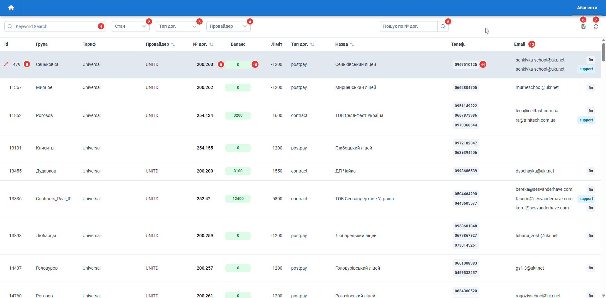
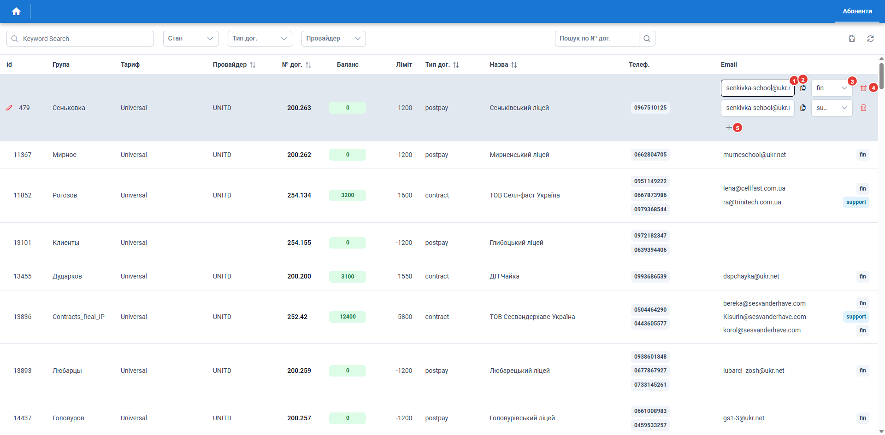
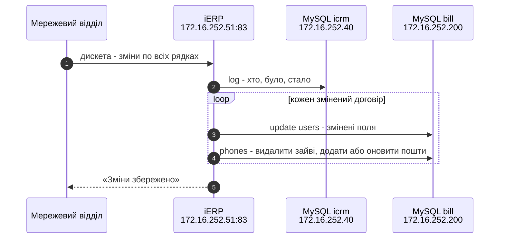

# Абоненти

Таблиця договорів для швидкої масової правки: тариф, група, провайдер, стан,
ліміт балансу, тип договору, назва і пошти. Тут не потрібно відкривати
картку кожного абонента — правки вносяться прямо в комірки й зберігаються
однією кнопкою для всіх змінених договорів.

Без пошуку показуються договори, що **не є офертою** і не входять до групи з
id 1, — на практиці це юридичні особи й договори з окремими умовами. Будь-який
інший договір знаходиться пошуком за номером.

Повна картка абонента — в iCRM: [Пошук і картка абонента](../../ui_users_search.md).

Назад до [iERP](README.md).

| Історія | Хто |
|---|---|
| Знайти договір | мережевий відділ |
| Змінити тариф, групу, стан або ліміт | мережевий відділ |
| Додати пошту для рахунків або підтримки | мережевий відділ |
| Зберегти зміни | мережевий відділ |

Розділ **«Абоненти»**.

---

### Знайти договір

**Мережевий відділ.** Угорі — пошук по всіх видимих колонках, фільтри за
станом, типом договору і провайдером, а посередині — пошук за точним номером
договору. Номер договору в таблиці — посилання: він відкриває картку абонента
в iCRM на вкладці задач.



| № | Елемент | Що робить |
|:-:|---|---|
| **1** | Keyword Search | пошук тексту в усіх колонках |
| **2** | Стан | `on` або `off` |
| **3** | Тип дог. | `oferta`, `contract`, `postpay` |
| **4** | Провайдер | IPORT або UNITD |
| **5** | Пошук по № дог. | завантажує один договір за номером — будь-якого типу, включно з офертою |
| **6** | Зберегти | див. «Зберегти зміни» |
| **7** | Оновити | повертає початковий список і скидає пошук за номером |
| **8** | id | id абонента; червоний олівець — у рядку є незбережені зміни |
| **9** | № дог. | номер договору; натискання відкриває картку абонента в iCRM |
| **10** | Баланс | зелений — стан `on`, червоний — `off` |
| **11** | Телеф. | телефони договору, лише для перегляду |
| **12** | Email | пошти з категорією — див. нижче |

**Технічно**

`GET /nd/contracts` — таблиця `users` бази `bill` з умовою
`contract_type <> 'oferta' and grp <> 1`; з номером — `GET /nd/contracts/:contract`.
Пошти — записи `phones` з `type = 'email'`. Список провайдерів (`1` — IPORT,
`14` — UNITD) задано в коді екрана.

| Де в коді | Що робить |
|---|---|
| `ierp-ui/src/pages/Contracts.vue` → `load()` (рядок 195) | завантаження і знімок «як було» |
| там же → `filters` (рядок 174), `providers` (рядок 182) | фільтри |
| `ierp-server/routes/nd.js` (рядок 4) | вибірка договорів |

```js
// ierp-ui/src/pages/Contracts.vue, load() — до кожного рядка кладеться копія початкових значень
data.forEach(_ => _.origin = {
  paket: _.paket, grp: _.grp, fio: _.fio, provider_id: _.provider_id, phone: _.phone,
  email: JSON.parse(JSON.stringify(_.email)),        // глибока копія — пошти правляться в масиві
  state: _.state, contract_type: _.contract_type, limit_balance: _.limit_balance,
})
```

```sql
-- ierp-server/routes/nd.js — без номера договору
select f.email, u.id, u.provider_id, u.paket, u.grp, u.contract, u.fio, u.balance,
       u.limit_balance, u.state, u.phone, u.contract_type
  from users u left join (
    select mid, JSON_ARRAYAGG(JSON_OBJECT('email', phone, 'category', category)) AS email
      from phones where type = 'email' group by mid
  ) f on u.id = f.mid
 where contract_type <> 'oferta' and grp <> 1
```

---

### Змінити тариф, групу, стан або ліміт

**Мережевий відділ.** Натискання на комірку відкриває редактор. Змінені
рядки позначаються червоним олівцем біля id, доки їх не збережено.

| Колонка | Що можна змінити |
|---|---|
| Група | група абонентів зі списку |
| Тариф | тариф зі списку |
| Провайдер | IPORT або UNITD |
| Баланс | натискання відкриває вибір **стану** `on` / `off`; сам баланс тут не змінюється |
| Ліміт | ліміт балансу, число |
| Тип дог. | `oferta`, `contract`, `postpay` |
| Назва | назва абонента |

**Технічно**

Список тарифів — `bill.plans2` (з непорожньою назвою), груп — `bill.user_grp`;
запит `GET /nd/meta`. Поля `paket`, `grp`, `provider_id`, `state`,
`limit_balance`, `contract_type`, `fio` таблиці `bill.users`.

```js
// ierp-ui/src/pages/Contracts.vue — червоний олівець
const dirty = data => Object.keys(data.origin).some(k => {
  if (k !== 'email') return data[k] !== data.origin[k]
  // пошти порівнюються поштучно: адреса і категорія
  ...
})
```

Комірки редагуються в режимі `editMode="cell"` таблиці PrimeVue; колонка «Баланс» у редакторі показує вибір `state`, тому баланс тут змінити неможливо.

---

### Додати пошту для рахунків або підтримки

**Мережевий відділ.** У колонці «Email» кожна пошта має категорію:
`support` — для звернень підтримки, `fin` — для фінансових документів
(сірий тег; `support` — блакитний). Натискання на комірку відкриває редактор.



| № | Елемент | Що робить |
|:-:|---|---|
| **1** | Пошта | змінити адресу |
| **2** | Копіювати | скопіювати адресу |
| **3** | Категорія | `support` або `fin` |
| **4** | Кошик | видалити пошту |
| **5** | Плюс | додати нову пошту |

**Технічно**

Пошти зберігаються в `bill.phones` з `type = 'email'` і полем `category`.
Порожні рядки при збереженні відкидаються. Пошти, яких більше немає в
переліку, видаляються. У нових і змінених пошт полем `owner` записується
працівник, що зберіг зміни.

```js
// ierp-server/routes/nd.js, contracts-update — пошти
const validEmails = email.filter(e => e.email && e.email.trim() !== '')
// 1) видалити пошти, яких більше немає в переліку
//    delete from phones where mid = <id> and type = 'email' and phone not in (<нові пошти>)
// 2) додати нові або оновити категорію наявних
//    insert into phones (mid, phone, active, sms, viber, prime, type, category, owner)
//      values (<id>, '<пошта>', 0, 0, 0, 0, 'email', '<категорія>', '<хто зберіг>')
//      on duplicate key update category = ..., owner = ...
// порожній перелік пошт — delete from phones where mid = <id> and type = 'email'
```

---

### Зберегти зміни

**Мережевий відділ.** Дискета вгорі праворуч збирає зміни з усіх
позначених рядків і питає: «Внесено зміни до N записів. Зберегти зміни?».
Після підтвердження зміни записуються, а таблиця перечитується.

Кожне збереження спочатку пишеться в журнал: хто зберіг, що було і що стало
по кожному договору.



**Технічно**

`POST /nd/contracts-update`. Журнал — таблиця `log` бази iCRM (`user`, `name`,
`delta` з парами «було / стало», `target = 'bill.users'`). І читання таблиці,
і запис ідуть у головну базу `bill` на `172.16.252.200`, а не в копію на
`172.16.252.204`. Якщо запис одного договору не вдався, решта все одно
записуються, а помилка лишається лише в лозі сервера.

```js
// ierp-ui/src/pages/Contracts.vue, save() — що йде на сервер
// [{ id: 479, o: { state: 'on' }, n: { state: 'off' } }, ...]  — лише змінені поля кожного договору
ae.post('/nd/contracts-update', delta)
```

```js
// ierp-server/routes/nd.js — скорочено
await icrm.query(`insert into log (user, name, delta, target) values (?, ?, ?, ?)`,
  [req.user.id, req.user.name, JSON.stringify(req.body), 'bill.users'])      // журнал — до запису
const conn = await bill.conn('bill')                                         // головна база 172.16.252.200
for (const row of req.body) {
  const { email, ...userFields } = row.n
  try {
    if (Object.keys(userFields).length > 0) {
      const query = pgp.helpers.update(userFields, null, 'bill.users').replaceAll('"', '') + ` WHERE id = ${row.id}`
      await conn.query(query)
    }
    /* пошти — див. вище */
  } catch (e) {
    console.log(e)          // помилка одного договору не зупиняє решту
  }
}
```

`pgp.helpers.update` — генератор SQL з бібліотеки PostgreSQL; тут ним збирають текст `UPDATE` для MySQL, прибираючи лапки.
