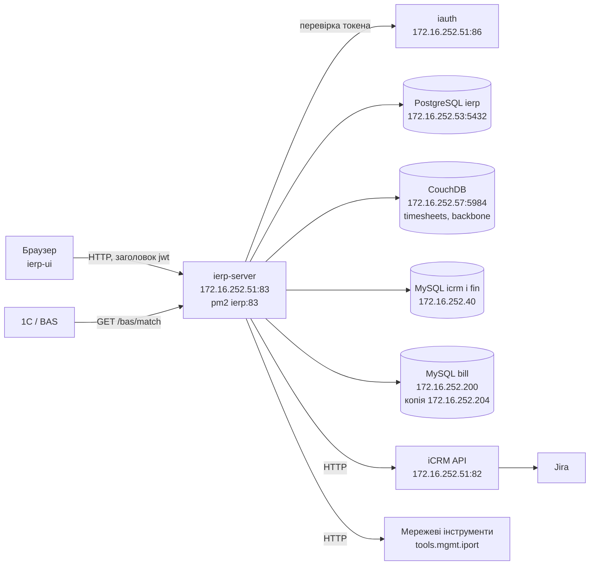
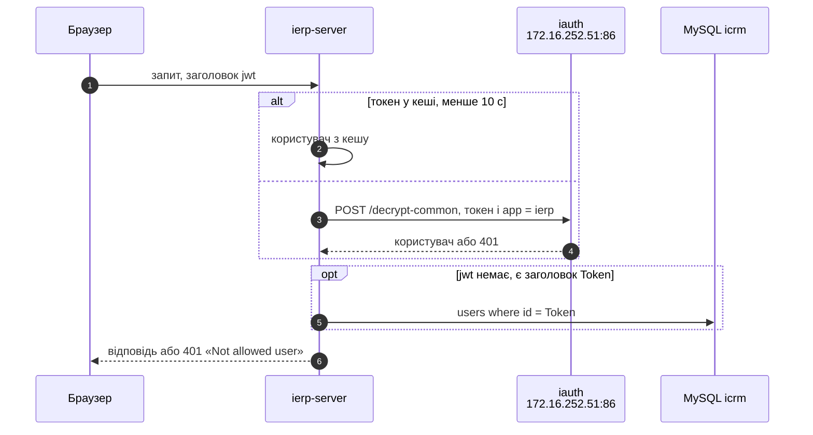

# Як влаштовано iERP

Сторінка для розробників і тих, хто підтримує сервер: з чого складається
iERP, де працює, як перевіряє користувача, які запити обслуговує і як
публікується. Де лежать дані — у [data.md](data.md), розрахунок пального — у
[fuel.md](fuel.md), звʼязки з іншими системами — у
[integrations.md](integrations.md).

Назад до [iERP](README.md).

## Складові



| Складова | Що це |
|---|---|
| `ierp-ui` | екрани: Vue 3 + Quasar 2 (Vite), таблиці й поля — PrimeVue 4, збірка як PWA. Внутрішня назва пакета `ui-q`, у заголовку — TrackLists |
| `ierp-server` | Node.js + Express 4, pm2-процес `ierp:83` на `SRV-APP-1` (`172.16.252.51`), Node 22.14.0. Віддає і API, і зібрані екрани з каталогу `public` |
| PostgreSQL `ierp` | документи, обладнання, місця, друковані форми; на `SRV-APP-DEV-1` (`172.16.252.53`) |
| CouchDB `timesheets` | маршрути бригад, довідник авто, адреси АЗС — спільна з i-map |
| CouchDB `backbone` | координати вузлів для вивантаження обладнання |
| MySQL `172.16.252.40` | працівники й табель iCRM, журнал змін, основні засоби з 1С (`fin.fixed_assets`), обʼєкти карти |
| MySQL `bill` | договори абонентів: запис у головну базу `172.16.252.200`, частина читань — з копії `172.16.252.204` |
| iCRM API | задачі Jira для маршрутів і нарядів (iERP у Jira напряму не ходить) |
| iauth | перевірка токена користувача і дозволених IP |

## Вхід і перевірка запитів

Екрана входу в iERP немає, сторінка входу iauth не використовується. Токен
працівник бере з іншої нашої системи і вручну кладе в `localStorage` браузера
(ключ `jwt`, рідше старий `ierp_token`) — як саме, див.
[README.md](README.md#вхід). Екрани додають його до кожного запиту заголовком.
Сервер лише перевіряє отриманий токен: `jwt` — запитом до сервера iauth
(`/decrypt-common`) з кешем на 10 секунд, `Token` — пошуком у таблиці `users`
iCRM. Ролей і прав немає: хто пройшов перевірку, тому доступні всі запити.



| Спосіб | Як працює | Де |
|---|---|---|
| `jwt` | токен перевіряє iauth (`/decrypt-common`), кеш на 10 с | усі запити, крім `/bas` |
| `Token` (старий) | значення — id рядка в таблиці `users` бази iCRM | запасний, якщо `jwt` немає |
| За IP | iauth (`/ip-allowed/:ip`) відповідає, чи адреса з внутрішніх мереж компанії | лише `GET /bas/match` для 1С |

```js
// ierp-server/app.js — порядок важливий
app.use(parser.json())
app.use(cors())
app.use(express.static('public'))            // зібрані екрани — без перевірки
app.use('/bas', require('./routes/bas'))     // 1С — своя перевірка за IP
app.use(auth.check)                          // далі — лише з користувачем
app.use('/', require('./routes/root'))
app.use('/nd', require('./routes/nd'))
app.use('/track-list', require('./routes/track-list'))
```

```js
// ierp-server/auth.js — скорочено
const jwt = async function(req) {
  const token = req.headers['jwt']
  if (!token) return null
  if (inprg) await inprg                                       // паралельні запити чекають один виклик
  if (global.cache.has(`jwt:${token}`)) return global.cache.get(`jwt:${token}`)
  inprg = axios.post(`${env.ierp.auth}/decrypt-common`, {token, app: 'ierp'}).then(({data}) => user = data)
  await inprg
  global.cache.set(`jwt:${token}`, user)                       // TTLCache, 10 с (app.js)
  return user
}
const deprecated = async (req) => {                            // старий заголовок Token
  const allow = await icrm.query(`select * from users where id = ?`, [req.headers['token']])
  return allow[0] || null
}
check: async (req, res, next) => {
  const user = await jwt(req) || await deprecated(req)
  if (!user) return res.status(401).send('Not allowed user')
  req.user = user                                              // далі — автор документа, журнал абонентів
  next()
}
```

```js
// ierp-ui/src/boot/axios.js — що надсилає браузер
const ae = axios.create({ baseURL: process.env.ierp.baseURL })   // http://172.16.252.51:83
ae.interceptors.request.use(function (config) {
  if (localStorage['jwt']) config.headers.jwt = localStorage['jwt']
  else if (localStorage['ierp_token']) config.headers.Token = localStorage['ierp_token']
  return config
})
```

`GET /meta/info` при старті екранів дає типи документів, мітки, працівників,
регіони і поточного користувача (з `users` iCRM за `icrm_id` з токена). Без
цього запиту екрани не працюють.

## Запити по розділах

Лише запити, якими користуються три робочі розділи.

### Подорожні листи і створення маршруту — `/track-list`

| Запит | Що робить |
|---|---|
| `GET /get-documents/:period/:carId?` | маршрути за місяць з CouchDB + номер, замок, друкована форма з PostgreSQL |
| `GET /all-names` | працівники-водії і списки цілей поїздки |
| `GET /cars/:period` | автопарк (документ `availableCars`) |
| `GET /destinations` | напрямки й адреси АЗС |
| `GET /route/:id` | перебудувати перелік маршруту через iCRM |
| `GET /single-purpose/:jira` | одна задача для маршруту через iCRM |
| `POST /save/:id` | записати перелік, одометр і заправки в маршрут |
| `POST /fuel-calc` | перерахувати залишки в баку по машині |
| `GET /expanded/:docId` | типові поля друку для ще не проведеного листа |
| `POST /insert/:doc` | провести лист: документ типу `9` і друкована форма |
| `GET /print/:docId` | HTML друкованої форми |
| `POST /modify-lock` | замок на лист |
| `GET /export/:period` | Excel за місяць |
| `POST /create` | новий маршрут (екран «Створити маршрут») |
| `POST /del-couch/:docId` | видалити маршрут |

### Наряди-допуски — `/work-permit`

| Запит | Що робить |
|---|---|
| `GET /list` | останні 200 нарядів з додатковими номерами |
| `GET /workers` | довідник бригад з коду |
| `GET /compose/:owner/:date/:mode/:assistant?` | зібрати наряд із задач Jira на дату |
| `GET /task/:jira` | одна задача для рядка наряду |
| `GET /doc/:id`, `POST /doc` | прочитати й зберегти наряд |
| `POST /blank` | додатковий номер |
| `GET /print/:id` | друк; `?blank=6` — бланк |

### Абоненти — `/nd`

| Запит | Що робить |
|---|---|
| `GET /contracts/:contract?` | договори з поштами |
| `GET /meta` | тарифи й групи |
| `POST /contracts-update` | журнал у iCRM і запис у `bill.users`, `bill.phones` |

### Обладнання та інвентаризація

| Запит | Що робить |
|---|---|
| `GET /equipment/ls` | усе обладнання з основними засобами 1С |
| `GET /equipment/ls-div/:div` | обладнання одного місця, модулі під своїм обладнанням |
| `GET /equipment/item/:id`, `POST /equipment/modify/:id` | картка: прочитати, створити (`0`), змінити |
| `GET /equipment/zab` | стан і серійні номери з мережевих інструментів (`tools.mgmt.iport`) |
| `GET /equipment/export-xlsx` | Excel усіх основних засобів |
| `GET /bas-equipment/ls/:date` | основні засоби 1С за останній період з групами |
| `GET /dicts/13`, `GET /dict/:id`, `POST /dict`, `GET /dict-del/:id` | місця зберігання |
| `GET /doc-list-simple/15` | список інвентаризацій |
| `GET /doc-get/:id`, `POST /doc-update`, `GET /doc-del/:id` | документ інвентаризації |

### Для 1С — `/bas`

| Запит | Що робить |
|---|---|
| `GET /bas/match` | перенести привʼязки основних засобів у новий період, див. [integrations.md](integrations.md#1с--bas) |

## Код

### `ierp-server`

| Файл | Що в ньому |
|---|---|
| `index.js`, `app.js` | запуск HTTP на порті з `env.js`; порядок: статика `public`, `/bas` (за IP), перевірка користувача, решта маршрутів |
| `auth.js` | три способи перевірки — див. вище |
| `db.js` | підключення: PostgreSQL (`pg-promise`), MySQL iCRM (нове зʼєднання на кожен запит), `bill` (головна і копія) |
| `routes/root.js` | документи, місця, наряди, обладнання |
| `routes/track-list.js` | подорожні листи |
| `routes/nd.js` | абоненти; уся логіка прямо в маршруті |
| `routes/bas.js` | запит для 1С |
| `models/track-list.js` | маршрути: список, створення, збереження, проведення, друк, замок, видалення |
| `models/fuel.js` | розрахунок пального, поля друкованої форми листа, звернення до iCRM за задачами |
| `models/rl-excel.js` | Excel за місяць |
| `models/work-permit.js` | наряди: збірка з задач Jira, список, друк |
| `models/equipment.js` | картка, списки, привʼязка до 1С, стан з `tools.mgmt.iport`, перенос привʼязок між періодами |
| `models/equipment-export.js` | Excel обладнання з координатами |
| `models/docs.js`, `models/blogic.js` | універсальні документи і обробник після збереження інвентаризації |
| `models/dict.js`, `models/meta.js` | довідники і стартові дані екранів |
| `docs/track-list/route-order.01.html` | шаблон подорожнього листа (handlebars) |
| `docs/track-list/work-permit.html` | шаблон наряду-допуску |
| `docs/track-list/work-permit.js` | довідник бригад наряду: працівники, посади, інструмент, ЗІЗ, посадові особи |
| `tasks/` | скрипти, які запускають вручну — див. нижче |

### `ierp-ui`

| Файл | Що в ньому |
|---|---|
| `quasar.config.js` | збірка; адреси сервера iERP (`http://172.16.252.51:83`) вшиваються в збірку |
| `src/models/nav.js` | розділи стартової сторінки і їхні вкладки, відкриті вкладки, підтвердження, сповіщення |
| `src/router/routes.js` | адреси екранів |
| `src/boot/axios.js` | клієнт до сервера iERP із заголовком `jwt` |
| `src/models/meta.js` | стартові дані з `/meta/info` |
| `src/pages/Docs.vue`, `src/models/route-list.js` | список подорожніх листів і картка |
| `src/components/RouteDetails.vue` | маршрут, одометр і заправки в картці листа |
| `src/pages/TrackCreate.vue`, `src/components/RouteTimeLine.vue`, `src/components/RefuelDialog.vue` | створення маршруту і картка заправки |
| `src/pages/WorkPermits.vue`, `src/components/WorkPermitForm.vue` | наряди-допуски |
| `src/pages/Contracts.vue` | абоненти |
| `src/pages/equipment/` | обладнання: список, ліва панель, картка, вибір 1С, інвентаризація |

## Збірка й публікація

```bash
# екрани — на машині розробника
cd ierp-ui
quasar build -m pwa           # результат у dist/pwa

# вміст dist/pwa вручну копіюється в ierp-server/public на 172.16.252.51

# сервер — на 172.16.252.51
pm2 restart ierp:83
```

Адреса сервера вшивається в екрани при збірці, тож зміна адреси чи порту
потребує перезбирання `ierp-ui`. Нова версія екранів доходить до користувачів
після оновлення сторінки: застосунок зібраний як PWA і кешує файли в браузері.

## Логи

Сервер пише лише в консоль, тобто в логи pm2: `pm2 logs ierp:83` на
`172.16.252.51`. Власних файлів логів немає. Помилки розрахунку пального,
запису абонентів і вивантажень видно тільки там.

## Скрипти обслуговування

Запускаються вручну з каталогу `ierp-server` на сервері (`node tasks/<файл>`);
у pm2 і за розкладом їх немає.

| Файл | Що робить |
|---|---|
| `odo-to-norm.js`, `fix-odo.js` | перерозподіл одометра між днями — див. [fuel.md](fuel.md#виправлення-одометра-скриптами) |
| `fix-permit-zip.js` | перераховує ЗІЗ у збережених нарядах за довідником бригад; без `apply` лише показує зміни |
| `akb_by_div.js` | звіт: акумулятори по місцях зберігання |
| `fixed_assets_inv_export.js` | записує в основні засоби 1С номер документа інвентаризації (разовий, з датою періоду в коді) |

## Де лежать доступи

| Що | Де |
|---|---|
| PostgreSQL `ierp`, MySQL iCRM, CouchDB, iauth, адреса iCRM API | `ierp-server/env.js` на `172.16.252.51` |
| MySQL `bill` (головна і копія) і база Jira | прямо в `ierp-server/db.js` на `172.16.252.51` |
| Адреса й токен iCRM для екранів | `ierp-ui/quasar.config.js` на машині розробника; потрапляє в зібрані файли |
