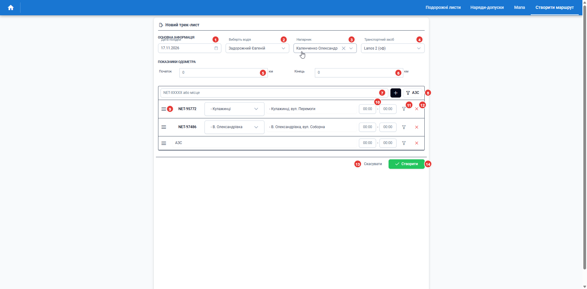
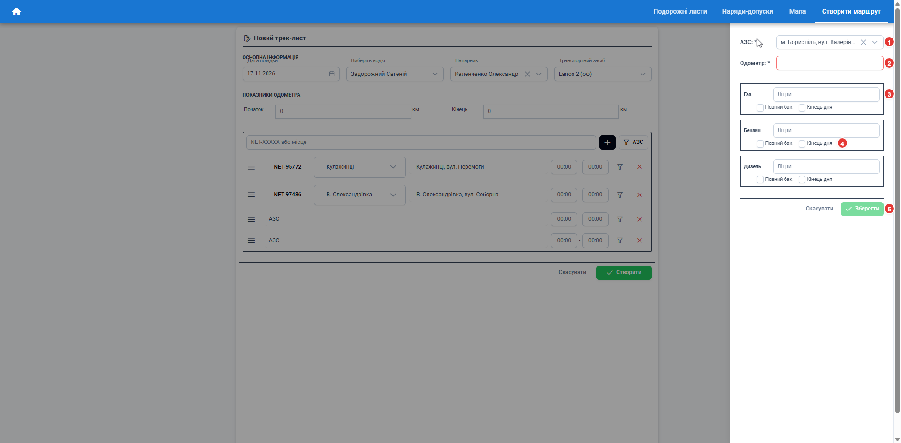

# Створити маршрут

Екран для дня, за який маршруту немає: бригада не вела лист у
[i-map](../imap/timesheet.md), їздив не монтажник, або день треба відновити
заднім числом. Екран створює **такий самий маршрут**, як i-map на телефоні,
тож далі він зʼявляється у списку
[подорожніх листів](route-lists.md) і проводиться звичайним порядком.

Назад до [iERP](README.md).

| Історія | Хто |
|---|---|
| Відновити день за водія | мережевий відділ |
| Внести заправку | мережевий відділ |

Розділ **«Подорожні листи»** → вкладка **«Створити маршрут»**.

---

### Відновити день за водія

**Мережевий відділ.** Бригада їздила, але маршрут у телефоні не вела. Працівник
відновлює день за словами водія й за задачами Jira: обирає дату, водія,
напарника й машину, вносить одометр на початок і кінець дня, додає пункти
маршруту з часом приїзду й виїзду і натискає «Створити».



| № | Елемент | Що робить |
|:-:|---|---|
| **1** | Дата поїздки | день маршруту; зміна дати скидає вибрану машину |
| **2** | Виберіть водія | хто вів машину; за ним маршрут потім знайдеться у списку |
| **3** | Напарник | необовʼязково; водія в цьому списку немає |
| **4** | Транспортний засіб | машина з довідника автопарку |
| **5** | Початок | одометр на початок дня, км |
| **6** | Кінець | одометр на кінець дня, км |
| **7** | Поле «NET-XXXXX або місце» і плюс | `NET-12345` додасть задачу з регіоном і адресою з Jira, інший текст — довільне місце. Enter теж додає |
| **8** | АЗС | додає зупинку-заправку й одразу відкриває картку заправки |
| **9** | Рядок маршруту | ручка для перетягування, номер задачі, регіон, опис |
| **10** | Час | приїзд і виїзд `ГГ:ХХ` |
| **11** | Значок заправки | відкриває картку заправки; помаранчевий, коли літри внесені |
| **12** | Хрестик | прибирає пункт, решта перенумеровується |
| **13** | Скасувати | очищає форму |
| **14** | Створити | активна, коли є дата, водій, машина і хоча б один пункт |

Номер задачі вводиться повністю, з `NET-`. Час нового пункту «з»
підставляється з часу «по» попереднього, тож вносити доводиться лише час
виїзду. Час прив'язується до дати поїздки, а не до сьогодні.

Після «Створити» і підтвердження «Створити треклист?» маршрут зʼявляється у
списку подорожніх листів того місяця. Далі його треба перебудувати й зберегти,
порахувати пальне і провести — так само, як маршрут з i-map.

Сервер не створить маршрут і назве, чого бракує:

| Повідомлення | Що не так |
|---|---|
| не вказано водія / авто / дату | порожнє поле |
| порожній маршрут | немає жодного пункту |
| не вказано одометр | немає початку або кінця |
| одометр: кінець менше початку | переплутані показники |
| заправка: потрібні адреса АЗС та одометр | у заправки немає адреси або одометра |
| Трек на цей час вже існує | у цієї машини вже є маршрут, що закінчується в ту саму хвилину |

**Технічно**

`POST /track-list/create`. Документ маршруту в CouchDB `timesheets`:
`_id = track.<авто>.<час кінця останнього пункту в секундах>`,
`parent = timesheet.<ключ Jira водія>.<РРРРММДД>` — день у табелі водія.
Звідси обмеження: у однієї машини не може бути двох маршрутів, що закінчуються
в одну секунду (CouchDB відповідає `409`). Заправки з пунктів АЗС збираються в
окремий перелік `refill[]`. Список водіїв — `GET /track-list/all-names`
(працівники iCRM з роллю `worker`), машин — `GET /track-list/cars/:period`
(документ `availableCars`), адрес АЗС — `GET /track-list/destinations`.
Детально про поля маршруту — у [data.md](data.md#маршрут-бригади-в-couchdb).

| Де в коді | Що робить |
|---|---|
| `ierp-ui/src/pages/TrackCreate.vue` → `create()` (рядок 70), `canCreate` (рядок 29) | збирає маршрут і надсилає |
| `ierp-ui/src/components/RouteTimeLine.vue` → `addDest()` (рядок 57), `nextStart()` (рядок 35), `toTs()` (рядок 113) | пункти маршруту і час |
| `ierp-server/models/track-list.js` → `create()` (рядок 33) | перевірка і запис у CouchDB |

```js
// ierp-ui/src/pages/TrackCreate.vue, create() — що йде на сервер
const end = Math.max(0, ...form.path.map(_ => _.status?.finish || 0))
const payload = {
  date: form.date,
  day: dayjs(form.date).format('YYYYMMDD'),
  end: end || null,                 // кінець останнього пункту — з нього буде _id
  owner: form.driver?.jira_key,
  assistant: form.assistant || null,
  car: form.car?.id,
  category: 'track',
  odo: { start: form.odoStart, finish: form.odoEnd },
  path: form.path.map(({ fuel, ...stop }) => fuel?.fuels?.length ? { ...stop, fuel } : stop)
}
await ae.post('/track-list/create', payload)
```

```js
// ierp-ui/src/components/RouteTimeLine.vue
const nextStart = () => rl.value[rl.value.length - 1]?.status?.finish ?? null   // «з» = «по» попереднього
const toTs = (time) => {                 // "09:30" -> мітка часу в день поїздки, а не сьогодні
  if (!time || time.includes('_')) return null
  const [h, m] = time.split(':').map(Number)
  const d = props.date ? new Date(props.date) : new Date()
  d.setHours(h, m, 0, 0)
  return d.getTime()
}
```

```js
// ierp-server/models/track-list.js, create() — скорочено
const errors = []
if (!owner) errors.push('не вказано водія')
if (!car) errors.push('не вказано авто')
if (!date) errors.push('не вказано дату')
if (!Array.isArray(path) || !path.length) errors.push('порожній маршрут')
if (!(odo?.start >= 0) || !(odo?.finish >= 0)) errors.push('не вказано одометр')
else if (odo.finish < odo.start) errors.push('одометр: кінець менше початку')
const azs = (path || []).filter(_ => _.fuel?.fuels?.length)
if (azs.some(_ => !_.address || !(_.fuel.odo >= 0))) errors.push('заправка: потрібні адреса АЗС та одометр')
if (errors.length) return res.status(400).json({ error: errors.join(', ') })

const finish = end || Math.max(0, ...path.map(_ => _.status?.finish || 0)) || dayjs(date).valueOf()
const _id = `track.${car}.${Math.floor(finish / 1000)}`
const doc = { _id, parent: `timesheet.${owner}.${day}`, category: 'track', owner, car, assistant, odo, path, refill }
await couch.createDocument('timesheets', doc, _id)     // 409, якщо такий _id уже є
```

---

### Внести заправку

**Мережевий відділ.** Кнопка «АЗС» або значок заправки в рядку відкриває праворуч
картку «Заправка».



| № | Поле | Правило |
|:-:|---|---|
| **1** | АЗС | обовʼязково; список типових адрес, можна вписати свою |
| **2** | Одометр | обовʼязково; не менший за одометр на початок дня |
| **3** | Газ · Бензин · Дизель | літри по кожному виду, заповнюються лише потрібні |
| **4** | Повний бак, Кінець дня | заправили до повного; заправка наприкінці дня |
| **5** | Зберегти | неактивна, доки немає адреси й одометра |

«Повний бак» — не формальність. Залишок пального рахується від заправки до
повного бака, і без цієї позначки відрізок між заправками не замкнеться (див.
[fuel.md](fuel.md)).

**Технічно**

Адреси АЗС — поле `azsAddr` документа `destinations` у CouchDB `timesheets`.
Заправка зберігається в пункті маршруту як `fuel: {odo, fuels[]}` і при
створенні копіюється в `refill[]` з ознаками `full` і `dayend`.

```js
// ierp-ui/src/components/RefuelDialog.vue
const canSave = computed(() => !!(state.address && state.odo))   // без адреси й одометра — не зберегти
const onSave = () => {
  if (!canSave.value) return
  emit('save', {
    odo: state.odo,
    address: state.address || null,
    fuels: state.fuels.filter(f => f.liters > 0).map(f => ({ ...f }))   // лише види, які заливали
  })
}
```

```js
// ierp-server/models/track-list.js, create() — заправки з пунктів АЗС у refill[]
const refill = path.flatMap(stop => (stop.fuel?.fuels || []).map(f => ({
  fuel: f.type,          // gas | petrol | diesel
  liters: f.liters,
  odo: stop.fuel.odo,
  full: !!f.fullTank,
  dayend: !!f.dayend,
  time: stop.status?.finish
})))
```
