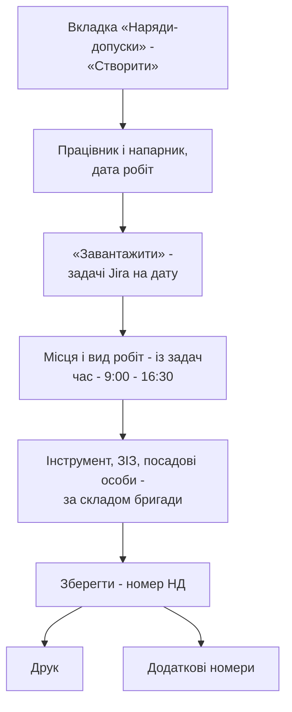
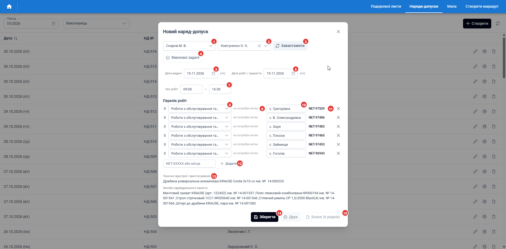
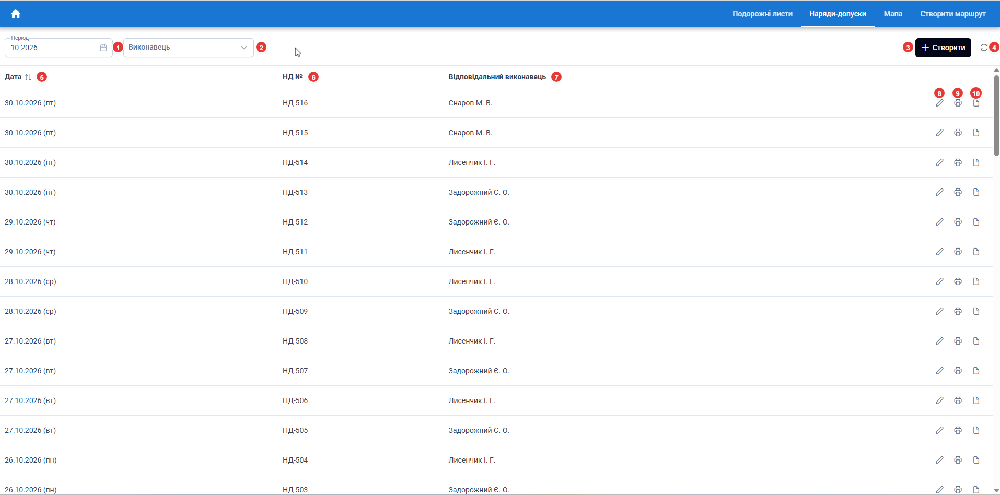
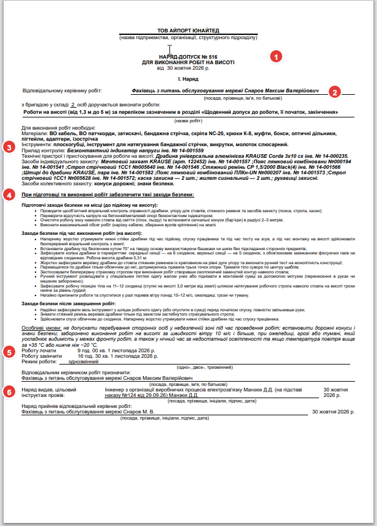

# Наряди-допуски

Наряд-допуск — документ з охорони праці для робіт на висоті: хто працює, де,
коли, з яким інструментом і засобами захисту, хто видав і хто відповідає.
Оформлюється на робочий день бригади, отримує номер і друкується на
підпис.

Наряди оформлюють на вкладці «Наряди-допуски»: перелік робіт збирається із
задач Jira працівника на дату робіт.

Назад до [iERP](README.md).

| Історія | Хто |
|---|---|
| Оформити наряд за задачами дня | мережевий відділ |
| Перевірити вид робіт і мітку задачі | мережевий відділ |
| Видати додатковий номер | мережевий відділ |
| Знайти й надрукувати наряд або порожній бланк | мережевий відділ |



---

### Оформити наряд за задачами дня

**Мережевий відділ.** На вкладці «Наряди-допуски» кнопка «Створити» відкриває
форму «Новий наряд-допуск».
Керівник обирає працівника й напарника і натискає «Завантажити» —
застосунок бере з Jira задачі працівника на дату робіт і складає з них перелік
робіт.



| № | Елемент | Що робить |
|:-:|---|---|
| **1** | Працівник | відповідальний керівник робіт у бригаді |
| **2** | Напарник | необовʼязково |
| **3** | Завантажити | незакриті задачі працівника з терміном на дату робіт |
| **4** | Виконані задачі | задачі, які працівник закрив у дату робіт; **замінює** перелік, а не доповнює |
| **5** | Дата видачі | дата наряду; поруч день тижня, вихідні — червоним |
| **6** | Дата робіт / закриття | слідує за датою видачі, доки її не змінили окремо |
| **7** | Час робіт | типово 9:00 — 16:30; початок має бути раніше за кінець |
| **8** | Вид робіт | один із шести типів або свій текст — див. нижче |
| **9** | Мітка | мітка Jira для цього виду робіт, «не потребує мітки» або «не відповідає» |
| **10** | Населений пункт | з префіксом «м.», «селище» або «с.» |
| **11** | Задачі Jira | номери задач рядка, відкриваються в Jira; хрестик праворуч прибирає рядок, ручка зліва — перетягує |
| **12** | Поле «NET-XXXXX або місце» і «Додати» | `NET-12345` додасть рядок з регіоном і видом робіт за міткою задачі, інший текст — населений пункт, порожнє поле — порожній рядок |
| **13** | Технічні пристрої, ЗІЗ | підставляються за складом бригади з інвентарними номерами, на екрані лише для читання |
| **14** | Зберегти | присвоює номер «НД-…» |
| **15** | Друк, Бланк (6 рядків) | активні після збереження |

Населений пункт отримує префікс «м.» для Борисполя, «селище» для Баришівки і
«с.» для решти.

**Технічно**

`GET /work-permit/compose/:owner/:date/:mode/:assistant?`. iERP питає iCRM
(`/timesheet/route-list/permit-tasks/…`), а той шукає в Jira задачі проєкту
`NET` цього виконавця: у режимі «Завантажити» — зі статусом To Do, In Progress
або Waiting і терміном на дату, у режимі «Виконані задачі» — Done або Closed,
закриті в цей день. Окрема задача — `GET /work-permit/task/:jira`. Збереження —
`POST /work-permit/doc`, документ типу `14`, усе в полі `raw`. Детальніше — у
[integrations.md](integrations.md#icrm-і-jira).

| Де в коді | Що робить |
|---|---|
| `ierp-ui/src/components/WorkPermitForm.vue` → `load()` (рядок 77) | «Завантажити» і «Виконані задачі» |
| там же → `addPlace()` (рядок 106) | додати рядок |
| там же → `save()` (рядок 140) | переносить працівника, дати й час у наряд і зберігає |
| там же → `badWorkTime()` (рядок 39) | перевірка часу робіт |
| `ierp-server/models/work-permit.js` → `compose()` (рядок 90) | збирає наряд за задачами |
| `ierp-server/models/work-permit.js` → `saveDoc()` (рядок 119) | запис у `docs` |

```js
// ierp-ui/src/components/WorkPermitForm.vue, load()
let url = `/work-permit/compose/${owner.value}/${dayjs(workDate.value).format('YYYY-MM-DD')}/${doneOnly ? 'done' : 'todo'}`
if (assistant.value) url += `/${assistant.value}`
ae.get(url).then(({ data }) => { permit.value = data })   // відповідь повністю замінює наряд
```

```js
// ierp-server/models/work-permit.js, compose() — інструмент і ЗІЗ за складом бригади
const team = [master.key, helper?.key].filter(Boolean)
const tools = data.tools.filter(_ => team.includes(_.owner) && _.type === 'tool')
  .map(_ => `${_.item} інв. №  ${_.inv}`).join(' ;')
const zip = data.tools.filter(_ => team.includes(_.owner) && _.type === 'zip')
  .map(_ => `${_.item} ${_.inv.startsWith('14-') ? `інв. № ${_.inv}` : `№ ${_.inv}`}`).join(' ;')
const instrument = data.tools.filter(_ => _.owner === master.key && _.type === 'instrument')  // лише керівника
  .map(/* так само */).join(' ;')

const tasks = await env.ax.get(`/timesheet/route-list/permit-tasks/${owner}/${dayjs(date).format('YYYY-MM-DD')}/${mode}`)
  .then(({ data }) => data).catch(e => [])          // iCRM недоступний — порожній перелік
const places = tasks.map(t => ({
  region: t.region ? `${regType} ${t.region}` : '',
  work: workType(t.labels).name,
  labels: t.labels || [],
  jiras: t.jira ? [t.jira] : []
}))
res.json({ places, tools, zip, instrument, actors, date })
```

`data` тут — довідник бригад `docs/track-list/work-permit.js` (`workers`, `tools`, `actors`, `workTypes`).

```js
// ierp-ui/src/components/WorkPermitForm.vue, save() — скорочено
if (badWorkTime()) return /* «Час початку робіт має бути раніше за час закінчення» */
permit.value.actors.master = { name: m.name, name_long: m.name_long, title: m.title }
permit.value.actors.worker = h ? { name: h.name, name_long: h.name_long, title: h.title, grp: h.grp } : null
permit.value.date = date.value
permit.value.workDate = workDate.value || null
permit.value.workTime = { ...workTime.value }        // "HH:mm", типово 09:00 — 16:30
ae.post('/work-permit/doc', { id: id.value, permit: permit.value })   // id = null — новий документ типу 14
```

---

### Перевірити вид робіт і мітку задачі

**Мережевий відділ.** Вид робіт у кожному рядку обирається з шести типів або
вписується свій. Поруч — мітка Jira, яка відповідає цьому виду. Натискання на
мітку копіює її.

| Вид робіт | Мітка задачі в Jira |
|---|---|
| Роботи з обслуговування та ремонту кінцевих пасивних пристроїв ВОЛЗ | без мітки (типовий) |
| Лінійно-кабельні роботи з монтажу ВОЛЗ | `build` |
| Ремонтні роботи та технічне обслуговування лінійних елементів ЕКМ | `repair` |
| Роботи з використанням ручного електроінструменту на висоті понад 1,3 м | `tools13` |
| Технічне обслуговування офісних та складських приміщень | `servicerooms` |
| Роботи, повʼязані з обслуговуванням обладнання на висоті (ODF-панелей, комутаторів, маршрутизаторів тощо) | `servicehardware` |

Якщо вид робіт у рядку не збігається з міткою привʼязаної задачі, поле
обводиться помаранчевим, а замість мітки зʼявляється «не відповідає» з
підказкою, яка мітка очікується. Наряд при цьому збережеться й надрукується.
Виправляти варто задачу в Jira: поставити там правильну мітку, інакше наступного
разу наряд знову збереться з тим самим видом робіт.

**Технічно**

Відповідність «мітка → вид робіт» задана двічі однаково: у коді форми
(`ierp-ui/src/components/WorkPermitForm.vue`) і в довіднику на сервері
(`ierp-server/docs/track-list/work-permit.js`).

```js
// ierp-ui/src/components/WorkPermitForm.vue
const workTypeFor = (labels) =>
  workTypes.find(w => w.label && (labels || []).includes(w.label)) || workTypes.find(w => !w.label)
// «не відповідає»: у рядку є задачі, і вибраний вид робіт ≠ тому, що дає мітка задачі
const mismatch = (row) =>
  Array.isArray(row.labels) && row.jiras?.length > 0 && row.work !== workTypeFor(row.labels).name
```

Якщо в задачі кілька міток зі списку, береться перша за порядком у `workTypes`, а не в задачі.

---

### Видати додатковий номер

**Мережевий відділ.** Протягом дня додалися роботи, яких не було при видачі
наряду. У рядку наряду кнопка з плюсом у колі «Згенерувати додатковий номер»
створює ще один номер до цього наряду. Він показується сірим тегом поруч з
основним номером.

Кнопка є **лише в день самого наряду**: заднім числом додатковий номер не
видається.

**Технічно**

`POST /work-permit/blank` з датою і id основного наряду. Додатковий номер —
окремий документ типу `14` з `raw.parent` = id основного. У списку такі
документи вкладені в основний.

```js
// ierp-ui/src/pages/WorkPermits.vue
const isToday = (d) => { /* рік, місяць і день збігаються з сьогоднішніми */ }
const addNumber = (row) => ae.post('/work-permit/blank', { date: row.date, parent: row.id }).then(() => loadList())
```

```js
// ierp-server/models/work-permit.js, createBlank()
const raw = { date }
if (req.body.parent) raw.parent = req.body.parent
const row = await conn.one(insert({ raw, type: 14 }, null, 'docs') + ' RETURNING id, num')
```

---

### Знайти й надрукувати наряд або порожній бланк

**Мережевий відділ.** На вкладці «Наряди-допуски» — список нарядів, від нових
до старих. Фільтри — місяць і виконавець. Подвійне натискання або олівець
відкриває наряд для правки.



| № | Елемент | Що робить |
|:-:|---|---|
| **1** | Період | місяць; кнопка очищення внизу календаря скидає фільтр |
| **2** | Виконавець | відповідальний виконавець |
| **3** | Створити | нова форма наряду |
| **4** | Оновити | перечитати список |
| **5** | Дата | дата видачі з днем тижня; вихідні — червоним |
| **6** | НД № | номер, поруч сірі теги — додаткові номери |
| **7** | Відповідальний виконавець | хто керує роботами |
| **8** | Олівець | відкрити наряд |
| **9** | Друк | заповнений наряд |
| **10** | Бланк | той самий наряд з шістьма порожніми рядками переліку робіт — для заповнення від руки |

У рядку сьогоднішнього наряду перед олівцем є ще плюс у колі — додатковий
номер.

Номери сортуються природним порядком: `6-45` іде після `6-123`, а не перед
ним, як було б за простим порівнянням тексту.

Друкована форма — «Наряд-допуск № … для виконання робіт на висоті». Перша
сторінка — розділ «Наряд», далі — розділ «Допуск» з переліком місць і часу.



| № | Розділ форми | Звідки |
|:-:|---|---|
| **1** | Номер і дата видачі | номер наряду, «Дата видачі» |
| **2** | Відповідальний керівник робіт і бригада | «Працівник» і «Напарник», посади — з довідника бригад |
| **3** | Матеріали, інструмент, прилад контролю, пристрої, ЗІЗ | довідник бригад, з інвентарними номерами |
| **4** | Заходи безпеки | постійний текст шаблону |
| **5** | Початок і кінець робіт | «Час робіт» і «Дата робіт / закриття» |
| **6** | Хто видав наряд і хто прийняв | посадові особи з довідника бригад, дата видачі |

**Технічно**

Список — `GET /work-permit/list`: останні 200 основних нарядів з додатковими
номерами. Фільтр за місяцем і виконавцем працює на екрані, у межах цих 200.
Друк — `GET /work-permit/print/:id`, бланк — той самий запит з `?blank=6`;
шаблон `ierp-server/docs/track-list/work-permit.html`. У друкованій формі
номер — частина після дефіса (`6-45` → `45`).

```sql
-- ierp-server/models/work-permit.js, list()
select d.id, d.num, d.raw->>'date' as date, d.raw->'actors'->'master'->>'name' as worker,
       coalesce((select json_agg(json_build_object('id', c.id, 'num', c.num) order by c.id)
                 from docs c where c.type = 14 and c.raw->>'parent' = d.id::text), '[]'::json) as extra
  from docs d
 where d.type = 14 and d.raw->>'parent' is null
 order by d.id desc limit 200
```

```js
// ierp-ui/src/pages/WorkPermits.vue — природне сортування номерів
const numKey = (v) => String(v ?? '').replace(/\d+/g, (m) => m.padStart(10, '0'))
// "НД-516" -> "НД-0000000516"; далі numKey(b).localeCompare(numKey(a)) — від більшого до меншого
```

```js
// ierp-server/models/work-permit.js, print() — скорочено
if (req.query.blank) data.permit.places = Array.from({ length: parseInt(req.query.blank, 10) || 6 }, () => ({}))
const base = data.permit.workDate || data.permit.places[0]?.start || data.permit.date   // «Роботу почати … <дата>»
const docNum = req.query.blank ? '' : (data.num || data.pgNum).split('-')[1]
const workTime = {
  start: hoursLabel(data.permit.workTime?.start, '9:00'),     // "9 год. 00 хв."
  finish: hoursLabel(data.permit.workTime?.finish, '16:30')
}
res.send(handlebars.compile(file)(Object.assign(data.permit, { today, writeDate, docNum, workTime })))
```

У бланку дата й номер порожні — їх вписують від руки.

---

## Довідник бригад наряду

Хто може бути керівником робіт і напарником, їхні посади, група з
електробезпеки, закріплені за ними драбини, інструмент, ЗІЗ з інвентарними
номерами, а також хто видає наряд і номер наказу про призначення — усе це
записано **в коді сервера**, у файлі
`ierp-server/docs/track-list/work-permit.js`, а не в базі. Новий працівник,
зміна посади чи новий інвентарний номер ЗІЗ потребують правки цього файла і
перезапуску сервера iERP. Працівника, якого немає в цьому файлі, не можна
обрати у формі наряду.
