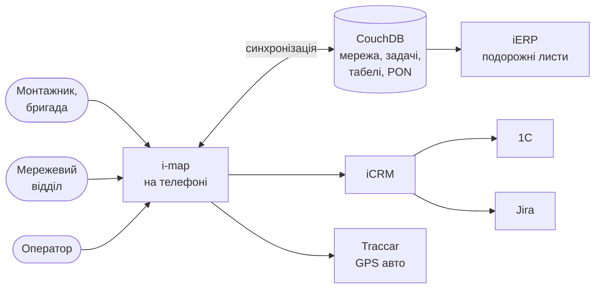

# i-map — карта мережі

i-map — карта оптичної мережі компанії і робочий інструмент бригад у полі.
На карті видно муфти, оптичні кроси (ODF), опори й кабелі, а в кожній муфті —
схему сплітерів, вільні й зайняті порти, договори абонентів і розрахункове
затухання. Тут же бригада веде робочий день і подорожній лист, а оператор
дивиться рівні сигналу абонента й сусідів по гілці.

Застосунок відкривається в браузері й встановлюється на телефон як звичайна
програма. Карта, схеми й пошук **працюють без звʼязку**: уся мережа лежить у
копії бази на самому пристрої й синхронізується, коли звʼязок зʼявляється.

| | |
|---|---|
| Адреса | `https://a.iport.net.ua/imap/track/` |
| Хто користується | монтажники й бригади, мережевий відділ, оператори підтримки |
| Пристрої | телефон або планшет бригади, ПК в офісі |
| Працює з | CouchDB (уся мережа), iCRM (id обʼєктів, Jira, PON, фото), Traccar (автомобілі), iERP (подорожні листи) |
| Репозиторій | `i-map`, версія `0.12.8` |

## Коротко

| Що | Де описано |
|---|---|
| Вхід, робота без звʼязку, оновлення, профіль і налаштування | [start.md](start.md) |
| Карта: населений пункт, пошук, шари, звʼязки, нові обʼєкти | [map.md](map.md) |
| Картка муфти: схема, вільні порти, підключення абонента, задачі Jira | [box.md](box.md) |
| Кабелі й опори: нова траса, привʼязка до муфт, кросування | [cables.md](cables.md) |
| PON-сигнали: рівні абонента, вся гілка, сусіди по вулиці | [signals.md](signals.md) |
| Робочий день бригади: маршрут, приїзд і виїзд, заправка | [timesheet.md](timesheet.md) |
| Магістральна мережа: траси між населеними пунктами, пошук обхідного маршруту | [netmap.md](netmap.md) |
| Як влаштовано: бази, синхронізація, сервер, код | [technical.md](technical.md) |
| Довідник елементів: карта, схема муфти, сигнали — кожен елемент екрана з полем бази й view CouchDB | [Карта мережі та PON — елементи екранів](../../ui_map.md) |

## Хто що робить

| Роль | Що робить в i-map |
|---|---|
| **Монтажник / бригада** | на місці відкриває муфту, бачить вільні порти, підключає абонента, бере задачу Jira; веде робочий день і подорожній лист |
| **Мережевий відділ** | веде топологію: муфти, сплітери, кабелі, опори, магістраль; дивиться, що живиться від порту ОЛТа |
| **Оператор** | перевіряє рівень сигналу абонента, дивиться, чи проблема в усієї гілки, знаходить муфту за договором |

Права видає iCRM. Звичайний користувач бачить карту, муфти, сигнали й свій
подорожній лист. Права **`timesheet-reports`** і **`architect`** дають розширений доступ на карті:
позначку «Муфта сварена», вибір стартової вкладки муфти, редагування всіх полів обʼєктів.

## Технічно, коротко

| | |
|---|---|
| Стек | Vue 2, Vuetify 2, PWA, Google Maps, PouchDB у браузері |
| Бази | CouchDB `172.16.252.57` (ззовні `a.iport.net.ua:8443`): `network`, `jira`, `timesheets`, `pon-new` — копії на пристрої, `backbone` — через iCRM |
| Сервер | iCRM API, `srv-app-1` `172.16.252.51:82`, ззовні — `a.iport.net.ua` |
| Вхід | iauth, `a.iport.net.ua:86` |
| Автомобілі | Traccar, `traccar.iport.net.ua` (`172.16.252.88`) — позиція машини бригади |

Детально — у [technical.md](technical.md).
