# Картка муфти

Картка відкривається натисканням на муфту, ODF або абонента на карті. Тут
бригада бачить порти, підключає абонента й бере задачу, а мережевий відділ веде
сплітери й опис. Назад до [i-map](README.md).

| Історія | Хто |
|---|---|
| Подивитися опис муфти | монтажник, мережа |
| Знайти вільний порт | монтажник, оператор |
| Підключити абонента до порту | монтажник |
| Відключити абонента від порту | монтажник |
| Додати сплітер | мережа, монтажник |
| Зрозуміти затухання на порту | мережа |
| Привʼязати або створити задачу Jira | монтажник, мережа |
| Передати виконану роботу в 1С | монтажник, мережа |
| Подивитися, хто й що міняв | мережа |
| Працювати з кросом (ODF) | мережа |
| Видалити муфту | мережа |

Покроковий опис елементів схеми з привʼязкою до полів бази — у довіднику [Карта мережі та PON — елементи екранів](../../ui_map.md), розділи 4–5.

Вкладки картки (меню **⋮** справа вгорі):

| Вкладка | Що там |
|---|---|
| **Описание** | назва, статус, адреса, провайдер, ЄКМ, опис, задачі Jira |
| **Схема** | сплітери й порти. Для монтажника відкривається першою |
| **Кабеля** | кабелі, заведені в муфту, з напрямом і волокном. Кошик розриває всі звʼязки по кабелю — див. [cables.md](cables.md) |
| **Расположение** | фото муфти по датах і текст «як знайти» |
| **Оборудование** | матеріали, списані на муфту в 1С |
| **История** | хто, коли і що змінив |
| **Контакты** | обслуговуюча компанія й контакти будинку. Лише для типу «Многоквартирный», якщо адреса збіглася з карткою будинку |

У тому ж меню — відкрити паспорт обʼєкта на Google Drive, відкрити точку в
Google Maps і видалити обʼєкт.

---

### Подивитися опис муфти

**Монтажник, мережа.**

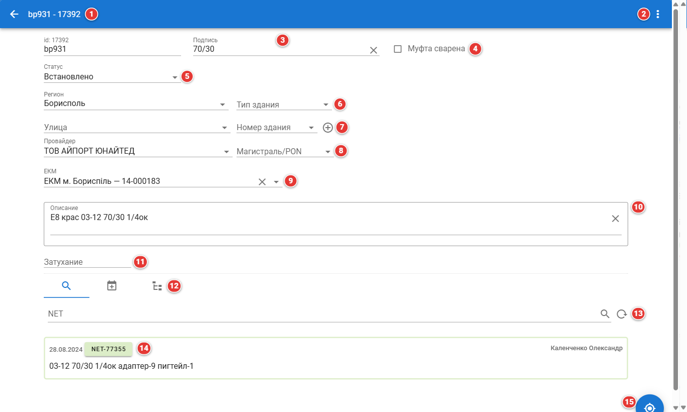

| № | Поле | Значення |
|:-:|---|---|
| **1** | Заголовок | назва й внутрішній номер: `bp931 - 17392` |
| **2** | Меню ⋮ | вкладки, паспорт на Google Drive, Google Maps, видалення |
| **3** | Подпись | що показується на карті в дужках після назви: `70/30` |
| **4** | Муфта сварена | муфта фактично змонтована, маркер стає зеленим. Ставить мережевий відділ |
| **5** | Статус | Проект · Встановлено · Кільце · Ящик з обладнанням |
| **6** | Регион, Тип здания | населений пункт і тип забудови. Тип впливає на фільтр карти й вкладку «Контакты» |
| **7** | Улица, Номер здания, **+** | адреса. «+» додає ще одну: одна муфта може обслуговувати кілька будинків |
| **8** | Провайдер, Магистраль/PON | юридичний власник і рівень мережі |
| **9** | ЕКМ | обʼєкт обліку. Для нової муфти підставляється за населеним пунктом |
| **10** | Описание | що де стоїть, як потрапити: `E8 крас 03-12 70/30 1/4ок` |
| **11** | Затухание | значення, внесене вручну |
| **12** | Робота з Jira | три вкладки: привʼязати задачу, створити, створити підзадачу |
| **13** | NET | номер задачі для привʼязки, оновити список |
| **14** | Задача | дата, номер, виконавець, текст. Рамка зелена — закрита, жовта — в роботі, рожева — відкрита |
| **15** | Приціл | закрити картку й перетягнути маркер на нове місце |

Кнопка збереження зʼявляється, щойно щось змінили. Регіон не зміниться, якщо до
муфти привʼязані кабелі: разом із регіоном міняється назва, а кабелі посилаються
на стару.

**Технічно**

Документ `ponbox.<id>` у базі `network`. Зміна регіону — `PUT /map/box/upd-region`,
адреси — `PUT /map/network/address`. Код — `src/components/NetworkDialog.vue`.

### Знайти вільний порт

**Монтажник, оператор.** Вкладка **Схема**. Кожен встановлений дільник — окрема
вкладка вгорі. Праворуч у кожному рядку видно, чим зайнятий порт.

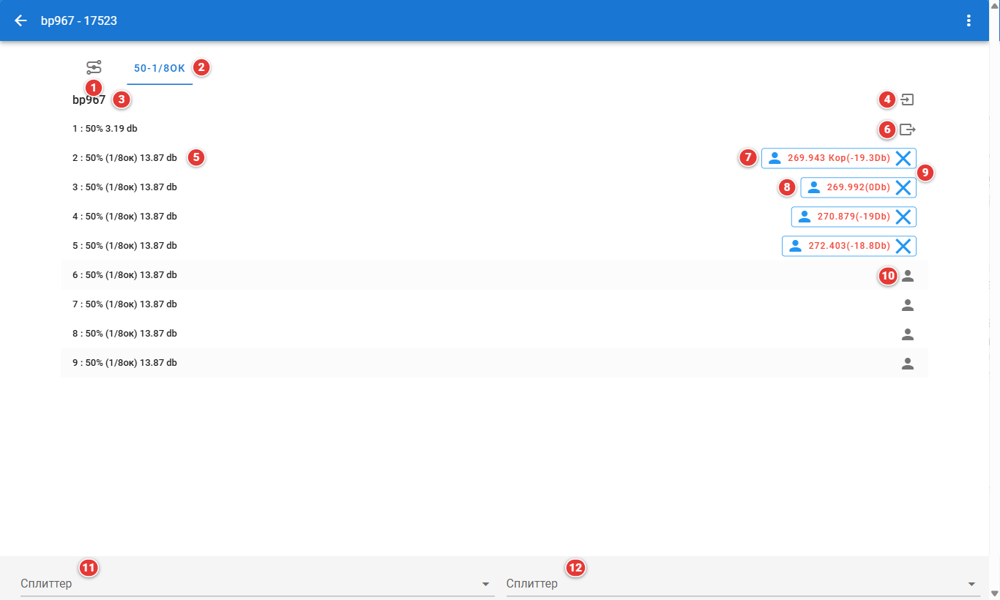

| № | Елемент | Значення |
|:-:|---|---|
| **1** | Крос | «нульовий» сплітер: прохідні зварки без ділення |
| **2** | Сплітер | назва дільника: `50-1/8ОК` — відвід 50/50, на ньому абонентський 1/8 |
| **3** | Вхід | назва кореня гілки. Якщо вхід підключено, тут видно муфту-джерело, кабель і колір волокна |
| **4** | Значок входу | вхід без підключення |
| **5** | Порт | номер, частка дільника і затухання плеча: `2 : 50% (1/8ок) 13.87 db` |
| **6** | Вільний прохідний вихід | сюди заводять кабель на наступну муфту |
| **7** | Зайнятий абонентський порт | номер договору, позначка (якщо є) і останній рівень сигналу ONU: `269.943 Кор(-19.3Db)`. Натискання відкриває сигнали цього абонента |
| **8** | Абонент без сигналу | `(0Db)` — ONU вимкнено або немає даних |
| **9** | ✕ | відключити абонента від порту |
| **10** | **Вільний абонентський порт** | сіра іконка людини — сюди можна підключати |
| **11** | Прохідний сплітер | 70/30, 90/10, … — для додавання дільника |
| **12** | Абонентський сплітер | 1/4, 1/8, … |

Якщо на вкладці немає сірої іконки людини — вільних абонентських портів на цьому
дільнику немає.

**Технічно**

Виходи — `o[n]` документа муфти, `dir`: `ext` — на іншу муфту, `user` — абонент,
`int` — на інший сплітер цієї ж муфти. Хто підключений до порту, i-map
знаходить видом `chld/boxes` (батько не знає своїх нащадків). Рівень у чіпі —
з вигрузки PON за договором і id аліаса (вид `list/oltByOnu` бази `pon-new`, ключ
`<id аліаса>-<договір>`). Код — `BoxSchema.vue`, `Splitter.vue`, `RelOutBtn.vue`.
Схема працює без звʼязку: усе береться з локальних `network` і `pon-new`.

### Підключити абонента до порту

**Монтажник.** На місці бригада відкриває муфту, натискає на вільний
абонентський порт **[10]**, і відкривається діалог порту.

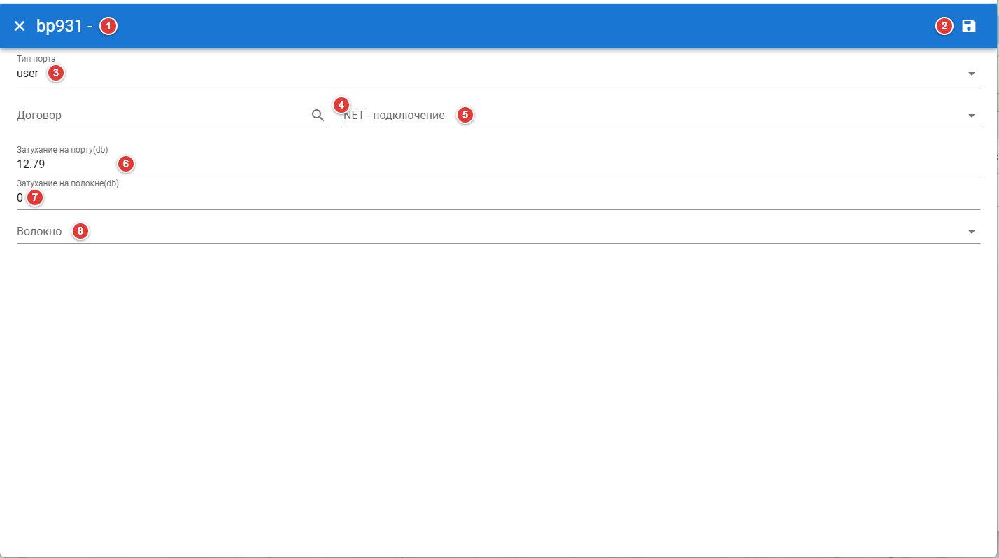

| № | Поле | Значення |
|:-:|---|---|
| **1** | Заголовок | муфта, в якій підключають |
| **2** | Зберегти | |
| **3** | Тип порта | `user` — абонент |
| **4** | Договор | пошук договору в білінгу, від 5 символів |
| **5** | NET - подключение | задача Jira на підключення — договір підставиться з неї |
| **6** | Затухание на порту | затухання плеча дільника, підставляється само |
| **7** | Затухание на волокне | затухання самого волокна, якщо є |
| **8** | Волокно | колір волокна |

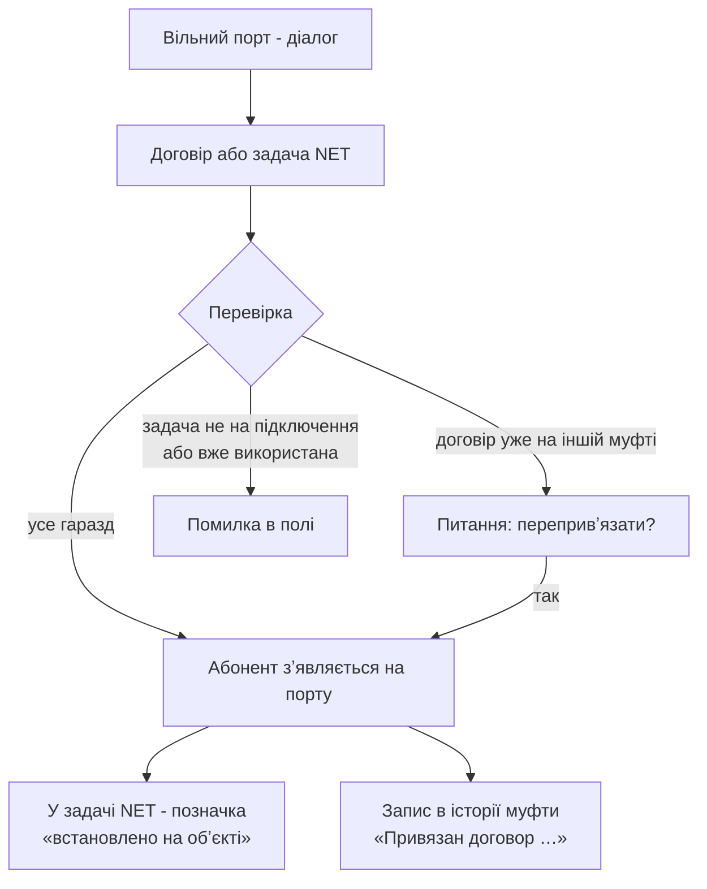

Після збереження в порту видно номер договору, а поруч — рівень сигналу з
вигрузки PON (оновлюється раз на 30 хвилин). Зміни пишуться на телефон і доїжджають на
сервер, коли зʼявиться звʼязок. Пошук договору й задачі потребують звʼязку.

**Технічно**

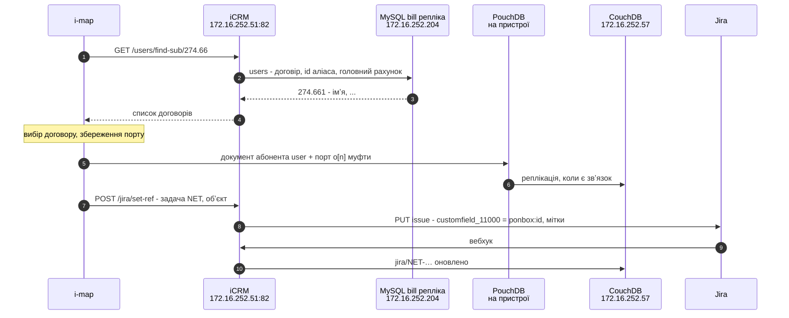

- Пошук договору — `GET /users/find-sub/<текст>` в iCRM (`TaskSelector.vue`) → запит до `users`
  на репліці `bill` (`172.16.252.204`): для кожного рахунку — головний договір (`mid`) і
  текст `договір | імʼя`. Шукається від 5 символів або за шаблоном з крапкою.
- Абонент — окремий документ з `category: "user"`, `contract`, `mid` (id аліаса) і
  посиланням на порт муфти в `i`. Його пише i-map сам, без сервера.
- Позначка в задачі — `POST /jira/set-ref` → `updateJiraRef()` у `libs/work-orders.js`.
- Зіставлення з ONU — пара «договір + id аліаса», бо в одного договору може бути
  кілька ONU. Деталі — `docs/network.md` у репозиторії `i-map`.

### Відключити абонента від порту

**Монтажник.** Хрестик **[9]** на чіпі абонента. Абонент не видаляється, а
переноситься на крос цієї муфти. Так зроблено навмисно: відключений абонент
часто повертається на інший порт, і його історія не губиться.

**Технічно**

`src/models/rel.js`: порт абонента стає `{splitter: '0', dir: 'user', att: 0}`.

### Додати сплітер

**Мережа, монтажник.** Унизу схеми два списки: прохідний дільник **[11]** і
абонентський **[12]**. Можна вибрати один або обидва — тоді вийде каскад в одному
слоті, наприклад `90-1/8ок`. Кнопка «+» створює один новий вхід і стільки
виходів, скільки плечей у дільника, із затуханням кожного плеча.

Сплітер видаляється хрестиком на його вкладці, лише коли на ньому немає жодного
підключення.

**Технічно**

`addSlot()` у `src/models/network-item.js`. Ключ `"0"` у `splitters` завжди `CROSS`.
Суфікс `ок` означає абонентський дільник: усі його плечі створюються з `dir: "user"`.

### Зрозуміти затухання на порту

**Мережа.** Затухання на порту — **розрахункове**: i-map проходить від порту
вгору по гілці до кореня й складає затухання всіх дільників і волокон на шляху.
Тому на підключеному вході видно сумарне затухання від ОЛТа, а не одного
відрізка. Реальний рівень — на екрані [сигналів](signals.md). Велика різниця між
розрахунком і заміром підказує, де шукати проблему.

Якщо в описі мережі є кільце (муфта через ланцюг посилається сама на себе),
обхід зупиняється, і картка показує червоне вікно **«КОЛЬЦА !!!»** з
проблемними сплітерами. Поки кільце не розірване, затухання по гілці не рахується.

**Технічно**

Функція `path()` у `src/models/network-item.js`, обрив після 100 кроків. Фрагмент
коду — у [technical.md](technical.md).

### Привʼязати або створити задачу Jira

**Монтажник, мережа.** Блок унизу вкладки «Описание» **[12]** має три режими:
лупа — привʼязати наявну задачу NET, календар з плюсом — створити нову,
дерево — створити підзадачу з вибором виконавця.

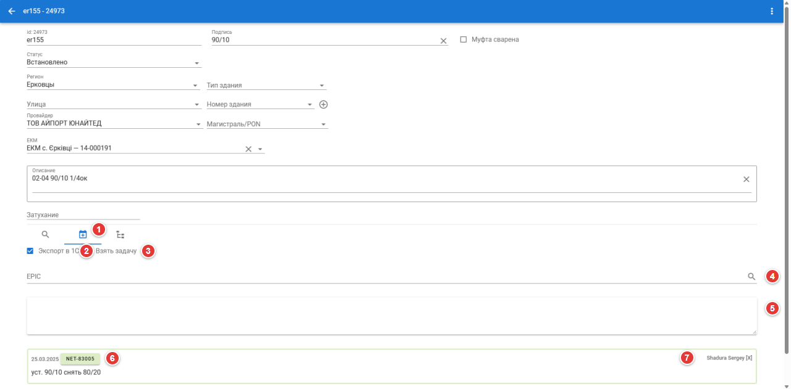

| № | Елемент | Значення |
|:-:|---|---|
| **1** | Створити задачу | друга вкладка блоку Jira |
| **2** | Экспорт в 1С | позначити задачу для експорту в 1С |
| **3** | Взять задачу | одразу призначити на себе |
| **4** | EPIC | номер епіка, до якого додати задачу. Лупа перевіряє його |
| **5** | Опис епіка | показується після перевірки |
| **6** | Задача обʼєкта | привʼязана задача з номером і текстом |
| **7** | Виконавець і **[X]** | зняти привʼязку — лише зі своєї задачі |

Тема нової задачі формується сама: `er155 : Монтаж муфты`, для опори —
`… : Монтаж опоры`, для кабелю — `… : Монтаж кабеля`. Мітка — населений пункт.

**Експорт у 1С неможливий**, доки в обʼєкта не заповнені одночасно провайдер і
ЄКМ — прапорець неактивний з підказкою «Отсутствует провайдер или ЕКМ».

У списку задач для кожної доступні: відкрити в Jira, «Взять задачу» (якщо
виконавця немає), «Экспорт в 1С», зняти привʼязку.

**Технічно**

Клієнт — `src/components/PonParts.vue`. Усі запити до Jira iCRM робить **з логіном
співробітника** (`jira_auth` з токена), тож у Jira автором буде він.

| Дія | Запит в iCRM | Що відбувається на сервері |
|---|---|---|
| Привʼязати задачу | `POST /jira/set-ref` | Jira `PUT /issue/<NET>`: `customfield_11000 = ponbox:<id>` (для опори `pole:<id>`), мітки. Якщо стоїть «Экспорт в 1С» — `insert into user_orders (oid, jira, worker, pid, operator, issuetype, description, category, provider_id)` у MySQL `bill` (`172.16.252.200`) |
| Створити задачу | `POST /jira/create-net-trans` | Jira `POST /issue`: проєкт `NET`, тип `10002`, тема, мітка-регіон, `customfield_11000`, епік у `customfield_10002`. З «Взять задачу» — одразу призначення на себе |
| Підзадача | `POST /jira/create-subtask` | Jira `POST /issue`: тип `10003`, батьківська задача, виконавець, термін — сьогодні |
| Взяти задачу | `POST /jira/assign-me` | Jira: призначити й перевести статус (`/transitions`) |
| Чи вже поставлено в 1С | `POST /jira/isInOneC` | `select count(*) from bill.user_orders where jira = ?` на репліці `172.16.252.204` — рядок є, незалежно від того, чи 1С уже забрав роботу |
| Зняти привʼязку | `GET /jira/unbind/<задача>/<id>` | `delete from user_orders where jira = ? and oid = ?` + Jira `customfield_11000 = null` |
| Дані задачі, епіка | `GET /jira/jira-info/NET-…`, `/epic-info/…` | Jira `GET /issue` |

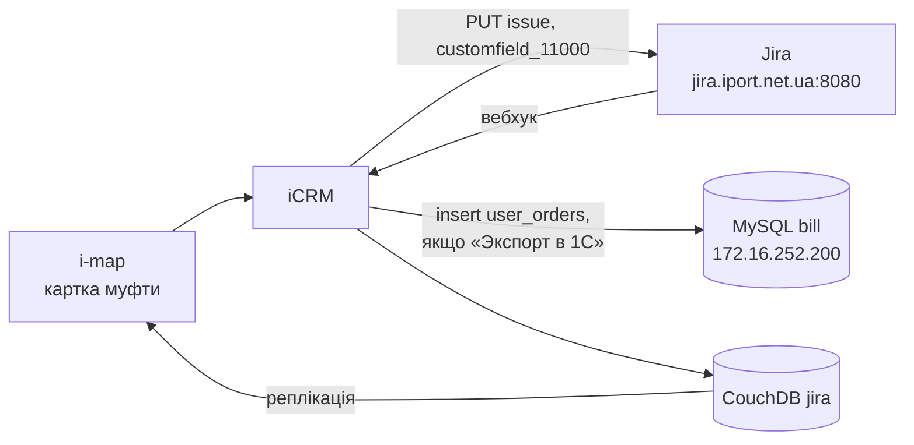

Як задача потрапляє в 1С — у наступній історії.

### Передати виконану роботу в 1С

**Монтажник, мережа.** Щоб робота на муфті, опорі чи кабелі потрапила в облік
1С (хто, коли, на якому обʼєкті, за яким ЄКМ), у задачі має стояти **«Экспорт в
1С»** — прапорець при створенні задачі або кнопка в списку задач картки.

i-map сам у 1С нічого не надсилає. Задача стає в чергу, а **1С сам забирає** її
з iCRM — і лише тоді, коли задачу в Jira закрито. Відкрита задача в черзі чекає.
Після того як 1С забрав роботу, він позначає її як прийняту, і вдруге вона не
передається.

Тому прапорець і вимагає провайдера та ЄКМ: без них 1С не знає, на яку компанію
й на який обʼєкт обліку списати роботу.

**Технічно**

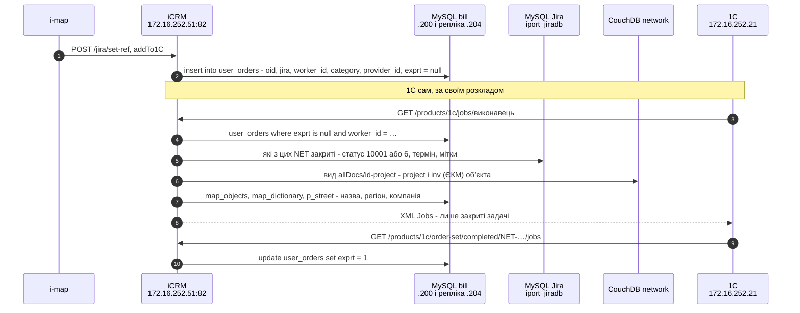

1С звертається до iCRM за адресою `/products/1c/...` (`routes/products.js`, реалізація —
`libs/products.js` icrm-server). Що 1С отримує по роботах на обʼєктах мережі:

| Запит 1С | Що повертає iCRM |
|---|---|
| `GET /products/1c/jobs/<виконавець>` | XML `Jobs` — усі ще не забрані (`exprt is null`) роботи виконавця, задачі яких закрито в Jira |
| `GET /products/1c/job/<NET-…>` | те саме для однієї задачі |
| `GET /products/1c/order-set/completed/<NET-…,NET-…>/jobs` | позначити роботи забраними: `exprt = 1`. Будь-яка інша дія замість `completed` повертає `exprt = NULL` — робота знову піде в наступну вигрузку |
| `GET /products/1c/box-by-name/<назва>`, `/box-by-id/<id>` | XML про обʼєкт: категорія, назва, id, регіон, компанія |
| `GET /products/1c/companies` | компанії-провайдери (`plat_providers` бази `bill`) |
| `GET /products/1c/objects` | довідники для 1С: працівники з Jira, товари сайту, послуги |

Один рядок `Job` у відповіді:

```xml
<Jobs>
  <Job JIRAId="NET-77355" InstallerId="<виконавець>" Date="28.08.2024"
       ObjectId="17392" ObjectName="b.bp931" Category="box"
       Project="<проєкт>" Inv="<ЄКМ>" Region="Борисполь" CompanyId="<id провайдера>"
       Description="bp931 : Монтаж муфты …" JiraLabel="build"/>
</Jobs>
```

| Атрибут | Звідки |
|---|---|
| `JIRAId`, `InstallerId`, `Description`, `Category` | рядок `bill.user_orders`, записаний при «Экспорт в 1С» |
| `Date` | термін задачі (`duedate`) у Jira |
| `ObjectId`, `ObjectName`, `Region` | `map_objects` і `map_dictionary` у MySQL `icrm`. `ObjectName` — перша літера категорії + назва обʼєкта |
| `Project`, `Inv` | документ обʼєкта в CouchDB `network`, поле `inv` — ЄКМ |
| `CompanyId` | провайдер з рядка, інакше — провайдер населеного пункту з `p_street` |
| `JiraLabel` | лише мітки `build`, `repair`, `tools13`, `servicerooms`, `servicehardware` |

Закритою вважається задача зі статусом `10001` або `6` у проєкті NET; це iCRM перевіряє
прямим запитом до бази Jira (`iport_jiradb`), а не через REST.

Як часто 1С забирає роботи, налаштовано на боці 1С ❓.

### Подивитися, хто й що міняв

**Мережа.** Вкладка **История**: дата, автор і що змінено —
підключені договори, робота з портами, сплітери, опис, підпис, координати.

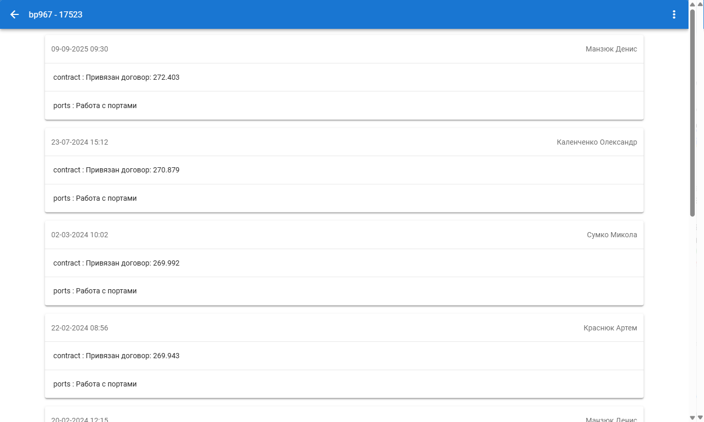

**Технічно**

Історія зберігається в самому документі муфти. Автор — «Имя Фамилия» з профілю
співробітника.

### Працювати з кросом (ODF)

**Мережа.** Крос показує не дільники, а комутацію волокон: вкладки — це кабелі,
заведені в ODF, рядки — волокна кабелю з кольорами.

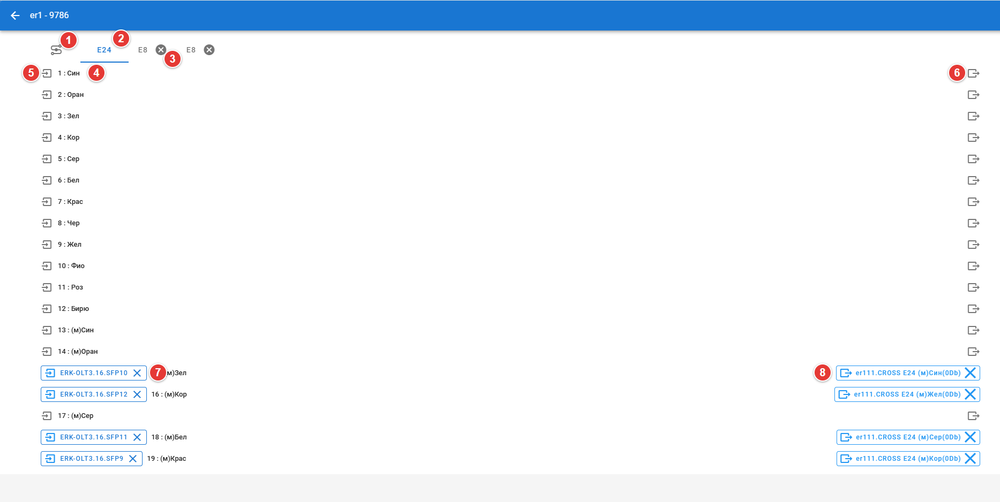

| № | Елемент | Значення |
|:-:|---|---|
| **1** | Крос | прохідні звʼязки |
| **2** | Кабель | вкладка кабелю: ємність `E24`, `E8` |
| **3** | ✕ на вкладці | прибрати кабель із кросу, якщо на ньому немає підключень |
| **4** | Волокно | номер і колір: `1 : Син`. `(м)` — другий модуль, волокна 13–24 |
| **5** | Вхід вільний | |
| **6** | Вихід вільний | |
| **7** | Вхід підключено | який порт ОЛТа світить у це волокно: `ERK-OLT3.16.SFP10` |
| **8** | Вихід підключено | куди йде волокно: муфта, сплітер, колір |

Порядок кольорів залежить від виробника кабелю — див. [cables.md](cables.md).

### Видалити муфту

**Мережа.** Меню ⋮ → видалити. Перед видаленням i-map перевіряє три речі, і
будь-яка з них блокує дію:

| Перевірка | Повідомлення |
|---|---|
| у муфти є входи й виходи | «Объект имеет связи» |
| є незакриті задачі NET | «Объект имеет отрытые Jira-задачи» |
| на обʼєкт списані матеріали в 1С | «Объект имеет списанные материалы в 1С» |

Тобто муфту видаляють лише порожньою: спершу знімають звʼязки, потім закривають задачі.

**Технічно**

- Перевірки робить i-map: звʼязки — у самому документі, задачі — у локальній базі `jira`,
  матеріали — `GET /map/box/equipment/<id>` в iCRM → 1С `172.16.252.21/IPORT/hs/equipment/object/<id>`.
- Видалення: `DELETE /map/object/<id>` (iCRM видаляє запис у `map_objects` MySQL `icrm`)
  і видалення документа з локальної `network`, далі — реплікацією в CouchDB.

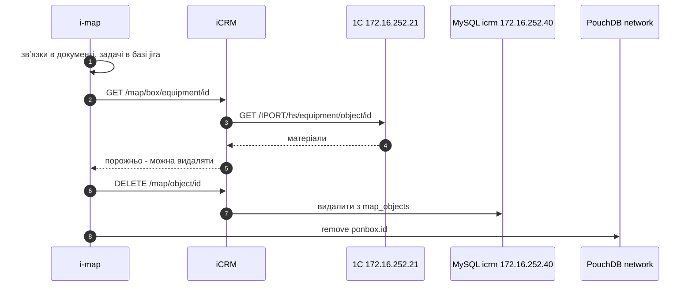
