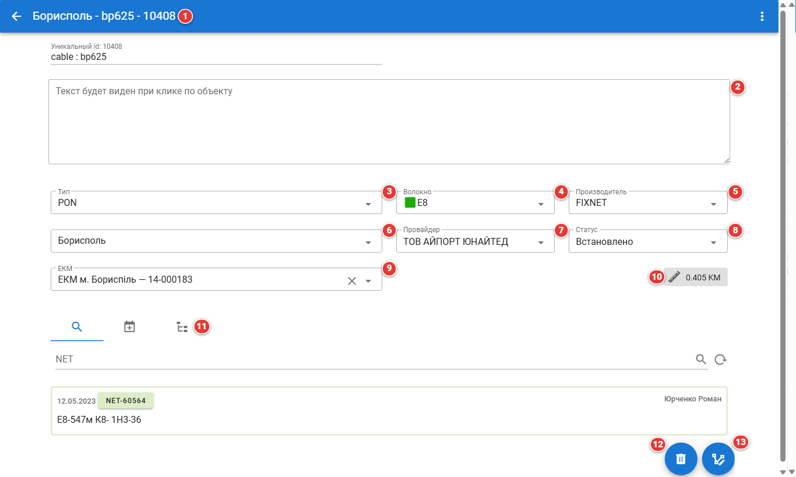
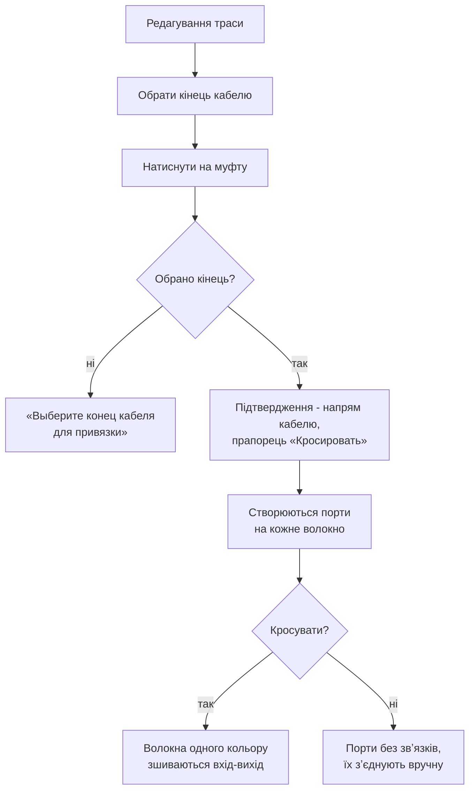

# Кабелі та опори

Кабель в i-map — не просто лінія на карті. Привʼязка кабелю до муфти створює в
муфтах порти на кожне волокно, тому цю дію роблять усвідомлено. Назад до
[i-map](README.md).

| Історія | Хто |
|---|---|
| Занести нову трасу | мережа, монтажник |
| Заповнити картку кабелю | мережа |
| Привʼязати кабель до муфт | мережа, монтажник |
| Поставити муфту в розрив кабелю | мережа, монтажник |
| Розірвати звʼязок муфти з кабелем | мережа |
| Вести опори | мережа |

---

### Занести нову трасу

**Мережа, монтажник.** На карті кнопка нової траси **[6]** (див.
[map.md](map.md)) вмикає режим малювання. Кліками ставлять точки зламу від
однієї муфти до іншої, унизу показується довжина в кілометрах. Кнопку видно,
лише коли у фільтрі вибрано один населений пункт.

Після малювання натискання на лінію відкриває картку кабелю. Довжина ніде не
зберігається — її щоразу рахують за точками траси.

### Заповнити картку кабелю

**Мережа.**

| № | Поле | Значення |
|:-:|---|---|
| **1** | Заголовок | населений пункт, назва, номер: `Борисполь - bp625 - 10408` |
| **2** | Описание | примітки по трасі, видно при натисканні на кабель |
| **3** | Тип | PON · Магистраль |
| **4** | Волокно | ємність: E2 · E4 · E8 · E12 · E16 · E24 · E48 · E96 · E8(ground). **Визначає колір лінії на карті** |
| **5** | Производитель | Одеса · Ютекс · Fin Mark · FIXNET. **Визначає порядок кольорів волокон** |
| **6** | Регион | населений пункт |
| **7** | Провайдер | юридичний власник |
| **8** | Статус | Проект · Погоджено · В роботу · Встановлено |
| **9** | ЕКМ | обʼєкт обліку, потрібен для експорту задач у 1С |
| **10** | Довжина | рахується автоматично |
| **11** | Робота з Jira | той самий блок, що в муфті, див. [box.md](box.md) |
| **12** | Видалити | |
| **13** | Редагувати трасу | точки траси стають перетягуваними |

**Виробник важливіший, ніж здається.** У кабелях Fin Mark порядок кольорів
інший: перше волокно синє, а не червоне. Якщо виробника вказали неправильно,
кольори волокон у схемах муфт не збігатимуться з тим, що бригада бачить у
реальній муфті. Якщо виробника не вказано, береться порядок Одеси.

| Виробник | Порядок кольорів |
|---|---|
| Одеса, Ютекс, FIXNET | Крас, Зел, Син, Жел, Бел, Сер, Кор, Фио, Бирю, Чер, Оран, Роз |
| Fin Mark | Син, Оран, Зел, Кор, Сер, Бел, … |

Волокна 13–24 — другий модуль, ті самі кольори з позначкою `(м)`.

На карті встановлений кабель (або без статусу) — суцільна яскрава лінія. Решта
статусів — бліда лінія з пунктиром.

**Технічно**

- Номер нового кабелю видає iCRM так само, як для муфти: `POST /map/upload` з категорією
  `cable` → процедура `insert_map_object` у MySQL `icrm` (`172.16.252.40`). Далі документ
  `cable.<id>` i-map пише в локальну `network`, `gps` — масив точок.
- Зміна регіону — `PUT /map/box/upd-region` (оновлює `map_objects`), видалення —
  `DELETE /map/object/<id>` після перевірки задач і матеріалів 1С, як у муфти.
- Кольори виробників — `cableProducers` у `src/models/network-item.js`. Стиль лінії —
  `netPolyOptions()` у `src/views/Map.vue`.

### Привʼязати кабель до муфт

**Мережа, монтажник.** У режимі редагування траси обирають кінець кабелю і
натискають на маркер муфти. i-map питає підтвердження «связь с муфтой», а для
першої муфти — напрям (вхідний чи вихідний) і чи **кросувати** волокна.

У вихідній муфті зʼявляється стільки вихідних портів, скільки волокон у кабелі,
у вхідній — стільки ж вхідних, кожен із номером волокна й посиланням на кабель.
Для E12 це 12 портів з кожного боку. Автоматичне кросування не спрацює, якщо у
вхідній муфті вже є два входи з однаковим волокном — тоді порти лишаються без звʼязків.

**Технічно**

`confirmCableConnection()` і `crossConnection()` у `src/models/network-item.js`. У муфті
кабель записується у `connectedCables`, у порті — `cable` і `fiber`.

### Поставити муфту в розрив кабелю

**Мережа, монтажник.** Якщо муфту привʼязують не до кінця, а до середини траси,
кабель ділиться на два окремі кабелі, а звʼязок «муфта А → муфта Б»
перебудовується в «муфта А → нова муфта → муфта Б». Старий кабель лишається в
базі з позначкою, що його розрізано, і на карті не малюється.

**Технічно**

Поля `ancestor` і `isAncestor` документа кабелю. Один проліт може бути кількома
документами, довжина рахується по частинах.

### Розірвати звʼязок муфти з кабелем

**Мережа.** Вкладка **Кабеля** в картці муфти, кошик у рядку кабелю. Видаляються
**усі** порти, створені цим кабелем, з обох боків — і в цій муфті, і в сусідній.
Окремі волокна так не знімаються — для цього хрестики на портах у схемі.

### Вести опори

**Мережа.** Опора — окремий обʼєкт («Столб» у кнопці додавання) зі своєю
карткою. Портів і сплітерів у неї немає: це облік фізичної інфраструктури, на
якій висить кабель.

| Поле | Значення |
|---|---|
| Регион, Подпись | населений пункт і підпис на карті |
| Тип | спосіб прокладання (ґрунт, підвіс, оренда, ККЕ) |
| Магистраль/PON | рівень мережі |
| Власник інфраструктури, Районний підрозділ ДТЕК, Дані власника | з ким узгоджувати підвіс і кому платити |
| Тип лінії | 0.4 · 6 · 10 кВ |
| Описание | довільний текст |

Нижче — той самий блок Jira, що в муфті, з темою `… : Монтаж опоры`. Колір
маркера, як і в муфти, залежить від задач.

Опори видно на карті лише при фільтрі «Без улиц» або для «СТ».

**Технічно**

Документ `pole.<id>` у базі `network`, картка — `src/components/PoleDialog.vue`.
