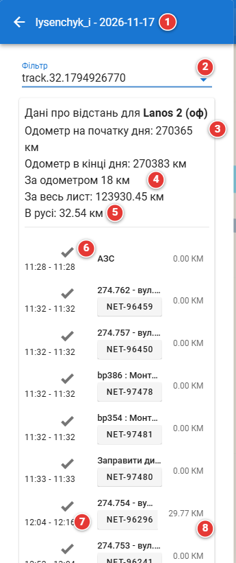
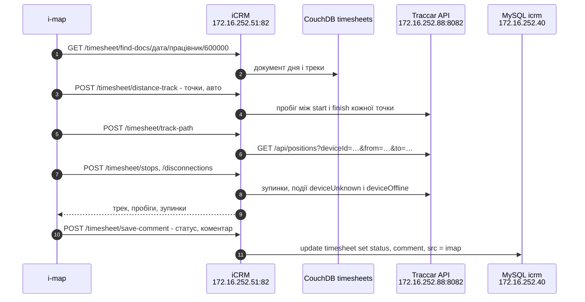

# Для мережевого відділу

Екрани для мережевого відділу. Відкриваються лише з
правом `timesheet-reports` або `architect`. Назад до [i-map](README.md).

| Історія | Хто |
|---|---|
| Перевірити подорожні листи бригади | мережа |
| Бачити автомобілі на карті наживо | мережа |

---

### Перевірити подорожні листи бригади

**Мережа.** Шар **«Отчет»** → кнопка з діаграмою зліва внизу. Вибирають
місяць і працівника, кнопка оновлення показує його робочі дні. «Детально»
відкриває день.

| № | Елемент | Значення |
|:-:|---|---|
| **1** | Працівник і дата | чий лист відкрито |
| **2** | Фільтр | трек дня. Якщо бригада міняла машину, треків кілька |
| **3** | Автомобіль, одометр | машина, показники на початок і кінець дня |
| **4** | За одометром | пробіг за показниками, які ввела бригада |
| **5** | В русі | пробіг за GPS-трекером між точками маршруту |
| **6** | Точка маршруту | фактичний час приїзду й виїзду, задача, населений пункт |
| **7** | Точка з реальним часом | `12:04 - 12:16` — бригада відмітила по ходу |
| **8** | Пробіг до точки | за трекером від попередньої точки |

Нижче — **«Підтвердження листа»**: статус «Одобрен» / «Не одобрен» і коментар.
Кнопка «Зберегти» записує їх у табель працівника за цей день.

На що дивитися:

- **пробіг за одометром проти «В русі»** — велика різниця означає, що одометр
  внесено неправильно або машина їздила поза маршрутом;
- **однакові часи на всіх точках** (усі `11:32 - 11:32`) — бригада відмітила точки
  разом наприкінці, а не по ходу дня. Пробіг до точок тоді нульовий, і перевірити
  маршрут неможливо;
- зупинки довші за 10 хвилин і моменти, коли трекер авто був недоступний, позначаються
  на карті окремо ❓.

**Технічно**

| Запит | Що робить iCRM | Куди |
|---|---|---|
| `GET /timesheet/find-docs/<дата>/<працівник>/<поріг>` | документ дня й треки працівника | CouchDB `timesheets` |
| `POST /timesheet/distance-track` | пробіг за трекером між часами кожної точки | Traccar |
| `POST /timesheet/track-path` | точки треку для карти | Traccar `/api/positions` |
| `POST /timesheet/stops` | стоянки довші за поріг (`maxStopMs` 600000 — 10 хв) | Traccar |
| `POST /timesheet/disconnections` | коли трекер був недоступний | Traccar `/api/reports/events` |
| `POST /timesheet/save-comment` | `update timesheet set status, comment, src = 'imap'` за датою й працівником | MySQL `icrm` |

Клієнт — `src/components/timesheet/RouteAdminDialog.vue`, `src/models/route-admin.js`.
Сервер — `routes/timesheet.js`, `libs/map.js` (`traccarPath`, `computeStopsSummary`,
`getDisconnectionPoints`, `updateCommentAndStatus`). Статус і коментар живуть у MySQL, а не в
документі треку.

### Бачити автомобілі на карті наживо

**Мережа.** Меню → «Настройки» → «Отслеживать координаты автомобилей»
([start.md](start.md)). Після цього кнопка справа внизу на карті відкриває
список автомобілів із прапорцями. Обрана машина зʼявляється на карті: зелена —
у русі, червона — стоїть, за нею тягнеться слід останніх хвилин.

Дані йдуть постійним зʼєднанням із Traccar, тож режим має сенс в офісі зі
стабільною мережею.

**Технічно**

`src/models/traccar.js`: браузер напряму, без iCRM, відкриває WebSocket
`wss://traccar.iport.net.ua/api/socket` (Traccar `172.16.252.88`) з обліковим записом Traccar
із коду застосунку. Список машин — документ `availableCars` у локальній базі `timesheet`.
