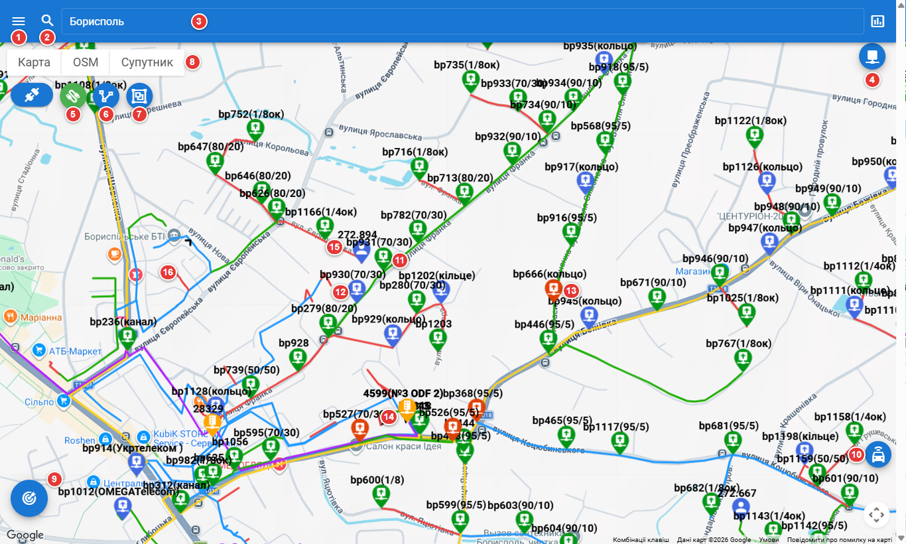
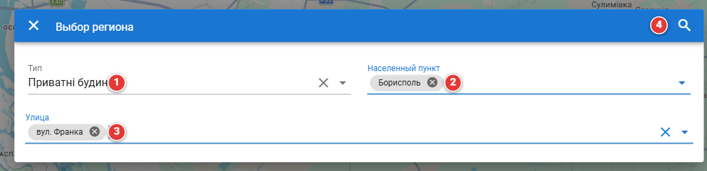
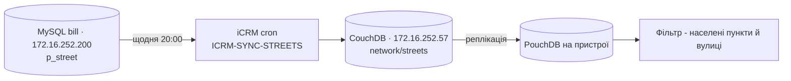
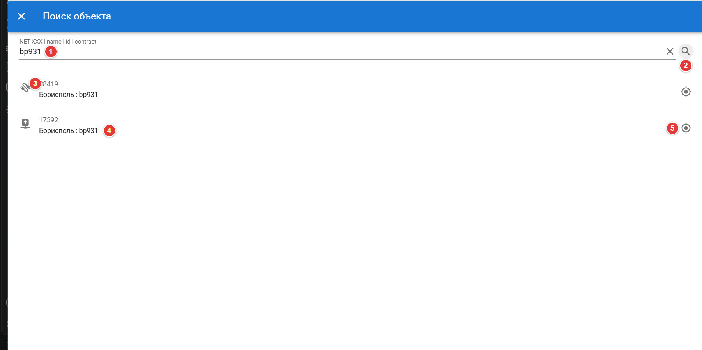
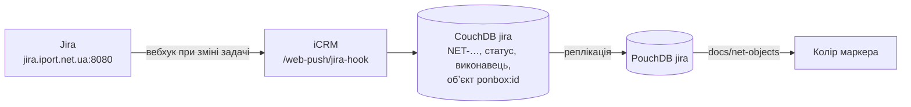
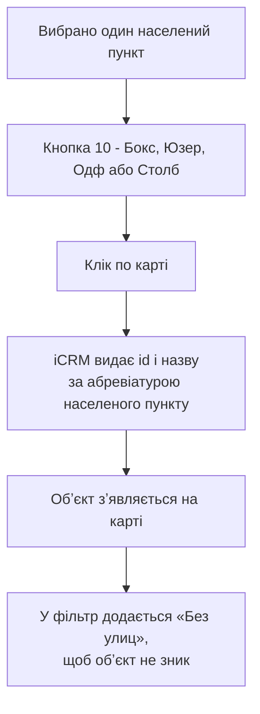
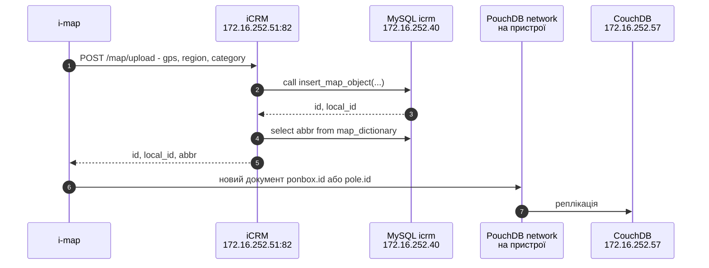

# Карта мережі

Головний екран i-map. Карта одна, але показує різні шари: мережу, магістраль,
подорожні листи. Назад до [i-map](README.md).

| Історія | Хто |
|---|---|
| Показати мережу населеного пункту | усі |
| Знайти муфту, кабель або абонента | оператор, монтажник, мережа |
| Зрозуміти маркер за кольором | усі |
| Перемкнути шар карти | усі |
| Додати на карту нову муфту, ODF, опору або абонента | мережа, монтажник |
| Перенести обʼєкт в іншу точку | мережа, монтажник |
| Показати себе або автомобілі | монтажник, мережа |

Детальний розбір елементів карти з привʼязкою до полів бази — у довіднику [Карта мережі та PON — елементи екранів](../../ui_map.md).

| № | Елемент | Що робить |
|:-:|---|---|
| **1** | Меню | версія, PON-сигнали, профіль, налаштування, вихід |
| **2** | Лупа | пошук обʼєкта |
| **3** | Населений пункт | великим — обраний населений пункт, дрібним — вулиці. Натискання відкриває фільтр |
| **4** | Шар карти | Сеть, Карта сети, Отчет та інші |
| **5** | Кабелі | показати кабелі населеного пункту або лише магістральні |
| **6** | Нова траса | режим малювання кабелю, див. [cables.md](cables.md) |
| **7** | Кластеризація | зводити близькі маркери в групи з числом. Вимкнути, щоб бачити кожну муфту |
| **8** | Підкладка | схема Google, OpenStreetMap, супутник |
| **9** | Додати обʼєкт | Бокс, Юзер, Одф, Столб |
| **10** | Моя позиція / автомобілі | у монтажника — показати себе, у мережевого відділу — список автомобілів |
| **11** | Муфта, зелена | задача виконана або муфта позначена як зварена. Підпис — назва і сплітер, `bp931(70/30)` |
| **12** | Муфта, синя | задач Jira немає |
| **13** | Муфта, червона | є відкрита задача Jira |
| **14** | ODF | оптичний крос, завжди жовтий |
| **15** | Абонент | точка абонента з номером договору |
| **16** | Кабель | колір — ємність кабелю |

---

### Показати мережу населеного пункту

**Усі.** Поки населений пункт не вибрано, мережевих обʼєктів на карті немає
взагалі. Натискання на поле **[3]** відкриває фільтр.

| № | Поле | Що вибирають |
|:-:|---|---|
| **1** | Тип | Приватні будинки · СТ (садові товариства) · Квартири |
| **2** | Населенный пункт | один або кілька |
| **3** | Улица | конкретні вулиці, «Все улицы», «Без улиц». Для «Квартири» й однієї вулиці зʼявляється ще поле «Дом» |
| **4** | Лупа | застосувати |

Після лупи карта стає на населений пункт, вибираються обʼєкти, довантажуються
кабелі. Вибір запамʼятовується на пристрої.

**На практиці майже завжди потрібне «Без улиц».** Більшості муфт вулицю не
проставлено: у приватному секторі всіх населених пунктів понад 10 тис. обʼєктів
без вулиці і лише кілька десятків — з вулицею. Фільтр «Все улицы» показує лише
тих, у кого вулиця є, тому без «Без улиц» карта буде майже порожньою. Найчастіше
вибирають обидва — «Все улицы» і «Без улиц».

Інші особливості:

- тип забудови важливий: муфта в багатоквартирному будинку не зʼявиться при
  типі «Приватні будинки», навіть якщо населений пункт і вулиця правильні;
- для «СТ» вулиці не застосовуються — садове товариство вибирається цілим;
- новий обʼєкт одразу після створення не має вулиці, тому i-map сам додає у
  фільтр «Без улиц» — інакше маркер зник би.

**Технічно**

- Набір обʼєктів — couch-види `streets/*` у базі `network`. Назва виду складається з
  типу (`pole`, `poleST`, `apartm`, `noType`) і вулиць (`AllStreets`, `NoStreets`,
  `SelectedStreets`). При «Все улицы» + «Без улиц» робляться два запити й результати
  зливаються. Для «Квартири» з будинком — `box/by-address`, ключ `<id вулиці>.<будинок>`.
- Код — `load()` у `src/models/network-items.js`, діалог — `src/components/RegionsFilterPopup.vue`.
- Центр населеного пункту — `GET /map/position/region/<назва>` в iCRM →
  `select … from map_objects where category = 'region'` у MySQL `icrm` (`172.16.252.40`).
- Довідник вулиць — документ `streets` у базі `network`. Його щодня о 20:00 оновлює iCRM
  (cron `ICRM-SYNC-STREETS`, `syncCouchStreets()` у `libs/monthly.js`) з таблиці `p_street`
  бази `bill` (`172.16.252.200`): назва вулиці, `streetId`, провайдер. Назви населених
  пунктів у ньому російською («Борисполь», «Барышевка»).

### Знайти муфту, кабель або абонента

**Оператор, монтажник, мережа.** Лупа **[2]** відкриває пошук. Що саме шукати,
i-map визначає сам за введеним текстом.

| № | Елемент | Значення |
|:-:|---|---|
| **1** | Рядок пошуку | номер договору, внутрішній id, назва або задача NET |
| **2** | Шукати | запуск пошуку |
| **3** | Значок категорії | муфта, кабель, ODF, опора, абонент |
| **4** | Результат | id і «населений пункт : назва» |
| **5** | Приціл | перейти до обʼєкта на карті |

| Що ввели | Як розпізнається | Приклад |
|---|---|---|
| є крапка | номер договору | `274.661` |
| лише цифри | внутрішній id | `17392` |
| починається з `NET-` | задача Jira | `NET-96954` |
| решта | назва обʼєкта | `bp931` |

Приціл **[5]** сам перемикає фільтр на населений пункт і тип забудови обʼєкта,
вмикає шар «Сеть» і наближає карту на максимум. Для кабелю карта стає на
середину траси й показує його назву у виносці.

Те саме робить пряме посилання `…/imap/track/#/map/network/<id>` — так i-map
відкривається з картки абонента в iCRM. Якщо обʼєкта ще немає в копії на
пристрої, зʼявиться «Объект не найден».

**Технічно**

- Розпізнавання — `src/models/search.js` (фрагмент коду — у [technical.md](technical.md)).
- Види: `box/by-contract`, `box/by-id`, `box/by-localId` у базі `network`. Для
  задачі спершу `docs/objId-by-net` у базі `jira`, потім `box/by-id`.
- Пряме посилання обробляє `goToNetworkObject()` у `src/views/Map.vue`: спершу
  піднімає документ, виставляє за ним регіон, тип і вулиці, і лише потім завантажує карту.

### Зрозуміти маркер за кольором

**Усі.** Колір муфти й опори показує стан задач Jira, привʼязаних до неї.

| Колір | Що означає |
|---|---|
| зелений | задача виконана, або на муфті стоїть позначка «Муфта сварена» |
| жовтий | задача в роботі й має виконавця |
| червоний | є відкрита задача |
| синій | задач немає. У спрощеному режимі — всі муфти |
| фіолетовий | адреса обʼєкта не збіглася з довідником будинків — ознака помилки в адресі |
| жовтий значок ODF | оптичний крос, колір не залежить від задач |

Якщо задач кілька, береться найважливіша: спершу відкрита, потім у роботі.
Червоні й жовті маркери малюються поверх інших, щоб не ховатися під сусідніми.

Підпис муфти — назва і сплітер з поля «Подпись»: `bp931(70/30)`, `bp735(1/8ок)`,
`bp917(кольцо)`.

**Технічно**

`getColor()` у `src/components/MapMarkers.vue`: статус Jira `10001` — зелений,
`3` з виконавцем — жовтий, інший — червоний. Статуси підтягує `assignStatuses()`
у `src/models/network-items.js` через вид `docs/net-objects` бази `jira` за ключем
`ponbox:<id>` або `pole:<id>` — по одному запиту на кожну муфту.

Звʼязок задачі з обʼєктом — поле Jira `customfield_11000` («ObjectId») зі значенням
`ponbox:<id>` або `pole:<id>`. Його ставить i-map при привʼязці задачі ([box.md](box.md)).

### Перемкнути шар карти

**Усі.** Кнопка **[4]** справа вгорі. Шар записується в адресу сторінки
(`#/map/network`, `#/map/netMap`, …).

| Шар | Що показує | Де описано |
|---|---|---|
| **Сеть** | муфти, ODF, опори, абоненти, кабелі | цей документ, [box.md](box.md), [cables.md](cables.md) |
| **Карта сети** | магістраль: траси між населеними пунктами й вузли | [netmap.md](netmap.md) |
| **Отчет** | подорожній лист бригади, у мережевого відділу — перевірка листів | [timesheet.md](timesheet.md), [management.md](management.md) |
| Квартирный, Камера, Баннер, Пластик, Визитница | будинки, камери відеоспостереження, рекламні носії. Обʼєкти й фото зберігаються в iCRM, а не в CouchDB | — |

### Додати на карту нову муфту, ODF, опору або абонента

**Мережа, монтажник.** Кнопка **[9]** розкривається на чотири: **Бокс**,
**Юзер**, **Одф**, **Столб**. Після вибору наступний клік по карті створює
обʼєкт у цій точці. Потрібен звʼязок: номер і назву видає сервер.

Кнопку видно, лише коли у фільтрі вибрано **рівно один** населений пункт.

Абонент, доданий кнопкою «Юзер», видно на карті з номером договору. Абонентів,
підключених через порт муфти, на карті немає — вони живуть у схемі муфти.

**Технічно**

- Клієнт — `addFlag()` у `src/views/Map.vue`. Категорія `ponbox` надсилається як `box`.
- Сервер — `routes/map.js` icrm-server, `POST /upload/:mid?`. Номер обʼєкта — лічильник у
  таблиці `map_objects`, назва — абревіатура населеного пункту з `map_dictionary` + номер
  (`bp` — Бориспіль, `er` — Єрківці).
- Сам документ мережі пише вже i-map у локальну базу, сервер про нього більше нічого не знає.

### Перенести обʼєкт в іншу точку

**Мережа, монтажник.** Координати змінюють із картки обʼєкта: кнопка прицілу
внизу картки закриває її, і маркер можна перетягнути. Нова точка зберігається
кнопкою збереження в картці. Привʼязані до муфти кабелі тягнуться за нею.

### Показати себе або автомобілі

**Монтажник.** Кнопка **[10]** показує свою позицію — з телефона або з трекера
автомобіля, залежно від налаштування «Источник GPS данных»
([start.md](start.md)).

**Мережа.** Замість цього — список автомобілів із прапорцями. Обрані
показуються на карті живими маркерами: зелений — у русі, червоний — стоїть.
Потрібно увімкнути «Отслеживать координаты автомобилей» у налаштуваннях.

**Технічно**

- Живі авто для мережевого відділу — браузер напряму відкриває WebSocket
  `wss://traccar.iport.net.ua/api/socket` (Traccar `172.16.252.88`), з обліковим записом
  Traccar із коду застосунку (`src/models/traccar.js`).
- Позиція автомобіля бригади — `GET /map/traccar-gps/<id>` в iCRM → Traccar API
  `172.16.252.88:8082/api`, остання позиція пристрою.
- Позиція телефона — геолокація браузера.
