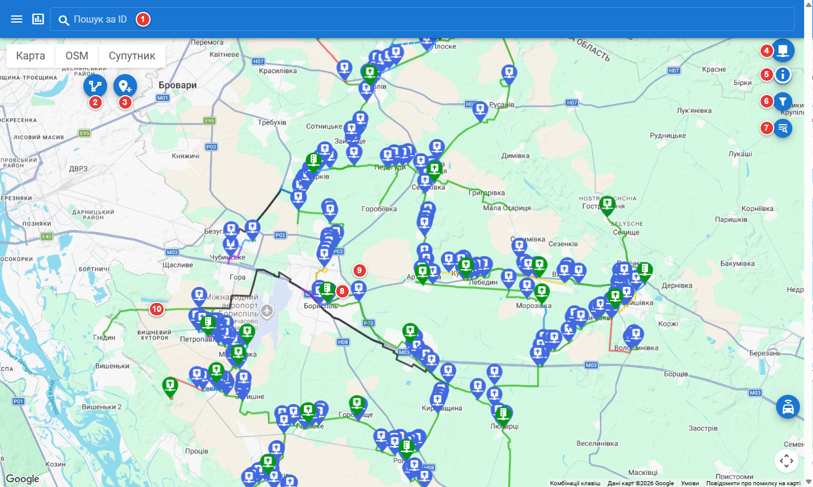
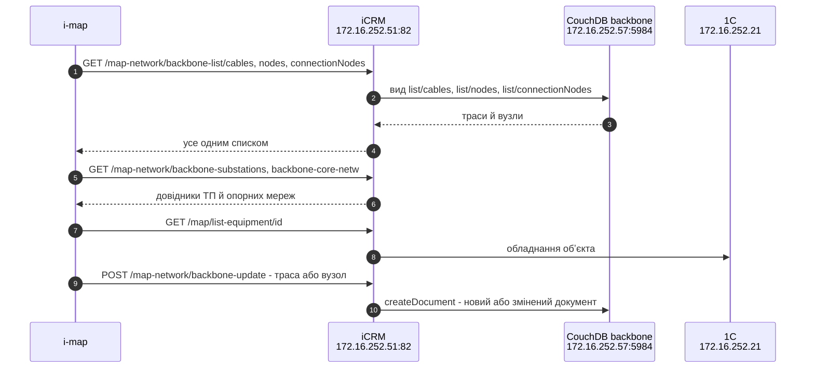
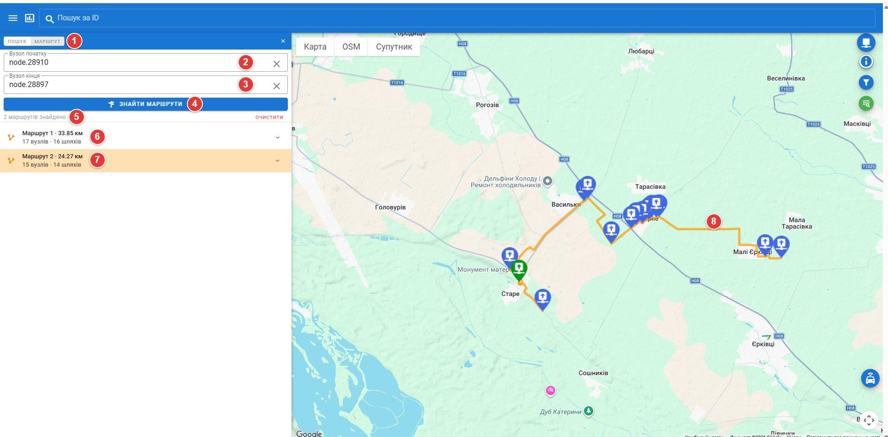
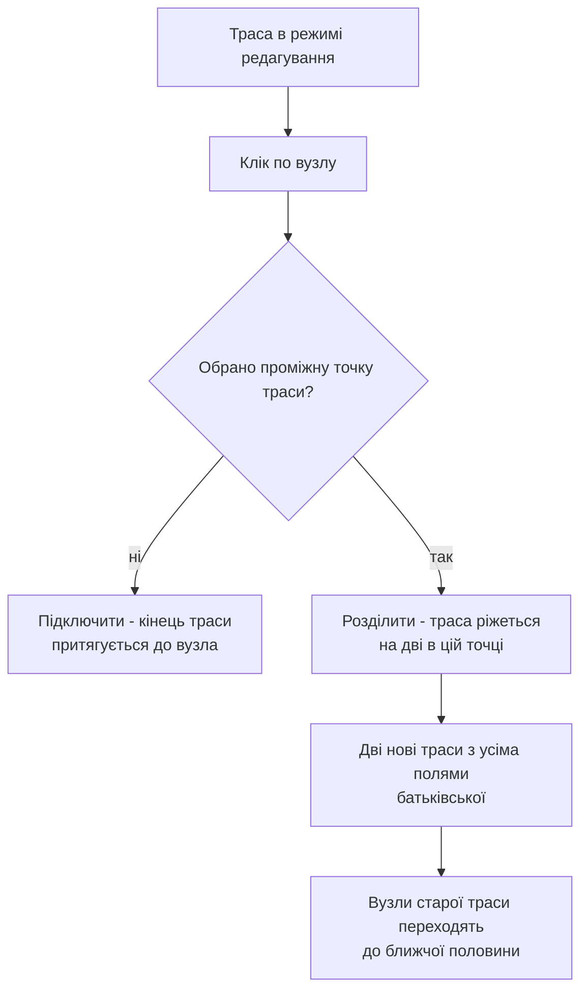

# Магістральна мережа

Шар **«Карта сети»** — окремий рівень обліку, не повʼязаний зі схемами муфт.
Тут описана магістраль: оптичні траси між населеними пунктами й вузли, в яких
вони сходяться, а також опори, власники інфраструктури й статус узаконення
підвісу. Назад до [i-map](README.md).

Відмінність від шару «Сеть»: там облік волокон і портів, тут — облік трас.

| Історія | Хто |
|---|---|
| Подивитися магістраль | мережа |
| Знайти обхідний маршрут між двома вузлами | мережа |
| Знайти неузаконені ділянки | мережа |
| Занести нову трасу або вузол | мережа |
| Привʼязати трасу до вузла або розрізати її | мережа |

| № | Елемент | Що робить |
|:-:|---|---|
| **1** | Пошук за ID | підсвітити траси й вузли за переліком ідентифікаторів |
| **2** | Нова траса | малювання траси кліками по карті |
| **3** | Новий вузол | вузол зʼєднання в точці кліку |
| **4** | Шар карти | повернутися на інші шари |
| **5** | Зведення | загальна довжина трас за ємністю |
| **6** | Фільтр | показати лише траси з обраним статусом узаконення |
| **7** | Панель пошуку | бічна панель: пошук і маршрут |
| **8** | Вузол з обладнанням | зелений. Вузли рівня «Бекбон» — значком кросу, решта — значком муфти |
| **9** | Вузол зʼєднання | синій — службова точка, де сходяться траси, без обладнання |
| **10** | Траса | колір — ємність кабелю |

---

### Подивитися магістраль

**Мережа.** Шар «Карта сети». Натискання на трасу відкриває її
картку:

| Поле | Значення |
|---|---|
| Рівень | Бекбон · Магістраль · Доступ |
| Належить | провайдер |
| Тип | спосіб прокладання (ґрунт, підвіс, оренда, ККЕ) |
| Ємність | E1 … E96 — визначає колір лінії |
| Лінія (РЕС), ТП, Диспечерська назва ПЛ | лінія електропередач, на якій висить кабель |
| Регіон | населений пункт |
| Статус мережі | Експлуатація · Проект |
| Власник інфраструктури, Районний підрозділ ДТЕК, Дані власника | з ким узгоджувати підвіс |
| Тип лінії | 0.4 · 6 · 10 кВ |
| Кількість опор, Опорна мережа | |
| Статус погодження | Узаконено · Не узаконено · Без можливості узаконити · УЗАКОНЮЄТЬСЯ · На домовленості |

Нижче — вкладки **Опис** (обладнання, списане на обʼєкт у 1С), **Деталі**
(довільний текст) і для вузла — **Шляхи**: привʼязані траси.

Шар потребує звʼязку: магістраль не копіюється на пристрій, її щоразу
завантажують через iCRM.

**Технічно**

- Окрема база CouchDB `backbone`, на пристрій не реплікується. i-map працює з нею лише через
  iCRM (`libs/map.js`: `getNetworkMap`, `createNetworkMapObject`, `updateNetworkMapObject`,
  `deleteNetworkMapObject`).
- Пошук маршруту рахується в браузері по завантаженому списку, без запитів на сервер.
- Код — `src/models/network-map.js`, `src/components/Backbone*.vue`.

### Знайти обхідний маршрут між двома вузлами

**Мережа.** Пошкоджено магістраль між двома вузлами — чи є обхід і якої
довжини? Панель пошуку **[7]** → режим **«Маршрут»**.

| № | Елемент | Значення |
|:-:|---|---|
| **1** | Режим | Пошук · Маршрут |
| **2** | Вузол початку | ідентифікатор виду `node.28910` |
| **3** | Вузол кінця | |
| **4** | Знайти маршрути | неактивна, поки обидва вузли не знайдено |
| **5** | Скільки знайдено | «очистити» прибирає результат |
| **6** | Маршрут | довжина, кількість вузлів і трас. Стрілка розкриває перелік ідентифікаторів |
| **7** | Обраний маршрут | підсвічений |
| **8** | Маршрут на карті | помаранчевим, решта трас ховається |

i-map перебирає всі шляхи між вузлами по привʼязаних трасах, не проходячи двічі
через той самий вузол, і для кожного рахує сумарну довжину.

Якщо маршрут не знаходиться, найчастіше причина не в тому, що фізичного шляху
немає, а в тому, що **траси не привʼязані до вузлів**: пошук іде по привʼязках, а
не по тому, як лінії лежать на карті.

**Технічно**

Перебір у глибину з множиною відвіданих вузлів — `src/models/network-map.js`. Колір
знайденого маршруту — `#FF9800`.

### Знайти неузаконені ділянки

**Мережа.** Фільтр **[6]** показує на карті лише траси з обраним
статусом погодження. Наприклад, «Не узаконено» — робочий перелік того, що треба
оформити з власником опор. «Скинути» повертає всі траси.

### Занести нову трасу або вузол

**Мережа.** Кнопка **[2]** — малювання траси кліками, унизу показується довжина.
Кнопка **[3]** — наступний клік по карті ставить вузол зʼєднання. Обидві видно,
коли у фільтрі вибрано один населений пункт.

Щоб перенести вузол, по ньому клацають правою кнопкою: вузол стає
перетягуваним, унизу зʼявляється «Перетягніть вузол, потім збережіть».

### Привʼязати трасу до вузла або розрізати її

**Мережа.** У картці траси — редагування, потім клік по вузлу. Зʼявляється вікно
«Дія з вузлом»:

Після привʼязки кінець траси фіксується на вузлі: якщо його потягнути, він
повернеться. Так траси не розходяться з вузлами при редагуванні.
