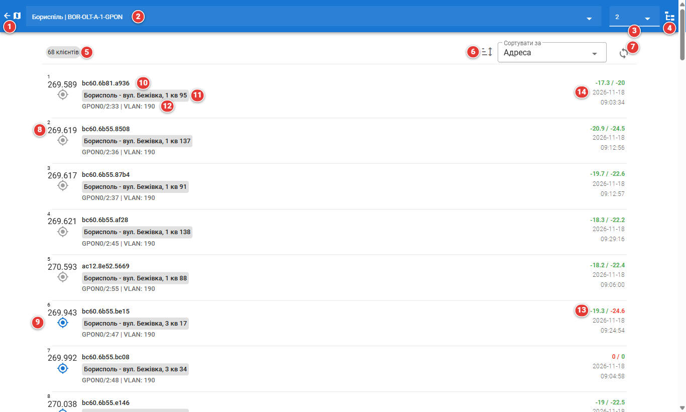
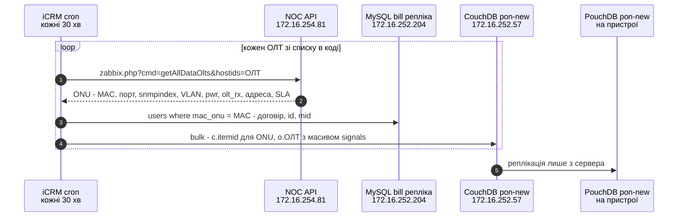
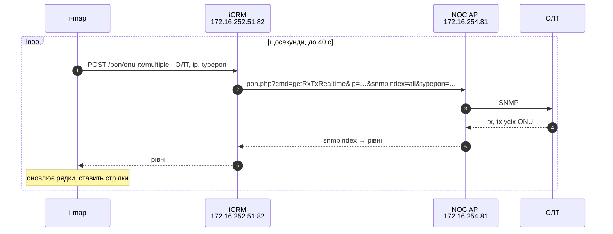
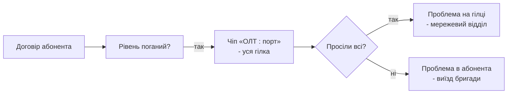
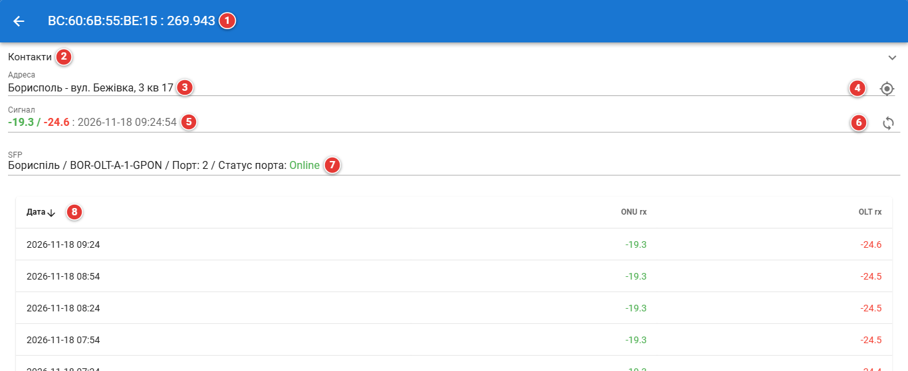

# PON-сигнали

Окремий екран i-map. Відповідає на два питання: **який зараз рівень сигналу в
абонента** і **хто ще підключений на тій самій гілці**. Відкривається з меню (☰) →
**PON**, з картки муфти — натисканням на договір у порту, або посиланням з
iCRM. Назад до [i-map](README.md).

| Історія | Хто |
|---|---|
| Знайти абонента і його рівень сигналу | оператор |
| Зняти рівні наживо | оператор, мережа |
| Перевірити, чи проблема в усієї гілки | оператор, мережа |
| Подивитися історію рівнів абонента | оператор, мережа |
| Перейти від абонента до його муфти | оператор, монтажник |

Покроковий опис елементів екрана з привʼязкою до полів бази `pon-new` — у
довіднику [Карта мережі та PON — елементи екранів](../../ui_map.md), розділ 6.

| № | Елемент | Що робить |
|:-:|---|---|
| **1** | Назад, карта | повернутися на попередній екран або на карту в тому ж вигляді |
| **2** | ОЛТ | вибір станційного комутатора, з населеним пунктом |
| **3** | SFP | порт ОЛТа. «Всі» — усі порти цього ОЛТа |
| **4** | Режим | ОЛТи · Адреса · Телефон · Договір |
| **5** | Лічильник | скільки абонентів у вибірці |
| **6** | Сортування | Адреса · ONUrx · OLTrx · Фіз.№ ONU, і напрям |
| **7** | Оновити | опитати обладнання наживо |
| **8** | Договір | номер договору. Червона цифра над ним — кількість звернень абонента |
| **9** | Приціл | на карту до муфти абонента. Синій — муфту знайдено, сірий — абонент не привʼязаний до порту жодної муфти |
| **10** | ONU | MAC абонентського термінала. Натискання — картка абонента |
| **11** | Адреса | натискання — режим «Адреса» по цій вулиці |
| **12** | Порт і VLAN | логічний порт ОЛТа й номер ONU на ньому, VLAN |
| **13** | Рівні | ONU rx / OLT rx у dBm |
| **14** | Час | коли рівні виміряно |

---

### Знайти абонента і його рівень сигналу

**Оператор.** Абонент телефонує: «інтернет пропадає». Оператор відкриває PON,
вибирає режим **[4]** і шукає абонента:

| Режим | Що вводять | Коли зручно |
|---|---|---|
| **Договір** | номер договору | звичайне звернення |
| **Телефон** | номер телефону | абонент не памʼятає договору |
| **Адреса** | населений пункт → вулиця → будинок | звернення по вулиці чи будинку |
| **ОЛТи** | ОЛТ і SFP-порт | подивитися всю гілку |

Як читати рівні **[13]**:

| Значення | Правило |
|---|---|
| **ONU rx** — перше число | що бачить термінал абонента. Зелене від −15 до −27 dBm, інакше червоне |
| **OLT rx** — друге число | що бачить ОЛТ від абонента. Червоне, якщо відрізняється від першого на 5 dB і більше |
| `0 / 0` | термінал вимкнений або не відповідає |

Велика різниця між двома числами — окрема ознака: сигнал в обидва боки йде тим
самим волокном, тому несиметрія вказує на проблему на волокні або зварці, а не
в сплітерах.

**Технічно**

- Дані — локальна копія бази `pon-new`. Її кожні 30 хвилин оновлює iCRM з NOC API
  (cron `ICRM-OLT-SCAN`), тож рівні в списку — до пів години давності.

- Документ ONU — `c.<itemid>`, документ ОЛТа — `o.<id>`. Рівні лежать не в ONU, а в масиві
  `signals` ОЛТа. Для GPON MAC шукається за закінченням (`like '%…'`), для EPON — точно.
- Перелік ОЛТів записаний у `libs/pon-export.js` icrm-server: новий ОЛТ не зʼявиться в i-map,
  поки його не додадуть у код.
- Види: `list/onus` (ключ `<ОЛТ>|<порт>`), `list/regions` (`регіон|вулиця|будинок`),
  `list/phones`, `list/contracts`.
- Кольори — `src/models/signals.js`: `-15 > pwr > -27` — зелений, `|pwr - olt_rx| >= 5` — червоний.

### Зняти рівні наживо

**Оператор, мережа.** Кнопка **[7]**. iCRM опитує ОЛТ напряму, значення в
списку оновлюються щосекунди протягом 40 секунд, поки іконка обертається. Поруч
із рівнем зʼявляється стрілка: зелена донизу — сигнал покращився, червона
вгору — погіршився. Так зручно перевірити результат, коли бригада на місці
перезварює волокно.

У режимі «Адреса» абоненти однієї вулиці можуть бути на різних ОЛТах — тоді
опитуються всі. Якщо вибрано лише населений пункт без вулиці, кнопка неактивна:
опитувати обладнання по всьому місту i-map не дає.

Свіжий замір живе лише на екрані: у базу й історію він не записується.

**Технічно**

iCRM сам ОЛТ не опитує — він передає запит у NOC API, а той іде на ОЛТ по SNMP.

- Для всієї вибірки — `POST /pon/onu-rx/multiple` (`rxTxMultipleOlts()` у `libs/pon.js`), для
  однієї ONU — `GET /pon/onu-rx/<ip>/<snmp>/<тип>`.
- Таймер 40 с — `updateSignals()` у `src/models/signals.js`. Помилка NOC приходить як
  «Помилка на pon.php».

### Перевірити, чи проблема в усієї гілки

**Оператор, мережа.** У режимах «Договір», «Телефон» і «Адреса» під MAC абонента
є чіп **«ОЛТ : порт»**. Натискання перемикає екран у режим «ОЛТи» і показує
**всіх абонентів цього порту**. Якщо просіли всі — справа не в абоненті, а в
гілці. Натискання на адресу **[11]** показує сусідів по вулиці.

### Подивитися історію рівнів абонента

**Оператор, мережа.** Натискання на рядок відкриває картку абонента.

| № | Елемент | Значення |
|:-:|---|---|
| **1** | Заголовок | MAC ONU і договір |
| **2** | Контакти | телефони абонента. Натискання набирає номер, значок поруч відкриває Viber |
| **3** | Адреса | |
| **4** | Приціл | на карту до муфти |
| **5** | Сигнал | ONU rx / OLT rx і час заміру |
| **6** | Оновити | живе опитування, як у списку |
| **7** | SFP | населений пункт, ОЛТ, порт і стан порту: Online або Offline |
| **8** | Історія | рівні по датах, кожні 30 хвилин |

Історія відрізняє поступове погіршення (волокно, конектор) від різкого обриву.
Вона зазвичай свіжіша за рядок у списку: її тягнуть із сервера в момент
відкриття картки.

**Технічно**

| Що | Запит в iCRM | Куди йде iCRM |
|---|---|---|
| Історія | `GET /pon/history/<ОЛТ>/<MAC ONU>` | NOC `zabbix.php?cmd=getPonRxTxDetils&mac_onu=…&countrows=350` — останні 350 замірів. Поля `rx`, `tx` перейменовуються в `pwr`, `olt_rx` |
| Стан порту | `GET /pon/onu-rx/<ip>/<snmp>/<тип>/operstatus` | NOC `pon.php?operstatus=1&cmd=getRxTxRealtime…` → SNMP ОЛТа, `admin_status` і `operstatus` |
| Телефони | — | з локальної `pon-new`, туди вони потрапляють з адреси абонента в NOC |

Помилка NOC приходить як «Помилка на zabbix.php». Код — `src/components/SignalsClientDialog.vue`,
сервер — `libs/pon.js` (`rxTxHistory`, `rxTx`).

### Перейти від абонента до його муфти

**Оператор, монтажник.** Приціл **[9]** відкриває карту й наводить її на муфту,
до порту якої підключено абонента. Сірий приціл означає, що абонент не
привʼязаний до жодного порту в i-map — його треба підключити в схемі муфти
([box.md](box.md)). Зворотний шлях — натискання на договір у схемі муфти —
відкриває цей екран.

**Технічно**

Зіставлення ONU з картою — вид `box/contract` бази `network` за ключем
`<договір>|<id аліаса>`: у одного договору може бути кілька ONU, і кожен
привʼязаний до свого порту.
