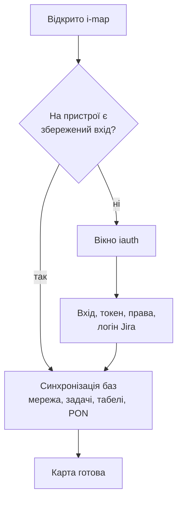
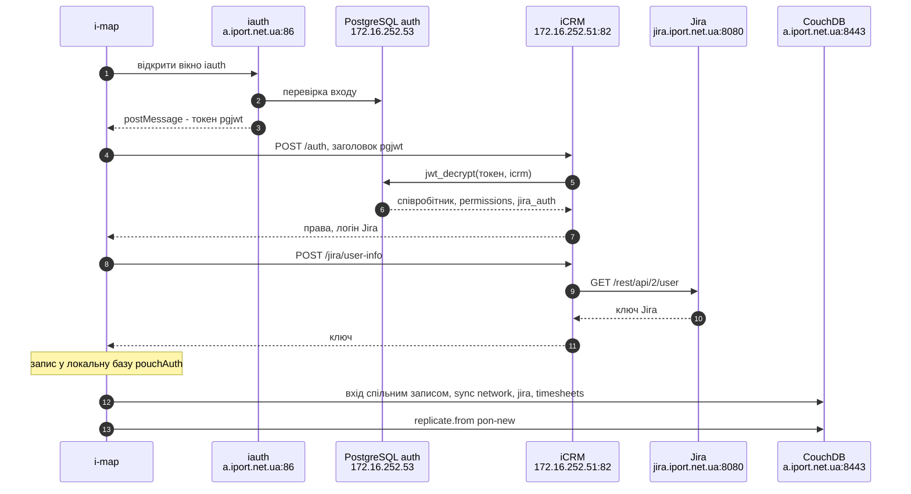
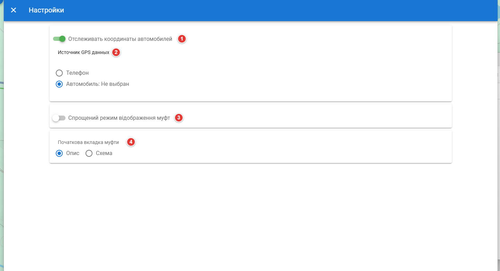

# Вхід, робота без звʼязку, налаштування

Що відбувається від першого запуску до моменту, коли карта готова до роботи в
полі. Назад до [i-map](README.md).

| Історія | Хто |
|---|---|
| Встановити i-map на телефон і увійти | усі |
| Працювати без звʼязку | монтажник / бригада |
| Оновити застосунок до нової версії | усі |
| Налаштувати застосунок під себе | усі, частину — мережа |
| Побачити нові права після їх зміни | усі |

---

### Встановити i-map на телефон і увійти

**Монтажник / бригада, мережа, оператор.** Співробітник відкриває в Chrome
`a.iport.net.ua/imap/track/` і додає сторінку на головний екран — далі
i-map відкривається як звичайна програма, без адресного рядка.

Під час першого запуску відкривається вікно входу iauth. На телефоні браузер
часто блокує спливне вікно — тоді i-map показує екран із кнопкою **«Увійти»**,
і вікно відкривається вже по дотику. Після входу застосунок запамʼятовує токен
і права, і **більше вхід не потрібен** — навіть без інтернету.

Одразу після входу починається перше завантаження мережі на пристрій. Воно
триває кілька хвилин, а перші пошук і відкриття карти — ще довше: пристрій
будує власні індекси. Поки це не завершилось, карта порожня, а пошук нічого не
знаходить.

**Технічно**

- Вхід — `a.iport.net.ua:86/iauth/#icrm` (iauth-server на `srv-app-1`, база `auth` на
  `172.16.252.53`). Токен повертається у вікно i-map через `postMessage`.
- Кожен наступний запит до iCRM несе заголовок `pgjwt`. iCRM розшифровує його в PostgreSQL
  (`pgjwtCheck` у `auth.js` icrm-server) і кладе в `req.user` права й `jira_auth` — з ним
  потім іде кожен запит до Jira.
- Усе це записується в локальну базу `pouchAuth`. Код — `src/utils/auth.js`, `src/utils/pouch.js`.
- На повну копію — приблизно 40 тис. документів мережі, 55 тис. задач Jira,
  28 тис. документів PON.

### Працювати без звʼязку

**Монтажник / бригада.** На опорі чи в підвалі звʼязку часто немає. Карта,
пошук, картка муфти, схема сплітерів, розрахунок затухання і подорожній лист
працюють і без нього: усе лежить у копії бази на телефоні. Зміни зберігаються
на пристрої й самі доїжджають на сервер, щойно звʼязок зʼявиться.

Без звʼязку не вийде: створити новий обʼєкт (номер видає сервер), працювати з
задачами Jira, опитати сигнал наживо, вибрати автомобіль і задачі на день,
додати фото.

Головне правило для підтримки: **чого ще немає в копії на пристрої, того для
i-map не існує.** Муфта, яку колега створив хвилину тому, не знайдеться ні в
пошуку, ні за посиланням, поки не доїде синхронізація.

**Технічно**

Повний перелік — у [technical.md](technical.md), розділ «Що працює без звʼязку».

### Оновити застосунок до нової версії

**Усі.** i-map раз на годину перевіряє, чи вийшла нова версія. Коли вона
готова, посеред екрана зʼявляється синя плашка **«Доступна новая версия»** з
кнопкою **«Обновить»**. Поки її не натиснули, працює стара версія, тож після
релізу частина бригад якийсь час лишається на попередній. Номер версії видно
першим рядком у меню (☰): `Версия-0.12.8`.

**Технічно**

Службовий працівник (`src/registerServiceWorker.js`) викликає `registration.update()`
щогодини. «Обновить» надсилає йому `skipWaiting`, після чого сторінка перезавантажується.

### Налаштувати застосунок під себе

**Усі, перемикач автомобілів — мережа.** Меню (☰) → **«Настройки»**.

| № | Налаштування | Що змінює |
|:-:|---|---|
| **1** | Отслеживать координаты автомобилей | вмикає живі координати автомобілів на карті. Лише з правом `timesheet-reports` або `architect`, потрібен стабільний звʼязок |
| **2** | Источник GPS данных: Телефон / Автомобиль | звідки брати «мою позицію» на карті — з телефона чи з трекера автомобіля, вибраного в подорожньому листі. Без вибраної машини — помилка «Машина не выбрана» |
| **3** | Спрощений режим відображення муфт | не перевіряти задачі Jira для кожної муфти. Карта відкривається помітно швидше, але всі маркери сині |
| **4** | Початкова вкладка муфти: Опис / Схема | яка вкладка відкривається при натисканні на муфту. Діє лише для мережевого відділу — у решти муфта завжди відкривається на «Схемі» |

Спрощений режим варто вмикати бригадам на великих населених пунктах: без нього
на кожну муфту робиться окремий запит до бази задач.

Налаштування, останній населений пункт, тип забудови й вулиці зберігаються на
цьому пристрої й не переносяться на інші. Тому i-map відкривається там, де його
закрили.

**Технічно**

Ключі в `localStorage`: `imap.gpsSource`, `imap.networkDialogStartTab`,
`imap.selected-streets` та інші з префіксом `imap.`. Спрощений режим — прапорець
`noStatusesOnMap`: при ньому `networkItems.load()` пропускає `assignStatuses()`.

### Побачити нові права після їх зміни

**Усі.** Права й логін Jira i-map запамʼятовує при вході. Якщо їх змінили,
застосунок цього не побачить, поки співробітник не натисне в меню **«Выход»**:
це видаляє збережений вхід і перезавантажує сторінку. Копії робочих баз при
цьому лишаються, повторно завантажувати мережу не треба.

**Технічно**

«Выход» викликає `deleteAuthDB()` (`src/utils/pouchAuth.js`) — видаляє лише базу `pouchAuth`.
