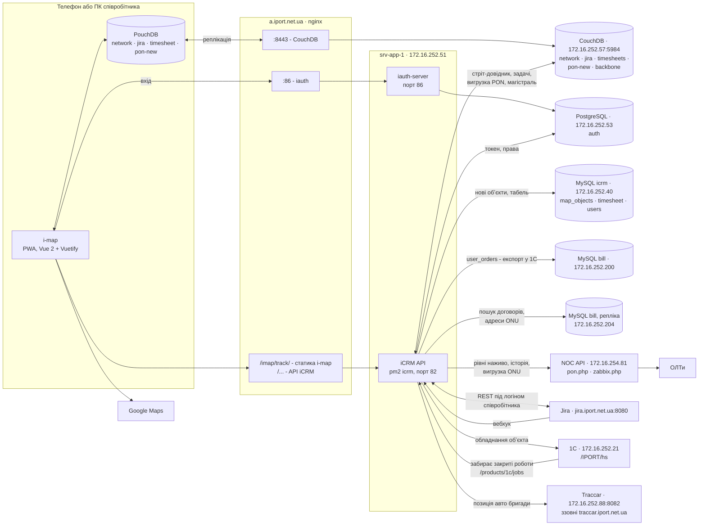
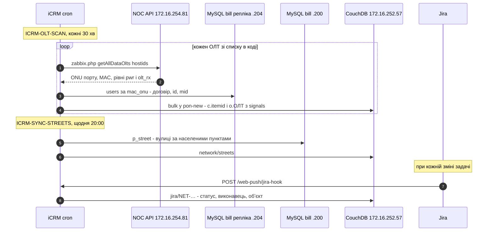
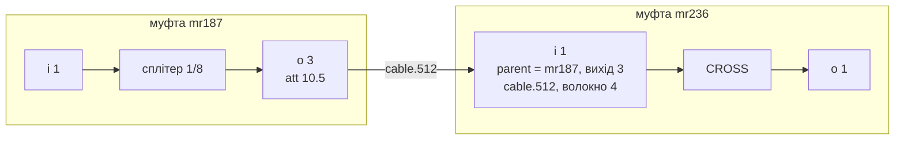

# Як влаштовано i-map

Складові, бази, звідки беруться дані, що робить сервер і де шукати код.
Назад до [i-map](README.md).

---

## Складові



| Складова | Адреса | Що робить для i-map |
|---|---|---|
| **i-map** | `https://a.iport.net.ua/imap/track/` | застосунок у браузері. Уся робота з мережею — у локальних копіях баз |
| **nginx** | `a.iport.net.ua` | віддає статику i-map і API iCRM, проксі до CouchDB (`:8443`) і iauth (`:86`) |
| **CouchDB** | `172.16.252.57:5984` | топологія (`network`), задачі (`jira`), табелі (`timesheets`), вигрузка PON (`pon-new`), магістраль (`backbone`) |
| **iCRM API** | `srv-app-1`, `172.16.252.51:82` | видає id обʼєктів, працює з Jira, тягне рівні з NOC, зберігає фото, рахує маршрути й зупинки |
| **iauth** | `172.16.252.51:86`, база `auth` на `172.16.252.53` | вхід співробітника, видає токен `pgjwt` |
| **MySQL `icrm`** | `172.16.252.40` | `map_objects` (номери й назви обʼєктів), `map_dictionary` (абревіатури населених пунктів), `timesheet` (план працівників), `users` (працівники) |
| **MySQL `bill`** | `172.16.252.200`, репліка `172.16.252.204` | `users` — договори й ONU абонентів, `user_orders` — задачі для експорту в 1С, `p_street` — вулиці |
| **NOC API** | `172.16.254.81` | `pon.php` — живе SNMP-опитування ОЛТа, `zabbix.php` — вигрузка ONU й історія рівнів |
| **Jira** | `jira.iport.net.ua:8080` | задачі проєкту NET. Привʼязка до обʼєкта — поле `customfield_11000` = `ponbox:<id>` або `pole:<id>` |
| **1С** | `172.16.252.21/IPORT/hs` | обладнання, списане на обʼєкт. Сам забирає з iCRM закриті роботи (`/products/1c/*`) |
| **Traccar** | `172.16.252.88:8082`, ззовні `traccar.iport.net.ua` | GPS-трекери автомобілів: позиція машини бригади |
| **iERP** | | бере закриті треки з `timesheets` і робить із них подорожні листи |

### Хто кого питає

| Хто | Кого | Адреса | Навіщо |
|---|---|---|---|
| i-map | CouchDB | `a.iport.net.ua:8443` → `172.16.252.57:5984` | реплікація `network`, `jira`, `timesheets`, `pon-new` |
| i-map | iCRM | `a.iport.net.ua` → `172.16.252.51:82` | усе, що потребує сервера. Заголовок `pgjwt` — токен співробітника |
| i-map | iauth | `a.iport.net.ua:86` | вікно входу |
| iCRM | PostgreSQL `auth` | `172.16.252.53:5432` | розшифрувати `pgjwt`: хто це, які права, логін Jira |
| iCRM | MySQL `icrm` | `172.16.252.40:3306` | створення обʼєкта, центр населеного пункту, план працівників |
| iCRM | MySQL `bill` | `172.16.252.200` | запис у `user_orders` (експорт у 1С), довідник вулиць |
| iCRM | MySQL `bill`, репліка | `172.16.252.204` | пошук договору, договір за MAC ONU, перевірка «вже в 1С» |
| iCRM | CouchDB | `172.16.252.57:5984` | запис вигрузки PON, задач Jira, вулиць, магістралі, читання задач на день |
| iCRM | NOC API | `172.16.254.81` | рівні наживо, історія, вигрузка ONU з усіх ОЛТів |
| iCRM | Jira REST | `jira.iport.net.ua:8080/rest/api/2` | створити, привʼязати, взяти задачу, пошук закритих задач |
| Jira | iCRM | `POST /web-push/jira-hook` | кожна зміна задачі → документ у CouchDB `jira` |
| iCRM | 1С | `172.16.252.21/IPORT/hs/equipment/object/<id>` | обладнання на обʼєкті |
| 1С | iCRM | `/products/1c/jobs/<виконавець>`, `/products/1c/order-set/...` | забрати закриті роботи з `bill.user_orders` і позначити забраними — див. [box.md](box.md), «Передати виконану роботу в 1С» |
| iCRM | Traccar API | `172.16.252.88:8082/api` | остання позиція автомобіля бригади |
| iERP | CouchDB | `172.16.252.57:5984` | читає `track.*` з `timesheets` |

### Фонові задачі iCRM, що наповнюють i-map



**Технічно**

- Вигрузка — `scan()` у `libs/pon-export.js` icrm-server. **Перелік ОЛТів записаний у коді**
  (`const olts = [...]`): новий ОЛТ зʼявиться в i-map лише після зміни коду.
- Вулиці — `syncCouchStreets()` у `libs/monthly.js`.
- Вебхук — `routes/web-push.js` → `handle()` у `libs/jira-couch.js`. Задача потрапляє в CouchDB,
  якщо має виконавця або привʼязана до `ponbox`. Видалена в Jira — видаляється.

---

## Бази в браузері

| Локальна база | Віддалена | Напрям | Що в ній |
|---|---|---|---|
| `network` | `network` | двостороння, постійна | муфти, ODF, абоненти, опори, кабелі, довідник вулиць `streets` |
| `jira` | `jira` | двостороння, постійна | задачі NET і їх привʼязка до обʼєктів |
| `timesheet` | `timesheets` | двостороння, постійна | документи дня, треки, список автомобілів, типові адреси |
| `pon-new` | `pon-new` | **тільки з сервера** | ОЛТи, ONU, останні рівні сигналу, договори, адреси, телефони |
| `pouchAuth` | — | не синхронізується | токен і права цього пристрою |

Головне правило: **чого немає в локальній копії, того для застосунку не існує**.
Новий пристрій перші хвилини показує порожню карту й нічого не знаходить: іде
перша реплікація. Повна копія — приблизно 40 тис. документів `network`
(27 тис. муфт, ODF і абонентів, 10 тис. кабелів), 55 тис. `jira`, 28 тис.
`pon-new`, 19 тис. `timesheets`. Після цього кожен вид (`view`) ще індексується
локально при першому запиті: на свіжому пристрої перший показ населеного пункту
займає хвилину-дві, бо будуються індекси вулиць і задач Jira.

Магістраль (база `backbone`) на пристрій не копіюється — шар «Карта сети»
завантажує її через iCRM при кожному відкритті.

**Технічно**

- Підключення — `src/utils/pouch.js`. `network`, `jira`, `timesheet` — `sync({live: true, retry: true})`.
  `pon-new` — спершу повна `replicate.from`, після неї — постійна, з `revs_limit: 1`, щоб копія
  не розросталася.
- До CouchDB застосунок входить одним спільним обліковим записом, а не обліковим
  записом співробітника. Облікові дані лежать у `src/utils/env.js`.

---

## Звідки беруться дані

| Дані | Хто пише | Як часто |
|---|---|---|
| Топологія (`network`) | сам i-map, з пристроїв користувачів | одразу, реплікацією |
| Довідник вулиць (`network/streets`) | iCRM, з таблиці `p_street` бази `bill` | щодня о 20:00, cron `ICRM-SYNC-STREETS` |
| Сигнали й ONU (`pon-new`) | iCRM, з NOC API (`/api/pon/zabbix.php`) | кожні 30 хв, cron `ICRM-OLT-SCAN` |
| Задачі (`jira`) | iCRM, з вебхука Jira `POST /web-push/jira-hook` | при кожній зміні задачі |
| Табелі й треки (`timesheets`) | i-map з пристроїв бригад, iERP | одразу |
| Id і людська назва нового обʼєкта | iCRM, процедура `insert_map_object` у MySQL `icrm` | при створенні |
| Фото обʼєктів | iCRM, `public/ad/<id>` | при завантаженні |
| Обладнання, списане на обʼєкт | 1С (`172.16.252.21/IPORT/hs`) через iCRM | при відкритті вкладки |
| Черга робіт для 1С | iCRM, таблиця `user_orders` бази `bill` (`exprt = null` — не забрано, `1` — забрано) | рядок — при «Экспорт в 1С», `exprt = 1` — коли 1С забрав роботу |
| План працівників | iCRM, таблиця `timesheet` MySQL `icrm` | з табеля |

Вигрузка PON — це зріз моніторингу, а не замір наживо. Наживо рівні знімає
лише кнопка оновлення на екрані сигналів: iCRM просить NOC API (`pon.php`), а той опитує ОЛТ по SNMP. Сам iCRM з ОЛТами напряму не працює.

---

## Що працює без звʼязку

| Без звʼязку | Потребує звʼязку |
|---|---|
| карта, фільтри, маркери, пошук | створення нового обʼєкта (id видає сервер) |
| картка муфти, схема, затухання | будь-яка дія з Jira |
| правка портів, сплітерів, звʼязків, опису | живе опитування сигналу, історія рівнів |
| подорожній лист: старт, фініш, заправка | вибір автомобіля й задач на день |
| | фото, обладнання 1С, позиція автомобіля |

Зміни, зроблені без звʼязку, лежать у локальній базі й доїжджають на сервер
самі, коли звʼязок зʼявляється.

---

## Ідентифікатори обʼєктів

| Поле | Приклад | Звідки |
|---|---|---|
| `id` | `17392` | iCRM, таблиця `map_objects` у MySQL `icrm` |
| `local_id` | `bp931` | абревіатура населеного пункту з `map_dictionary` + номер |
| `_id` у CouchDB | `ponbox.17392`, `cable.24-1`, `pole.512` | категорія не завжди збігається з префіксом |

Муфта, ODF і абонент мають однаковий префікс `ponbox.`. Категорію визначає поле
`category`. Абонент на карті не малюється: у нього немає `gps`, він живе
лише в схемі муфти.

**Технічно**

Створення обʼєкта: `POST /map/upload` з `gps`, `region`, `category` → у iCRM
`call insert_map_object(...)` → відповідь `{id, local_id, abbr}`. Код — `addFlag()`
у `src/views/Map.vue`, сервер — `routes/map.js` в icrm-server.

---

## Модель мережі, коротко

Муфта — документ із трьома обʼєктами: `i` (входи), `o` (виходи), `splitters`
(встановлені дільники). Звʼязок між муфтами записаний лише у вхідному порту
нащадка: `i[n].parent = {o: <id муфти-джерела>, n: <номер її виходу>}`.
Вихід посилається на вхід своєї ж муфти рядком: `o[n].parent = "<номер входу>"`.



Затухання ніде не зберігається. Його щоразу рахують обходом від порту вгору
до кореня, складаючи `att` усіх пройдених портів.

```js
// src/models/network-item.js — обхід шляху вгору і сума затухань
async function path(node) {
    const path = []
    async function next(node) {
        if (path.length > 100) throw `КОЛЬЦО`          // кільце в описі мережі
        path.push(node)
        if (!node.port.parent) return
        const doc = typeof node.port.parent === 'string'
            ? node.doc                                    // вихід → вхід цієї ж муфти
            : await db.net.get(`ponbox.${node.port.parent.o}`)   // вхід → вихід сусідньої
        const port = typeof node.port.parent === 'string'
            ? doc.i[node.port.parent]
            : doc.o[node.port.parent.n]
        if (!port.parent) return path.push({doc, port})
        await next({doc, port})
    }
    await next(node)
    // сума att по всіх портах шляху, з розкладкою по муфтах
}
```

Детальний опис полів портів, кабелів, аліасів договорів і видів CouchDB —
у файлі `docs/network.md` репозиторію `i-map`.

---

## Важливі місця в коді

| Що | Файл |
|---|---|
| Старт: вхід, бази, права | `src/main.js`, `src/utils/auth.js`, `src/utils/pouch.js` |
| Карта, шари, кнопки | `src/views/Map.vue`, `src/store/index.js` |
| Маркери і їх кольори | `src/components/MapMarkers.vue` (`getColor`) |
| Фільтр населеного пункту | `src/components/RegionsFilterPopup.vue`, `src/models/network-items.js` |
| Пошук | `src/models/search.js` |
| Картка муфти | `src/components/NetworkDialog.vue`, `BoxSchema.vue`, `Splitter.vue` |
| Модель муфти, затухання, звʼязки | `src/models/network-item.js` |
| Кабелі | `src/models/cable.js`, `src/components/CableDialog.vue` |
| Робота з Jira в картці | `src/components/PonParts.vue` |
| PON-сигнали | `src/models/signals.js`, `src/components/Signals*.vue` |
| Подорожній лист | `src/components/timesheet/`, `src/models/timesheet.js` |
| Магістраль | `src/models/network-map.js`, `src/components/Backbone*.vue` |

Як застосунок розпізнає, що ввели в пошук:

```js
// src/models/search.js
let criterion = phrase.includes('.')                ? 'contract'   // 274.661
              : !isNaN(parseInt(phrase))            ? 'id'         // 4536
              : phrase.toUpperCase().startsWith('NET-') ? 'jira'   // NET-96954
              : 'name'                                             // br127
```

---

## Маршрути

| Адреса | Екран |
|---|---|
| `#/map/<шар>` | карта, `<шар>` — `network`, `netMap`, `timesheet`, `building`, `camera`, `ad`, `plastic`, `businessCard`, `all` |
| `#/map/network/<id>` | карта, одразу на обʼєкті мережі. Так відкриває i-map картка абонента в iCRM |
| `#/signals/<режим>/<договір>` | PON-сигнали, режим `olts`, `address`, `phone` або `contracts` |

---

## Запити до iCRM і що за ними на сервері

Усі запити йдуть на `a.iport.net.ua` з заголовком `pgjwt`. iCRM спершу розшифровує
токен у PostgreSQL `auth` (`172.16.252.53`, функція `jwt_decrypt`) — так він знає
співробітника, його права й логін Jira. Запити до Jira iCRM робить **від імені цього
співробітника**, з його логіном.

| Запит | Для чого | Що робить iCRM | Куди йде |
|---|---|---|---|
| `POST /auth` | права, профіль | повертає `permissions`, `jira_auth` із токена | PostgreSQL `auth` |
| `POST /jira/user-info` | ключ Jira | `GET /rest/api/2/user?username=` | Jira |
| `POST /map/upload` | створити обʼєкт, фото | `call insert_map_object(gps, category, region, …)`, абревіатура з `map_dictionary`, фото — у `public/ad/<id>` | MySQL `icrm` `.40` |
| `GET /map/position/region/<назва>` | центр населеного пункту | `select … from map_objects where category = 'region'` | MySQL `icrm` |
| `DELETE /map/object/<id>` | видалити обʼєкт | видаляє запис у `map_objects` | MySQL `icrm` |
| `GET /map/box/equipment/<id>` | обладнання | `GET /IPORT/hs/equipment/object/<id>` | 1С `.21` |
| `GET /users/find-sub/<текст>` | пошук договору | `users` + головний рахунок, текст `договір \| імʼя` | MySQL `bill`, репліка `.204` |
| `POST /jira/set-ref` | привʼязати задачу | Jira: `PUT issue` з `customfield_11000 = ponbox:<id>` і мітками. Якщо «Экспорт в 1С» — `insert into user_orders` | Jira, MySQL `bill` `.200` |
| `POST /jira/create-net-trans` | створити задачу | Jira: `POST issue`, проєкт NET, тип 10002, `customfield_11000`, епік у `customfield_10002`. За «Взять задачу» — одразу призначення | Jira |
| `POST /jira/create-subtask` | підзадача | Jira: `POST issue`, тип 10003, термін — сьогодні, виконавець | Jira |
| `POST /jira/assign-me` | взяти задачу | Jira: призначити й перевести статус (`/transitions`) | Jira |
| `POST /jira/isInOneC` | чи вже в 1С | `select count(*) from bill.user_orders where jira = ?` | MySQL `bill`, репліка |
| `GET /jira/unbind/<задача>/<id>` | зняти привʼязку | `delete from user_orders`, Jira: `customfield_11000 = null` | MySQL `bill`, Jira |
| `GET /jira/jira-info/NET-…`, `/epic-info/…` | дані задачі, епіка | `GET issue` | Jira |
| `POST /pon/onu-rx/multiple` | рівні всіх ONU ОЛТа | `pon.php?cmd=getRxTxRealtime&ip=<ОЛТ>&snmpindex=all` | NOC API `.254.81` → ОЛТ |
| `GET /pon/onu-rx/<ip>/<snmp>/<тип>` | рівні однієї ONU, стан порту | `pon.php?cmd=getRxTxRealtime&snmpindex=<ONU>` (+ `operstatus=1`) | NOC API → ОЛТ |
| `GET /pon/history/<ОЛТ>/<ONU>` | історія рівнів | `zabbix.php?cmd=getPonRxTxDetils&countrows=350` | NOC API |
| `GET /jira/due-tasks/<ключ>` | задачі на день | вид `docs/assignee-due` бази `jira` + мітки регіонів з `jira/configs` | CouchDB |
| `GET /timesheet/cars/<власник>` | машини й одометр | `timesheets/availableCars`, останній одометр — вид `selectedCar/car-odo` | CouchDB |
| `GET /timesheet/planned-today-workers` | напарники | таблиця `timesheet` + `users` за сьогодні | MySQL `icrm` |
| `GET /map/traccar-gps/<id>` | позиція авто бригади | остання позиція пристрою | Traccar |
| `GET /map/all-providers` | провайдери для карток | | MySQL |
| `GET /map-network/backbone-list/…`, `POST /backbone-update`, `/backbone-delete` | магістраль | читання й запис документів | CouchDB `backbone` |

Код — `routes/` і `libs/` в icrm-server: `map.js`, `map-network.js`, `jira.js`, `pon.js`,
`timesheet.js`, `libs/work-orders.js`, `libs/jira.js`, `libs/pon.js`, `libs/map.js`, `libs/one-s.js`.

---

## Права

Права приходять з iCRM при вході (`permissions.edit`) і зберігаються на пристрої.

| Ознака в коді | Право | Що відкриває |
|---|---|---|
| `$architect` | `architect` | адміністративні режими карти, редагування всіх полів |
| `$timesheetRead` | `timesheet-reports` | те саме, що `architect`, для частини функцій |
| `$changeAllowed` | один конкретний обліковий запис | додавання будинків у шарі «Квартирный» |

У коді `admin` — це `$architect || $timesheetRead`.

---

## Збірка й публікація

| | |
|---|---|
| Репозиторій | `i-map` (`github.com/iport-snk/i-map`), пакет `i-map-timesheet` |
| Версія | `0.12.8` — видно першим рядком у меню |
| Збірка | `npm run build` → `dist/`, шлях публікації `/imap/track/` (`vue.config.js`) |
| Робоча адреса | `https://a.iport.net.ua/imap/track/` — віддає Express за nginx. Останнє оновлення — 29.10.2026 |
| Стара адреса | `https://a.iport.net.ua/imap/` — досі відкривається, але це версія `0.10.72` від 17.09.2024. iCRM веде на `/imap/track/` |
| Оновлення на пристроях | службовий працівник перевіряє нову версію щогодини, показує плашку «Доступна новая версия» з кнопкою «Обновить» |

Облікові дані CouchDB і Traccar, ключі Google — у `src/utils/env.js`
репозиторію. Облікові записи Jira для перемикача в профілі —
`src/utils/jira-accounts.js`.
