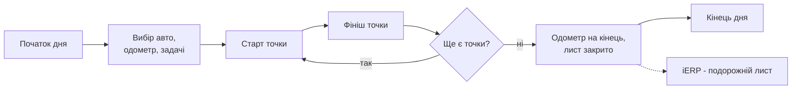
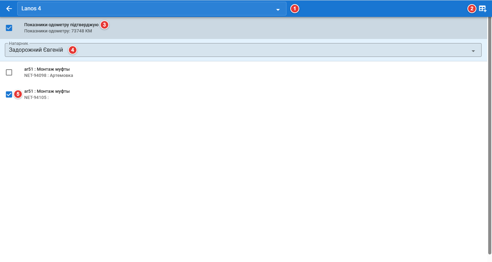
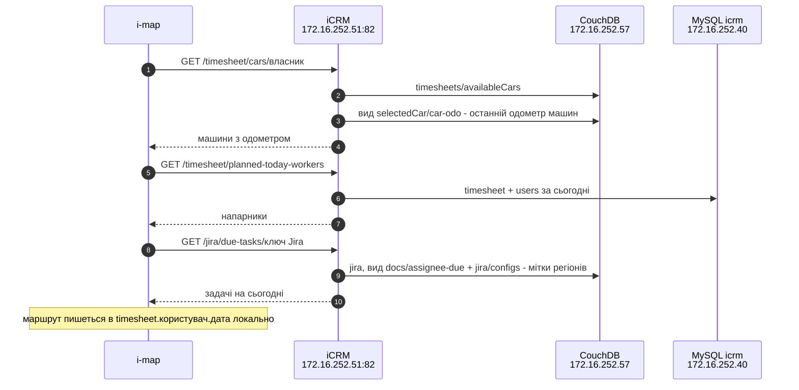
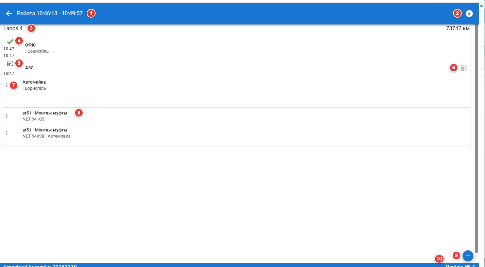
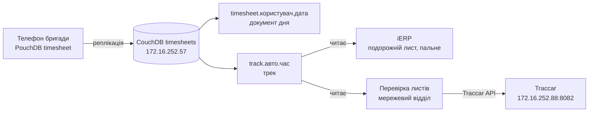

# Робочий день бригади

Екран, яким бригада користується щодня. Він одночасно план на день (задачі
Jira, які треба обʼїхати), табель (початок і кінець робочого дня) і
подорожній лист (автомобіль, одометр, заправки, час приїзду й виїзду). Усе
пишеться на телефон, тож зникнення звʼязку посеред дня нічого не ламає.

Закриті листи потім забирає iERP і оформлює з них подорожні листи для обліку.
Назад до [i-map](README.md).

| Історія | Хто |
|---|---|
| Почати робочий день і вибрати автомобіль | монтажник / бригада |
| Відмітити приїзд і виїзд на кожній точці | монтажник / бригада |
| Внести заправку | монтажник / бригада |
| Додати задачу або місце серед дня | монтажник / бригада |
| Закрити лист і робочий день | монтажник / бригада |

Шар карти **«Отчет»** → кнопка з календарем зліва внизу. Перевірку листів
мережевим відділом описано в [management.md](management.md).

---

### Почати робочий день і вибрати автомобіль

**Монтажник / бригада.** Ранок, бригада на базі. Кнопка запуску вгорі
підтверджує «начало рабочего дня» — з цієї миті в заголовку йде час роботи.
Далі кнопка вибору автомобіля відкриває формування маршруту.

| № | Елемент | Значення |
|:-:|---|---|
| **1** | Автомобіль | машини, доступні цьому працівнику |
| **2** | Підтвердити маршрут | записати маршрут у лист |
| **3** | Показники одометру підтверджую | показник на початок дня підставляється з довідника машин, його треба підтвердити |
| **4** | Напарник | зі списку тих, хто сьогодні в плані |
| **5** | Задачі на сьогодні | задачі Jira, призначені на цього працівника на сьогодні. Відмічають потрібні й перетягують у порядку обʼїзду |

Останнім пунктом автоматично додається **ОФІС** (Бориспіль, вул. Бежівка 31-Б).
Маршрут не збережеться, поки не вибрано автомобіль, хоча б одну задачу і не
підтверджено одометр — усі незаповнені пункти показуються одним повідомленням:
«Оберіть автомобіль», «Оберіть задачі», «Підтвердіть показники одометру».

Підтвердження одометра — не формальність: від нього рахується пробіг за день,
який мережевий відділ звіряє з трекером.

Задача зʼявиться у списку, лише якщо диспетчер поставив у Jira виконавця й дату
на сьогодні.

**Технічно**

- Клієнт — `src/components/timesheet/RouteSelector.vue`. Адреса офісу записана в коді компонента.
- Одометр на початок береться з останнього треку цієї машини (вид `selectedCar/car-odo`),
  а не з окремого довідника.
- Хто сьогодні працює — таблиця `timesheet` у MySQL `icrm` (план табеля), задачі — з копії Jira в
  CouchDB, а не з самої Jira. Тому задача зʼявляється в списку лише після вебхука.
- Вибір машини потребує звʼязку, усе далі — ні.

### Відмітити приїзд і виїзд на кожній точці

**Монтажник / бригада.** Одна кнопка дії вгорі справа завжди показує наступний
крок.

| № | Елемент | Значення |
|:-:|---|---|
| **1** | Робота | початок робочого дня й поточний час |
| **2** | Кнопка дії | вибрати авто → старт точки → фініш точки → завершити лист. На знімку — фініш поточної точки |
| **3** | Автомобіль і одометр | машина й показник на початок |
| **4** | Пройдена точка | зелена галочка, час приїзду й виїзду |
| **5** | Поточна точка | значок руху й час початку |
| **6** | Картка пального | для пункту «АЗС», активна після його завершення. Червона — заправку не внесли, зелена — внесли |
| **7** | Меню ⋮ непочатої точки | Видалити · На кінець · Наступна |
| **8** | Додатково призначені | задачі, видані протягом дня. Їх додають у маршрут вручну |
| **9** | **+** | додати пункт: довільне місце або зі списку типових |
| **10** | Документ і ревізія | номер ревізії зростає з кожною зміною — ознака, що зміни записані |

| Стан маршруту | Кнопка дії | Що робить |
|---|---|---|
| маршруту немає | вибрати авто | відкриває формування маршруту |
| є точка в роботі | фініш | ставить час завершення точки |
| є непочата точка | старт | ставить час початку наступної |
| усі точки завершені | завершити лист | просить одометр на кінець і закриває лист |

Переставляти можна лише непочаті точки. Час треба відмічати по ходу дня: саме
за цими часами мережевий відділ бачить на треку, де бригада була і скільки їхала.

**Технічно**

`src/components/timesheet/index.vue`, стани кнопки — `actions` (`load`, `start`, `finish`,
`complete`). Документ дня — `timesheet.<користувач>.<РРРРММДД>` у базі `timesheets`.

### Внести заправку

**Монтажник / бригада.** Після завершення пункту «АЗС» картка пального **[6]**
відкриває форму: показники одометра, адреса АЗС (з типових або своя), скільки
літрів по видах пального, передбачених для цієї машини, прапорці «Повний бак» і
«Кінець місяця, кінець дня».

Прапорець «Повний бак» важливий для обліку: витрату рахують від повного бака до
повного бака, без позначки відрізок не замкнеться.

**Після збереження заправку з телефона змінити не можна.** Помилку виправляє
офіс.

**Технічно**

`src/components/timesheet/FuelDialog.vue`. Типові адреси АЗС — документ `destinations`
у базі `timesheets`.

### Додати задачу або місце серед дня

**Монтажник / бригада.** Коли диспетчер призначає нову задачу, вона сама
зʼявляється внизу списку **[8]** — бригадир додає її в маршрут. Довільне місце
(автомийка, склад) додається кнопкою **+** **[9]**.

**Технічно**

Задачі дня — документ `addTasks.<користувач>.<дата>` у `timesheets`, його наповнює
серверна частина, на телефон він доїжджає синхронізацією.

### Закрити лист і робочий день

**Монтажник / бригада.** Коли всі точки пройдені, кнопка дії стає «завершити
лист»: вводиться одометр на кінець, і маршрут закривається в окремий трек.
Наприкінці дня кнопка зупинки підтверджує «конец рабочего дня».

Якщо бригада серед дня здала одну машину й узяла іншу, формується новий маршрут
і новий трек — усі вони належать тому самому дню.

**Технічно**

Трек — документ `track.<id авто>.<час кінця в секундах>` у `timesheets`: `path` (маршрут
із часами `status.start` / `status.finish`), `car`, `odo`, `refill` (заправки), `assistant`
(напарник), `parent` — документ дня. Саме ці треки читає iERP.

