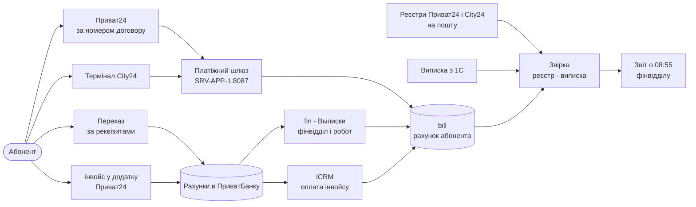

# Платежі

Способи поповнення рахунку абонентом, зарахування платежів на баланс в iCRM і
звірка зарахованих платежів з реєстрами платіжних систем та банківськими
виписками.

Платіж зараховується на рахунок абонента в iCRM (база `bill`) одразу або
після надходження грошей у банк — залежно від способу оплати. Платіж вважається
остаточно підтвердженим, коли його сума збігається з реєстром платіжної системи та
банківською випискою.

| | |
|---|---|
| Хто користується | абоненти (платять), оператори (перевіряють платежі в картці абонента), фінвідділ (виписки, звірка) |
| Способи оплати | Приват24 за номером договору, термінали City24, переказ за реквізитами, інвойс у додатку Приват24 |
| Отримувач | ТОВ «Айпорт Юнайтед»; інвойси в додатку Приват24 виставляє ФОП |
| Сервер | `SRV-APP-1` (`172.16.252.51`): платіжний шлюз, `fin`, iCRM |
| Репозиторії | `xml-payment-gate` (шлюз), `fin` (виписки), `icrm-server` (інвойси Приват24, звірка) |

## Коротко

| Що | Де описано |
|---|---|
| Як абонент платить, як оператор перевіряє і переносить платіж | [channels.md](channels.md) |
| Як платіжний шлюз приймає Приват24 і City24, повторні запити, пошук платежу | [gate.md](gate.md) |
| Виписки й баланс у `fin`: робот, ручне зарахування, повернення | [statements.md](statements.md) |
| Звірка з реєстрами й виписками, виписка з 1С, звіт о 08:55 | [reconciliation.md](reconciliation.md) |
| Як влаштовано: процеси, задачі за розкладом, таблиці, збої | [technical.md](technical.md) |

Що абонент бачить у кабінеті під час оплати — у
[кабінеті абонента](../customer.md#поповнити-рахунок).

## Хто що робить

| Роль | Що робить |
|---|---|
| **Абонент** | платить у Приват24, у терміналі City24, переказом за реквізитами або оплачує інвойс у додатку Приват24 — за поповнення, підключення чи ремонт |
| **Оператор** (абонвідділ / підтримка) | надсилає абоненту посилання на оплату, виставляє інвойс за підключення чи ремонт, перевіряє в картці абонента, чи дійшов платіж, переносить платіж, зарахований не тому абоненту |
| **Фінвідділ** | розносить перекази, які робот не зміг зарахувати, повертає помилкові платежі, вивантажує виписку з 1С для звірки, розбирає щоденний звіт розбіжностей |

## Строки зарахування

| Спосіб | Коли зараховується | Хто зараховує |
|---|---|---|
| Приват24 за номером договору | одразу | платіжний шлюз |
| Термінал City24 | одразу | платіжний шлюз |
| Переказ за реквізитами | після надходження коштів на рахунок у банку | робот у `fin` або фінвідділ вручну |
| Інвойс у додатку Приват24 | після появи оплати в банківській виписці ФОП | iCRM |

Платежі Приват24 і City24 зараховуються до фактичного надходження коштів на
рахунок, щоб абонент одразу отримав послугу. Наступного дня платіжна система
надсилає реєстр, а банк — один платіж на всю суму реєстру. Звірка перевіряє
відповідність реєстру й банківської виписки.
