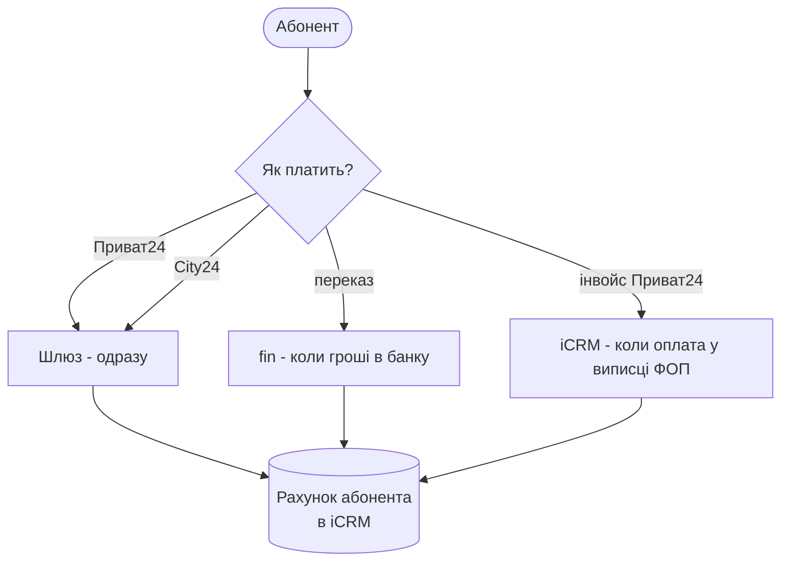
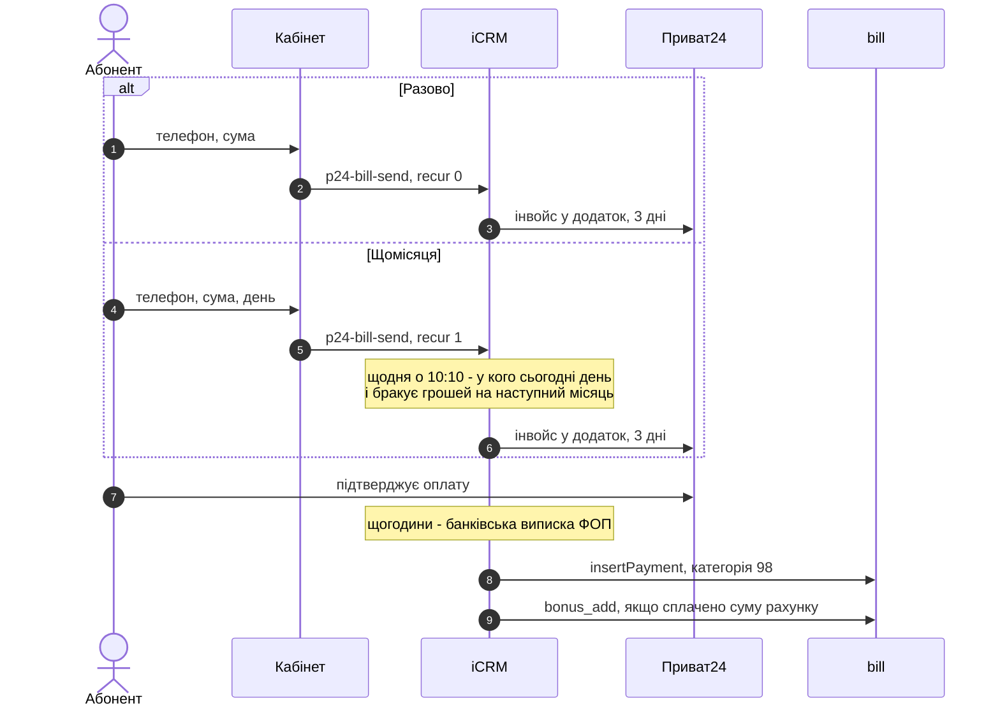
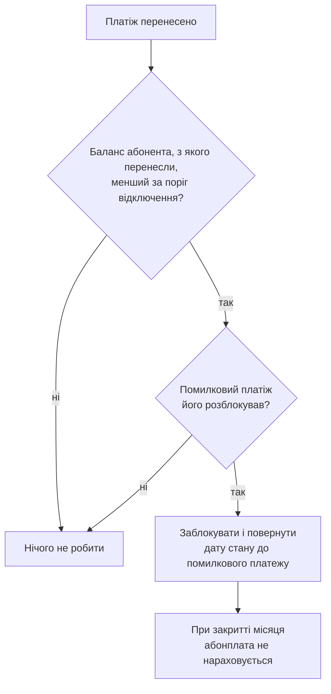

# Як абонент платить

Чотири способи поповнити рахунок, що відбувається після оплати, і що робить
оператор, коли абонент звертається щодо платежу.

Назад до [Платежів](README.md).

| Історія | Хто |
|---|---|
| Оплатити в Приват24 за номером договору | абонент |
| Оплатити готівкою в терміналі City24 | абонент |
| Оплатити переказом за реквізитами | абонент |
| Поповнити рахунок інвойсом у додатку Приват24 — разово або щомісяця | абонент |
| Оплатити підключення або ремонт інвойсом у додатку Приват24 | оператор, абонент |
| Отримати рахунок на пошту (юрособа) | абонент |
| Надіслати абоненту посилання на оплату | оператор |
| Перевірити, чи дійшов платіж | оператор |
| Перенести платіж, зарахований не тому абоненту | оператор |



---

### Оплатити в Приват24 за номером договору

**Абонент.** У Приват24 абонент знаходить iPort і вводить номер договору у
форматі `XXX.XXX`, або відкриває готове посилання — з кабінету, SMS чи Viber.
Приват24 показує ПІБ, баланс, абонплату і пропонує суму, якої бракує до
відновлення доступу. Абонент може вписати свою суму.

Платіж зараховується на рахунок одразу. Якщо доступ був заблокований, шлюз
ініціює розблокування IP-адрес договору через iCRM. Подробиці — у
[gate.md](gate.md#оплатити-в-приват24--шлюз-знаходить-договір-і-зараховує-платіж).


**Технічно**

- Посилання — `https://a.iport.net.ua/pb/<договір>`. iCRM знаходить токен
  отримувача договору і перенаправляє у форму `next.privat24.ua` з уже
  вписаним договором. Договір не знайдено — на сторінку оплати сайту.
- Кабінет будує те саме посилання сам, з токеном отримувача з
  `/profile/provider-by-id`.

```js
// icrm-server/routes/pb24.js:4 — короткий лінк на оплату
const redir = (req, res) => {
    // процедура в bill: отримувач договору і його токен у Приват24
    db.bro.query(`call lp_check_account(?)`, [req.params.contract]).then(([user]) => {
        let ur = user
            ? `https://next.privat24.ua/payments/form/{"token":"${user.pb_token}","personalAccount":"${req.params.contract}"}`
            : `https://iport.net.ua/#payment`        // договору немає — сторінка оплати сайту
        res.redirect(ur)
    })
}
```

---

### Оплатити готівкою в терміналі City24

**Абонент.** У терміналі City24 абонент обирає iPort, вводить номер договору,
бачить баланс і вносить готівку. Гроші на рахунку одразу.


**Технічно**

Запити термінала приймає той самий шлюз — [gate.md](gate.md#оплатити-в-терміналі-city24).
Платіж — категорія `83`.

---

### Оплатити переказом за реквізитами

**Абонент.** Реквізити й готове призначення платежу абонент бере в кабінеті
(«Банківський переказ»). У призначенні платежу обовʼязково зазначається
номер договору. Оплата можлива з будь-якого банку, у касі або на пошті.

На рахунок абонента гроші потрапляють лише тоді, коли надійшли в банк. Далі:

- робот у `fin` знаходить у призначенні номер договору і зараховує сам;
- якщо не вийшло (немає номера, чужі реквізити, переплата, платіж юрособи) —
  платіж розбирає фінвідділ вручну.

Тому зарахування переказу займає до кількох банківських днів, і кабінет
рекомендує оплачувати до 25 числа. Зарахування роботом і фінвідділом описано в
[statements.md](statements.md).

**Технічно**

- Реквізити — з `plat_providers` отримувача договору
  (`get_provider_by_contract`), призначення з підставленим договором.
- Платіж — категорія `7`, процедура `insertWirePayment`.

---

### Поповнити рахунок інвойсом у додатку Приват24 — разово або щомісяця

**Абонент.** У кабінеті («Рахунок Приват 24») абонент вказує номер телефону,
на який зареєстрований Приват24, обирає суму — і в додатку Приват24 зʼявляється
інвойс. Його лишається підтвердити. Інвойс дійсний 3 дні.

Інвойси виставляються не лише на поповнення рахунку: так само абонент оплачує
підключення і ремонт — див. нижче.

За передоплату нараховується бонус:

| Сума | Абонент платить | Бонус | На рахунок |
|---|---|---|---|
| 1 місяць | 95 % | 5 % | 100 % місячної оплати |
| 2 місяці | 85 % | 15 % | 200 % |
| 3 місяці | 80 % | 20 % | 300 % |

Наприклад, при абонплаті 300 грн за три місяці абонент платить 720 грн і
отримує 180 грн бонусу — на рахунку 900 грн. Якщо абонплата від 1000 грн,
пропонується лише один місяць без бонусу. Якщо замовлено зміну тарифу,
сума рахується вже за новим тарифом.

Інвойс можна отримати **разово** (приходить одразу) або **щомісяця** у
вибраний день. У щомісячному режимі інвойс приходить лише тоді, коли на
наступний місяць грошей не вистачає. Скасувати щомісячний інвойс абонент
може сам у кабінеті.

Оплачений інвойс зараховується протягом години — коли оплата зʼявилась у
банківській виписці ФОП. Бонус додається, лише якщо сплачено рівно суму інвойсу.

Неоплачений інвойс через 3 дні видаляється в Приват24 та в iCRM. Для оплати
абонент створює новий інвойс.



**Технічно**

- Інвойси виставляє ФОП (провайдер `10`) через API інвойсів ПриватБанку.
  Інвойс на поповнення записується в `icrm.inv` з `category = 'refill'` (`amt` — до сплати, `total` — разом з
  бонусом), номер інвойсу в Приват24 — у `p24_id`.
- Щомісячні налаштування — `bill.comments.props.pb24_rec`
  (`phone`, `refill`, `day`).
- Задачі за розкладом (процес pm2 `icrm-cron`): `ICRM-INV-SENDER-AND-CHECKER`
  щодня о 10:10 — `jobs/osi-inv.js`, `ICRM-PB-STATEMENT-READER` щогодини —
  `jobs/pb24-statement-reader.js`.
- Видалення неоплачених — та сама задача о 10:10 (`jobs/osi-inv.js`, `checkInv`):
  інвойси на поповнення, виставлені 3 дні тому, без оплати.

```js
// icrm-server/libs/profile.js:268 — варіанти суми з бонусом
const refill = (submoney < 1000 ? [[1, 0.05], [2, 0.15], [3, 0.2]] : [[1, 0]]).map(_ => {
    const total = submoney * _[0]             // місяців × абонплата
    const bonus = Math.ceil(total * _[1])     // бонус, округлений угору
    const refill = total - bonus              // скільки платить абонент
    return { label: `${refill} грн + Бонус ${bonus} грн`, value: [refill, bonus] }
})
```

```js
// icrm-server/jobs/osi-inv.js:85 — щомісячний інвойс
WHERE props->>"$.pb24_rec" is not null and JSON_EXTRACT(props, '$.pb24_rec.day') = DAY(CURDATE())
...
// скільки треба на наступний місяць: новий тариф або поріг відключення
let requiredBalance = row.next_price ? money.due(row.next_price, 0, row.srvs, row.discount, 0, 0) : row.limit_balance
// після списання поточної абонплати грошей не вистачить — виставити рахунок
const isBelowRequiredBalance = (row.balance - row.submoney) < requiredBalance
if (isBelowRequiredBalance) await p24.instant(row.id, props)   // виставити інвойс
```

```js
// icrm-server/libs/cash.js:14 — зарахування оплаченого інвойсу
const cash = parseFloat(stm.SUM)
// бонус — лише якщо сплачено рівно суму інвойсу
const bonus = (cash === inv.amt && inv.total > inv.amt) ? (inv.total - inv.amt) : 0
const payId = await db.bill.m('call insertPayment(?, ?, ?, ?, null, @payId); select @payId as payId;',
                              [inv.contract, stm.SUM, stm.ID, 98])
await db.icrm.query('update fin.stm set payment_id = ? where ID = ? limit 1', [payId, stm.ID])
if (bonus > 0) await db.bill.m('call bonus_add(?, ?)', [mid, bonus])
```

```js
// icrm-server/jobs/osi-inv.js:69 — видалити неоплачені через 3 дні
const invoices = await db.icrm.query(`select * from inv where category = 'refill'
                 and DATE(date) = CURDATE() - INTERVAL 3 DAY and p24_status is null`)
for (let inv of invoices) {
    const isPaid = await p24.check(inv.p24_id).then(_ => _.statusid === 'S')
    if (isPaid) throw Error(`Invoice is paid, no record for it: ...`)  // оплачений — лише запис у лог
    await delOldInv(inv)        // зняти інвойс у Приват24 і з icrm.inv
}
```

Інвойс у виписці знаходиться за номером `№<id>` у призначенні платежу
(`jobs/pb24-statement-reader.js`, `checkInvoice`). На рахунок абонента
зараховуються лише інвойси на поповнення (`refill`).

---

### Оплатити підключення або ремонт інвойсом у додатку Приват24

**Оператор.** Підключення чи ремонт у абонента оплачуються окремо від
абонплати. Оператор відкриває картку абонента → вкладка «Заявки» → рожева кнопка «+» внизу праворуч,
вводить номер задачі Jira (`NET-…`) і складає рахунок за роботи: послуги й
матеріали з прайсу, дорога, складність. iCRM підтягує з задачі тип (підключення
чи заявка) і виконавця. Для підключення абонент має бути привʼязаний до бокса
в i-map.

Далі оператор обирає, як абонент платить:

- **«Готівка»** — абонент розраховується з монтажником на місці;
- **«Рахунок»** — вказати номер телефону абонента, на який зареєстрований
  Приват24 (`0XXXXXXXXX`), і після збереження в додатку Приват24 абонента
  зʼявиться інвойс на цю суму. Дійсний 3 дні.

**Абонент** підтверджує інвойс у додатку Приват24. Ці гроші — плата за роботу,
на рахунок абонента вони **не** зараховуються. Чи оплачено, оператор бачить у
тій самій вкладці «Заявки» поруч із рахунком.

Поки рахунок не оплачений, його можна змінити або видалити — інвойс у
Приват24 знімається і, якщо треба, виставляється новий. Оплачений рахунок
змінити не можна.

**Технічно**

- Рахунок за роботи — `icrm.invoices`, прайс — `icrm.invoice_price`. Інвойс —
  `icrm.inv` з `category = 'service'` і посиланням `ref` на рахунок.
- Збереження — `POST /invoice/update`, видалення — `GET /invoice/del/:id`,
  список зі статусами з Приват24 — `GET /invoice/list/:mid`
  (`icrm-server/routes/invoice.js`). Екран — `icrm-ui.2/src/components/Invoice.vue`.
- Інвойс виставляється від того самого ФОП, що й інвойси на поповнення.
  Оплата знаходиться в банківській виписці ФОП тією ж щогодинною задачею, але
  до `insertPayment` не доходить — лише позначка `p24_status`.

```js
// icrm-server/routes/invoice.js:75 — інвойс за роботи
const createInv = async function (body, conn, id = null) {
    // category 'service' — плата за роботу, не поповнення рахунку
    const iid = await conn.query(`insert into inv ( mid, phone, amt, total, category, ref ) values (?, ?, ?, ?, ?, ?)`,
        [body.mid, body.phone, body.total, body.total, 'service', id || body.id]).then(r => r.insertId)
    // інвойс у додаток Приват24 абонента
    const p24_id = await p24.send({ amount: body.total, phone: body.phone, number: iid, param: `#${body.mid}` })
    return conn.query(`update inv set p24_id = ? where id = ?`, [p24_id, iid])
}

// icrm-server/routes/invoice.js:68 — змінити чи видалити можна лише неоплачений
const delInv = async function (inv, conn) {
    const isPaid = await p24.check(inv.p24_id).then(_ => _.statusid === 'S')
    if (isPaid) throw Error('Рахунок оплачено. Неможливо редагувати')
    await p24.del(inv.p24_id)
    ...
}
```

```js
// icrm-server/jobs/pb24-statement-reader.js:24 — оплата у виписці ФОП
const id = statement.OSND.match(/№([\S]+)/)?.[1].trim()        // номер інвойсу з призначення
await conn.query('update inv set p24_status = ? where id = ?', [...])  // позначити оплаченим
if (inv.category === 'refill') {
    await cash.insert(inv.mid, statement, inv)                  // на рахунок — лише поповнення
}
```

---

### Отримати рахунок на пошту (юрособа)

**Абонент.** Юрособи не платять через Приват24 чи термінал. Щомісяця вони
отримують рахунок у PDF на фінансову пошту договору — лист від ТОВ «Айпорт
Юнайтед» з нагадуванням оплатити до останнього робочого дня місяця. Той самий
рахунок можна завантажити в кабінеті. Оплата здійснюється переказом за
реквізитами — див. [statements.md](statements.md).

**Технічно**

- `ICRM-INV-MAIL-SENDER` щогодини — `jobs/inv-mail-send.js`. Бере рахунки
  (`doc_type = 'I'`) з `icrm.inv_1c`, ще не надіслані (`mail_status is null`),
  і надсилає на адреси з `bill.phones` з типом `email` і категорією `fin`.
  Результат відправки — у `mail_status`, тож рахунок не піде двічі.


---

### Надіслати абоненту посилання на оплату

**Оператор.** На запит абонента щодо оплати оператор надсилає посилання
`https://a.iport.net.ua/pb/<договір>`. Воно відкриває форму оплати Приват24 з
підставленим номером договору. Те саме посилання стоїть у
розсилках про оплату.

Для переказу — реквізити в кабінеті абонента; оператор може продиктувати їх
або нагадати вписати номер договору в призначення.

---

### Перевірити, чи дійшов платіж

**Оператор.** Картка абонента в iCRM → вкладка «Фінанси»: платежі з датою,
сумою і способом оплати. Будова вкладки — у
[Фінанси абонента](../../ui_users_fin.md).

| Абонент платив | Коли має бути в картці |
|---|---|
| Приват24, City24 | одразу |
| Інвойс у додатку Приват24 | до години після оплати |
| Переказ | після надходження в банк і зарахування роботом або фінвідділом; у вихідні — у робочий день |

Немає платежу через Приват24 чи City24 — попросіть номер транзакції з
квитанції і передайте у фінвідділ (як шукати —
[gate.md](gate.md#знайти-слід-платежу-якого-абонент-не-бачить)). Немає
переказу — фінвідділ перевіряє виписки в `fin`.

**Технічно**

Категорії платежів у `bill.pays`: `96` — Приват24, `83` — City24, `7` —
переказ, `98` — інвойс Приват24, `9` — перенесений платіж.

---

### Перенести платіж, зарахований не тому абоненту

**Оператор.** Абонент помилився в номері договору, і платіж зараховано на
інший рахунок. Порядок дій: картка абонента, на якого зараховано платіж →
«Фінанси» → олівець біля платежу → ввести правильний договір, виконати пошук,
за потреби додати коментар → «Сохранить».

- Платіж переноситься на рахунок іншого абонента з приміткою про перенесення. Бонус, нарахований на цей платіж, теж знімається.
- Перемикач «Разблокировать» (за замовчуванням) одразу вмикає доступ тому,
  на кого перенесли. «Не менять» — лишає стан як є.

Олівець видно лише в операторів з правом редагування, і лише на поповненнях
(Приват24, City24, переказ, інвойс Приват24 тощо). Перенести можна, лише
якщо обліковий запис оператора привʼязаний до входу в NoDeny — інакше
iCRM відповість «need nodeny login».

**Після перенесення — перевірити абонента, з якого перенесли.** Перенесення
лише зменшує його баланс: стан і дату стану воно не змінює. Якщо помилковий
платіж розблокував його, а тепер баланс знову менший за поріг відключення
(`limit_balance`), абонент лишається ввімкненим, а при закритті місяця йому
нарахується абонплата. Тому такого абонента треба заблокувати і повернути
дату стану (`state_date`) на ту, коли його було заблоковано до помилкового
платежу. .



**Технічно**

Що змінюється в базі `bill`:

| Де | Що відбувається |
|---|---|
| `pays`, сам платіж | `mid` → абонент, на якого перенесли; `category = 9`; `admin_id` → NoDeny-id оператора; до `reason` дописується «перенос платежа с абонента id:…» і коментар. Сума, дата (`time`) і `coment` лишаються як були — платіж у новій картці стоїть датою оплати |
| `pays`, бонус за цей платіж | рядок з `hash = 'bonus.<id платежу>'` видаляється |
| `pays`, новий рядок у того, з кого перенесли | лог: `type = 50`, `category = 410`, без суми, `reason` — «перенос платежа id:… … грн на абонента id:…» |
| `users`, з кого | `balance` − (сума платежу + бонус); `state` і `state_date` не змінюються |
| `users`, кому | `balance` + сума платежу (без бонусу); з «Разблокировать» — ще й `state = 'on'` |


Усі команди йдуть одним пакетом SQL у тому порядку, як у коді нижче.

```js
// icrm-ui.2/src/components/UserPayments.vue:95 — де показується олівець
allowed(item) {
    return ([93, 95, 83, 82, 94, 7, 99, 96, 97, 98].includes(item.category)   // поповнення
            || (item.category === 110 && item.coment.startsWith('За услуги доступа в интернет')))
        && item.cash !== 0
        && this.$user.editor()                                                // право редагування
}
```

```js
// icrm-server/routes/pays.js:21 — POST /pays/trans
let admin_id = parseInt(req.user.nodeny_id)
if (!(admin_id > 0)) throw 'need nodeny login'           // потрібна привʼязка до NoDeny

// сам платіж і бонус до нього (hash = 'bonus.<id>')
let [curr, bonus] = await db.bill.query(`select 'payment' name, p1.* from pays p1 where p1.id = ${data.id} union all
        select 'bonus' name, p2.* from pays p2 where p2.hash = 'bonus.${data.id}'`)
let delta = curr.cash
if (bonus) {
    delta += bonus.cash                                   // з балансу знімається і бонус
    q.push(`delete from pays where id = ${bonus.id}`)     // рядок бонусу видаляється
}
let reason = `\nперенос платежа с абонента id:${curr.mid}` + (data.comment ? `\n${data.comment}` : '')
let message = `перенос платежа id:${curr.id} ${curr.cash} грн на абонента id:${data.to}`
let allow = data.state === 'Разблокировать' ? ", state = 'on'" : ""
q.push(
    sql.log(curr.mid, admin_id, message),                                                       // лог у того, з кого
    `update users set balance = balance - ${delta} where id = ${curr.mid} limit 1`,             // з кого: − платіж − бонус
    `update users set balance = balance + ${curr.cash} ${allow} where id = ${data.to} limit 1`, // кому: + платіж
    `update pays set mid = ${data.to}, category = 9, admin_id = ${admin_id},
        reason = concat(reason, '${reason}') where id = ${curr.id} limit 1`,                    // платіж переїжджає
    `call bonus_card_add_bonus(${data.to}, ${curr.id}, ${curr.cash}, @ret_value)`              // бонусна картка
)
conn.query(q.join(';'))
```

```js
// icrm-server/libs/bill.js:12 — запис-лог у pays
log: (mid, user, message, category = 410) => `insert into pays (mid, time, admin_id, admin_ip, office, reason, type, category)
        values (${mid}, UNIX_TIMESTAMP(), ${user}, 0, 1, "${message}", 50, ${category})`,
```

Чому важлива дата стану: при закритті місяця абонплата не нараховується
абоненту, який на перше число вже стояв заблокованим.

```js
// icrm-server/jobs/new_month.js:126 — хто не платить за минулий місяць
// заблокований (state = 'off') з датою стану раніше за 1-ше число + 3 год
else if (p.paket !== 61 && p.state_date && (p.state_date < time1 + 10800) && (p.state === 'off')) no_submoney = 3
```

Тим самим вікном для нарахування абонплати (категорія `110`) робиться
перерахунок за неповний місяць — це робота з нарахуваннями, вона описана в
[Фінанси абонента](../../ui_users_fin.md).
