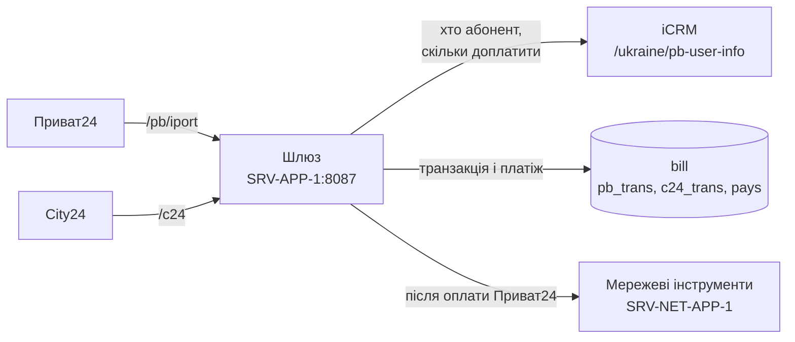
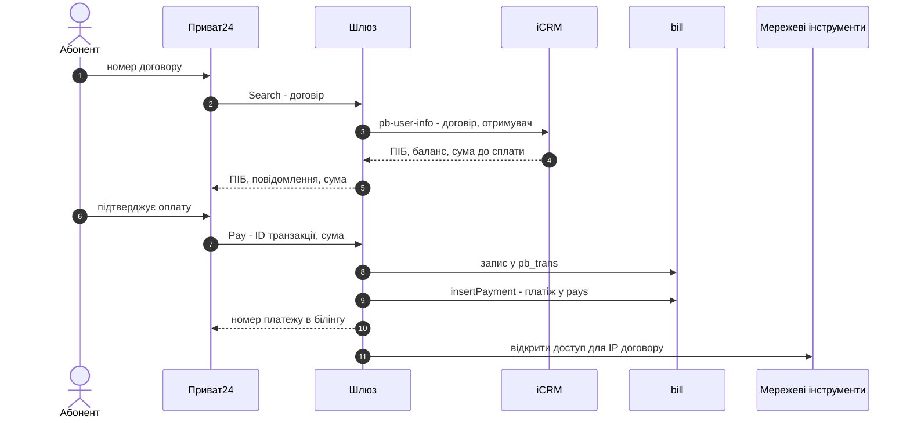

# Платіжний шлюз

Шлюз — окрема програма, до якої звертаються Приват24 і City24, коли абонент
платить за номером договору. Він перевіряє договір, повідомляє платіжній
системі, скільки треба доплатити, і зараховує платіж на рахунок абонента в
iCRM. Екрана в шлюзу немає — з ним працюють лише платіжні системи.

Назад до [Платежів](README.md).

| Історія | Хто |
|---|---|
| Оплатити в Приват24 — шлюз знаходить договір і зараховує платіж | абонент |
| Оплатити в терміналі City24 | абонент |
| Повторний запит не створює другого платежу | фінвідділ |
| Знайти слід платежу, якого абонент не бачить | фінвідділ |

| | |
|---|---|
| Сервер | `SRV-APP-1` (`172.16.252.51`), порт `8087` |
| Процес pm2 | `payment:8087` |
| Репозиторій | `xml-payment-gate` |
| Працює з | база `bill` (`172.16.252.200`), iCRM (дані абонента), мережеві інструменти `SRV-NET-APP-1` (`172.16.254.81`) |



---

### Оплатити в Приват24 — шлюз знаходить договір і зараховує платіж

**Абонент.** В Приват24 абонент вводить номер договору (або відкриває
посилання з уже підставленим номером — див. [channels.md](channels.md)).
Приват24 надсилає шлюзу запит `Search` з номером договору. Шлюз перевіряє
договір в iCRM і повертає ПІБ, повідомлення
«На вашем счете: … грн. Абонплата: … грн.» (і «Услуга заблокирована», якщо
доступ вимкнено) та суму до сплати.

Сума до сплати — це скільки бракує до порогу відключення. Якщо
баланс не відʼємний, сума до сплати дорівнює 0, і абонент вводить суму вручну.

Після підтвердження оплати Приват24 надсилає запит `Pay`. Шлюз записує
транзакцію в `pb_trans` і створює платіж у `pays` — платіж одразу
відображається в картці абонента. Після цього шлюз робить запит до iCRM
(`/ukraine/unlock/contract/<договір>`), де виконується розблокування всіх
IP-адрес договору через мережеві інструменти.



**Технічно**

- Запит від Приват24 — XML на `POST /pb/iport` (провайдер `14`, ТОВ «Айпорт
  Юнайтед»). Дія (`Search` чи `Pay`) — в атрибуті
  `action` тегу `transfer`.
- Платіж записується з категорією `96`. Ідентифікатор Приват24 і банківський
  референс (`stm_ref`) записуються в `pb_trans`. За цим референсом платіж
  наступного дня знаходять у реєстрі Приват24 під час звірки
  ([reconciliation.md](reconciliation.md)).

```js
// xml-payment-gate/pb.js:91 — оплата
Pay(payload) {
    let transId = payload.$.id,                       // ID транзакції Приват24
        stmRef = payload.$.number,                    // референс, за яким шукатимуть у реєстрі
        account = payload.payerinfo.$.billIdentifier, // номер договору
        amt = parseFloat(payload.totalsum),
        providerId = this.ref === 'iport' ? 14 : 10   // /pb/iport → 14, ТОВ

    return this.transInsert(transId, stmRef, providerId, JSON.stringify(payload))
    .then(() => {
        // процедура в bill: платіж у pays і зміна балансу, категорія 96
        return db.bill.m('call insertPayment(?, ?, ?, ?, ?, @payId); select @payId as payId;',
                         [account, amt, transId, 96, providerId])
    }).then(pay => {
        let payId = pay[1][0].payId;
        db.bill.query('update pb_trans set pay_id = ? where trans_id = ? limit 1', [payId, transId]);
        // ... відповідь Приват24 з reference = payId
    }).finally(() => {
        // відкрити доступ через мережеві інструменти
        http.get(`http://172.16.252.51:82/ukraine/unlock/contract/${account}`)
    });
}
```

```js
// icrm-server/routes/ukraine.js:69 — відкрити доступ для всіх IP договору
router.get('/unlock/contract/:account', function(req, res, next) {
    db.bro.query(`select a.ip from users a left join users u on (...) where u.contract = '...'`)
      .then(rows => Promise.all(
        rows.map(_ => axios.get(`http://172.16.254.81/api/network/client.php?cmd=setAllowUser&ip=${_.ip}`))
      ))
})
```


---

### Оплатити в терміналі City24

**Абонент.** У терміналі City24 абонент обирає iPort, вводить номер договору
і вносить готівку. Термінал спершу перевіряє договір (шлюз повертає баланс),
потім проводить платіж — шлюз записує транзакцію і зараховує гроші одразу.

**Технічно**

- `POST /c24`, команда — у полі `commandcall.command`: `check` (перевірка) або
  `pay` (оплата). Сума приходить у копійках.
- Оплата перевіряє логін і пароль City24 з `xml-payment-gate/env.js`
  (значення там, сюди не копіюємо).
- Платіж записується з категорією `83`, транзакція — у `c24_trans`.

```js
// xml-payment-gate/city24.js:56 — оплата
async pay(req, res) {
    const reqBody = req.body.commandcall
    checkCredentials(reqBody.login, reqBody.password)   // логін/пароль City24
    const transId = reqBody.transactionid,
        payId = reqBody.payid,          // за ним платіж знайдуть у реєстрі City24
        cash = reqBody.amount / 100,    // копійки → гривні
        contract = reqBody.account
    // отримувач договору з iCRM; переплата — відмова
    const providerId = await http.post(url, body).then(({data}) => { ... return data.provider_id })
    await transInsert(transId, payId, providerId, cash, contract, terminalId, JSON.stringify(req.body))
    const billPayId = await db.bill.m('call insertPayment(?, ?, ?, ?, ?, @payId); select @payId as payId;',
                                      [contract, cash, payId, 83, providerId])
    await db.bill.query('update c24_trans set bill_pay_id = ? where pay_id = ? limit 1', [billPayId, payId])
}
```

---

### Повторний запит не створює другого платежу

**Фінвідділ.** Платіжні системи інколи надсилають ту саму оплату двічі
(наприклад, не дочекавшись відповіді). Другий платіж на рахунку не зʼявиться:

- **Приват24** — шлюз відповідає помилкою «Платеж … уже существует в базе
  биллинга», Приват24 вважає платіж уже проведеним.
- **City24** — шлюз відповідає «OK», нічого не записуючи вдруге.

**Технічно**

Захист — унікальний ключ транзакції в `pb_trans` / `c24_trans`: вставка дубля
падає, і до `insertPayment` справа не доходить.

```js
// xml-payment-gate/pb.js:84
transInsert(transId, stmRef, providerId, xml) {
    return db.bill.query('insert into pb_trans (trans_id, provider_id, req, stm_ref) values (?, ?, ?, ?)', [...])
      .catch(e => {
        // дубль — код 7 для Приват24
        throw new PBError(`Платеж ${transId}  уже существует в базе биллинга`, 7, 'Pay')
      })
}

// xml-payment-gate/city24.js:19
if (e.code && e.code === "ER_DUP_ENTRY") return res   // City24: дубль = «OK»
```

---

- Лог шлюзу — `xml-payment-gate/logs/roll-<РРРР.ММ.ДД>.log` на `SRV-APP-1`.
  Кожен запит і відповідь: `PB INFO: request` / `response`, `C24 INFO: …`,
  помилки — `PB ERROR` / `C24 ERROR`.
- `pm2 logs payment:8087` — помилки самого процесу шлюзу.
