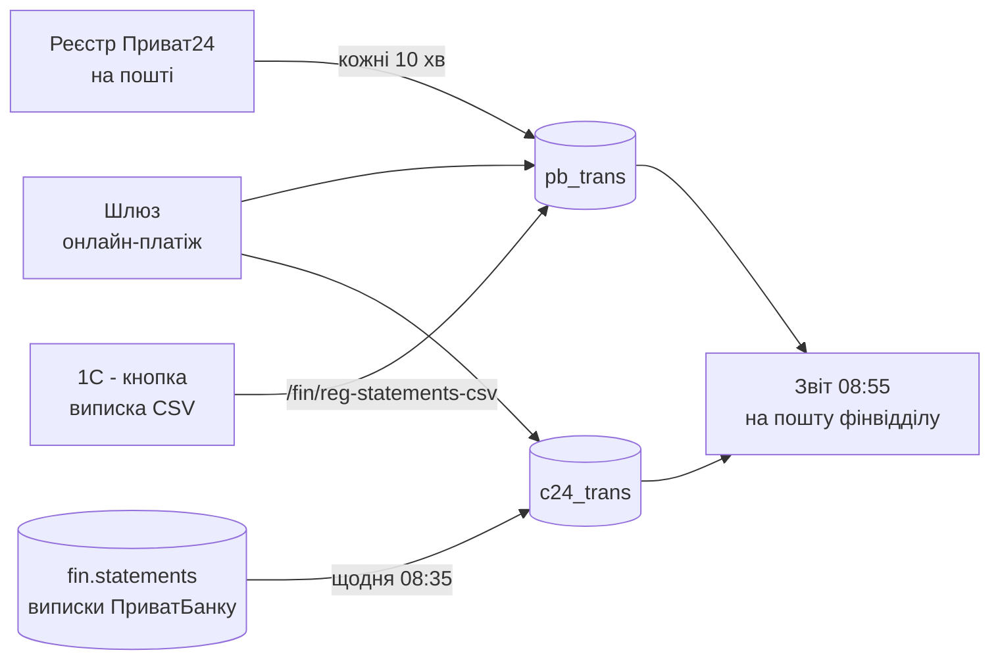

# Звірка платежів

Платежі Приват24 і City24 зараховуються на рахунок абонента одразу, до
фактичного надходження коштів у банк. Звірка підтверджує, що за кожним таким
платежем гроші справді прийшли на рахунок компанії в повній сумі. Результат —
щоденний звіт фінвідділу о 08:55.

Назад до [Платежів](README.md).

| Історія | Хто |
|---|---|
| Реєстри Приват24 надходять на пошту й привʼязуються до платежів | фінвідділ |
| Вивантажити виписку з 1С для звірки Приват24 | фінвідділ |
| Платежі City24 звіряються з банківською випискою | фінвідділ |
| Отримати щоденний звіт розбіжностей | фінвідділ |



## Як підтверджується платіж

| Платіжна система | Що надсилає наступного дня | З чим звіряється |
|---|---|---|
| Приват24 | реєстр на пошту — усі платежі за день, і один банківський платіж на суму реєстру з призначенням «Оплата згідно реєстру № … від …» | сума платежів реєстру = сума банківського платежу за реєстром |
| City24 | окремий банківський платіж на кожну оплату, номер оплати — в кінці призначення | сума банківського платежу = сума оплати в терміналі |

Платіж вважається підтвердженим, коли в його транзакції `fin_sum_match = 1`.

---

### Реєстри Приват24 надходять на пошту й привʼязуються до платежів

**Фінвідділ.** Щодня Приват24 надсилає на скриньку реєстрів лист із файлом
реєстру `reestr_<код>_<номер>.txt`. Кожні 10 хвилин iCRM перевіряє скриньку,
розбирає нові реєстри й до кожного онлайн-платежу дописує: файл реєстру, номер
і дату платіжного доручення, суму платежу за реєстром і загальну суму реєстру.
Оброблений лист позначається на видалення. Дій від працівника не потрібно.

**Технічно**

- Задача `ICRM-PAYMENTS-STATEMENT-READER`, `*/10 * * * *` —
  `icrm-server/jobs/payments-statement-reader.js`, процес pm2 `icrm-cron`.
- Скринька — IMAP `mail.adm.tools`; обробляються листи від
  `system.clients@pbank.com.ua` з вкладенням `reestr_*.txt`. Параметри входу —
  у коді задачі (значення сюди не копіюємо).
- Платіж у реєстрі знаходиться за банківським референсом: `pb_trans.stm_ref`,
  записаним шлюзом під час оплати.

```js
// icrm-server/jobs/payments-statement-reader.js — parseP24
let stm_date = s.match(/(?<=Дата створення звіту:).*?(?=\s\s\s+)/)[0].trim()
let stm_total = parseFloat(s.match(/(?<=До перерахування:\s+).*?(?=Підпис)/)[0]...)  // сума реєстру
let [stm_order_num, stm_order_date] = s.match(/(?<=Платіжне доручення №).*?(?=\s\s\s+)/)[0]
                                       .trim().split(' від ')                         // № і дата доручення
// рядки реєстру: референс, договір, сума — за позиціями в тексті
let result = inp.map(_ => ({
    stm_ref: _.substring(0, 18).trim(),
    stm_contract: _.substring(43, 94).trim(),
    stm_refill: parseFloat(_.substring(108, 122).trim().replace(',', '.'))
}))
// кожен рядок → update pb_trans set stm_doc, stm_date, stm_order_num, stm_order_date,
//                                  stm_contract, stm_refill, stm_total where stm_ref = ?
```

---

### Вивантажити виписку з 1С для звірки Приват24

**Фінвідділ.** Приват24 перераховує гроші за реєстром одним платежем. Щоб
перевірити, що сума цього платежу збігається з реєстром, працівник фінвідділу
натискає кнопку в 1С — 1С надсилає банківську виписку в iCRM.

iCRM знаходить у виписці платежі «Оплата згідно реєстру № … від …» і для
кожного реєстру порівнює суму банківського платежу із сумою всіх платежів
реєстру. Результат записується в кожну транзакцію реєстру: сума й дата
банківського платежу та ознака збігу.

Повторне вивантаження тієї самої виписки безпечне — дані перезаписуються тими
самими значеннями.

**Технічно**

- `POST /fin/reg-statements-csv` на iCRM (`icrm-server/routes/fin.js` →
  `libs/pb-reg-stm.js`). Тіло — CSV-файл виписки (`text/csv` або файл у
  `multipart/form-data`), UTF-8 або Windows-1251. Запит потребує токена iCRM.
- Колонки CSV: `ДАТА;ЧАС;UETR;НОМЕР;ПРИЗНАЧЕННЯ;КОД ІДЕНТ.;КОНТРАГЕНТ;РАХУНОК
  КОНТРАГЕНТА;КОД ID НБУ;СУМА ДЕБЕТ;СУМА КРЕДИТ`. Використовуються час,
  призначення і сума кредиту.
- Лог — `icrm-server/logs/pb-reg-stm-<дата>.log`: скільки реєстрів знайдено,
  оновлено, яких немає в `pb_trans`, де не зійшлися суми.

```js
// icrm-server/libs/pb-reg-stm.js
const PURPOSE_RE = /Оплата\s+зг[iі]дно\s+ре[єе]стру\s*№\s*(\S+)\s+в[iі]д\s+(\d{8})/i   // № реєстру і дата

// сума платежів кожного реєстру з pb_trans
const sums = await db.bro.query(
    `select stm_order_num, DATE_FORMAT(stm_order_date, '%Y%m%d') as stm_order_date,
            round(sum(stm_refill), 2) as cash_sum
     from pb_trans where (stm_order_num, DATE_FORMAT(stm_order_date, '%Y%m%d')) in (?)
     group by stm_order_num, stm_order_date`, [...])

for (const reg of registers) {
    reg.cash_sum = sum ? Number(sum.cash_sum) : 0
    // збіг: сума реєстру = сума банківського платежу, до копійки
    reg.fin_sum_match = reg.cash_sum.toFixed(2) === Number(reg.fin_stm_total).toFixed(2) ? 1 : 0
    await conn.query(
        `update pb_trans set fin_stm_total = ?, fin_stm_date = ?, fin_sum_match = ?
         where stm_order_num = ? and stm_order_date = STR_TO_DATE(?, '%Y%m%d')`, [...])
}
```

---

### Платежі City24 звіряються з банківською випискою

**Фінвідділ.** City24 перераховує кожну оплату окремим банківським платежем
через фінансові компанії — ТОВ «Свіфт Гарант» (договір `25/01-03СГ`) і
ТОВ «ФК Фенікс» (`25/01-03ФК`). Номер оплати стоїть у кінці призначення.
Щодня о 08:35 iCRM знаходить у виписках `fin` такі платежі, звіряє їх з
оплатами в терміналах за номером і перевіряє суму. Дій від працівника не
потрібно — потрібно лише, щоб виписки в `fin` були завантажені.

**Технічно**

- Задача `ICRM-REGISTERS-COMPARISON`, `35 8 * * *` —
  `icrm-server/jobs/trans-stm-comparison.js`.
- Виписки — з `fin.statements` (код платника `39859339` або `35075436`, лише
  ще не звірені, `register_match` порожній або `0`). Транзакції — `c24_trans` без
  привʼязаної виписки (`fin_stm_pk is null`).
- Збіг записується в `c24_trans` (`fin_stm_total`, `fin_stm_date`,
  `fin_stm_pk`, `fin_sum_match`), у виписці — `register_match = true`.

```js
// icrm-server/jobs/trans-stm-comparison.js
// "...зг. дог 25/01-03СГ від 03.01.2025, логін 56.66 , в т. ч. ПДВ,3828534438170229"
const payIdRegex = /,\s*(\d+)\s*$/                         // номер оплати в кінці призначення

const matched = transactions
    .map(trans => ({trans, statement: statements.find(st => st.pay_id === String(trans.pay_id))}))
    .filter(_ => _.statement)
const transactionsQ = matched.map(({trans, statement}) => {
    // сума банківського платежу = сума оплати в терміналі
    const sumMatch = Number(statement.amount_amt).toFixed(2) === Number(trans.cash).toFixed(2)
    return `Update c24_trans set fin_stm_total = ..., fin_stm_date = ..., fin_stm_pk = ${statement.pk},
                                 fin_sum_match = ${sumMatch} where id = ${trans.id}`
})
// у виписці: Update statements set register_match = true where pk = ...
```

---

### Отримати щоденний звіт розбіжностей

**Фінвідділ.** Щодня о 08:55 iCRM перевіряє транзакції платіжних систем і
надсилає лист «Звіт по реєстрам-випискам».

- Розбіжностей немає — лист з текстом «Всі транзакції мають реєстри, всі
  реєстри мають відповідні виписки, всі суми збігаються».
- Є розбіжності — у вкладенні Excel `registers_statements_report_<ДД-ММ-РРРР>.xlsx`
  з трьома аркушами.

| Аркуш | Що в ньому | Що перевірити |
|---|---|---|
| Реєстр без виписки | найдавніший реєстр, за яким немає банківського платежу | чи прийшли гроші за реєстром, чи завантажено виписку |
| Транзакція без реєстру | найдавніший онлайн-платіж, якого немає в жодному реєстрі | чи надіслала платіжна система реєстр за цей день |
| Не правильна сума | усі реєстри, де сума банківського платежу не дорівнює сумі платежів | який платіж реєстру не збігається, чи не було повернень |

На перших двох аркушах — по одному, найдавнішому рядку на кожну платіжну
систему: поки його не виправлено, він потрапляє в кожен наступний звіт.

**Технічно**

- Задача `ICRM-STM-REGISTERS-REPORT`, `55 8 * * *` —
  `icrm-server/jobs/statements-registers-report.js`. Лист надсилається з
  поштової скриньки сповіщень; адресати задані в коді (масив `to`).
- Для Приват24 не враховуються транзакції провайдера `10` (інвойси ФОП).

```js
// icrm-server/jobs/statements-registers-report.js — блок PB
// реєстр є, виписки немає
`select ... from pb_trans where fin_stm_pk is null and stm_doc is not null and provider_id != 10
     and date > '2024-08-19' and date < curdate() order by date asc LIMIT 1;`
// платіж є, реєстру немає
`select ... from pb_trans where stm_doc is null and date > '2024-08-19' and date < curdate()
     and provider_id != 10 order by date asc LIMIT 1;`
// суми не збігаються
`select ... from pb_trans t join plat_providers p on t.provider_id = p.id
     where date > '2024-08-19' and t.fin_sum_match is false`
```
