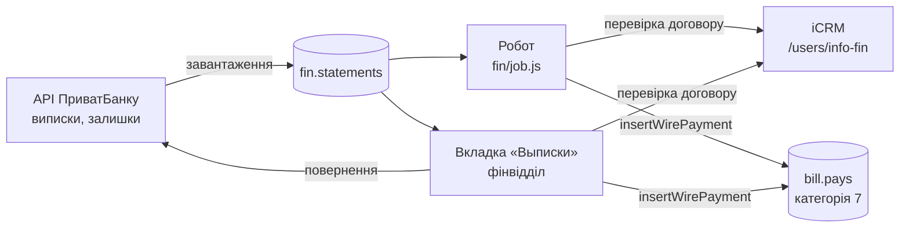
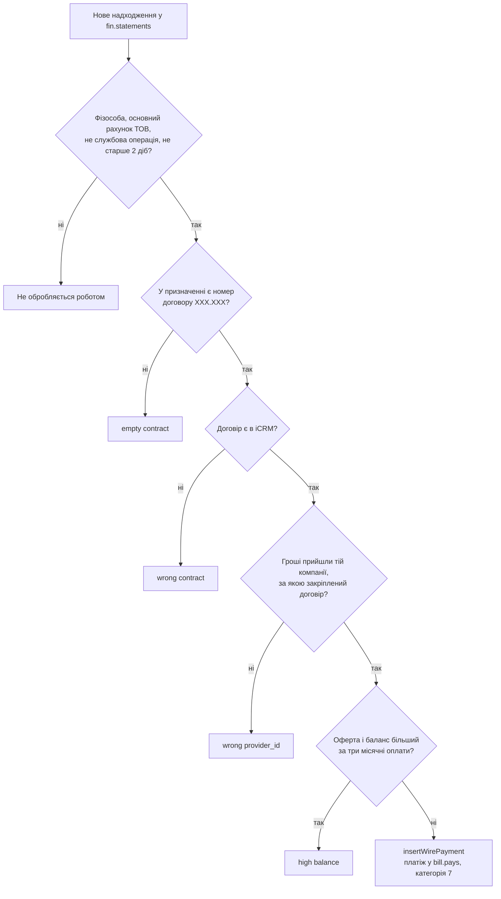

# Виписки й баланс у `fin`

`fin` — застосунок фінвідділу. Він завантажує банківські виписки за всіма
рахунками компанії з ПриватБанку, зараховує перекази абонентів на їхні рахунки
в iCRM — автоматично (робот) або вручну — і оформлює повернення помилкових
платежів. Тут описано дві вкладки, з якими працює фінвідділ: «Баланс» і
«Выписки».

Назад до [Платежів](README.md).

| Історія | Хто |
|---|---|
| Переглянути залишки на рахунках і завантажити нові виписки | фінвідділ |
| Знайти виписки за період, компанією або контрагентом | фінвідділ |
| Автоматичне зарахування переказу роботом | фінвідділ |
| Зарахувати переказ вручну | фінвідділ |
| Повернути помилковий переказ платнику | фінвідділ |

| | |
|---|---|
| Адреса | `http://172.16.252.51:8181` |
| Вхід | через iauth: вікно входу відкривається автоматично, токен зберігається в браузері |
| Сервер | `SRV-APP-1` (`172.16.252.51`), процес pm2 `fin:8181` |
| Бази | MySQL `fin` (виписки, рахунки компанії) на `172.16.252.40`, `bill` (платежі абонентів) на `172.16.252.200` |
| Працює з | API ПриватБанку (виписки, залишки, платежі), iCRM (`/users/info-fin`) |
| Репозиторій | `fin` |



---

### Переглянути залишки на рахунках і завантажити нові виписки

**Фінвідділ.** Вкладка «Баланс» — таблиця рахунків компанії в ПриватБанку:
назва, IBAN, залишок на початок дня, надходження, витрати, залишок на кінець
і час останньої операції у виписці. Внизу — підсумок за всіма рахунками.

Кнопка «Загрузить» запитує в ПриватБанку нові операції за всіма рахунками
та поточні залишки й оновлює таблицю. Автоматичне зарахування переказів ця
кнопка не запускає — це окрема задача (див. нижче).

**Технічно**

- «Загрузить» → `GET /statement/loadAll` → `statements.loadAll()`
  (`fin/models/statements.js`). Для кожного рахунку з `fin.accounts` виписка
  запитується від останньої завантаженої операції (`MAX(postdate)`) до
  сьогодні через `acp.privatbank.ua/api/statements/transactions`, залишки —
  через `/api/statements/balance`.
- Операції записуються в `fin.statements` з `INSERT IGNORE` — повторне
  завантаження не створює дублів. Залишки — у `fin.balances` (`REPLACE`).
- Токени доступу до API ПриватБанку — у таблиці `fin.accounts` (значення
  сюди не копіюємо).

```js
// fin/models/statements.js — loadAll
exports.loadAll = function () {
    return global.mysql.fin.query(
        // рахунки компанії і дата останньої завантаженої операції по кожному
        `select a.*, s.syncState from accounts a left join
            (SELECT MAX(s.postdate) syncState, s.provider_id FROM fin.statements s GROUP BY s.provider_id) s
         on a.provider_id = s.provider_id`, []
    ).then(rows => Promise.all(rows.map(row => p24.loadStatements_v2(row)))   // нові операції
        .then(rs1 => this.insert(rs1))                                       // INSERT IGNORE INTO statements
        .then(_ => Promise.all(rows.map(row => p24.loadBalances(row))))      // залишки
        .then(rs2 => this.updateBalances(rs2))                               // REPLACE INTO balances
    );
};
```

---

### Знайти виписки за період, компанією або контрагентом

**Фінвідділ.** Вкладка «Выписки». Ліворуч — панель «Фильтры», праворуч —
таблиця операцій.

| Фільтр | Що задає |
|---|---|
| Компании | рахунки компанії, за якими показувати операції |
| По документам / По контрагентам | кожна операція окремо або підсумок за парою «платник — отримувач» |
| Поквартально / Период | квартал і рік або довільні дати |
| Дебет / Кредит / Запрошенные | надходження на наші рахунки / вихідні платежі / вихідні платежі, за якими запитано оригінал документа |
| Поиск | частина назви контрагента; `[ВСЕ]` — без службових виключень, `ФОП` — лише контрагенти з 10-значним кодом |
| Применить | завантажити таблицю |

Без пошуку зі списку прибираються службові операції: перерахування за
реєстрами платіжних систем, комісії банку, зарплата, перекази між власними
рахунками тощо.

Колір рядка надходження показує його стан:

| Колір | Стан |
|---|---|
| Зелений | зараховано на договір (у колонці «Договор» — номер договору) |
| Рожевий | робот не зміг зарахувати; у колонці «Договор» — причина |
| Помаранчевий | позначено до повернення |
| Зелений з червоним текстом | повернуто платнику («повернули»; «повернули +» — зворотний платіж уже є у виписці) |

Рядки з помилками робота і позначені до повернення додатково виводяться
окремим списком під фільтрами — з датою і причиною.

Наведення на назву в колонках «Дебет» і «Кредит» показує код, рахунок і банк
контрагента.

**Технічно**

- Таблиця — `POST /statement` з фільтрами (`fin/routes/statement.js`).
  «Дебет» відповідає `trantype = 'C'` (надходження), «Кредит» — `trantype = 'D'`,
  «Запрошенные» — `D` з `contract < 0`.
- Колір рядка — `getRowClass` у `fin/public/app/view/Statement.js` за полями
  `contract` і `status`.

---

### Автоматичне зарахування переказу роботом

**Фінвідділ.** Перекази від фізичних осіб на основний рахунок ТОВ робот
зараховує сам. З призначення платежу він виділяє номер договору, перевіряє
його в iCRM і створює платіж на рахунку абонента. Зарахований рядок стає
зеленим, у колонці «Оператор» — `robot`.

Якщо перевірка не пройшла, платіж не створюється, а рядок отримує причину і
стає рожевим. Такі рядки фінвідділ розбирає вручну:

| Причина в колонці «Договор» | Що означає | Що робити |
|---|---|---|
| `empty contract` | у призначенні немає номера договору | знайти договір за ПІБ платника і зарахувати вручну або повернути |
| `wrong contract …` | договору з таким номером немає | уточнити договір або повернути |
| `wrong provider_id` | гроші прийшли на рахунок іншої компанії, ніж та, за якою закріплений договір | повернути |
| `high balance` | абонент публічної оферти, і на його рахунку вже більше, ніж три місячні оплати | повернути за заявою абонента |

Робот бере лише операції за останні дві доби. Старіші необроблені перекази
лишаються без стану — їх зараховують вручну.



**Технічно**

- Запускається скриптом `fin/job.js`: спершу завантажує виписки
  (`statements.loadAll()`), потім запускає робота (`utils/statementToBill.js`).
 
- Робот обробляє операції по одній, поки є необроблені. Результат — у
  `fin.statements`: `contract`, `payment_id`, `owner = 'robot'`,
  `status = 'done'` або `status = 'err: …'`.

```js
// fin/models/statements.js — toBill: що бере робот
return `select * from statements where trantype = 'C'          -- надходження
    AND purpose not like "Оплата згiдно реєстру%" AND ...      -- без службових операцій
    AND credit_crf != 39626179                                 -- без WayForPay
    AND postdate > now() - interval 2 day and postdate < now() -- лише за 2 доби
    and status is null and payment_id is null and contract is null  -- ще не оброблені
    AND (credit_number not like "%02600%"                      -- не з рахунків юросіб і ФОП
         or credit_number = 'UA373052990000026002035025103')   -- крім транзитного рахунку Укрпошти
    AND debet_number = 'UA093052990000026007010139796' limit 1`  // основний рахунок ТОВ
```

```js
// fin/utils/statementToBill.js — run
let parsed = row.purpose.replace(/\d{1,2}\.\d{1,2}\.\d{1,4}/gm, '')  // прибрати дати, щоб не сплутати з договором
const match = parsed.match(/\d{1,3}\.\d{1,3}/gm)                     // номер договору XXX.XXX
if (!match) throw new Error('err: empty contract')
row.contract = match[0]
let data = await rp(param(row.contract))                             // GET iCRM /users/info-fin/<договір>
if (data.length === 0) throw new Error(`err: wrong contract ${row.contract}`)
if (row.provider_id !== data[0].provider_id) throw new Error('err: wrong provider_id')
if (data[0].highBalance) throw new Error('err: high balance')
const payment_id = await insert(row)                                 // call insertWirePayment(...)
await global.mysql.fin.query(`update statements set contract = ?, payment_id = ?, owner = 'robot', status = 'done' where pk = ? `,
                             [row.contract, payment_id, row.pk])
// помилка → update statements set status = '<текст помилки>'
```

```js
// icrm-server/libs/user.js:90 — дані для перевірки (GET /users/info-fin/:contract)
"select u.fio, u.grp, u.contract_type, p.price, u.srvs, u.discount, u.balance, u.state, " +
"get_provider_by_contract(contract) provider_id from users u left join plans2 p on u.paket = p.id " +
"where u.grp != 1 and contract = ?"
...
// переплата: більше трьох місячних оплат, лише для публічної оферти
Object.assign(user, {highBalance: user.balance + 1 > due * 3 && user.contract_type === 'oferta'})
```

---

### Зарахувати переказ вручну

**Фінвідділ.** Вкладка «Выписки» → «Дебет» → правий клік на незарахованому
надходженні → «Провести плаіж» (так у меню). У вікні «Провести платеж» видно
платника, суму і призначення.

1. Ввести номер договору в поле «Договор» і натиснути пошук.
2. Під полем зʼявляється ПІБ і поточний баланс абонента.
3. Якщо договір закріплений за тією компанією, на рахунок якої прийшли гроші,
   і переплати немає — кнопка «Провести платеж» стає активною.
4. «Провести платеж» — платіж зараховується на рахунок абонента, рядок стає
   зеленим, у колонці «Оператор» — логін працівника.

Якщо договір закріплений за іншою компанією, вікно показує червоним
«Неправильні реквізити. ПОВЕРНЕННЯ ПЛАТЕЖУ !!!», при переплаті — «Занадто
високий баланс … ПОВЕРНЕННЯ ПЛАТЕЖУ !!!». Кнопка «Провести платеж» тоді
неактивна, платіж повертають (див. нижче).

Пункт меню доступний лише працівникам з правом на зарахування:

| Право | Що можна зараховувати |
|---|---|
| `payments-all` | будь-які надходження |
| `payments-limited` | лише від фізичних осіб|

**Технічно**

```js
// fin/public/app/view/PaymentController.js — lookupContract
Ext.Ajax.request({ url: 'bill/' + field.value })        // fin → iCRM /users/info-fin/<договір>
.then(response => {
    ...
    // та сама компанія і немає переплати — можна зараховувати
    if (payment.get('provider_id') === rows[0].provider_id && !rows[0].highBalance) {
        createBtn.enable();
    } else {
        values.details = rows[0].highBalance
            ? `Занадто високий баланс  ${rows[0].balance} грн. ПОВЕРНЕННЯ ПЛАТЕЖУ !!!`
            : 'Неправильні реквізити. ПОВЕРНЕННЯ ПЛАТЕЖУ !!!';
    }
})
```

```js
// fin/routes/bill.js — POST /bill: платіж у білінгу
global.mysql.bill.query("call insertWirePayment(?, ?, ?, ?, ?)",
    [params.contract, params.amount, params.ref, params.comment, params.providerId])  // категорія 7

// fin/routes/statement.js — PUT /statement: позначити рядок виписки
"update statements set contract = ?, payment_id = ?, owner = ?, status = 'done' where ref = ?"
//                                                    owner = логін працівника (req.user.name)
```

```js
// fin/public/app/controller/Statement.js — hasPaymentPermission
if (Fin.app.user.entitlements.some(_ => _ === 'payments-all')) return true;
return (Fin.app.user.entitlements.some(_ => _ === 'payments-limited') &&
        (record.get('credit_number') === 'UA373052990000026002035025103'   // транзитний рахунок Укрпошти
         || !record.get('credit_number').includes('2600')));               // не рахунок юрособи чи ФОП
```

---

### Повернути помилковий переказ платнику

**Фінвідділ.** Повернення робиться у два кроки — позначити, потім повернути.

1. Правий клік на рожевому рядку → «Провести плаіж» → у вікні «Возврат
   платежа». Рядок стає помаранчевим — позначено до повернення.
2. Правий клік на помаранчевому рядку → «Повернути». У вікні «Повернути платіж»
   видно номер, дату, отримувача, платника, призначення, рахунок і суму. Текст
   призначення зворотного платежу підставляється за причиною:
   - `empty contract`, `wrong provider_id` — «Повернення помилково перерахованих
     коштів зг. платежу № … від … - немає договірних відносин. Зверніться в
     тех.підтримку для уточнення реквізитів.»;
   - `high balance` — «Повернення коштів зг. платежу № … від … за
     зареєстрованою заявою абонента».

   Текст можна обрати інший зі списку. «Повернути» — `fin` створює в
   ПриватБанку платіж з нашого рахунку на рахунок платника на ту саму суму.
3. Рядок стає зеленим з червоним текстом «повернули». Коли зворотний платіж
   зʼявиться у виписці, напис змінюється на «повернули +», а підказка на ньому
   показує дату й номер зворотного платежу.

**Технічно**

- Крок 1 — `POST /statement/refund` зі статусом `refund: <причина>`; у рядку
  виписки очищаються `contract` і `payment_id`, `owner` — логін працівника.
- Крок 2 — той самий запит зі статусом `refunded: <причина>`; перед оновленням
  рядка викликається `p24.refund()`.
- Зворотний платіж знаходиться у виписці за призначенням, що починається з
  «Повернення» і містить номер вихідного платежу.

```js
// fin/routes/statement.js — POST /statement/refund
if (paymentDetails.status.startsWith('refunded:')) await p24.refund(paymentDetails)   // крок 2: платіж у банку
await global.mysql.fin.query(
    "update statements set status = ?, contract = null, payment_id = null, owner = ? where ref = ?",
    [paymentDetails.status, req.user.name, paymentDetails.ref])
```

```js
// fin/models/p24.js — refund: зворотний платіж через API ПриватБанку
const body = {
    recipient_account: stm.credit_number,       // рахунок платника
    recipient_nceo: stm.credit_crf,             // його код
    payment_naming: stm.credit_name,
    payment_amount: `${stm.amount_amt}`,        // та сама сума
    payment_destination: reason,                // призначення з вікна «Повернути платіж»
    payer_account: stm.debet_number,            // наш рахунок, на який прийшли гроші
    payment_ccy: "UAH",
    document_type: "cr",
}
// POST https://acp.privatbank.ua/api/proxy/payment/create з токеном рахунку з fin.accounts
```
