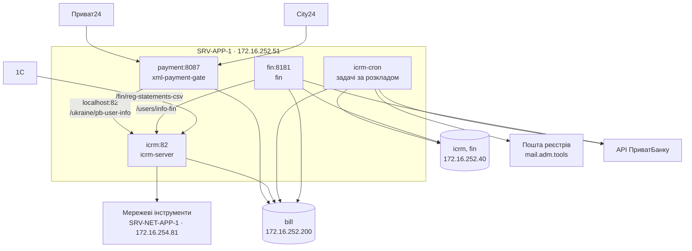

# Платежі — як влаштовано

Сервери, процеси, задачі за розкладом, таблиці й залежності між ними. Для
розробників і для розбору збоїв.

Назад до [Платежів](README.md).

## Процеси

| Процес pm2 | Порт | Репозиторій | Що робить |
|---|---|---|---|
| `payment:8087` | `8087` | `xml-payment-gate` | приймає запити Приват24 (`/pb/iport`) і City24 (`/c24`) |
| `icrm:82` | `82` | `icrm-server` | дані абонента для шлюзу й `fin`, розблокування після оплати, інвойси, перенесення платежів, прийом виписки з 1С |
| `icrm-cron` | — | `icrm-server` (`cron.js`) | задачі за розкладом (нижче) |
| `fin:8181` | `8181` | `fin` | вкладки «Баланс» і «Выписки», ручне зарахування, повернення |

Усі — на `SRV-APP-1` (`172.16.252.51`).

## Задачі за розкладом

| Задача | Розклад | Файл | Що робить |
|---|---|---|---|
| `ICRM-PAYMENTS-STATEMENT-READER` | кожні 10 хв | `jobs/payments-statement-reader.js` | реєстри Приват24 з пошти → `pb_trans` |
| `ICRM-PB-STATEMENT-READER` | щогодини, `:00` | `jobs/pb24-statement-reader.js` | виписка рахунку ФОП → `fin.stm`, зарахування оплачених інвойсів |
| `ICRM-INV-MAIL-SENDER` | щогодини, `:01` | `jobs/inv-mail-send.js` | рахунки юросіб у PDF на пошту |
| `ICRM-REGISTERS-COMPARISON` | 08:35 | `jobs/trans-stm-comparison.js` | звірка City24 з виписками `fin` |
| `ICRM-STM-REGISTERS-REPORT` | 08:55 | `jobs/statements-registers-report.js` | щоденний звіт розбіжностей |
| `ICRM-INV-SENDER-AND-CHECKER` | 10:10 | `jobs/osi-inv.js` | щомісячні інвойси, видалення неоплачених через 3 дні |

Усі задачі — у `icrm-server/cron.js`, процес `icrm-cron`. 

## Таблиці

| База | Таблиця | Що зберігає | Хто пише |
|---|---|---|---|
| `bill` | `pays` | усі операції абонента: платежі (`type = 10`), логи (`type = 50`) | шлюз, `fin`, iCRM |
| `bill` | `users` | `balance`, `limit_balance`, `state`, `state_date` | процедури платежів, iCRM |
| `bill` | `pb_trans` | транзакції Приват24, дані реєстру (`stm_*`), дані виписки (`fin_*`) | шлюз, читання реєстрів, імпорт з 1С |
| `bill` | `c24_trans` | транзакції City24, дані виписки (`fin_*`) | шлюз, звірка City24 |
| `bill` | `plat_providers` | отримувачі: реквізити, токен Приват24, дозволені платіжні системи | вручну  |
| `bill` | `comments` | `props.pb24_rec` — налаштування щомісячного інвойсу | кабінет |
| `icrm` | `inv` | інвойси Приват24: `refill` — поповнення, `service` — роботи | кабінет, iCRM, `osi-inv.js` |
| `icrm` | `invoices`, `invoice_price` | рахунки за підключення й ремонт, прайс | вкладка «Заявки» в iCRM |
| `icrm` | `inv_1c` | рахунки юросіб у PDF | 1C |
| `fin` | `statements` | банківські виписки за всіма рахунками компанії, стан зарахування | `fin` |

| `fin` | `stm` | виписка рахунку ФОП, на який надходять оплати інвойсів | `pb24-statement-reader.js` |

Бази `bill` — на `172.16.252.200`, `icrm` і `fin` — на `172.16.252.40`.

## Категорії платежів у `pays`

| Категорія | Що це | Хто створює |
|---|---|---|
| `96` | Приват24 за номером договору | шлюз, `insertPayment` |
| `83` | City24 | шлюз, `insertPayment` |
| `7` | переказ за реквізитами | `fin`, `insertWirePayment` |
| `98` | оплачений інвойс на поповнення | iCRM, `insertPayment` |
| `9` | перенесений платіж | iCRM, `/pays/trans` |
| `410` | лог дії (`type = 50`, без суми) | iCRM |

Процедури `insertPayment`, `insertWirePayment`, `bonus_add`,
`bonus_card_add_bonus`, `lp_check_account` і функція `get_provider_by_contract`
зберігаються в базі `bill` — у репозиторіях їхнього коду немає.

## Поля звірки

| Поле | `pb_trans` | `c24_trans` | Що означає |
|---|---|---|---|
| `stm_ref` | ✓ | | банківський референс з запиту Приват24, ключ пошуку в реєстрі |
| `pay_id` | | ✓ | номер оплати City24, ключ пошуку у виписці |
| `stm_doc`, `stm_order_num`, `stm_order_date`, `stm_refill`, `stm_total` | ✓ | | дані реєстру з пошти |
| `fin_stm_total`, `fin_stm_date` | ✓ | ✓ | сума й дата банківського платежу |
| `fin_stm_pk` | | ✓ | ключ рядка в `fin.statements` |
| `fin_sum_match` | ✓ | ✓ | `1` — сума збіглася, платіж підтверджено |

## Логи

| Де | Що |
|---|---|
| `xml-payment-gate/logs/roll-<РРРР.ММ.ДД>.log` | кожен запит і відповідь Приват24 і City24 |
| `icrm-server/logs/p24-<дата>.log` | читання реєстрів з пошти |
| `icrm-server/logs/pb-reg-stm-<дата>.log` | імпорт виписки з 1С |
| `icrm-server/logs/st-reg-comparison-<дата>.log` | звірка City24 |
| `icrm-server/logs/inv-sender-checker-<дата>.log` | щомісячні інвойси і видалення неоплачених |
| `icrm-server/logs/p24-st-reader-<дата>.log` | виписка рахунку ФОП і оплата інвойсів |
| `pm2 logs <процес>` | помилки самих процесів |

