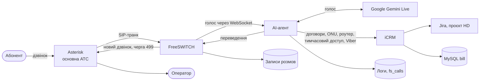
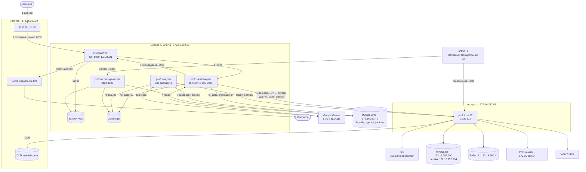

# AI-агент — голосовий помічник

AI-агент відповідає на дзвінки на лінію підтримки як оператор першої лінії:
впізнає абонента за номером телефону, відповідає на питання по договору,
перевіряє обладнання, вмикає тимчасовий доступ, створює заявки в Jira і, якщо
потрібно, переводить на живого оператора.

| | |
|---|---|
| Кого обслуговує | Абонентів із публічним договором (оферта). Решту одразу переводить на оператора |
| Мова | Українська, розуміє російську |
| Коли | Цілодобово. Оператори, на яких можна перевести, — з 9:00 до 21:00 |
| Тривалість | До 5 хвилин на розмову |
| Працює з | iCRM (дані абонента, PON, Jira), FreeSWITCH (дзвінок), Google Gemini Live (голос) |
| Репозиторій | `sandra-ai` |

## Коротко

| Що | Де описано |
|---|---|
| Хто потрапляє до AI-агента, як він впізнає абонента і як розмовляє | [conversation.md](conversation.md) |
| Що AI-агент робить сам: відповіді по договору, діагностика, тимчасовий доступ, кабінет, заявки | [actions.md](actions.md) |
| Переведення на оператора і завершення дзвінка | [handoff.md](handoff.md) |
| Після дзвінка: заявки, записи, автоматичний аналіз якості | [after-call.md](after-call.md) |
| Для адміністратора: оголошення, зміна промпту, запуск, оплата Gemini, усунення несправностей | [management.md](management.md) |
| Як влаштовано: складові, маршрутизація Asterisk ↔ FreeSWITCH, голос, режим «рації», інструменти, дані, логи, налаштування, код | [technical.md](technical.md) |

## Де працює

Сервер **`172.16.252.30`** — окремий сервер. На ньому ж FreeSWITCH.

| Процес | Що запускає | Порт | Навіщо |
|---|---|---|---|
| pm2 `sandra-agent` | `fs-listen.js` | `8080` (WebSocket, лише `127.0.0.1`) | сам агент: дзвінки, Gemini, інструменти |
| pm2 `recordings-server` | `recordings-server.js` | `8088` | віддає записи й логи у вкладку «Записи AI» iCRM |
| pm2 `analyzer` | `call-analyzer.js --watch` | — | після дзвінка оцінює, чи вирішено питання, і закриває вирішені заявки |
| FreeSWITCH (не pm2) | `freeswitch -nc -nonat` | `5080` SIP, `8021` ESL (лише `127.0.0.1`) | приймає дзвінки від Asterisk, пише записи |

Усі три процеси pm2 описані у власному ecosystem-файлі в `/home/oleg/sandra-ai`

## Повна схема

1. Абонент телефонує, дзвінок приймає Asterisk.
2. Asterisk передає дзвінок у FreeSWITCH на номер `7263`. FreeSWITCH
   перевіряє, чи живий агент, і вмикає запис.
3. FreeSWITCH стрімить голос в агента через WebSocket.
4. Агент веде розмову через Gemini Live.
5. Усе про абонента — через iCRM: договори й тимчасовий доступ — база `bill`,
   авторизація роутера — RADIUS, ONU — PON master, заявки — Jira,
   повідомлення — Viber/SMS.
6. Якщо треба людина — агент переводить дзвінок назад в Asterisk, у чергу 499.
7. Після дзвінка аналітик бере завершений дзвінок із `fs_calls`, читає лог,
   питає Gemini, чи питання вирішено, і через iCRM закриває заявку.

Оператор бачить усе в iCRM UI: запис і лог — через сервіс записів, оголошення
й журнал дзвінків — через iCRM.

## Адреси

| Система | Адреса | Для чого AI-агенту |
|---|---|---|
| Asterisk | `172.16.252.29` — SIP `5160`, AMI `5038` | приймає дзвінки, черга операторів, CDR |
| Сервер AI-агента + FreeSWITCH | `172.16.252.30` — SIP `5080`, ESL `8021`, агент `8080`, записи `8088` | усе, що вище |
| iCRM | `srv-app-1`, `172.16.252.51:82` (pm2 `icrm:82`). Ззовні — `a.iport.net.ua` | усі запити агента й аналітика |
| Jira | `jira.iport.net.ua:8080` (`91.226.253.21`) | заявки, проєкт `HD` — через iCRM |
| MySQL `icrm` | `172.16.252.40:3306` | `fs_calls`, `agent_injections` — напряму |
| MySQL `bill` | `172.16.252.200` (основна), `172.16.252.204` (репліка) | договори, баланс, тимчасовий доступ — через iCRM |
| RADIUS | `172.16.250.41` | авторизація роутера — через iCRM |
| PON master | `172.16.252.14` | статус ONU і сигнал — через iCRM |
| Google Gemini | хмара Google, AI Studio | голос (Live), аналітик (flash-lite) |
| Тестовий агент | `192.168.177.122:8080` | номер `7264`, у роботі не використовується |

## Межі

AI-агент **не**:

- дає дані по договору, якщо номер телефону не привʼязаний до договору — навіть
  якщо абонент назвав номер договору;
- рахує суми сам — бере готові з даних iCRM;
- вигадує баланс, статус обладнання, аварії, строки чи номери заявок;
- підключає нові послуги — на це створює заявку.

## Складові

- **Asterisk** — основна АТС: приймає зовнішні дзвінки й тримає чергу операторів.
- **FreeSWITCH** — приймає дзвінки для AI-агента, пише запис розмови, передає звук
  AI-агенту, а якщо AI-агент недоступний — повертає дзвінок операторам.
- **AI-агент** (Node.js) — веде розмову через Google Gemini Live і виконує
  інструменти: перевірки, заявки, тимчасовий доступ, переведення.
- **iCRM** — дані абонента (баланс, тариф, обладнання), заявки в Jira,
  повідомлення у Viber.
- **Сервіс записів** — віддає записи й логи дзвінків в iCRM.
- **AI-аналітик** — після дзвінка оцінює, чи вирішено питання, і закриває
  вирішені заявки.
- **iCRM UI** — вкладки «Записи AI» (записи, логи) і «Повідомлення AI»
  (оголошення).

Кожен дзвінок записується (аудіо) і має текстовий лог — хронологію подій.
Запис, лог, рядок у базі й заявки повʼязані через UUID дзвінка.

Детально — у [technical.md](technical.md).

## Технічно, коротко

| | |
|---|---|
| Сервер | `/home/oleg/sandra-ai`, той самий хост, що й FreeSWITCH (`172.16.252.30`) |
| Процеси | pm2: `sandra-agent`, `recordings-server`, `analyzer` — див. «Де працює» вище |
| Стек | Node.js 24, `@google/genai`, `modesl` (FreeSWITCH ESL), `ws` |
| Голос | Gemini Live, модель `gemini-3.1-flash-live-preview` (Google AI Studio), голос Puck, `uk-UA` |
| Дані | MySQL `icrm` (`172.16.252.40`): таблиці `fs_calls`, `agent_injections` |
| Секрети | `.env` на сервері: ключ Gemini, токен iCRM, пароль MySQL, токен записів |

