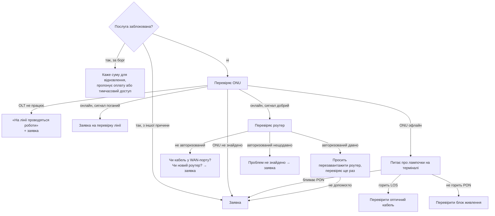

# Що AI-агент робить сам

Дії, які AI-агент виконує прямо під час дзвінка, без оператора.
Назад до [AI-агента](README.md).

| Дія | Коротко |
|---|---|
| Відповісти по договору | баланс, сума до поповнення, тариф, стан послуги |
| Діагностувати інтернет | перевіряє ONU, сигнал і роутер, веде абонента по кроках |
| Увімкнути тимчасовий доступ | на 3 дні, за згодою абонента |
| Надіслати доступ до кабінету | посилання й дані для входу у Viber, з дублюванням в SMS |
| Створити заявку | у Jira, з описом розмови й результатами перевірок |

---

### Відповісти на питання по договору

Баланс, сума до списання, скільки поповнити для відновлення, тариф, номер
договору, чи заблокована послуга. AI-агент бере все з даних договору, отриманих
на початку дзвінка, без додаткових запитів.

**Суми AI-агент ніколи не рахує сам** — ні додає, ні віднімає, ні округлює.
Якщо порахувати «борг + абонплата» самостійно, через округлення вийде менша
сума, абонент поповнить її й лишиться заблокованим. Тому на питання «скільки
поповнити» він називає одне готове число з iCRM і не розкладає його на
складові.

Заблокована послуга чи ні — AI-агент визначає лише за статусом послуги, а не за
балансом.

**Технічно**

- «Скільки поповнити»: якщо `payment_required = true` — поле `moneyToUnlock`,
  інакше — `next_month.refill`.
- Стан послуги — лише поле `state` (`on` / `off`).
- Правило про суми записане в `common` промпту, тож діє в будь-якій темі,
  навіть якщо інструкцію «Фінанси» не завантажено.

Якщо питають про розсилку щодо зміни умов тарифів «Активний гігабіт» і
«Вільний гігабіт» з 21.08.2026 (171 ГБ на добу на максимальній швидкості,
далі 100 Мбіт/с, вартість не змінюється), AI-агент відповідає за готовим текстом
і нічого не додає від себе.

### Діагностувати, чому не працює інтернет

AI-агент перевіряє все по черзі й зупиняється, щойно знайде причину.

Роутер AI-агент перевіряє **лише** тоді, коли ONU онлайн і сигнал добрий. Якщо
проблема на лінії, перевірка роутера нічого не дасть.

**Технічно**

- ONU: `GET /pon/pon-details/<MAC ONU>` в iCRM. AI-агент отримує один зі
  статусів: `notFound`, `oltDown`, `onuDown` або `onuUp` + рівень сигналу.
  Сигнал вважається поганим, якщо rx нижче −27 dBm.
- Роутер: `GET /users/devices/auth-time/<mid>`. «Нещодавно» — авторизація
  менш ніж 3 години тому.
- Код — `tools.js` (`check_onu_status`, `check_router_authorization`), порядок
  дій — сценарій `internet_outage` у `system-prompt.js`.

### Допомогти з Wi-Fi, швидкістю чи сайтом

AI-агент підказує, що перевірити: покриття Wi-Fi, забутий пароль, підключення
до мережі, VPN, як правильно виміряти швидкість. Якщо не допомогло —
створює заявку.

### Увімкнути тимчасовий доступ

Якщо доступ заблоковано за борг, AI-агент спершу пропонує абоненту увімкнути
його самому в кабінеті й надсилає у Viber дані для входу. Якщо абонент просить
розблокувати одразу, AI-агент зачитує умови, отримує згоду й вмикає доступ на 3
дні. Без згоди — створює заявку на спеціаліста.

Умови, діаграми й технічні деталі — у
[кабінеті абонента](../customer.md), розділ «Тимчасовий доступ».

### Надіслати доступ до особистого кабінету

На прохання абонента AI-агент надсилає у Viber (з дублюванням в SMS) посилання
на кабінет, номер договору й пароль. Повідомлення йде лише на номер, з якого
телефонують. Пароль AI-агент не знає й не озвучує — його підставляє сервер.

**Технічно**

`GET /sending/remind-password/<договір>/<телефон>` в iCRM (`send_cabinet_access`
у `tools.js`). Телефон — номер, з якого надійшов дзвінок, а не названий
абонентом.

### Створити заявку в Jira

AI-агент створює заявку щоразу, коли питання не вдалося закрити в розмові:
проблема на лінії, новий роутер, нове підключення, додаткова послуга, яку
компанія не надає, оператори недоступні. Каже, що заявку створено, лише після
підтвердження з Jira.

Що AI-агент пише в заявці:

1. причина звернення;
2. номер договору;
3. діагностика — що перевіряли й що знайшли («ONU онлайн, сигнал −24 dBm,
   роутер авторизований»);
4. що зроблено або рекомендовано;
5. чим закінчився дзвінок: вирішено, не вирішено, переведено на оператора,
   інформаційний запит, новий клієнт.

Якщо в абонента вже є відкрита заявка, новий запис додається до неї
коментарем, а не створює дубль.

| Мітка | Коли |
|---|---|
| `IVR, fix` | проблема з інтернетом |
| `IVR, task` | усе інше |
| `IVR, transfer` | переведення на оператора — див. [handoff.md](handoff.md) |
| `IVR, auto` | автоматична заявка після дзвінка — див. [after-call.md](after-call.md) |

**Технічно**

- `POST /jira/issue/create-or-comment-by-contract` в iCRM: проєкт `HD`,
  автор `IVR`, тип 10004 (інтернет) або 10002 (інше). Заголовок — адреса
  абонента. В описі — договір, телефон і UUID дзвінка, тож за заявкою можна
  знайти запис розмови.
- Договір для заявки: названий абонентом, якщо він є серед його договорів,
  інакше перший знайдений за телефоном. Номер телефону замість договору
  ставиться лише для абонентів без договору.
- Ключ заявки дописується до рядка дзвінка в `fs_calls.jiras`.
