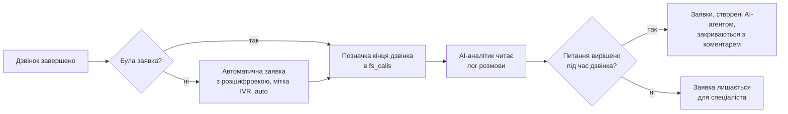

# Після дзвінка

Що лишається після кожного дзвінка і що з цим відбувається далі.
Назад до [AI-агента](README.md).

### Кожен дзвінок має заявку в Jira

Навіть інформаційний дзвінок («який у мене баланс») лишає заявку з описом
розмови. Якщо заявки не було, її створюється автоматично після дзвінка з
міткою `IVR, auto` і повною розшифровкою. Так жоден дзвінок не губиться, а
підтримка бачить історію звернень абонента в Jira.

### Знайти запис і лог розмови

iCRM → **Звонки → Записи AI**. Таблиця дзвінків AI-агента:

| Колонка | Що |
|---|---|
| Дата | час дзвінка |
| UUID | ідентифікатор дзвінка — спільний для запису, логу й заявки |
| Телефон | номер абонента |
| Договір | договір, по якому йшла розмова |
| Jira | заявки цього дзвінка, клікабельні |
| Тривалість | довжина запису |
| Розмір | розмір файлу запису |

Що можна зробити з дзвінком:

- **Відтворити** — прослухати запис у браузері з перемоткою, або завантажити;
- **Лог** — відкрити в новій вкладці хронологію розмови: що сказав AI-агент,
  що почув від абонента, які перевірки робив і що вони показали, де його
  перебили. Кнопка неактивна, якщо лога немає. Формат — у
  [technical.md](technical.md#лог-дзвінка);
- **Копіювати UUID**;
- **Пошук за UUID** — поле над таблицею. UUID є в описі кожної заявки AI-агента,
  тож від заявки в Jira легко перейти до запису розмови.

Ключі заявок видно і в колонці Jira, і в самому лозі.

### Заявки, які AI-агент вирішив сам, закриваються автоматично

Після дзвінка AI-аналітик читає лог і вирішує, чи отримав абонент результат
**прямо в розмові**: відповідь на питання, увімкнений тимчасовий доступ,
надісланий доступ до кабінету, інтернет запрацював після перезавантаження
роутера.

- **Вирішено** — заявки, створені AI-агентом, закриваються з коментарем
  «AI-аналітик: питання вирішено під час дзвінка». Заявки, які створила
  людина, а AI-агент лише прокоментував, лишаються відкритими — до них
  додається коментар.
- **Не вирішено** — заявка лишається для спеціаліста. Сюди ж потрапляють
  переведення на оператора, технічні збої (AI-агент довго мовчав, зациклився)
  і всі сумнівні випадки.

Крім висновку, аналітик записує тему дзвінка (не працює інтернет, Wi-Fi,
фінанси, оплата, тимчасовий доступ, кабінет, пошкодження лінії, новий клієнт,
оператор тощо) і коротке пояснення.

**Технічно**

- **Записи** — FreeSWITCH (`record_session`) пише
  `/var/log/freeswitch/recordings/<uuid>.wav`.
- **Логи** — `logs/call-<час>_Z_<uuid>.log` поруч із агентом (`call-logger.js`).
- **Сервіс записів** — `recordings-server.js`, порт 8088, доступ за токеном
  (`RECORDINGS_TOKEN`). Ендпоїнти: `/recordings`, `/recordings/<uuid>`
  (перемотка, `&download=1`), `/calls`, `/logs`, `/logs/<uuid>`, `/health`.
  Працює лише у внутрішній мережі. Вкладку в iCRM реалізовано в `icrm-ui.2`,
  `src/components/FsRecordings.vue`.
- **`fs_calls`** (MySQL `icrm`) — рядок на дзвінок: `uuid`, `phone`,
  `contract`, `jiras` (через кому), `ended_at`, а також висновок аналітика:
  `is_accepted`, `labels`, `reason`.
- **Аналітик** — `call-analyzer.js`, модель `gemini-3.1-flash-lite`.
  Опитує `fs_calls` кожні 10 с: беруться дзвінки, які завершилися, мають заявку
  й ще не мають висновку. Закриває заявку переходом `done` (`/jira/do-transition`),
  але лише ту, що має мітку `IVR`. Вимкнути закриття — `CLOSE_RESOLVED=false`.
  Запуск: `node call-analyzer.js --watch`. Один дзвінок без запису в базу —
  `node call-analyzer.js <uuid> --dry`.
