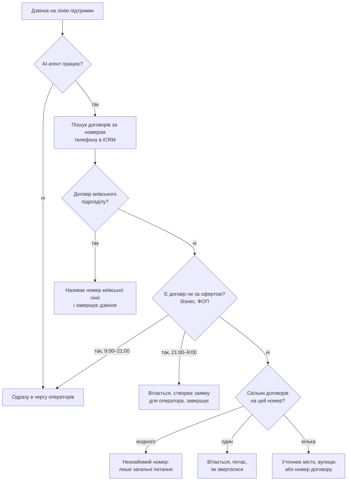
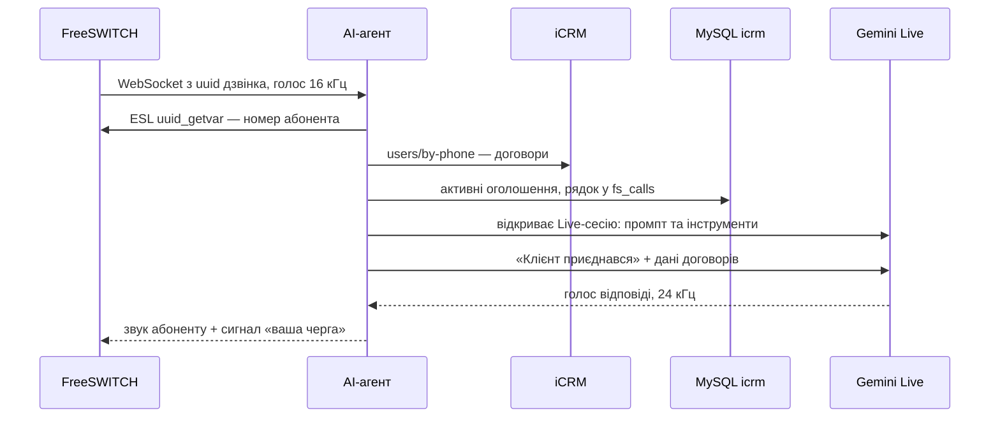

# Розмова

Хто потрапляє до AI-агента, як він впізнає абонента і як веде розмову.
Назад до [AI-агента](README.md).

## Хто куди потрапляє

### Абонент телефонує з номера, вказаного в договорі

AI-агент уже знає договір, коли бере трубку: «Добрий день. Вас вітає
віртуальний помічник компанії Айпорт. Як я можу до вас звертатись?». Далі
звертається на імʼя (якщо абонент назвав справжнє імʼя) і працює з даними
цього договору без додаткових запитів.

### У абонента кілька договорів

AI-агент каже, що знайшов кілька договорів, і уточнює, про який мова:

- якщо договори в різних населених пунктах — питає населений пункт;
- якщо в одному — питає вулицю;
- якщо й вулиця та сама — перелічує номери договорів і просить вибрати.

### Абонент телефонує з номера, якого немає в жодному договорі

Ідентифікувати абонента неможливо, тому AI-агент **не дає** даних по договору
(баланс, тариф, стан послуги) і не перевіряє обладнання — навіть якщо абонент
назвав номер договору. Він не підтверджує й не заперечує, що такий договір
існує, і радить зателефонувати з номера, вказаного в договорі.

З загальними питаннями допомагає повністю: способи оплати, оплата не
зарахувалась, тарифи, особистий кабінет, публічний договір, нове підключення.

Якщо не працює інтернет — переводить на оператора, а коли операторів немає,
створює заявку.

### Абонент із договором не за офертою

Бізнес, ФОП та інші договори не за публічною офертою AI-агент не обслуговує:

- **9:00–21:00** — дзвінок одразу йде оператору, AI-агент не говорить;
- **21:00–9:00** — AI-агент вітається, каже, що оператори працюють з 9:00 до
  21:00, створює заявку для оператора й завершує дзвінок. Питань по суті не
  ставить.

### Абонент київського підрозділу

Для абонентів Києва працює окрема лінія підтримки. AI-агент повільно, по одній
цифрі, диктує номер цієї лінії й завершує дзвінок. Заявку не створює й на
оператора не переводить.

**Технічно**

- Договори шукаються в iCRM: `GET /users/by-phone/<телефон>` (номер без `+38`,
  таймаут 5 с). Якщо за 3 с відповіді немає, розмова починається як з
  незнайомим номером. Після дзвінка пошук повторюється, щоб заявка лягла на
  правильний договір.
- Маршрут визначається за полями договору: `grp = 36` — Київ,
  `contract_type` ≠ `oferta` — не оферта.
- Години операторів — 9:00–21:00 за годинником сервера
  (`OPERATOR_FROM_HOUR` / `OPERATOR_TO_HOUR` у `fs-listen.js`).
- Дані договору (баланс, тариф, адреса, `mid`, ONU, тимчасовий доступ)
  передаються в розмову одним повідомленням на старті — окремих запитів по
  ходу розмови AI-агент не робить.

## Як AI-агент розмовляє

- **Коротко**: 1–3 речення, одне питання за раз, без довгих пояснень і
  великих списків. Не перепитує те, на що вже отримав відповідь.
- **На «Ви»**, українською. Розуміє російську.
- **По черзі, як по рації.** Поки AI-агент говорить або щось перевіряє,
  мікрофон абонента приглушено — телевізор, фонові голоси чи луна не
  перебʼють відповідь.
- **Сигнал «ваша черга».** Після кожної відповіді звучить короткий сигнал:
  можна говорити.
- **Перед перевірками каже, що робить**: «Перевіряю обладнання.», щоб
  абонент не думав, що звʼязок обірвався.
- **Голос і команди не змішуються.** Абонент чує лише звичайну мову: назви
  внутрішніх команд, полів і технічні значення AI-агент не вимовляє ніколи.
- **Не вигадує.** Баланс, тариф, швидкість, статус обладнання, аварії, строки,
  номери заявок, імена — лише з даних iCRM або результатів перевірок. Якщо
  даних немає: «Зараз не вдається отримати інформацію. Я створив заявку, з
  вами скоро звʼяжуться». Ремонт і строки не обіцяє.
- **«Заявку створено» — лише після підтвердження з Jira.** Якщо заявка не
  створилась, AI-агент так і каже.

### Коли абонент перебиває або питає кілька речей одразу

- Остання репліка абонента — найважливіша: AI-агент відповідає на неї й
  повертається до попередньої теми, лише якщо це потрібно.
- Якщо питань кілька — підтверджує, що почув усі, і відповідає по черзі.

### Коли поруч шумно або погано чути

AI-агент з першої осмисленої репліки визначає головного співрозмовника й
говорить лише з ним. Інші голоси, телевізор, YouTube, музику вважає фоном і
не відповідає на них.

| Ситуація | Що робить AI-агент |
|---|---|
| Зміст зрозумілий, є дрібні звуки («угу», кашель, дихання) | Нічого — це не перебивання, відповідь не обриває |
| Шум є, але абонента можна розібрати | Коротко уточнює ключове: «Вибачте, є перешкоди. Чи правильно я зрозумів — …?» |
| Сторонні голоси чи шум заважають зрозуміти | «Мені заважає сторонній шум. Будь ласка, якщо є можливість, відійдіть у тихіше місце» |
| Шум не зникає після прохання | Пропонує оператора: «Через сильний фоновий шум я не можу гарантувати правильність консультації. Якщо бажаєте, я можу перевести вас на оператора» |
| Мова переривається, пропадають слова | Не вгадує: «Вибачте, вас погано чути. Повторіть, будь ласка» |

## Про що можна питати

Коли абонент називає тему, AI-агент завантажує окрему інструкцію для неї. За
один дзвінок тем може бути кілька.

| Тема | Приклади |
|---|---|
| Не працює інтернет | діагностика ONU і роутера — див. [actions.md](actions.md#діагностувати-чому-не-працює-інтернет) |
| Не відкривається сайт | конкретний ресурс недоступний |
| Wi-Fi і швидкість | покриття, забутий пароль, не підключається, повільно, розриви, VPN, новий роутер |
| Фінанси | баланс, скільки поповнити, сума до списання, тариф, тимчасовий доступ |
| Зміна тарифу | як змінити тарифний план |
| Оплата | способи оплати, оплата не зарахувалась, оплата не на той договір |
| Публічний договір | де знайти оферту |
| Договір | розірвання, переоформлення, перенесення |
| Статична IP-адреса | як отримати |
| Особистий кабінет | доступ, пароль |
| Не можу додзвонитись | через блокування послуг |
| Пошкодження лінії | провисла оптика, злетів бокс, пошкодження на опорі |
| Призупинення послуги | на час відпустки, відновлення |
| Нове підключення | людина ще не клієнт — AI-агент створює заявку на підключення |

Додаткові послуги — другий роутер, mesh, локальна мережа, IPTV, телефонія,
відеоспостереження — компанія не надає. AI-агент так і каже й створює заявку,
щоб підтримка знала про запит.

## Оголошення на початку дзвінка

Якщо в iCRM увімкнено оголошення, AI-агент одразу після привітання переказує
його абоненту — лише тим, кого впізнав за номером. Як увімкнути — у
[management.md](management.md#увімкнути-оголошення-для-всіх-хто-телефонує).

## Не довше 5 хвилин

Через 5 хвилин AI-агент закінчує розмову: «Схоже, нам не вдається вирішити
питання», створює заявку, обіцяє, що звʼяжеться спеціаліст, і прощається.
Якщо в цей момент він говорить, то спершу договорює.

**Технічно: початок дзвінка**

- Промпт — `system-prompt.js`: загальні правила + перелік тем + правила
  завершення. Інструкцію конкретної теми AI-агент підвантажує сам інструментом
  `get_scenario_instructions`.
- Режим «рації» — `half-duplex.js`: поки грає відповідь AI-агента або працює
  інструмент, у Gemini замість голосу абонента йде тиша. Сам знімається,
  ніколи не «залипає».
- Сигнал — 660 Гц, 180 мс (`audio-beep.js`, `BEEP_ENABLED`).
- Розпізнавання мови: Gemini менш чутливий до початку мовлення (щоб не
  реагувати на шум) і швидко визначає її кінець (`gemini.js`).
- Ліміт 5 хвилин рахується від початку розмови. Після нього в розмову
  надсилається системне повідомлення з командою завершити.
