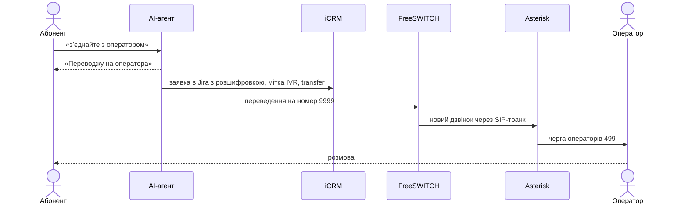

# Переведення на оператора і завершення дзвінка

Назад до [AI-агента](README.md).

### Коли AI-агент переводить на оператора

- абонент просить оператора — AI-агент один раз пропонує свою допомогу, а якщо
  абонент наполягає, переводить без затримок;
- абонент дуже роздратований;
- проблему не вдається діагностувати або дані системи суперечать одне одному;
- конфлікт по оплаті;
- потрібне нестандартне налаштування;
- не працює інтернет, а номер абонента не привʼязаний до договору.

Абонентів із договором не за офертою (бізнес, ФОП) AI-агент не обслуговує
взагалі — у робочий час дзвінок одразу йде оператору.

### Як проходить переведення

AI-агент каже, що переводить, і після цього: створює в Jira заявку з повною
розшифровкою розмови та передає дзвінок у чергу операторів. Оператор, відкривши
заявку, бачить, про що абонент уже говорив з AI-агентом.

### Коли операторів немає (21:00–9:00)

AI-агент каже: «На жаль, оператори зараз недоступні. Підтримка працює з 9:00 до
21:00», створює заявку з описом проблеми, повідомляє, що звʼяжеться
спеціаліст, і прощається.

### Як AI-агент завершує дзвінок

Після вирішення питання AI-агент питає, чи може ще чимось допомогти. Якщо ні —
прощається й кладе трубку, коли абонент дослухав прощання до кінця.

Якщо за дзвінок не було жодної заявки, перед завершенням AI-агент мовчки
створює її з описом розмови — щоб кожен дзвінок лишав слід у Jira.

### Що бачить оператор у розділі «Звонки» iCRM

Переведений дзвінок у журналі iCRM виглядає як **два рядки**:

| Рядок | Що показує |
|---|---|
| AI-агент (позначка AI Agent) | справжній номер абонента й тривалість **усього** дзвінка — разом із розмовою з оператором |
| Оператор | розмова з оператором, із записом Asterisk |

Тож тривалість у рядку AI-агента — це не час, коли говорив AI-агент, а весь час,
поки абонент був на лінії.

**Технічно**

- Переведення: `uuid_transfer <uuid> 9999 XML default` через ESL. Номер 9999
  у FreeSWITCH робить `bridge sofia/gateway/asterisk/12345678`, Asterisk ставить
  дзвінок у чергу 499.
- FreeSWITCH не повертає початковий канал, а створює новий дзвінок в Asterisk.
  Тому в CDR Asterisk це два дзвінки з різними `linkedid`.
- Рядок AI-агента в CDR має контекст `ext-trunk`. iCRM показує його з іконкою
  `support_agent` і номером абонента (`icrm-server`, `routes/aster.js`).
- Переведення можливе лише з 9:00 до 21:00. Поза цим часом інструмент
  повертає `available: false`, і AI-агент створює заявку.
- Завершення: `uuid_kill <uuid> NORMAL_CLEARING`. AI-агент чекає, доки дограє
  весь звук, і ще 0,8 с.
- Код — `tools.js` (`transfer_to_operator`, `hangup_call`), `fs-listen.js`.
