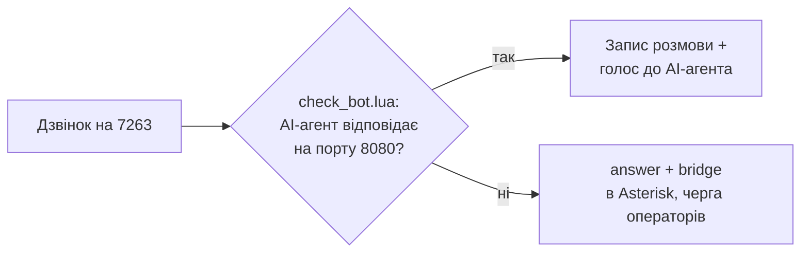
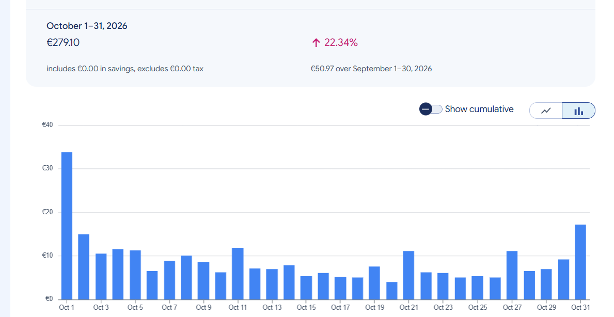

# Керування та надійність

Оголошення, зміна поведінки,
запуск і зупинка, оплата Gemini, усунення несправностей.
Назад до [AI-агента](README.md).

 Як AI-агент влаштований зсередини —
у [technical.md](technical.md).

Для розділів про промпт і запуск потрібен доступ до сервера по SSH і
текстовий редактор.

---

### Увімкнути оголошення для всіх, хто телефонує

Наприклад, про аварію в районі чи зміну умов. iCRM → **Звонки → Повідомлення AI**:
список оголошень із перемикачем. Увімкнене оголошення AI-агент переказує кожному,
кого впізнав за номером, одразу після привітання, — природно, своїми словами,
один раз. Кілька увімкнених оголошень зачитуються разом. iCRM запамʼятовує, хто
й коли перемкнув.

Перемикач діє одразу: AI-агент читає оголошення на початку кожного дзвінка,
перезапуск не потрібен.

Текст оголошення в iCRM змінити не можна — лише ввімкнути чи вимкнути. Новий
текст додається в базу, у таблицю `agent_injections`: `type = 'announcement'`,
`content` — JSON `{"text": "..."}` (або `{"html": "..."}` — теги прибираються,
бо текст озвучується).

**Технічно**

- iCRM: `GET /agent-injections`, `POST /agent-injections/<id>/toggle`
  (`icrm-server`, `routes/agent-injections.js`). Вкладка —
  `icrm-ui.2`, `src/components/AgentInjections.vue`.
- AI-агент: `getActiveAnnouncement()` у `db.js` — лише для абонентів, яких
  знайдено за номером. Якщо таблиці немає чи база недоступна, дзвінок іде без
  оголошення.

---

### Змінити те, що AI-агент каже і як поводиться

Уся логіка й «характер» розмови — у файлі **`system-prompt.js`** на сервері.
Код міняти не треба, перелік інструментів теж. Файл редагується як звичайний
текст.

```
systemInstruction = common + scenariosSection + ending
```

| Що змінити | Що редагувати |
|---|---|
| Поведінка в усіх темах: тон, звертання, шум, заборони, гроші | блок `common` |
| Конкретна тема | константа теми: `billing`, `wifi`, `payments`, `internet_outage`… |
| Завершення дзвінка | блок `ending` |
| Відповіді про поточну розсилку | розділ «АКТУАЛЬНА РОЗСИЛКА» в `common` |

**Додати нову тему:**

1. створити константу `` const my_scenario = `...` ``;
2. додати її в обʼєкт `scenarios` унизу файлу;
3. додати назву й опис у перелік `scenariosSection`, щоб AI-агент знав, коли її
   вибирати;
4. додати назву в перелік тем інструмента `get_scenario_instructions`
   (`tools.js`).

**Домовленості в тексті промпту:**

| Позначення | Значення |
|---|---|
| «у подвійних лапках» | фраза, яку AI-агент каже **дослівно** |
| `[У_КВАДРАТНИХ_ДУЖКАХ]` | внутрішня команда — виклик інструмента. AI-агент її ніколи не озвучує |
| 'в одинарних лапках', назви полів (`state`, `balance`, `onu`…) | технічні дані, які ніколи не озвучуються |

Перед деякими командами AI-агент обовʼязково каже фразу вголос (розділ
«ОЗВУЧЕННЯ ПЕРЕД КОМАНДОЮ»), наприклад «Перевіряю обладнання.» — щоб абонент
не думав, що звʼязок обірвався.

 Якщо AI-агент почав **вимовляти назви команд** — у тексті промпту назву
написано звичайним словом, а не в квадратних дужках.

 Рядок промпту, у який підставляються дані (`${contracts...}`), має бути
**функцією** `` (contracts) => `...` ``, а не константою. Інакше AI-агент не
запуститься: `ReferenceError: contracts is not defined`.

 Зміни діють лише після перезапуску: `pm2 restart sandra-agent`. «Гарячого»
перезавантаження немає.

---

### Що буде, якщо AI-агент не працює



Якщо процес AI-агента зупинено або він впав, абоненти не чують тиші: FreeSWITCH
сам відправляє дзвінок операторам. pm2 автоматично перезапускає процес після
збою й після перезавантаження сервера.

---

### Оплата Gemini

**Gemini API — платний.** Голосовий режим Live тарифікується за обсягом
вхідного й вихідного аудіо. Безкоштовний рівень має жорсткі обмеження й для
роботи не підходить.

**Скільки це коштує** — витрати за жовтень 2026, Google Cloud Console → Billing:



| | |
|---|---|
| Жовтень 2026 | **€279,10**, без знижок і податків |
| Вересень 2026 | ≈ €228,13 — жовтень дорожчий на €50,97 (+22,34 %) |
| Звичайний день | €5–12 |
| Найдорожчі дні | 1 жовтня ≈ €34, 31 жовтня ≈ €17 |

Витрати залежать від кількості й тривалості дзвінків: оплачується кожна секунда
звуку в обидва боки. До цього додаються невеликі витрати на AI-аналітика
(`gemini-3.1-flash-lite`, ті самі ключ і рахунок).

До ключа `GEMINI_API_KEY` має бути привʼязано:

- активний платіжний акаунт Google Cloud;
- дійсну, не протерміновану картку з достатнім балансом;
- жодної заборгованості за попередні періоди.

Де перевіряти:

- **Google AI Studio** — `aistudio.google.com` → API keys / Billing: план і
  привʼязка оплати до ключа;
- **Google Cloud Console** — `console.cloud.google.com/billing`: платіжний
  акаунт, картка, рахунки, історія витрат. Там же — **бюджет і сповіщення**
  (budget alerts), щоб дізнатися про наближення до ліміту заздалегідь.

Якщо оплата не пройшла, Google відхиляє запити (`429 RESOURCE_EXHAUSTED`,
`403`), і AI-агент не може відкрити голосову сесію. Найчастіша причина раптової
зупинки — протермінована картка або вичерпаний бюджет.

---

### Запустити, зупинити, перезапустити

FreeSWITCH має працювати — інакше AI-агент не підключиться до нього:

```bash
sudo freeswitch -nc -nonat                  # запуск
fs_cli -x status                            # стан
fs_cli -x shutdown                          # зупинка
fs_cli -x "sofia status gateway asterisk"   # транк до Asterisk: має бути REGED / UP
```

AI-агент і сервіс записів працюють під **pm2** — перезапускаються після збою й
після перезавантаження сервера. `node fs-listen.js` вручну — лише для
відладки.

```bash
pm2 list                        # процеси: стан, кількість перезапусків, час роботи
pm2 restart sandra-agent           # після зміни промпту, коду або .env
pm2 restart recordings-server
pm2 logs sandra-agent              # живий лог AI-агента
pm2 logs recordings-server
pm2 restart analyzer
pm2 logs analyzer              # висновки AI-аналітика
pm2 save                        # зберегти перелік процесів
```

Точні назви процесів — у `pm2 list`.

Нормальний старт: у лозі `[ESL] Authenticated!`, на першому дзвінку —
`[GEMINI] Live session open`.

AI-аналітик запускається окремо: `node call-analyzer.js --watch` (постійно) або
`node call-analyzer.js <uuid> --dry` (перевірити один дзвінок без запису в базу
й без закриття заявок). На сервері працює під pm2 як `analyzer`.

---

### Усунення несправностей

Лог AI-агента — `pm2 logs sandra-agent` або файл дзвінка `logs/call-*.log`
(формат — у [technical.md](technical.md#лог-дзвінка)).

**Запуск і підключення**

| Що видно | Причина й що робити |
|---|---|
| Процес не стартує, у `pm2 list` росте лічильник перезапусків | Помилка при завантаженні — `pm2 logs sandra-agent`. Найчастіше: `.env`, недоступний iCRM чи MySQL, помилка в промпті |
| `[ESL] error: connect ETIMEDOUT` / `ECONNREFUSED :8021` | FreeSWITCH не запущений або неправильна адреса ESL. На сервері — `127.0.0.1:8021` |
| `[ESL] Authentication FAILED` | Неправильний пароль ESL |
| `Could not read source map … .map` | Нешкідливе попередження Node 24 — ігнорувати, справжня помилка далі |

**Gemini**

| Що видно | Причина й що робити |
|---|---|
| `Live session closed (code=1008 … not found)` | Модель недоступна. `gemini-3.1-flash-live-preview` працює **лише через AI Studio** за ключем, не через Vertex. Перевірити `GEMINI_LIVE_MODEL` |
| `Live session closed (code=1008 … not supported for bidiGenerateContent)` | Ключ або модель не підтримує режим Live |
| Сесія одразу закривається, `401` / `403` | Неправильний або протермінований `GEMINI_API_KEY` |
| `429 RESOURCE_EXHAUSTED`, помилки квоти чи оплати | Квота вичерпана або проблема з оплатою — див. вище |

**Під час дзвінка**

| Що видно | Причина й що робити |
|---|---|
| AI-агент не відповідає, дзвінки одразу йдуть операторам | AI-агент не запущений або впав: `check_bot.lua` не підключився до `127.0.0.1:8080`. `pm2 list`, `pm2 logs sandra-agent` |
| Тиша або звук лише в один бік | Чи підключив FreeSWITCH `audio_stream` до `ws://127.0.0.1:8080`, чи є в лозі `Live session open` |
| AI-агент замовкає на фоновому шумі | Особливість режиму «рації»: тайминги в `half-duplex.js`, чутливість у `gemini.js` |
| AI-агент вимовляє назви команд | У промпті команду написано без квадратних дужок |
| `transferToOperator is not a function` | У `tools.js` `transferToOperator` має братися з `ctx` у `handleToolCalls`, а не імпортуватися |
| `ReferenceError: contracts is not defined` при старті | Рядок промпту з `${contracts...}` має бути функцією |

**Заявки, записи, дані**

| Що видно | Причина й що робити |
|---|---|
| Заявки не створюються | Недоступний iCRM (`ICRM_BASE_URL`) або неправильний `ICRM_TOKEN` |
| Помилки `[DB]` | Недоступний MySQL `172.16.252.40:3306` або неправильні дані в `.env` |
| Немає аудіозапису | Не спрацював `record_session` у діалплані або неправильний `RECORDINGS_DIR` (типово `/var/log/freeswitch/recordings`) |
| У «Записи AI» немає лога | Сервіс записів не бачить `logs/` — перевірити `LOGS_DIR` |
| Помилка `require` після копіювання файлів | На сервері промпт може називатися `system-prompts.js` (множина), локально — `system-prompt.js` |
| Дзвінок на `192.168.177.122` «іншим голосом» | Це тестовий агент на номері 7264, не бойовий |
