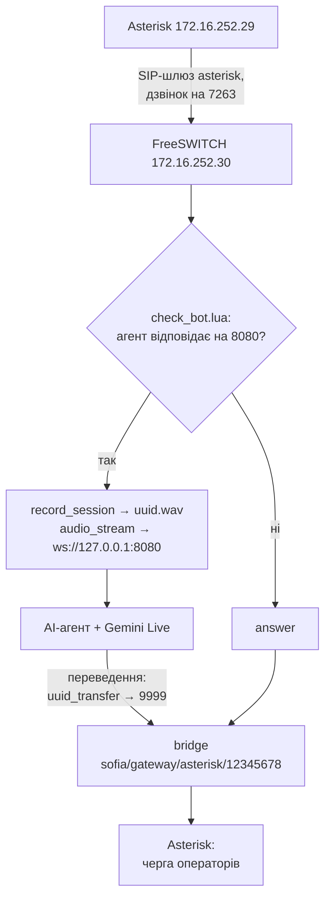
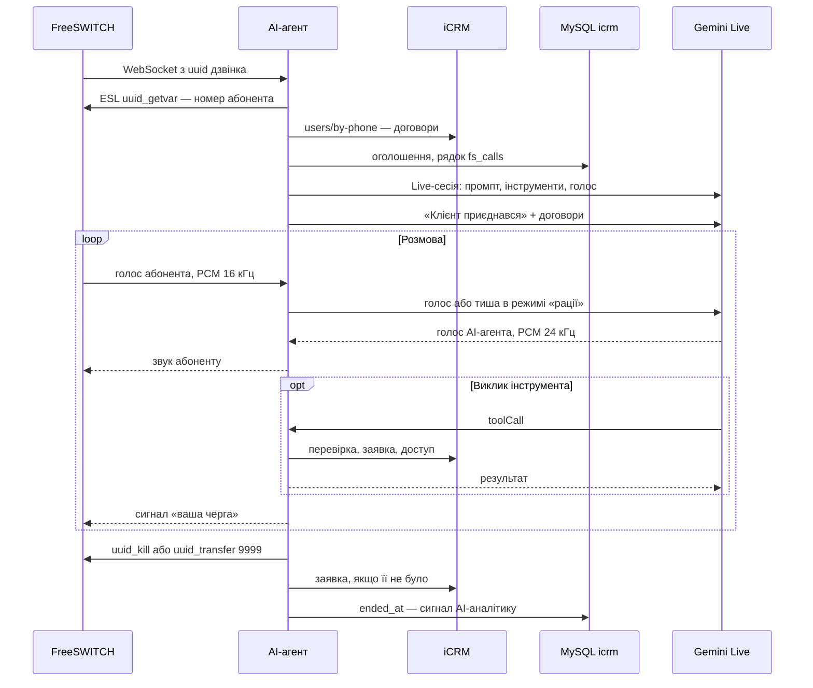

# Технічна будова

Як AI-агент влаштований зсередини: складові, маршрутизація дзвінків, голос, дані,
логи, налаштування й код. Назад до [AI-агента](README.md).

## Складові

| Складова | Що робить | Де |
|---|---|---|
| **Asterisk** | Основна АТС: приймає зовнішні дзвінки, тримає чергу операторів | `172.16.252.29:5160` |
| **FreeSWITCH** | Приймає дзвінки для AI-агента, пише запис розмови, передає звук AI-агенту | `172.16.252.30:5080` |
| **AI-агент** (pm2 `sandra-agent`, `fs-listen.js`) | Веде розмову: звʼязує дзвінок із Gemini Live, виконує інструменти | `172.16.252.30`, WebSocket `127.0.0.1:8080` |
| **Google Gemini Live** | Розпізнає мову, вирішує, що відповісти, синтезує голос | хмара Google, AI Studio |
| **iCRM** | Дані абонента, PON, Jira, Viber, тимчасовий доступ | `srv-app-1`, `172.16.252.51:82` (`ICRM_BASE_URL`) |
| **MySQL `icrm`** | Таблиці `fs_calls` (дзвінки) і `agent_injections` (оголошення) | `172.16.252.40:3306` |
| **Сервіс записів** (pm2 `recordings-server`) | Віддає записи й логи в iCRM | `172.16.252.30:8088` |
| **AI-аналітик** (pm2 `analyzer`, `call-analyzer.js`) | Оцінює дзвінки й закриває вирішені заявки | `172.16.252.30` |
| **iCRM UI** | Вкладки «Записи AI» і «Повідомлення AI» в розділі «Звонки» | `icrm-ui.2` |

## Маршрутизація дзвінка: Asterisk ↔ FreeSWITCH



Обидва шляхи до людей — автоматичний (AI-агент недоступний) і свідомий (AI-агент
переводить) — ведуть в одну точку: `sofia/gateway/asterisk/12345678`.

| Обʼєкт | Значення | Роль |
|---|---|---|
| Asterisk | `172.16.252.29:5160` | основна АТС |
| FreeSWITCH | `172.16.252.30:5080` | обробляє дзвінки для AI-агента |
| SIP-шлюз | `sofia/gateway/asterisk` | транк між FreeSWITCH і Asterisk. Робочий стан — `REGED` / `UP` |
| `7263` (`Sandra_AI_Direct`) | номер у FreeSWITCH | **бойовий**: агент на цьому ж сервері, `127.0.0.1:8080` |
| `7264` (`Sandra_AI_Remote`) | номер у FreeSWITCH | тестовий: агент на `192.168.177.122:8080`, у роботі не використовується |
| `9999` | номер у FreeSWITCH | переведення на оператора |
| `12345678` | акаунт FreeSWITCH на транку Asterisk | ним FreeSWITCH реєструється в Asterisk, і його ж набирає, щоб вийти на операторів |
| `check_bot.lua` | `/usr/share/freeswitch/scripts/` | перевірка AI-агента + запасний шлях на операторів |

Файли FreeSWITCH:

- `/etc/freeswitch/dialplan/default.xml` — номери 7263, 7264, 9999;
- `02_asterisk_outbound.xml` — public-контекст: приймає дзвінки **лише з
  `172.16.252.29`** і передає в `default` без зміни номера;
- `02_ai_transfer.xml` — маршрут переведення;
- `asterisk.xml` — налаштування SIP-шлюзу (містить пароль реєстрації).

### Як увімкнути AI-агента на вхідній лінії

У Asterisk направити цю лінію на транк FreeSWITCH, на номер `7263`. Поки AI-агент
працює й `check_bot.lua` бачить його доступним, дзвінки обслуговує він. Якщо
AI-агента вимкнути, дзвінки автоматично йдуть операторам.

## Один дзвінок зсередини



## Голос: Gemini Live

| Параметр | Значення |
|---|---|
| Модель | `gemini-3.1-flash-live-preview` (`GEMINI_LIVE_MODEL`) |
| Доступ | Google AI Studio за API-ключем (`GEMINI_API_KEY`), `apiVersion` з `GEMINI_API_VERSION`. Через Vertex AI ця модель **недоступна** |
| Відповідь | лише аудіо (`responseModalities: AUDIO`), `temperature 0.9` |
| Голос, мова | `Puck`, `uk-UA` |
| Розшифровка | вмикається і для абонента, і для AI-агента — з неї будуються лог і стенограма для заявок |
| Визначення мовлення | початок — низька чутливість (не реагувати на шум), кінець — висока (швидко відповідати) |
| Звук | від абонента PCM 16 кГц, від AI-агента PCM 24 кГц |

## Режим «рації» і сигнал

Gemini сам вирішує, коли абонент почав і закінчив говорити. По телефону це
ламається: луна від власного голосу AI-агента, телевізор чи фонові голоси його
перебивають. Тому AI-агент веде облік, скільки звуку ще грає в трубці абонента:

- поки грає його відповідь (+ 250 мс «хвіст») або працює інструмент (до 8 с),
  у Gemini замість голосу абонента йде **тиша**;
- облік ведеться за часом, тому режим знімається сам — абонент не може
  «залипнути» приглушеним, навіть якщо Gemini не надішле кінець ходу;
- після кожної відповіді — сигнал «ваша черга»: 660 Гц, 180 мс, з плавним
  наростанням і спадом 12 мс, щоб не клацало;
- кладе трубку AI-агент лише тоді, коли весь звук дограв, плюс 0,8 с. Якщо
  Gemini не надіслав кінець ходу, трубка кладеться через 3 с.

Налаштування — `half-duplex.js` (`tailMs`, `toolMuteMs`), `audio-beep.js`
(`BEEP_ENABLED`, `BEEP_MS`).

## Ліміти й таймаути

| Що | Значення | Де |
|---|---|---|
| Тривалість розмови | 5 хв, потім AI-агент завершує й створює заявку | `fs-listen.js` |
| Очікування пошуку абонента | 3 с, потім розмова як із незнайомим номером | `fs-listen.js` |
| Запит до iCRM по телефону | 5 с | `icrm.js` |
| Приглушення на час інструмента | до 8 с | `half-duplex.js` |
| Години переведення на оператора | 9:00–21:00 за годинником сервера | `fs-listen.js`, `tools.js` |
| Тимчасовий доступ | 3 дні | `tools.js` |
| AI-аналітик | опитування кожні 10 с, до 4 спроб, пауза 20 с × спроба після `429` | `call-analyzer.js` |

## Промпт

```
systemInstruction = common + scenariosSection + ending
```

- **`common`** — правила, що діють завжди: голос і команди не змішуються,
  фраза перед кожною перевіркою, звертання на «Ви», постійний співрозмовник,
  фоновий шум, якість телефонного каналу, гроші не рахувати, нічого не
  вигадувати, послуги, які не надаються, коли можна казати «заявку створено»,
  що писати в заявці, початок діалогу, незареєстрований номер, ескалація,
  актуальна розсилка.
- **`scenariosSection`** — перелік 14 тем, щоб AI-агент міг вибрати потрібну.
- **`scenarios`** — інструкція кожної теми. AI-агент завантажує її сам
  інструментом `get_scenario_instructions`, коли зрозумів тему:
  `internet_outage`, `no_site_access`, `wifi`, `billing`, `packet_change`,
  `payments`, `public_contract`, `contract_issue`, `static_ip`,
  `personal_account`, `phone_blocking`, `no_optics`, `service_pause`,
  `new_client`.
- **`ending`** — завершення дзвінка.

Код додатково підставляє в розмову системні повідомлення: дані договорів на
старті, оголошення, сценарій для договорів не за офертою вночі, сценарій для
Києва, команду завершити розмову через 5 хвилин.

## Інструменти

| Інструмент | Команда в промпті | Що робить | Виклик в iCRM |
|---|---|---|---|
| `check_onu_status` | `[ПЕРЕВІР_ONU]` | статус ONU і сигнал | `GET /pon/pon-details/<MAC ONU>` |
| `check_router_authorization` | `[ПЕРЕВІР_РОУТЕР]` | авторизація роутера | `GET /users/devices/auth-time/<mid>` |
| `create_ticket` | `[СТВОРИ_ЗАЯВКУ]` | заявка в Jira | `POST /jira/issue/create-or-comment-by-contract` |
| `transfer_to_operator` | `[ПЕРЕВЕДИ_ОПЕРАТОРУ]` | заявка + переведення | та сама заявка, потім ESL `uuid_transfer` |
| `send_cabinet_access` | `[НАДІШЛИ_ДОСТУП]` | дані для входу в кабінет у Viber і SMS | `GET /sending/remind-password/<договір>/<телефон>` |
| `grant_temp_access` | `[НАДАЙ_ДОСТУП]` | тимчасовий доступ на 3 дні | `GET /users/add-temp-access/<mid>/3/ai_agent` |
| `get_scenario_instructions` | `[ОТРИМАЙ_ІНСТРУКЦІЇ]` | інструкція теми | — |
| `hangup_call` | `[ЗАВЕРШИ_ДЗВІНОК]` | покласти трубку | ESL `uuid_kill` |

Усі запити до iCRM — із сервісним токеном у заголовку `token` (`ICRM_TOKEN`).
Поки працює інструмент, абонент приглушений.

## Дані

**`fs_calls`** — рядок на кожен дзвінок. Усі записи — `INSERT … ON DUPLICATE
KEY UPDATE` за `uuid`, тож порядок записів не важливий, а заявки накопичуються.

| Поле | Що |
|---|---|
| `uuid` | ідентифікатор дзвінка FreeSWITCH, первинний ключ. Спільний для запису, логу й заявки |
| `phone` | номер абонента |
| `contract` | договір |
| `jiras` | ключі заявок через кому, без дублів |
| `created` | час дзвінка — за ним iCRM звʼязує дзвінок із CDR Asterisk |
| `ended_at` | кінець дзвінка — після нього дзвінок бере AI-аналітик |
| `is_accepted`, `labels`, `reason` | висновок AI-аналітика: вирішено чи ні, теми, пояснення |

**`agent_injections`** — оголошення: `id`, `type` (`announcement`), `title`,
`content` (JSON `{text}` або `{html}`), `active`, `changed_by`, `changed_at`.

Підключення до MySQL відкривається на кожен запит і одразу закривається — щоб
не тримати зʼєднання, яке MySQL може розірвати під час простою. Помилка бази
ніколи не обриває дзвінок.

## Лог дзвінка

Файл `logs/call-<час>_Z_<uuid>.log` — один на дзвінок. Усе, що AI-агент пише в
консоль під час дзвінка, потрапляє у файл цього дзвінка. Кожен рядок починається
з часу за Києвом і рівня (`LOG`, `WARN`, `ERR`). Поверх технічних рядків —
читабельна хронологія з часом від початку дзвінка (`+…ms`). Приклад (дату
скорочено):

```
10:15:02.120 [LOG] +  1200ms 🔊 AI said: "Добрий день. Вас вітає віртуальний помічник компанії Айпорт..."
10:15:05.720 [LOG] +  4800ms 👂 heard from caller: "У мене не працює інтернет"
10:15:06.020 [LOG] +  5100ms 🔧 TOOL CALL get_scenario_instructions({"scenario":"internet_outage"})
10:15:07.820 [LOG] +  6900ms 🔧 TOOL CALL check_onu_status({"onu":"..."})
10:15:08.300 [LOG] 🔧 TOOL RESULT check_onu_status → {"online":true,"status":"onuUp",...}
10:15:09.920 [LOG] +  9000ms ⚠️  INTERRUPTED (barge-in) — AI partial: "..."
10:15:10.020 [LOG] +  9100ms ── turn end ──
```

Позначки: 🔊 — що сказав AI-агент, 👂 — що він почув (головне для пошуку луни),
🔧 — інструменти, ⚠️ — перебивання, звук абонента під час відповіді AI-агента,
`goAway` від Gemini.

## Сервіс записів

`recordings-server.js`, порт `8088`.

| Запит | Що віддає |
|---|---|
| `GET /recordings` | список записів |
| `GET /recordings/<uuid>` | запис, з перемоткою (HTTP Range). `&download=1` — завантажити |
| `GET /calls` | рядки `fs_calls` — iCRM поєднує їх із записами за `uuid` |
| `GET /logs` | список логів |
| `GET /logs/<uuid>` | лог дзвінка, текстом. `&download=1` — завантажити |
| `GET /health` | перевірка, що сервіс живий |

Доступ — за токеном `RECORDINGS_TOKEN`: у рядку запиту `?token=` (щоб працювали
`<audio>` і посилання на завантаження) або в заголовку `Authorization: Bearer`.
Токен порівнюється за сталий час. Сервіс має бути доступний лише з внутрішньої
мережі.

## Налаштування

У `.env` на сервері (значень тут немає):

| Змінна | Що |
|---|---|
| `GEMINI_API_KEY`, `GEMINI_API_VERSION`, `GEMINI_LIVE_MODEL` | Gemini Live |
| `ICRM_BASE_URL`, `ICRM_TOKEN` | iCRM |
| `MYSQL_HOST`, `MYSQL_PORT`, `MYSQL_DATABASE`, `MYSQL_USER`, `MYSQL_PASSWORD` | MySQL `icrm` |
| `FS_ESL_HOST`, `FS_ESL_PORT`, `FS_ESL_PASSWORD`, `WS_PORT` | FreeSWITCH ESL і порт для звуку |
| `RECORDINGS_DIR`, `RECORDINGS_TOKEN`, `RECORDINGS_EXT`, `PORT`, `BIND`, `LOGS_DIR` | сервіс записів |
| `ANALYZE_MODEL`, `ANALYZER_POLL_MS`, `CLOSE_RESOLVED`, `JIRA_CLOSE_TRANS` | AI-аналітик |

Прямо в коді: тип договору для AI-агента (`AI_CONTRACT_TYPE = 'oferta'`) і години
операторів — `fs-listen.js`; голос і мова — `gemini.js`; тайминги «рації» —
`half-duplex.js`; сигнал — `audio-beep.js`.

## Код

| Файл | Що в ньому |
|---|---|
| `fs-listen.js` | точка входу: ESL, WebSocket-сервер і весь дзвінок — пошук абонента, маршрутизація, Gemini, переведення, завершення |
| `gemini.js` | клієнт Gemini (AI Studio) і налаштування голосової сесії |
| `tools.js` | опис інструментів, їх виконання, системні сценарії (Київ, ніч, 5 хвилин) |
| `system-prompt.js` | промпт: правила й теми. **На сервері файл може називатися `system-prompts.js`** |
| `icrm.js` | клієнт iCRM, пошук договорів, автоматична заявка |
| `db.js` | `fs_calls`, `agent_injections` |
| `half-duplex.js` | режим «рації» |
| `audio-beep.js` | частоти звуку, сигнал «ваша черга» |
| `call-logger.js` | лог-файл на кожен дзвінок |
| `recordings-server.js` | сервіс записів |
| `call-analyzer.js` | AI-аналітик |


