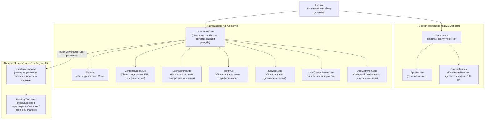
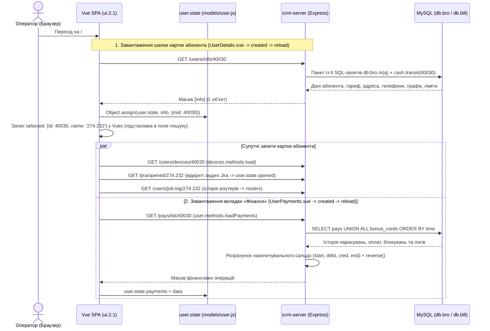

# Документація UI: Картка абонента — вкладка «Фінанси» (`/#/user/:mid/payments`)

Цей документ описує будову інтерфейсу користувача (проєкт **`ui.2.1`** на Vue.js + Vuetify), потік даних, структуру основного HTTP-запиту **`GET /users/info/:mid`** та супутнього запиту фінансової історії **`GET /pays/list/:mid`**, а також бізнес-логіку всіх інтерактивних елементів на сторінці:
- **URL сторінки:** `https://a.iport.net.ua/#/user/:mid/payments` *(наприклад, `https://a.iport.net.ua/#/user/40030/payments`)*
- **Основний запит даних картки:** `GET https://a.iport.net.ua/users/info/:mid` *(наприклад, `https://a.iport.net.ua/users/info/40030`)*
- **Запит таблиці фінансових операцій:** `GET https://a.iport.net.ua/pays/list/:mid` *(наприклад, `https://a.iport.net.ua/pays/list/40030`)*

---

## 1. Архітектура сторінки та дерево Vue-компонентів

Сторінка побудована за допомогою вкладеної маршрутизації `vue-router` ([`ui.2.1/src/router/index.js:107-156`](file:///c:/Projects/icrm/ui.2.1/src/router/index.js#L107-L156)) та централізованого реактивного стану абонента [`user.state`](file:///c:/Projects/icrm/ui.2.1/src/models/user.js#L55-L58) (`Vue.observable`).

### 1.1. Ієрархія компонентів на екрані



### 1.2. Послідовність HTTP-запитів при відкритті `/#/user/40030/payments`



---

## 2. Основний запит `GET /users/info/:mid` та структура даних

Запит **`GET /users/info/:mid`** (наприклад, `https://a.iport.net.ua/users/info/40030`) є головним джерелом даних для всієї верхньої частини картки абонента ([`UserDetails.vue`](file:///c:/Projects/icrm/ui.2.1/src/components/UserDetails.vue) та її дочірніх компонентів).

### 2.1. Обробка запиту на бекенді (`icrm-server`)
1. **Маршрут:** [`routes/users.js:266-268`](file:///c:/Projects/icrm/test-mysql/icrm-server/routes/users.js#L266-L268)
   ```javascript
   router.get('/info/:mid', async function(req, res, next) {
       user.info(req.params.mid, 'bro', true).then( data => res.json([data]))
   });
   ```
   > **Зверніть увагу:** Ендпоінт повертає JSON-масив з одним елементом `[data]`. На фронтенді в [`models/user.js:87-88`](file:///c:/Projects/icrm/ui.2.1/src/models/user.js#L87-L88) береться `let info = data[0]`.

2. **Бізнес-логіка та SQL-вибірка:** функція [`user.info(mid, ds = 'bro', internal = true)`](file:///c:/Projects/icrm/test-mysql/icrm-server/libs/user.js#L73-L169) виконує мультизапит `db.bro.m(q)` із **6 SQL-запитів одночасно**:
   - **Запит №1 (`rows`):** головний запис абонента з `users u` (`WHERE u.id = :mid AND u.mid = 0 LIMIT 1`) з приєднанням (`JOIN` / `LEFT JOIN`):
     - `comments c` (`u.id = c.id`) — текстовий коментар `comment`, JSON-налаштування `props` та посилання `gdoc`;
     - `plat_providers pp` (`pp.id = get_provider_by_contract(u.contract)`) — провайдер/ФОП договору та його `props`;
     - `user_grp g` (`u.grp = g.grp_id`) — ID та назва групи клієнта (`grp_id`, `grp_name`);
     - `plans2 p` (`u.paket = p.id`) — поточний тариф (`p_name`, `p_price`, `p_descr`, `speed`);
     - `plans2 np` (`u.next_paket = np.id`) — запланований тариф на наступний місяць (`np_name`, `np_price`, `np_descr`);
     - `p_street s` та `regions r` — вулиця та населений пункт (`name_street`, `address_region`, `address_street`);
     - підзапит до `phones` (`active = 1`, `GROUP BY mid`) — з'єднані через кому списки телефонів та їхніх прапорців (`phone`, `sms`, `viber`, `prime`);
     - підзапит до `pays` — кількість обіцяних платежів у поточному місяці (`category = 900`, `period = YYYYMM`).
   - **Запит №2 (`traff`):** сумарний вхідний та вихідний трафік за поточний місяць з `users_trf` по головному запису та всіх додаткових пристроях абонента (`WHERE uid IN (SELECT id FROM users WHERE id = :mid OR mid = :mid)`).
   - **Запит №3 (`warnings`):** невідповічені питання/попередження для оператора з таблиці `user_warnings` (`WHERE mid = :mid AND res IS NULL`).
   - **Запит №4 (`ip`):** список зовнішніх («білих») IP-адрес абонента (`WHERE (id = :mid OR mid = :mid) AND ip LIKE '91%'`).
   - **Запит №5 (`tmp`):** сума та час дії активних тимчасових платежів (`SELECT SUM(cash) pay, MAX(time) date FROM pays WHERE mid = :mid AND type = 20 AND category = 1000`).
   - **Запит №6 (`tmp_acc`):** максимальна дата дії тимчасового доступу з `rad_temp_access` (`SELECT MAX(date_to) date_to FROM rad_temp_access WHERE mid = :mid`).
   - **Додатковий розрахунок бонусів:** до поля `u.bonus` додається сума транзитних бонусів `await cash.transit(mid)`.

### 2.2. Повна таблиця полів відповіді `GET /users/info/:mid` та їх відображення в UI

| Поле у відповіді `/users/info/:mid` | Тип даних | Джерело в БД / Формула розрахунку на сервері | Де використовується у Vue (`user.state`) та як відображається в UI |
| :--- | :--- | :--- | :--- |
| **`contract`** | `String` | `users.contract` | Відображається в заголовку картки (`274.232`), підставляється в глобальне поле пошуку зверху (`SearchUser.vue`), використовується для запитів `/jira/opened/:contract`, `/users/job-log/:contract` та переходу в кабінет `profile`. |
| **`fio`** | `String` | `users.fio` | ПІБ абонента у заголовку картки (`Кудрик Катерина`) та в діалозі редагування контактів ([`ContactsDialog.vue`](file:///c:/Projects/icrm/ui.2.1/src/components/ContactsDialog.vue)). |
| **`grp_id`**, **`grp_name`** | `Number`, `String` | `user_grp.grp_id`, `user_grp.grp_name` | Назва групи відображається перед номером договору в заголовку (`Клиенты \| 274.232 \| Кудрик Катерина`). |
| **`state`** | `String` | `users.state` (`'on'` або `'off'`) | Якщо `state !== 'on'`, у лівому верхньому куті картки рендериться червоний чіп **`ЗАБЛОКИРОВАН`** ([`UserDetails.vue:32-35`](file:///c:/Projects/icrm/ui.2.1/src/components/UserDetails.vue#L32-L35)). |
| **`state_date`** | `Number` (Unix) | `users.state_date` | Timestamp останньої зміни стану `state` (наприклад, час блокування `2026-09-01 06:07`). |
| **`next_state`**, **`future`** | `String`, `Array` | `users.next_state` | Запланований стан на наступний місяць (`next_state:unlock` / `next_state:lock`). |
| **`sla`** | `Number \| null` | `users.sla` | Відображається в синьому чіпі **`SLA: n/a`** (або `SLA: 0..4`) у компоненті [`Sla.vue`](file:///c:/Projects/icrm/ui.2.1/src/components/Sla.vue). |
| **`cstate`** | `Number` | `users.cstate` | Якщо `cstate === 10` (неактуальні контакти), у шапці виводиться червоний чіп **`Уточнить телефон`** ([`UserDetails.vue:39-44`](file:///c:/Projects/icrm/ui.2.1/src/components/UserDetails.vue#L39-L44)). |
| **`contract_type`** | `String` | `users.contract_type` (`'oferta'`, `'contract'`, `'postpay'`) | Якщо `contract_type === 'contract'` (обчислювана властивість `corp`), у правому верхньому куті виводиться синій чіп **`Юр. лицо`** ([`UserDetails.vue:5-7`](file:///c:/Projects/icrm/ui.2.1/src/components/UserDetails.vue#L5-L7)). |
| **`balance`** | `Number` | `users.balance` | Поточний баланс абонента у правому верхньому чіпі **`Баланс: 0 грн.`** ([`UserDetails.vue:12-19`](file:///c:/Projects/icrm/ui.2.1/src/components/UserDetails.vue#L12-L19)). |
| **`limit_balance`** | `Number` | `users.limit_balance` | Поріг відключення або сума передоплати. Якщо `block_if_limit === 1`: при `limit_balance > 0` виводиться червоним **`Предоплата: 350 грн.`**, при `limit_balance <= 0` — **`Лимит: -1 грн.`** ([`UserDetails.vue:22-24`](file:///c:/Projects/icrm/ui.2.1/src/components/UserDetails.vue#L22-L24)). |
| **`block_if_limit`** | `Number` (`0\|1`) | `users.block_if_limit` | Визначає, чи показувати рядок `Предоплата: / Лимит:` під чіпом балансу. |
| **`due`** | `Number` | [`money.due(p_price, service_cost, srvs, discount, start_day, share)`](file:///c:/Projects/icrm/test-mysql/icrm-server/libs/money.js#L30-L42) | Підсумкова сума щомісячного нарахування з урахуванням знижки, додаткових послуг та дня підключення. Виводиться підкресленим текстом **`Итого со скидной: 350 грн.`** ([`UserDetails.vue:25-27`](file:///c:/Projects/icrm/ui.2.1/src/components/UserDetails.vue#L25-L27)). |
| **`refill`** | `Number` | [`money.refill(balance, limit_balance, temp_pays)`](file:///c:/Projects/icrm/test-mysql/icrm-server/libs/money.js#L45-L48): якщо `balance - temp_pays < limit_balance`, то `limit_balance - (balance - temp_pays) + 1`, інакше `0`. | Визначає колір чіпа **Баланс** (`refill > 0` → червоний колір `red`) та текст підказки при наведенні: *«Рекомендуемая сумма пополнения {refill}»*. |
| **`temp_pays`**, **`temp_date`** | `Number` | `SUM(cash)` та `MAX(time)` з `pays` (`type = 20, category = 1000`) | Якщо `temp_pays > 0`, ліворуч від чіпа балансу з'являється червоний чіп **`Временный платеж: {temp_pays} грн.`** ([`UserDetails.vue:8-10`](file:///c:/Projects/icrm/ui.2.1/src/components/UserDetails.vue#L8-L10)). |
| **`discount`** | `Number` | `users.discount` (`0..100`) | Персональна знижка (%). Враховується у `due` та при перерахунку абонплати в [`UserPayTrans.vue:119`](file:///c:/Projects/icrm/ui.2.1/src/components/UserPayTrans.vue#L119). |
| **`start_day`** | `Number` | `users.start_day` (`-1`, `0`, `1..31`) | День початку споживання послуг у поточному місяці. У [`Tariff.vue:91`](file:///c:/Projects/icrm/ui.2.1/src/components/Tariff.vue#L91) визначає `isNewClient` (`start_day !== 0`), що дозволяє змінювати тариф поточним місяцем із перерахунком. |
| **`paket`**, **`p_name`**, **`p_c_name`**, **`p_price`**, **`speed`** | `Number`, `String` | `users.paket`, `plans2.name`, `JSON.parse(plans2.descr).title`, `plans2.price`, `plans2.speed` | ID та параметри поточного тарифу. У [`Tariff.vue:106-110`](file:///c:/Projects/icrm/ui.2.1/src/components/Tariff.vue#L106-L110) за `paket` знаходиться назва тарифу у `$store.state.COMMON.prices` (наприклад, **`Активний гігабіт - 350 грн`**). |
| **`next_paket`**, **`np_name`**, **`np_c_name`**, **`np_price`** | `Number`, `String` | `users.next_paket`, `plans2` | Параметри тарифу, запланованого на наступний місяць (`0`, якщо не заплановано). |
| **`srvs`**, **`services`** | `Number`, `Array` | Бітова маска `users.srvs` та розшифрований масив [`money.decode(u.srvs)`](file:///c:/Projects/icrm/test-mysql/icrm-server/libs/money.js#L18-L25) (`[{id, idx, name, price}]`) | Відображається у полі **`Доп. послуги`** ([`Services.vue`](file:///c:/Projects/icrm/ui.2.1/src/components/Services.vue)) через `' /'`. |
| **`user_service`** | `Object \| null` | `money.decodeFlatRate(service_cost, service_name)` | Якщо не `null`, між полем тарифу та полем доп. послуг з'являється додаткове поле **`Начисление ежемесячное`** ([`UserDetails.vue:82-84`](file:///c:/Projects/icrm/ui.2.1/src/components/UserDetails.vue#L82-L84)). |
| **`name_street`**, **`building`**, **`block`**, **`room`** | `String` | `p_street.name_street`, `CONCAT(building, '(', block, ')')`, `users.room` | Формують рядок адреси під заголовком картки ([`UserDetails.vue:65-67`](file:///c:/Projects/icrm/ui.2.1/src/components/UserDetails.vue#L65-L67)): наприклад, `Вороньков - вул. Незалежності, 5(а)` (+ `кв. X`, якщо `parseInt(room) > 0`). |
| **`phones`** | `Array<Object>` | [`parsePhones(u)`](file:///c:/Projects/icrm/test-mysql/icrm-server/libs/user.js#L170-L180) з таблиці `phones` (`[{phone, sms, viber, prime}]`), відсортовані за `prime DESC` | Список контактних телефонів у підзаголовку картки. Основний номер (`prime === 1`) обводиться синьою рамкою (`0503315779`). Також визначає чіп помилки Viber (`viberFailureDescription`). |
| **`email`** | `String` | `users.email` | Виводиться праворуч від телефонів у підзаголовку картки та редагується в `ContactsDialog.vue`. |
| **`in1`**, **`out1`** | `Number \| null` | `SUM(t.in1)`, `SUM(t.out1)` з `users_trf` (у байтах) | Відображаються у лівому блоці компонента [`UserComment.vue:57-70`](file:///c:/Projects/icrm/ui.2.1/src/components/UserComment.vue#L57-L70) як **`Трафик входящий (MB)`** та **`Трафик исходящий (MB)`** (`Math.trunc(val / 1024 / 1024)` або `'n/a'`, якщо `null`/`0`). |
| **`comment`** | `String \| null` | `comments.comment` | Текстовий коментар по абоненту у правому блоці компонента [`UserComment.vue`](file:///c:/Projects/icrm/ui.2.1/src/components/UserComment.vue). |
| **`warning`** | `Object \| null` | Запис із `user_warnings` (`WHERE mid = :mid AND res IS NULL`) | Якщо не `null`, іконка `mdi-alert` у заголовку стає помаранчевою і збільшується до `40px`, а при відкритті картки автоматично спливає вікно опитування абонента ([`UserWarning.vue`](file:///c:/Projects/icrm/ui.2.1/src/components/UserWarning.vue)). |
| **`bonus`** | `Number` | `users.bonus + await cash.transit(mid)` | Записується у `bonuses.state.bonus` ([`models/user.js:89`](file:///c:/Projects/icrm/ui.2.1/src/models/user.js#L89)). |
| **`temp_access_date`**, **`banner_off`** | `Number`, `Boolean` | `MAX(date_to)` з `rad_temp_access` | Дата завершення тимчасового доступу та прапорець відключення без активного тимчасового доступу. |

---

## 3. Детальний опис елементів інтерфейсу (Зверху Вниз)

Нижче наведено опис кожного візуального блоку та елемента керування у тому порядку, в якому вони розташовані на екрані `https://a.iport.net.ua/#/user/40030/payments`.

---

### 3.1. Блок 1: Синя верхня панель навігації ([`UserNav.vue`](file:///c:/Projects/icrm/ui.2.1/src/components/UserNav.vue))

Розташована у верхній частині екрана (`v-app-bar color="primary"`):
1. **Кнопка головного меню `☰` ([`AppNav.vue`](file:///c:/Projects/icrm/ui.2.1/src/AppNav.vue)):** відкриває випадаючий список переходів між модулями системи (`Звонки` → `/cdr`, `Абоненты` → `/users`, `Вопросы` → довідка, `Тарифы` → `/price` [лише для редакторів], `Отчеты` → `/report-work-orders`, `Адреси` → `/streets`, `Профиль` → налаштування профілю оператора).
2. **Вкладки розділу абонентів (`v-tabs`):**
   - **`АБОНЕНТ`** (або `ЛИД`, якщо відкрито лід) — активна вкладка поточного вибраного клієнта (`/user/:mid`);
   - **`ПОИСК`** — перехід до реєстру та фільтрації абонентів за адресою/тарифом/статусом (`/users`, компонент [`Users.vue`](file:///c:/Projects/icrm/ui.2.1/src/components/Users.vue));
   - **`ЗАЯВКИ`** — перехід до списку заявок (`/userOrders`, компонент [`Orders.vue`](file:///c:/Projects/icrm/ui.2.1/src/components/Orders.vue));
   - **`ПОН`** — перехід до браузера оптичної мережі PON (`/user-pon`, компонент [`PonBrowser.vue`](file:///c:/Projects/icrm/ui.2.1/src/components/PonBrowser.vue)).
3. **Поле швидкого пошуку абонента ([`SearchUser.vue`](file:///c:/Projects/icrm/ui.2.1/src/components/SearchUser.vue)):**
   - Коли відкрита картка абонента, у полі автоматично відображається його номер договору (на скріншоті — **`274.232`**).
   - Під час введення тексту компонент автоматично розпізнає тип пошукового запиту за регулярними виразами ([`SearchUser.vue:62-74`](file:///c:/Projects/icrm/ui.2.1/src/components/SearchUser.vue#L62-L74)) і звертається до `GET /users/find/:criteria/:val`:
     - `^\d{1,3}(\.\d{1,3}){3}$` → **`ip`** (`GET /users/find/ip/:ip`);
     - `^\d+\.\d+$` → **`contract`** (`GET /users/find/contract/:contract`);
     - `^0\d{9}$` (10 цифр, префікс `+38` відсікається автоматично) → **`phone`** (`GET /users/find/phone/:phone`);
     - `> 4` літер кирилицею/латиницею → **`fio`** (`GET /users/find/fio/:fio`).
   - При виборі знайденого абонента зі списку зберігається поточна активна вкладка (`params[3]`, тобто при пошуку з `/#/user/40030/payments` новий абонент також відкриється відразу на вкладці `/payments`).

---

### 3.2. Блок 2: Шапка картки абонента ([`UserDetails.vue`](file:///c:/Projects/icrm/ui.2.1/src/components/UserDetails.vue))

#### Ліва та центральна частина заголовка (`v-card-title` та `v-card-subtitle`):
1. **Індикатор блокування (`ЗАБЛОКИРОВАН`):**
   - Відображається червоним чіпом (`color="red"`), якщо `info.state !== 'on'`.
   - Показує іконку блокування `mdi-block-helper`, напис `ЗАБЛОКИРОВАН` та дату/час переходу в цей стан (`state_date`, на скріншоті `2026-09-01 06:07`).
2. **Індикатор та діалог SLA ([`Sla.vue`](file:///c:/Projects/icrm/ui.2.1/src/components/Sla.vue)):**
   - Синій чіп **`SLA: n/a`** (якщо `user.state.sla === null`) або **`SLA: 0..4`**. Відображається, якщо у клієнта заданий SLA або якщо оператор має права редагування (`$user.editor()`).
   - Клік по чіпу відкриває модальне вікно **«SLAs»** із 5 рівнями моніторингу:
     - `0` — *Минимальный* (моніторинг порту без реакції);
     - `1` — *Садики, школы, амбулатории и т.п.* (тригери активні 07:30–22:00);
     - `2` — *Камеры в минимальном тарифе* (порт + ICMP 24x7x365);
     - `3` — *Провайдеры, Юр. лица, Выделенный VLAN ...* (порт + ICMP 24x7x365, підвищений пріоритет);
     - `4` — *Транспортные клиенты* (24x7x365, високий пріоритет).
   - Збереження викликає `GET /users/update-sla/:mid/:sla` (або `:mid/reset`), що оновлює `users.sla` для головного та дочірніх записів і пише лог у `pays` (`type = 50, category = 410`).
3. **Чіп «Уточнить телефон»:**
   - З'являється червоним кольором, якщо `info.cstate === 10` або серед активних телефонів абонента немає жодного з ознакою основного (`!address.phones.some(_ => _.prime === 1)`).
4. **Рядок ідентифікації абонента:**
   - Формат: `{{info.grp_name}} | {{info.contract}} | {{info.fio}}`
   - На скріншоті: **`Клиенты | 274.232 | Кудрик Катерина`**.
5. **Кнопка редагування контактів (іконка олівця `edit`):**
   - Відкриває модальне вікно **[`ContactsDialog.vue`](file:///c:/Projects/icrm/ui.2.1/src/components/ContactsDialog.vue)**, у якому оператор може змінити:
     - ПІБ абонента (`fio`);
     - Основний телефон (`Основной телефон` → встановлює `prime = 1`);
     - `email`;
     - Список телефонів (маска `+38 (###) ### - ####`) та для кожного номера перемкнути іконки-індикатори отримання **SMS** (`mdi-message-text-outline`) і **Viber** (`mdi-cellphone-message`).
   - При натисканні **«Сохранить»** виконується `POST /users/contacts` ([`routes/users.js:345-367`](file:///c:/Projects/icrm/test-mysql/icrm-server/routes/users.js#L345-L367)), який оновлює таблиці `phones`, `users` (`email`, `fio`, скидає `cstate = 0` якщо був `10`) та викликає процедуру `icrm_update_dop_field` для синхронізації з NoDeny.
6. **Кнопка опитування / попередження абонента (іконка трикутника `mdi-alert`):**
   - Якщо для абонента в таблиці `user_warnings` немає активного питання (`info.warning === null`), іконка сіра (`24px`). Клік по ній відкриває діалог **[`UserWarning.vue`](file:///c:/Projects/icrm/ui.2.1/src/components/UserWarning.vue)** із заголовком *«Питання абоненту»*, де оператор може створити нове питання (`POST /users/warning-question`), яке потрібно поставити клієнту при наступному зверненні.
   - Якщо активне питання існує (`info.warning !== null`), іконка стає помаранчевою (`40px`), а діалог пропонує оператору поставити питання клієнту й зафіксувати відповідь (`POST /users/warning-answer`).
7. **Чіп статусу Viber (`viberFailureDescription`):**
   - Якщо жоден телефон не має активного Viber (`viber > 0`), і є номер зі статусом `-2`, виводиться червоний чіп `IPORT ЗАБЛОКИРОВАН`; якщо `-1` — `VIBER НЕ УСТАНОВЛЕН`.
8. **Кнопка `nodeny ❐`:**
   - Відкриває у новій вкладці браузера сторінку цього абонента в класичній адмін-панелі білінгу **NoDeny** ([`UserDetails.vue:217-220`](file:///c:/Projects/icrm/ui.2.1/src/components/UserDetails.vue#L217-L220)):
     `https://b.iport.net.ua/cgi-bin/adm/adm.pl?pp=session&a=user&id=40030`
9. **Кнопка `profile ❐`:**
   - Відкриває у новій вкладці особистий кабінет абонента з авторизацією за поточним токеном оператора `pgjwt` ([`UserDetails.vue:221-225`](file:///c:/Projects/icrm/ui.2.1/src/components/UserDetails.vue#L221-L225)):
     `https://my.iport.ua/#/redirect/274.232/<pgjwt>`
10. **Підзаголовок з адресою та контактами (`v-card-subtitle`):**
    - Виводить: `{{address.street}}, {{address.building}}` (плюс `кв. {{address.room}}`, якщо квартира `> 0`) — на скріншоті: **`Вороньков - вул. Незалежності, 5(а)`**.
    - Поруч виводяться всі активні телефони абонента. Основний номер (`prime === 1`) виділяється синім кольором та заокругленою рамкою (клас `.primary-border` — на скріншоті **`0503315779`**). Далі виводиться `info.email`.

#### Права верхня частина шапки (Фінансовий блок, [`UserDetails.vue:4-29`](file:///c:/Projects/icrm/ui.2.1/src/components/UserDetails.vue#L4-L29)):
1. **Чіп `Юр. лицо`:** з'являється синім кольором, лише якщо `info.contract_type === 'contract'`.
2. **Чіп `Временный платеж: X грн.`:** з'являється червоним кольором, якщо у клієнта є активний тимчасовий платіж (`info.temp_pays > 0`).
3. **Чіп `Баланс: X грн.`:**
   - Показує поточний баланс (`info.balance`, на скріншоті **`Баланс: 0 грн.`**).
   - **Колірна індикація:**
     - **Червоний (`red`)** — якщо `info.refill > 0` (тобто реального балансу без урахування тимчасових платежів не вистачає до порогу `limit_balance`: `balance - temp_pays < limit_balance`);
     - **Помаранчевий (`orange`)** — якщо `overpaid === true` (`balance >= due * 3`, переплата на 3 і більше розрахункових періодів);
     - **Зелений (`green`)** — якщо коштів достатньо і немає надмірної переплати.
   - **Спливаюча підказка (`v-tooltip` при наведенні курсора):**
     - при `refill > 0`: *«Рекомендуемая сумма пополнения {refill}»*;
     - при `overpaid`: *«Переплата на > 3 периода. Пополнение запрещено»*;
     - інакше: *«Средств достаточно»*.
4. **Рядок `Предоплата: X грн.` / `Лимит: X грн.`:**
   - Відображається, якщо увімкнено автоблокування за лімітом (`info.block_if_limit === 1`).
   - Якщо `info.limit_balance > 0`, текст друкується **червоним кольором**: **`Предоплата: 350 грн.`** (означає, що для роботи послуги на рахунку має бути щонайменше 350 грн).
   - Якщо `info.limit_balance <= 0`, текст друкується стандартним кольором: **`Лимит: -1 грн.`** (або від'ємна сума кредитного ліміту).
5. **Рядок `Итого со скидной: X грн.`:**
   - Підкреслений рядок із розрахунковою вартістю послуг `info.due` (на скріншоті **`Итого со скидной: 350 грн.`**).
   - Формула розрахунку на сервері ([`libs/money.js:35-42`](file:///c:/Projects/icrm/test-mysql/icrm-server/libs/money.js#L35-L42)):
     $$\text{due} = \text{round}\left((\text{price} + \text{extra}_{\text{srvs}} + \text{flat} + \text{share}) \times \frac{100 - \text{discount}}{100} \times k,\ 2\right)$$
     де $k = \frac{32 - \text{start\_day}}{31}$ при $\text{start\_day} > 0$, або $k = 1$ при $\text{start\_day} \le 0$.

---

### 3.3. Блок 3: Тарифний план, Додаткові послуги, Задачі Jira, Трафік та Коментар

1. **Поле «Тарифный План» ([`Tariff.vue`](file:///c:/Projects/icrm/ui.2.1/src/components/Tariff.vue)):**
   - Відображає назву та вартість поточного тарифу клієнта (на скріншоті **`Активний гігабіт - 350 грн`**).
   - Якщо оператор має право `this.$user.editor('user-price')`, праворуч у полі активна іконка олівця `mdi-pencil`.
   - При кліку на олівець виконується запит `POST /users/prices` (визначає доступні тарифи для населеного пункту клієнта та категорії `kv` / `private` / `business` / `contract` у [`libs/user.js:264-293`](file:///c:/Projects/icrm/test-mysql/icrm-server/libs/user.js#L264-L293)) і відкривається діалог **«Прайс»**:
     - Перемикач **«Следующий месяц» (`nextm`)**: для існуючих клієнтів (`start_day === 0`) увімкнений примусово (зміна тарифу можлива лише з 1-го числа наступного місяця із автоматичним створенням задачі в Jira).
     - Перемикач **«Пересчет» (`recalc`)**: доступний лише для нових клієнтів, підключених у поточному місяці (`start_day !== 0`), коли вимкнено «Следующий месяц».
     - При збереженні викликається `POST /users/change-tariff` → показується вікно підтвердження умов [`UserWarning.vue`](file:///c:/Projects/icrm/ui.2.1/src/components/UserWarning.vue) → після згоди виконується `POST /users/do-actions` і генерується подія `$bus.$emit('TARIFF_CHANGED')`, яка автоматично оновлює і картку, і таблицю фінансів.
2. **Поле «Доп. послуги» ([`Services.vue`](file:///c:/Projects/icrm/ui.2.1/src/components/Services.vue)):**
   - Відображає перелік підключених додаткових послуг із `user.state.services` (розшифрована бітова маска `users.srvs`).
   - Клік на іконку олівця відкриває діалог **«Прайс доп. услуг»** зі списком усіх послуг із `$store.state.COMMON.services` та чекбоксами.
   - При збереженні виконується `POST /users/set-srvs` (`{mid, srvs}`), після чого викликається `user.methods.reloadInfo(mid)` (`GET /users/info/:mid`) для перерахунку `due` та оновлення картки.
3. **Рядок чіпів відкритих задач Jira ([`UserOpenedIssues.vue`](file:///c:/Projects/icrm/ui.2.1/src/components/UserOpenedIssues.vue)):**
   - Відображається під полем тарифу, якщо масив `user.state.opened` (отриманий із `GET /jira/opened/:contract`) не порожній.
   - На скріншоті: сірий чіп **`[HD-313092] Вороньків, ...`**.
   - Показуються задачі, у яких `duedate` відсутній або вже настав (`due <= Date.now()`).
   - Якщо опис задачі містить JSON-масив зміни тарифу `[prevId, nextId]`, клік по чіпу відразу відкриває діалог зміни тарифу (`SHOW_PLAN_CHANGE`) з автоматичним закриттям задачі після збереження (`POST /jira/do-transition`), а клік на іконку `❐` відкриває саму задачу в Jira (`http://jira.iport.net.ua/browse/HD-313092`).
4. **Картка зведеного трафіку та Поле коментаря ([`UserComment.vue`](file:///c:/Projects/icrm/ui.2.1/src/components/UserComment.vue)):**
   - **Ліва картка (3 колонки ширини):**
     - `Трафик входящий (MB):` — значення `info.in1`, переведене з байтів у мегабайти (`Math.trunc(in1 / 1024 / 1024)`), або `'n/a'`, якщо трафік `0` / `null` (як на скріншоті).
     - `Трафик исходящий (MB):` — значення `info.out1` у МБ або `'n/a'`.
   - **Права картка (9 колонок ширини):**
     - Прокручуване поле висотою `88px` із текстом коментаря `info.comment` (з таблиці `bill.comments`).
     - Якщо оператор має права `$user.editor()`, у правому верхньому куті поля є іконка олівця `mdi-pencil`, яка відкриває діалог **«Коментарий»** і зберігає зміни через `POST /users/change-comment`.
5. **Кругла плаваюча кнопка оновлення `↻` ([`UserDetails.vue:91-93,234-237`](file:///c:/Projects/icrm/ui.2.1/src/components/UserDetails.vue#L91-L93)):**
   - Розташована праворуч під полем коментаря.
   - При натисканні викликає `reloadSection()`, що змінює реактивний проп `:ver="ver"` (`this.ver = Math.random()`), переданий у `<router-view>`. Активна вкладка (зокрема `UserPayments.vue`, яка має `watch: { ver() { this.reload(); } }`) негайно перезавантажує свої дані з сервера.

---

### 3.4. Блок 4: Навігаційні вкладки картки та вкладка «ФИНАНСЫ» ([`UserPayments.vue`](file:///c:/Projects/icrm/ui.2.1/src/components/UserPayments.vue))

#### Горизонтальна панель вкладок картки абонента ([`UserDetails.vue:97-106`](file:///c:/Projects/icrm/ui.2.1/src/components/UserDetails.vue#L97-L106)):
Перемикає дочірні маршрути всередині `/user/:mid/...`:
- `УСТРОЙСТВА` (`/devices` — [`UserDevices.vue`](file:///c:/Projects/icrm/ui.2.1/src/components/UserDevices.vue))
- **`ФИНАНСЫ`** (`/payments` — [`UserPayments.vue`](file:///c:/Projects/icrm/ui.2.1/src/components/UserPayments.vue), **активна на скріншоті**)
- `ТРАФИК` (`/traffic` — [`UserTraffic.vue`](file:///c:/Projects/icrm/ui.2.1/src/components/UserTraffic.vue))
- `ЗАДАЧИ` (`/issues` — [`UserIssues.vue`](file:///c:/Projects/icrm/ui.2.1/src/components/UserIssues.vue))
- `НАРЯДЫ` (`/orders` — [`UserWorkOrders.vue`](file:///c:/Projects/icrm/ui.2.1/src/components/UserWorkOrders.vue))
- `ЗАЯВКИ` (`/invoice` — [`Invoice.vue`](file:///c:/Projects/icrm/ui.2.1/src/components/Invoice.vue))
- `ЗВОНКИ` (`/cdr` — [`Cdr.vue`](file:///c:/Projects/icrm/ui.2.1/src/components/Cdr.vue))
- `СООБЩЕНИЯ` (`/messages` — [`UserMessages.vue`](file:///c:/Projects/icrm/ui.2.1/src/components/UserMessages.vue))

---

## 4. Робота вкладки «ФИНАНСЫ» (`UserPayments.vue`) та запит `GET /pays/list/:mid`

### 4.1. Як формується список операцій на сервері (`GET /pays/list/:mid`)
Коли відкривається вкладка `ФИНАНСЫ`, фронтенд викликає `user.methods.loadPayments()` → **`GET /pays/list/:mid`** ([`routes/pays.js:7-9`](file:///c:/Projects/icrm/test-mysql/icrm-server/routes/pays.js#L7-L9) → [`libs/user.js:41-57`](file:///c:/Projects/icrm/test-mysql/icrm-server/libs/user.js#L41-L57)).

1. **SQL-вибірка (`db.bro`):**
   Об'єднує через `UNION ALL` записи з таблиці **`bill.pays`** та таблиці бонусних карток **`bill.bonus_cards`**, впорядковані хронологічно від найстаріших до найновіших (`ORDER BY time`):
   ```sql
   SELECT p.id, p.cash, p.time, YEAR(FROM_UNIXTIME(p.time)) year, p.reason, p.coment,
          p.category, pr.full_name as provider, c.name as category_name, p.src, p.period, p.mid, p.paket  
   FROM (
       SELECT id, mid, cash, time, reason, coment, category, provider_id, 'pays' src, period, paket
       FROM pays
       WHERE mid = ? AND (type IN (10, 20) OR category IN (423, 900, 410))
       UNION ALL
       SELECT id, mid, 0 cash, time, bonus reason, '' coment, 410 category, NULL provider_id,
              'bonus' src, DATE_FORMAT(FROM_UNIXTIME(time), '%Y%m') period, NULL paket
       FROM bonus_cards
       WHERE mid = ?
   ) p
   LEFT JOIN plat_providers pr ON p.provider_id = pr.id
   LEFT JOIN pay_categories c ON p.category = c.category
   ORDER BY time
   ```
   **Які записи потрапляють у вибірку з `bill.pays`:**
   - `type = 10` — усі грошові операції (поповнення `cash > 0` та списання абонплати/послуг `cash < 0`);
   - `type = 20` — тимчасові платежі (`category = 1000`);
   - `category = 423` — події автоматичного блокування за заборгованістю (`type = 50, cash = 0`);
   - `category = 900` — обіцяні платежі;
   - `category = 410` — службові логи дій операторів та системи (зміна тарифу, зміна ліміту, тимчасовий доступ, зміна IP, SLA тощо, де `type = 50, cash = 0`).

2. **Розрахунок накопичувального сальдо (`balance`) на сервері ([`libs/user.js:50-55`](file:///c:/Projects/icrm/test-mysql/icrm-server/libs/user.js#L50-L55)):**
   Проходячи масив від першої операції абонента до останньої (починаючи зі `start = 0`), сервер обчислює для кожного рядка об'єкт `balance`:
   - `balance.start` — початкове сальдо перед операцією (**Сальдо Н.**);
   - `balance.debt` — сума приходу (`row.cash`, відображається в UI лише якщо `> 0`, **Приход**);
   - `balance.cred` — сума витрати (`row.cash < 0 ? -row.cash : 0`, **Расход**);
   - `balance.end` — кінцеве сальдо після операції (`start = start + row.cash`, **Сальдо К.**).
   Після розрахунку масив розвертається (`rows.reverse()`), щоб найновіші операції передавалися першими.

---

### 4.2. Фільтр за роками та колонки таблиці у `UserPayments.vue`

1. **Вкладки років (`v-tabs` над таблицею, на скріншоті — `2026`):**
   - Обчислювана властивість `years` ([`UserPayments.vue:142-147`](file:///c:/Projects/icrm/ui.2.1/src/components/UserPayments.vue#L142-L147)) збирає всі унікальні значення `item.year` із завантаженого масиву `payments`.
   - За замовчуванням обрано індекс `year: 0` (найновіший рік, наприклад `2026`).
   - Таблиця рендерить відфільтрований масив `filtered` за обраний рік, відсортований за колонкою `time` за спаданням (`:sort-by="['time']" :sort-desc="[true]"`).

2. **Опис колонок таблиці фінансів:**

| Колонка в UI | Поле даних | Логіка форматування та інтерактивність у [`UserPayments.vue`](file:///c:/Projects/icrm/ui.2.1/src/components/UserPayments.vue) |
| :--- | :--- | :--- |
| **Дата ↓** | `item.time`, `item.id` | <ul><li>У верхньому рядку комірки виводиться дата й час у форматі `DD.MM.YY HH:mm` (`formatTime(item.time)`).</li><li>Під датою дрібним шрифтом виводиться **ID запису (`item.id`)**. Якщо `item.src === 'pays'`, ID є клікабельним синім посиланням (`@click="nodeny(item.id)"`), яке відкриває деталі цього платежу/логу в NoDeny: `https://b.iport.net.ua/cgi-bin/adm/adm.pl?pp=session&a=pays&act=show&id={id}`.</li><li>Праворуч у комірці з'являється іконка олівця `mdi-pencil`, якщо `allowed(item) === true` (див. Розділ 4.4).</li></ul> |
| **Категория** | `item.category`, `item.category_name` | Метод `categoryText(item)` ([`UserPayments.vue:74-80`](file:///c:/Projects/icrm/ui.2.1/src/components/UserPayments.vue#L74-L80)):<ul><li>`category === 1000` → червоний чіп **`Временный платеж`**;</li><li>`category === 423` → червоний чіп **`Блокировка по задолженности`**;</li><li>`category === 900` → червоний чіп **`Обещанный платеж`**;</li><li>усі інші категорії → текстова назва з довідника `pay_categories.name` (`item.category_name`, наприклад `Запись отредактирована`, або порожньо для технічних логів `410`, якщо назва не задана).</li></ul> |
| **Описание** | `item.reason`, `item.coment` | Метод `reason(item)` ([`UserPayments.vue:103-106`](file:///c:/Projects/icrm/ui.2.1/src/components/UserPayments.vue#L103-L106)):<ul><li>якщо `item.src === 'bonus'` → `'Пополнение бонусного счета на {reason} грн'`;</li><li>якщо `category` дорівнює **`1000`** (тимчасовий платіж), **`423`** (блокування) або **`410`** (системний лог) → виводиться поле **`item.reason`**;</li><li>для всіх інших категорій (зокрема грошових поповнень та списань `110`, `109`, `600`, `7`, `83`, `96`, `98`) → виводиться поле **`item.coment`**.</li></ul> |
| **Сальдо Н.** | `item.balance.start` | Баланс абонента до виконання операції (`toFixed(2)`). Для логів з `cash = 0` дорівнює `Сальдо К.`. |
| **Приход** | `item.balance.debt` | Сума поповнення (`cash > 0`). Виводиться **зеленим жирним шрифтом** (`color: green; font-weight: bold`). Якщо `cash <= 0`, комірка порожня. |
| **Расход** | `item.balance.cred` | Сума списання (`cash < 0`, виводиться за модулем `-cash`). Відображається **червоним жирним шрифтом** (`color: red; font-weight: bold`). Якщо `cash >= 0`, комірка порожня. |
| **Сальдо К.** | `item.balance.end` | Баланс абонента після виконання операції (`toFixed(2)`). |

---

### 4.3. Розбір конкретних рядків таблиці зі скріншота

На скріншоті для абонента `274.232` (підключеного в кінці серпня з предоплатним тарифом `Активний гігабіт - 350 грн`) відображено 4 записи (від новішого до старішого):

1. **`30.09.26 23:59` | ID `1752108501` | Категорія: `Запись отредактирована` (`category = 109`):**
   - **Опис (`coment`):**
     ```text
     За послуги по тарифу: I.125
     День початку споживання послуг: 2
     Сума нарахування складає 0.9700 від 350 грн.
     ```
   - **Пояснення:** Запис щомісячного білінгового списання абонплати в кінці вересня (тариф `I.125`, вартість 350 грн, пропорційний коефіцієнт за неповний місяць з 2-го дня: $(32 - 2)/31 \approx 0.9700$), який згодом був відредагований/перерахований (при перерахунку категорія змінюється зі `110` на `109` — `Запись отредактирована`, а сума `cash` у цьому прикладі була скоригована в `0.00`).
2. **`02.09.26 10:53` | ID `1752068790` | Категорія: `410` (лог):**
   - **Опис (`reason`):** `Тимчасовий доступ | Due 05.09.2026 10:48`
   - **Пояснення:** Службовий запис (`type = 50, category = 410, cash = 0`), створений методом [`bill.Subscription.addTempAccess`](file:///c:/Projects/icrm/test-mysql/icrm-server/libs/bill.js#L231-L244) при наданні абоненту тимчасового доступу на 3 доби до `05.09.2026 10:48`.
3. **`01.09.26 06:07` | ID `1752064540` | Категорія: `Блокировка по задолженности` (`category = 423`):**
   - **Опис (`reason`):** `198.18.0.165:0.00:350`
   - **Пояснення:** Запис автоматичного блокування абонента через те, що його баланс (`0.00`) менший за встановлений ліміт передоплати (`350`), із фіксацією IP-адреси пристрою (`198.18.0.165`). Саме час цього запису (`2026-09-01 06:07`) відображається у верхньому червоному чіпі `ЗАБЛОКИРОВАН`.
4. **`31.08.26 15:56` | ID `1752033461` | Категорія: `410` (лог):**
   - **Опис (`reason`):**
     ```text
     Пакет: 'Заблокирован' -> 'Активний гігабіт'
     Включен ли доступ: нет -> да
     Лимит отключения: -1
     Откл. при превышении лимита: да
     ```
   - **Пояснення:** Службовий лог першої активації абонента (`cstate === 9` → `0`, `state: 'off'` → `'on'`) та зміни стартового технічного тарифу `'Заблокирован'` (`paket = 43`) на робочий тариф `'Активний гігабіт'`, сформований методом [`actionsNow`](file:///c:/Projects/icrm/test-mysql/icrm-server/libs/bill.js#L127-L187).

---

### 4.4. Модальне вікно редагування операції (`UserPayTrans.vue`)

У першій колонці таблиці (`Дата`) праворуч від дати/ID з'являється іконка олівця (`mdi-pencil`), якщо для рядка виконується умова `allowed(item)` ([`UserPayments.vue:96-102`](file:///c:/Projects/icrm/ui.2.1/src/components/UserPayments.vue#L96-L102)):
1. Оператор має загальні права редагування: `this.$user.editor()` (`permissions.edit` містить `'all'`);
2. Сума операції не нульова: `item.cash !== 0`;
3. Категорія операції належить до одного з двох типів:
   - **Тип А (Списання абонплати):** `item.category === 110` і `item.coment.startsWith('За услуги доступа в интернет')`;
   - **Тип Б (Поповнення рахунку):** `item.category` входить до списку `[93, 95, 83, 82, 94, 7, 99, 96, 97, 98]`.

Клік по іконці олівця викликає `$refs.trans.open(item)` і відкриває модальне вікно **[`UserPayTrans.vue`](file:///c:/Projects/icrm/ui.2.1/src/components/UserPayTrans.vue)** у відповідному режимі:

#### Режим А: Перерахунок абонплати за неповний місяць (`category === 110`)
- **Заголовок вікна:** `Перерасчет : {item.period}` (плюс випадаючий список у тулбарі: `'Разблокировать'` або `'Не менять'`).
- **Завантаження трафіку:** при відкритті виконується запит `GET /traffic/daily/:mid/:period`, який повертає подобовий трафік абонента за вказаний місяць `YYYYMM`.
- **Поля розрахунку у вікні:**
  1. `Нараховано білінгом за період` (`billTotal = 0 - item.cash`, тільки читання);
  2. `Складова абонплати за разрахунковий період` (`price` — вартість інтернет-пакету з урахуванням знижки `discount`, редагується);
  3. `Добова ціна (N діб в місяці)` (`dayPrice = price / daysInMonth`, тільки читання);
  4. `Кількість днів за які спожито > 10mb трафика` (`daysUsed = data.filter(_ => _.i > 10).length`, автоматично підраховує дні з трафіком `> 10 МБ`, редагується оператором);
  5. `Перерахована абонплата` (`priceRecalc = dayPrice * daysUsed`);
  6. `Перераховане нарахування в білінг за період` (`billTotalRecalc = billTotal - price + priceRecalc`).
- **Збереження (`POST /pays/recalc` у [`routes/pays.js:11-19`](file:///c:/Projects/icrm/test-mysql/icrm-server/routes/pays.js#L11-L19)):**
  - Обчислює різницю (суму компенсації) `delta = (data.cash - data.origin).toFixed(2)`;
  - Додає коригуючий запис у `bill.pays` (`type = 10, category = 600`) з коментарем: *«Компенсація за неповний місяць користування\n{days} днів за період {period}»* та збільшує `users.balance` на `delta` (і встановлює `state = 'on'`, якщо обрано `'Разблокировать'`);
  - Змінює категорію початкового запису списання зі `110` на **`109`** (*«Запись отредактирована»*), щоб повторний перерахунок цього ж запису був неможливим.

#### Режим Б: Перенос помилкового платежу на іншого абонента (`category` зі списку поповнень)
- **Заголовок вікна:** `Перенос платежа : {item.id} | {item.coment} | {item.cash} грн`.
- **Пошук отримувача:** оператор вводить номер договору правильного абонента у поле `Договор` і натискає іконку лупи (`GET /users/find/contract/:toContract/exact`). Якщо знайдено рівно одного абонента, у сусідньому полі виводиться його ПІБ (`toName`) і зберігається `toId`. Також заповнюється поле `Коментарий`.
- **Збереження (`POST /pays/trans` у [`routes/pays.js:21-55`](file:///c:/Projects/icrm/test-mysql/icrm-server/routes/pays.js#L21-L55)):**
  - Перевіряє наявність `req.user.nodeny_id`;
  - Знаходить сам платіж (`pays.id = data.id`) та пов'язаний із ним бонус (`pays.hash = 'bonus.{id}'`), якщо такий нараховувався;
  - Якщо бонус був нарахований, видаляє запис бонусу з `pays` і зменшує баланс старого абонента на суму `cash + bonus.cash`;
  - Записує в історію старого абонента лог (`type = 50, category = 410`): *«перенос платежа id:{id} {cash} грн на абонента id:{to}»*;
  - Збільшує `users.balance` нового абонента на `curr.cash` (та розблоковує його `state = 'on'`, якщо обрано `'Разблокировать'`);
  - Переприв'язує сам запис платежу в `bill.pays` на нового абонента (`SET mid = :to, category = 9, admin_id = :admin_id`), дописуючи в `reason`: *«перенос платежа с абонента id:{old_mid}»*, та викликає процедуру `CALL bonus_card_add_bonus` для нового абонента.
