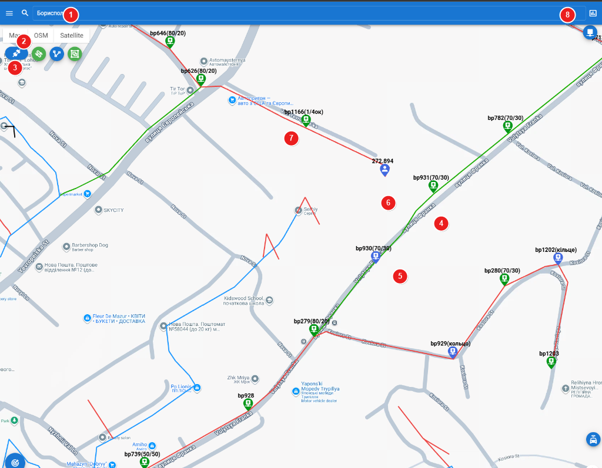
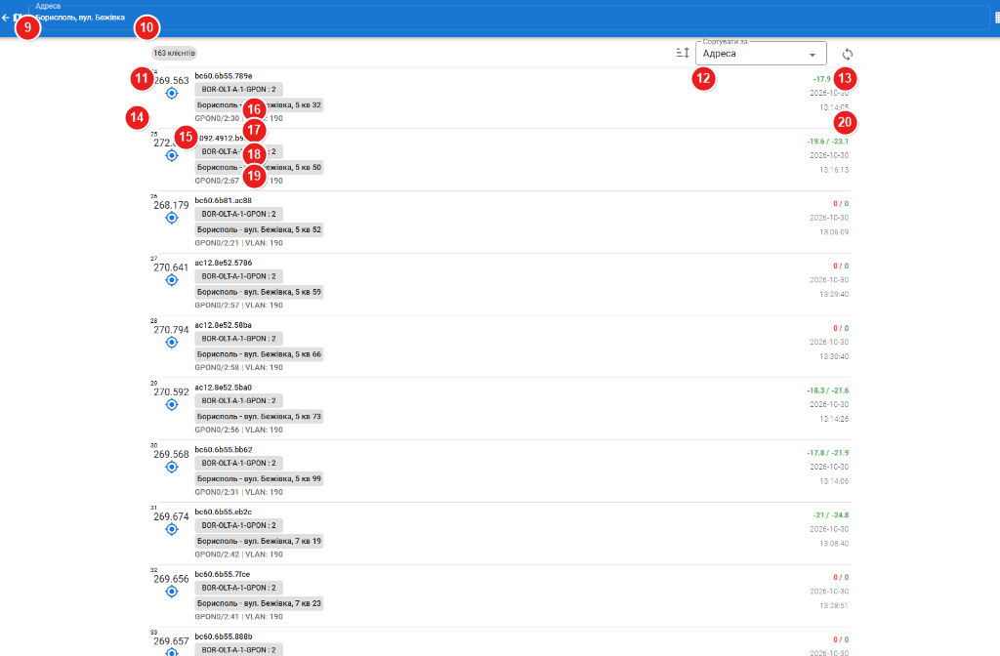
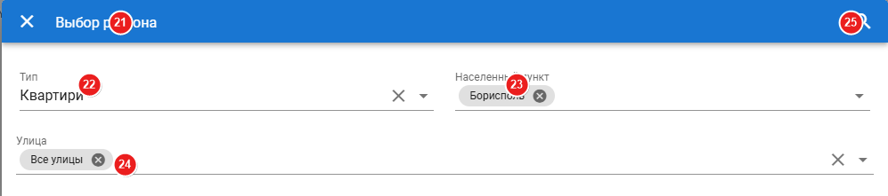
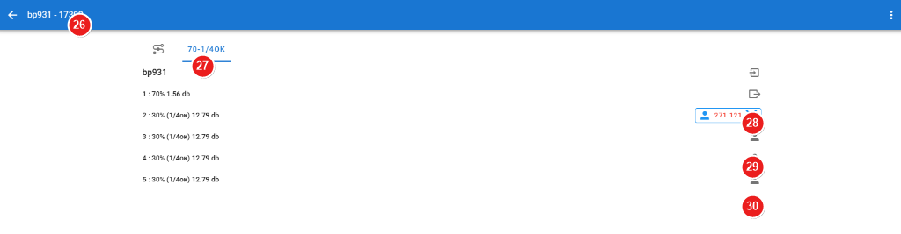
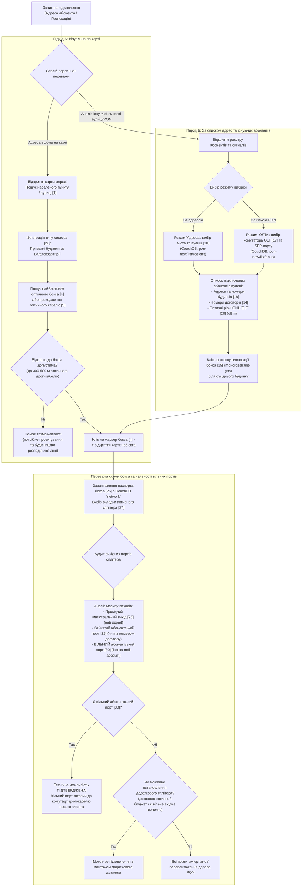
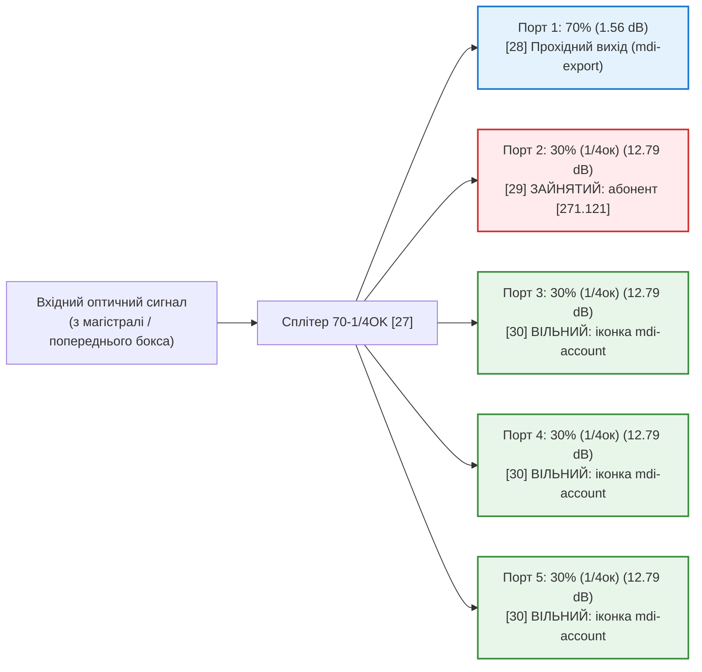

---
layout:
  width: wide
  outline:
    visible: false
---

# Опис інтерфейсу: Карта мережі та PON (`ui_map.md`)

Цей документ містить структурований опис екранних форм підсистеми візуалізації та обліку оптичної інфраструктури (модуль **i-map**): інтерактивної карти мережі, перевірки технічної можливості підключення абонентів, схеми оптичних муфт/боксів та оптичних сигналів PON:
- **URL сторінки Карти:** `https://a.iport.net.ua/imap/#/map/network` *(маршрут: `/#/map/:category/:ids?`)*
- **URL сторінки Сигналів та абонентів:** `https://a.iport.net.ua/imap/#/signals/address` *(маршрут: `/#/signals/:mode/:contract?`)*
- **Бази даних CouchDB (локальна синхронізація через PouchDB):**
  - **`network`** — фізична топологія: оптичні муфти та бокси (`ponbox`), траси кабелів (`cable`), точки комутації абонентів (`user`), опори (`pole`), глобальний реєстр адрес і прив'язок провайдерів (`streets`).
  - **`pon-new`** — активне обладнання: станційні комутатори OLT (`o.*`), клієнтські термінали ONU, кеш оптичних рівнів і статусів опитування за адресами, договорами та OLT/SFP.
  - **`jira`** — прив'язка задач монтажних бригад та технічних погоджень до об'єктів мережі.
- **Серверний REST API:**
  - `POST /pon/onu-rx/multiple` — пакетне опитування рівнів сигналу абонентів обраної вулиці з кількох OLT через SNMP.
  - `GET /pon/onu-rx/:ip/:snmp/:typepon` — живе зняття оптичних рівнів (RX/TX dBm) з конкретного порту OLT.
  - `GET /pon/history/:olt/:onu` — історія зміни оптичного згасання абонентського термінала.
  - `PUT /map/box/upd-region` — прив'язка бокса до району/сектора.

---

## 1. Анотовані скріншоти та карта елементів інтерфейсу

### Скріншот 1: Інтерактивна карта оптичної мережі (бокси, кабельні лінії, маркери абонентів)

---

### Скріншот 2: Реєстр абонентів, моніторинг оптичних рівнів та прив'язка до боксів

---

### Скріншот 3: Діалог вибору регіону та розділення Приватного сектору / Квартир

---

### Скріншот 4: Схема оптичного бокса (комутація сплітерів, зайняті та вільні порти)

---

## 2. Бізнес-процес визначення технічної можливості підключення

Перевірка можливості підключення нового абонента здійснюється диспетчером або оператором двома взаємопов'язаними шляхами:

### Порівняльний аналіз підходів:
1. **Підхід А (Візуально по карті):**
   - Використовується, коли заявка надходить із чіткими географічними координатами або при підключенні приватного сектора.
   - Дозволяє оцінити фактичну трасу підвісу дроп-кабелю по опорах від бокса **[4]** до будинку клієнта, наявність водних/дорожніх перешкод та розташування сусідніх підключених абонентів **[6]**.
2. **Підхід Б (За списком адрес та існуючих абонентів):**
   - Використовується при телефонному дзвінку клієнта, коли оператор оперативно знаходить сусідів за адресою **[10]**, **[18]**.
   - Дозволяє одразу перевірити стабільність оптичного сигналу на вулиці **[20]** (відсутність масової деградації чи затухань на гілці), після чого в один клік на кнопку **[15]** перейти до точного розташування бокса на карті.

---

## 3. Фільтрація боксів: Приватний сектор vs Багатоквартирні будинки

У діалоговому вікні вибору регіону **[21]** реалізовано фільтрацію типів забудови **[22]**, яка кардинально оптимізує відображення оптичних боксів на карті:

| Значення селектора типу [22] | Назва в інтерфейсі | Особливості розміщення обладнання | Запит та Design View у CouchDB (`network`) |
| :---: | :--- | :--- | :--- |
| **`1`** | **Приватні будинки** | Бокси малої місткості (4–8 портів), змонтовані на опорах ЛЕП або фасадах приватних садиб. Фільтр виключає дачні товариства. | View `streets/pole` (за обраними вулицями) або `streets/poleAllStreets` (за всіма вулицями населеного пункту). |
| **`2`** | **СТ** | Садово-дачні товариства та кооперативи (наприклад «Бориспіль - СТ»). | View `streets/poleST` (за назвою регіону з постфіксом `- СТ`). |
| **`3`** | **Квартири** | Багатоквартирний сектор. Бокси встановлюються у поверхових слабкострумових щитах, під'їздах або горищах. | View `streets/apartm` / `streets/apartmAllStreets`. При виборі конкретного будинку активується view `box/by-address` за ключем `${streetId}.${building}`. |

### Багаторівневий вибір адреси для квартир:
1. При виборі типу «Квартири» **[22]** поле «Улица» **[24]** заповнюється результатом запиту до CouchDB view `streets/streetIdsWithApartm`, який повертає виключно вулиці, де фізично збудована мережа в багатоквартирних будинках.
2. При виборі конкретної вулиці в діалозі з'являється додаткове поле вибору будинку, дані для якого повертає view `streets/buildings` за ключем `${region}.${street}`.
3. Після збереження фільтра **[25]** на карті відображаються виключно поверхові комутаційні бокси обраної багатоповерхівки, виключаючи візуальне перевантаження мапи боксами приватного сектора.

---

## 4. Визначення вільних портів у схемі бокса

Схема комутації бокса **[26]** відкривається при виборі оптичного бокса на карті **[4]** або через швидкий перехід із картки пристроїв абонента.

### Структура сплітера на скріншоті 4 (`bp931`, вкладка `70-1/4OK` [27]):
Встановлено комбінований оптичний дільник:
- **70% (1.56 dB)** — прохідне плече для транзиту сигналу на наступні бокси магістралі.
- **30% (12.79 dB)** — відгалужувальне абонентське плече, розварене на рівномірний сплітер 1/4 (4 абонентські порти).

### Типи та статуси портів:
1. **Прохідний магістральний вихід [28]:**
   - Позначається іконкою стрілки назовні `mdi-export`.
   - На скріншоті: `1 : 70% 1.56 db`. Використовується для підключення вихідного оптичного волокна кабелю, що йде до наступного бокса мережі.
2. **Зайнятий абонентський порт [29]:**
   - Відображається у вигляді прямокутної кнопки-чипа: блакитна рамка, іконка людини, номер договору абонента (`271.121`), розраховане згасання сигналу та хрестик `mdi-close` для демонтажу або перекомутації.
   - Клік на договір перемикає екран на білінгові та діагностичні дані цього клієнта.
3. **ВІЛЬНИЙ абонентський порт [30]:**
   - Позначається **сірою іконкою людини `mdi-account`** навпроти розрахованого значення затухання: `3 : 30% (1/4ок) 12.79 db`.
   - Наявність цієї іконки свідчить про **підтверджену наявність вільного фізичного порту для нового абонента**.
   - При натисканні на сіру іконку відкривається випадаюче меню нерозподілених абонентів бокса, що дозволяє прикріпити новий договір до вільного порту в один клік безпосередньо з інтерфейсу схеми.

---

## 5. Обґрунтування мапінгу об'єктів CouchDB на елементи UI

Уся архітектура модуля побудована на документоорієнтованій моделі CouchDB. У браузері клієнта створюються локальні дзеркала баз через PouchDB із безперервною фоновою синхронізацією.

### 5.1. База даних `network` (Фізична топологія та геодані)

| Тип документа CouchDB | Ключові поля документа | Логіка обробки даних | Відповідний елемент на скріншотах |
| :--- | :--- | :--- | :--- |
| **`ponbox.${id}`** *(Оптичний бокс / муфта)* | `_id: "ponbox.17392"` `category: "ponbox"` `local_id: "bp931"` `region: "Борисполь"` `street: "вулиця Франка"` `gps: {lat, lng}` `splitters: {"0":"CROSS", "1":"70-1/4OK"}` `i: { "1": { parent: {o, n}, dir, att } }` `o: { "1": { splitter, dir, att } }` `connectedCables: [ ... ]` | Зберігає геокоординати, адресу встановлення, перелік встановлених дільників, матрицю кросування вхідних волокон (`i`) та вихідних портів (`o`). | - **[4]** Маркер бокса на карті `bp931(70/30)` - **[26]** Заголовок форми `bp931 - 17392` - **[27]** Вкладка сплітера `70-1/4OK` - **[28]** Магістральний вихід порт 1 - **[29]** Зайнятий порт 2 - **[30]** Вільні порти 3, 4, 5 |
| **`cable.${id}`** *(Оптичний кабель)* | `_id: "cable.24-1"` `category: "cable"` `local_id: "24-1"` `gps: [{lat, lng}, ...]` `color: "#1bad03"` `netType: "pon" / "mag"` `provider_id: 1` | Масив координат точок траси, волоконність (E2..E96), кольорове маркування лінії та прив'язка до провайдера. | - **[5]** Кольорові траси ліній зв'язку на карті (зелені, червоні, сині полілінії між боксами) |
| **`user`** *(Точка підключення абонента)* | `_id: "user.271.121"` `category: "user"` `contract: "271.121"` `gps: {lat, lng}` `parent_id: "17392"` `i: {"1": {parent: {o: "17392", n: "2"}}}` | Фіксує прив'язку договору до конкретного вихідного порту `n` батьківського бокса `o`. | - **[6]** Маркер підключеного абонента на карті (`272.894`) - **[29]** Чип абонента на виході 2 бокса `[271.121 x]` |
| **`streets`** *(Довідник адрес)* | `_id: "streets"` `streets: [{city, streets: [...]}]` | Реєстр населених пунктів та вулиць із прив'язкою до провайдерів. | - **[1]** Рядок пошуку міста на карті - **[23]** Вибір населеного пункту - **[24]** Вибір вулиці |

### 5.2. База даних `pon-new` (Активне обладнання OLT/ONU та сигнали)

| Документ / View CouchDB | Поля та структура | Логіка та призначення | Відповідний елемент на скріншотах |
| :--- | :--- | :--- | :--- |
| **`o.${olt_id}`** *(Комутатор OLT)* | `_id: "o.BOR-OLT-A-1"` `address: "172.16.x.x"` `place: "BOR-OLT-A-1"` `typepon: "gpon"` `signals: [{itemid, pwr, olt_rx, last_activity}]` | Зберігає IP-адресу комутатора, технологію (GPON/EPON) та масив останніх опитаних оптичних рівнів з усіх портів. | - **[17]** Чип комутатора та порту `BOR-OLT-A-1-GPON : 2` |
| **View `list/onus`** | `key: "${oltName}\|${sfp}"` `doc: {contract, onu, mac, port, street, build, flat, name, vlanonport, sla}` | Індексує клієнтські термінали за станційними портами OLT/SFP. Дозволяє миттєво отримати абонентів конкретної гілки PON. | - **[11]** Кількість знайдених клієнтів на дереві - **[14]** Договір абонента - **[16]** MAC ONU - **[19]** Назва GPON-порту та VLAN |
| **View `list/regions`** | `key: "${region}\|${street}\|${build}"` `doc: { ... }` | Індексує клієнтські термінали за фізичною адресою. Підтримує пошук діапазоном `startkey .. endkey`. | - **[10]** Поточна адреса вибірки - **[18]** Фізична адреса підключення в рядку клієнта |
| **View `box/by-contract`** *(у базі `network`)* | `key: contract` `value: {region, id, gps, local_id, category}` | Зв'язує договір абонента з `pon-new` із фізичним боксом у `network`. | - **[15]** Кнопка геолокації бокса (`mdi-crosshairs-gps`). Синя — бокс знайдено, сіра — прив'язка до бокса відсутня |

---

## 6. Таблиця мапінгу елементів інтерфейсу на дані

| № | Елемент на екрані | Значення на скріншоті | Поле в моделі / API | Джерело даних (CouchDB / API) | Логіка та бізнес-призначення |
| :-: | :--- | :--- | :--- | :--- | :--- |
| **1** | **Пошуковий рядок регіону/вулиці** | `Борисполь` | `region`, `streets` | CouchDB `network: streets` | Відображає поточний вибраний населений пункт. Клік відкриває модальне вікно вибору регіону **[21]**. |
| **2** | **Перемикачі підкладки карти** | `Map`, `OSM`, `Satellite` | `mapType` | Google Maps API / OSM tiles | Дозволяє перемикати базовий шар карти: векторна схема Google, OpenStreetMap або супутниковий знімок місцевості. |
| **3** | **Панель мережевих інструментів** | Зелені/сині круглі кнопки | `activeLayer`, `mode` | Внутрішній стан карти | Інструменти керування видимістю шарів: показ/приховування боксів, трас кабелів, опор, а також вимірювання відстаней. |
| **4** | **Маркер оптичного бокса** | `bp931(70/30)`, `bp626(80/20)` | `local_id`, `title` | CouchDB `network: ponbox.*` | Зелена/синя іконка шафи з назвою бокса та коефіцієнтом встановленого сплітера. Клік відкриває схему комутації бокса **[26]**. |
| **5** | **Траси оптичних ліній** | Зелені, червоні, сині лінії | `cable.gps`, `cable.color` | CouchDB `network: cable.*` | Полілінії кабельних ліній. Колір позначає тип кабелю та волоконність (E2, E4, E8, E12 тощо). |
| **6** | **Маркер підключеного абонента** | Синій значок з числом `272.894` | `user.contract`, `user.gps` | CouchDB `network: user.*` | Фіксує розташування будинку абонента на місцевості відносно розподільчого бокса. |
| **7** | **Вузол відгалуження / розварки** | `bp1166(1/4ок)` | `local_id`, `category` | CouchDB `network: ponbox.*` | Оптична муфта, де відбувається первинний поділ магістрального волокна на абонентські гілки. |
| **8** | **Кнопка відкриття аналітики/звітів** | Іконка графіка `mdi-chart-box-outline` | Режим адміністратора | Маршрут `/reports` | Відкриває зведені звіти щодо завантаженості ємностей мережі та динаміки підключень по регіонах. |
| **9** | **Кнопка повернення назад** | `<-` (стрілка ліворуч) | Попередній маршрут | Маршрутизатор SPA | Повертає на попередній екран (наприклад із реєстру сигналів назад на карту мережі або в картку CRM). |
| **10** | **Адреса / вулиця активної вибірки** | `Борисполь, вул. Бежівка` | `selected.address` | CouchDB `pon-new: list/regions` | Показує поточний географічний контекст вибірки. Клік відкриває діалог швидкої зміни вулиці чи будинку. |
| **11** | **Лічильник знайдених абонентів** | `163 клієнтів` | `selected.items.length` | Результат запиту до CouchDB | Кількість підключених абонентів на обраній вулиці або оптичному дереві PON. |
| **12** | **Селектор сортування списку** | `Сортувати за: Адреса` | `sort` | `['Адреса', 'ONUrx', 'OLTrx', 'Фіз.№ ONU']` | Сортує клієнтів: за алфавітом вулиць/номерами будинків, за оптичним рівнем модема (пошук затухань) або за фізичним номером порту. |
| **13** | **Кнопка онлайн-опитування сигналів** | Іконка синхронізації `mdi-sync` | `refreshing` | `POST /pon/onu-rx/multiple` | Запускає фоновий SNMP-опит оптичних рівнів (RX/TX) клієнтів цієї вулиці з комутаторів OLT. Під час опиту іконка обертається. |
| **14** | **Номер договору та SLA абонента** | `24 269.563`, `25 272.826` | `contract`, `sla` | CouchDB `pon-new` -> `doc.contract` | Номер договору абонента. При наявності підвищеного SLA відображається червоний індикатор пріоритету. |
| **15** | **Кнопка геолокації бокса** | Синя іконка `mdi-crosshairs-gps` | `box` | CouchDB `network: box/by-contract` | **Ключовий елемент зв'язку списку з картою.** Клік миттєво відкриває карту та центрує її точно на боксі, до якого підключено абонента. |
| **16** | **MAC-адреса оптичного термінала** | `bc60.6b55.789e` | `doc.onu` / `doc.mac` | CouchDB `pon-new` -> `doc.onu` | Апаратна MAC-адреса ONU. Клік на рядок відкриває вікно детальної діагностики та історії рівнів сигналу. |
| **17** | **Комутатор OLT та станційний порт** | `BOR-OLT-A-1-GPON : 2` | `olt.place`, `doc.port` | CouchDB `pon-new` -> `doc.olt` | Станційне розташування комутатора OLT та номер SFP-порту. Клік перемикає вибірку на перегляд усього дерева цього порту. |
| **18** | **Фізична адреса точки підключення** | `Борисполь - вул. Бежівка, 5 кв 32` | `region`, `street`, `build`, `flat` | CouchDB `pon-new` -> `doc.street` | Повна адреса абонента. Клік на адресу автоматично фільтрує реєстр за цією конкретною вулицею. |
| **19** | **Логічний інтерфейс та VLAN** | `GPON0/2:30 \| VLAN: 190` | `doc.name`, `doc.vlanonport` | CouchDB `pon-new` -> `doc.name` | Логічний порт у шасі OLT (слот/порт:номер ONU) та транспортний VLAN абонента в ядрі мережі. |
| **20** | **Оптичні рівні та час опитування** | `-17.9 / -21`, `2026-10-30 13:14:05` | `signal.pwr`, `signal.olt_rx` | CouchDB `pon-new` / Live SNMP | Рівні згасання (ONU RX / OLT RX в dBm). Зелений колір — сигнал у нормі (від -15 до -27 dBm). Червоний — критичне затухання або `0 / 0` (модем вимкнено). |
| **21** | **Заголовок діалогу вибору регіону** | `Выбор региона` | Діалогове вікно | Інтерфейсний контейнер | Відкриває параметри вибірки об'єктів для відображення на карті. |
| **22** | **Селектор типу об'єкта / забудови** | `Квартири` (або `Приватні будинки`) | `regionType` (1, 2, 3) | Конфігурація фільтра | **Розділяє приватний сектор від багатоповерхівок.** Визначає, з яких view CouchDB підвантажувати бокси (`streets/pole` чи `streets/apartm`). |
| **23** | **Вибір населеного пункту** | `Борисполь` | `selectedRegions` | CouchDB `network: streets` | Дозволяє вибрати один або кілька населених пунктів обслуговування. |
| **24** | **Вибір вулиці / будинку** | `Все улицы` (або конкретна вулиця) | `selectedStreets` | CouchDB `network: streets/apartm` | Для багатоповерхівок фільтрує лише вулиці з багатоквартирними будинками та дозволяє обрати номер будинку. |
| **25** | **Кнопка застосування фільтра** | Іконка лупи `mdi-magnify` | Дія збереження | Локальне сховище та карта | Зберігає налаштування в LocalStorage та ініціює перезавантаження маркерів боксів і трас кабелів на карті. |
| **26** | **Ідентифікатор оптичного бокса** | `bp931 - 17392` | `doc.local_id - doc.id` | CouchDB `network: ponbox.*` | Назва та унікальний внутрішній номер оптичного бокса в базі даних. |
| **27** | **Вкладка активного сплітера** | `70-1/4OK` | `box.doc.splitters` | CouchDB `network` -> `doc.splitters` | Вкладка встановленого оптичного дільника. Відображає схему комутації конкретного касетного модуля. |
| **28** | **Прохідний магістральний вихід** | `1 : 70% 1.56 db` | `port.dir === 'ext'`, вихід 1 | CouchDB `network` -> `doc.o["1"]` | Вихід транзитного сигналу 70% (згасання 1.56 dB) для підключення наступного розподільчого бокса по ланцюжку. |
| **29** | **Зайнятий абонентський порт** | `[271.121 x]` | `port.dir === 'user'`, `port.remote` | CouchDB `network` -> `doc.o["2"]` | Порт 2 зайнятий діючим договором `271.121`. Натискання на хрестик розриває комутацію, клік на номер відкриває дані абонента. |
| **30** | **ВІЛЬНИЙ абонентський порт** | `3, 4, 5 : 30%` з іконкою людини | `port.dir === 'user'`, `!port.remote` | CouchDB `network` -> `doc.o["3..5"]` | **Підтвердження технічної можливості підключення.** Порти 3, 4 та 5 вільні. Клік відкриває меню вибору нового клієнта для прив'язки. |
