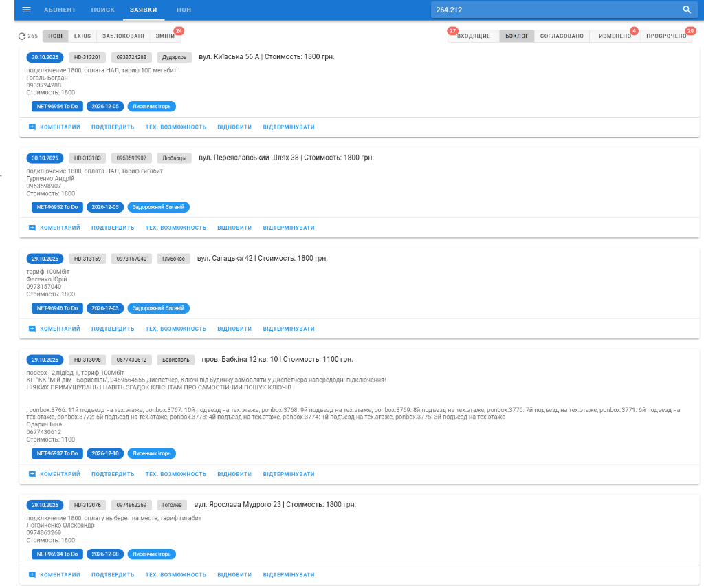
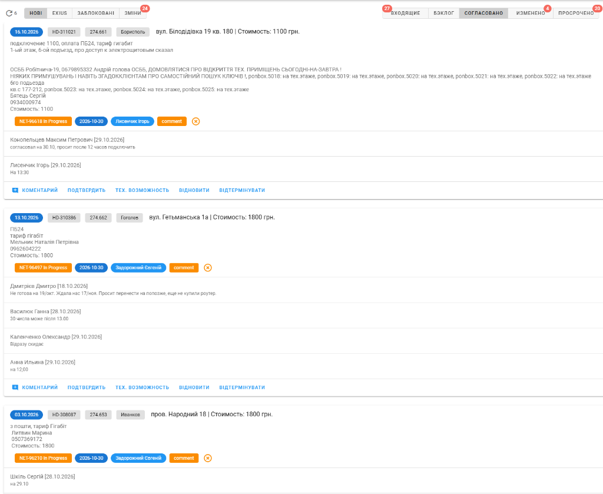
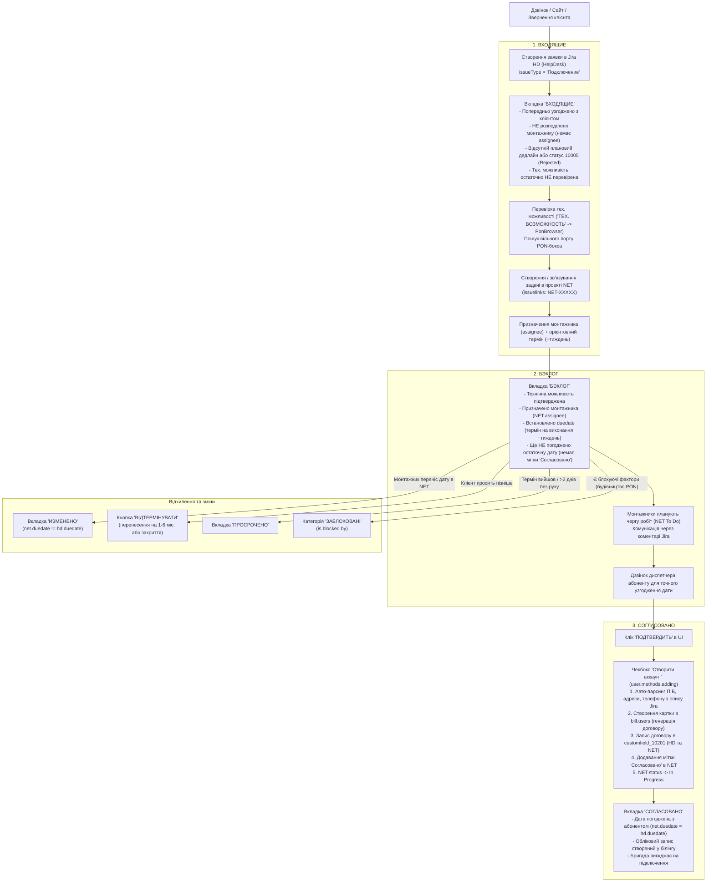

# Опис інтерфейсу: Заявки на підключення (`ui_orders.md`)

Цей документ містить структурований опис екранної форми управління заявками на підключення нових абонентів (імпорт та синхронізація з Atlassian Jira, білінг NoDeny та карта PON):
- **URL сторінки:** `https://a.iport.net.ua/#/userOrders` *(маршрут у SPA: `/#/userOrders`)*
- **Основний запит завантаження заявок:** `GET https://a.iport.net.ua/orders/issues/backlog`
- **Запит коментування:** `POST https://a.iport.net.ua/orders/comment`
- **Запит погодження та створення:** `POST https://a.iport.net.ua/orders/confirm`
- **Запит зміни життєвого циклу (відтермінування/відновлення):** `POST https://a.iport.net.ua/orders/reopen`
- **Компоненти Vue:** [`Orders.vue`](file:///c:/Projects/icrm/ui.2.1/src/components/Orders.vue), [`PonBrowser.vue`](file:///c:/Projects/icrm/ui.2.1/src/components/PonBrowser.vue), [`UserAdd.vue`](file:///c:/Projects/icrm/ui.2.1/src/components/UserAdd.vue)
- **Моделі та міксини:** [`models/order.js`](file:///c:/Projects/icrm/ui.2.1/src/models/order.js), [`models/user.js`](file:///c:/Projects/icrm/ui.2.1/src/models/user.js)
- **Контролер бекенда:** [`routes/orders.js`](file:///c:/Projects/icrm/test-mysql/icrm-server/routes/orders.js), бібліотека [`libs/jira.js`](file:///c:/Projects/icrm/test-mysql/icrm-server/libs/jira.js)
- **Датасорси:** Atlassian Jira API v2 (проекти `HD` та `NET`), MySQL `bill` (NoDeny), MySQL `icrm` (`jira_watch_log`), MySQL `ponMaster`

---

## 1. Скріншоти та карта елементів інтерфейсу

### Скріншот 1: Категорія «НОВІ», Вкладка «БЭКЛОГ»


### Скріншот 2: Категорія «НОВІ», Вкладка «СОГЛАСОВАНО»


---

## 2. Основний бізнес-флоу обробки заявок

Життєвий цикл підключення базується на зв'язці двох проектів у Jira — **`HD` (HelpDesk / Диспетчери)** та **`NET` (Монтажні бригади)**, а також білінгової бази **NoDeny**:



---

## 3. Таблиця мапінгу UI-елементів на дані API, Jira та БД

| № | Елемент інтерфейсу | Приклад зі скріншота | Поле в API / моделі Vue | Джерело даних (Jira / MySQL) | Логіка та бізнес-призначення |
| :-: | :--- | :--- | :--- | :--- | :--- |
| **1** | **Кнопка оновлення та лічильник** | `(refresh) 265`, `(refresh) 6` | `loading`, `filtered.length` | Результат роботи клієнтського фільтра | Оновлює список через `GET /orders/issues/backlog`. Лічильник відображає кількість заявок у поточній активній вибірці (категорія + вкладка). |
| **2** | **Категорія «Нові»** | `НОВІ` (активна) | `category = 'incoming'` | `models/order.js:3-5` | Фільтрує стандартні підключення нових клієнтів: `item.labels.indexOf('exius') === -1`. |
| **3** | **Категорія «exius»** | `EXIUS` | `category = 'existing'` | `models/order.js:3-5` | Заявки перепідключення колишніх абонентів Exius: `item.labels.indexOf('exius') > -1`. |
| **4** | **Категорія «Заблоковані»** | `ЗАБЛОКОВАНІ` | `category = 'blocked'` | `item.blockers.length > 0` | Заявки, які заблоковані іншими задачами в Jira (зв'язок `is blocked by`, статус блокатора `!= Done`). |
| **5** | **Категорія «ЗМІНИ»** | `ЗМІНИ [24]` | `category = 'changes'` | `item.changes` / `jira_watch_log` | Бадж із червоним лічильником непереглянутих змін у зв'язаних NET-задачах (нові коментарі монтажників, зміна дедлайну, статусу). |
| **6** | **Вкладка «Входящие»** | `ВХОДЯЩИЕ [27]` | `tab = 'incoming'` | `models/order.js:17` | Заявки, де ще не розподілений виконавець (`!net.assignee`), немає планової дати (`!net.duedate`) або задача відхилена монтажником (`net.status.id === '10005'`). |
| **7** | **Вкладка «Бэклог»** | `БЭКЛОГ` | `tab = 'backlog'` | `models/order.js:16` | Технічна можливість підтверджена, призначено монтажника (`net.assignee`), виставлено орієнтовний дедлайн (`net.duedate`), але дата ще не узгоджена з клієнтом (немає мітки `'Согласовано'`). |
| **8** | **Вкладка «Согласовано»** | `СОГЛАСОВАНО` | `tab = 'confirmed'` | `models/order.js:15` | Дата погоджена з абонентом, в білінгу створено договір, у задачі `NET` стоїть мітка `'Согласовано'`, а дедлайни синхронізовані (`net.duedate === item.duedate`). |
| **9** | **Вкладка «Изменено»** | `ИЗМЕНЕНО [4]` | `tab = 'changed'` | `models/order.js:18` | Роботи були погоджені, але монтажник самостійно змінив `duedate` у задачі `NET` (`net.duedate !== item.duedate`). Потрібен повторний контакт з клієнтом. |
| **10** | **Вкладка «Просрочено»** | `ПРОСРОЧЕНО [20]` | `tab = 'over'` | `models/order.js:19` | Заявки без руху понад 2 дні у вхідних (`alerted(item)`) або ті, де прострочено планову дату монтажу (`net.duedate < today`). |
| **11** | **Дата створення заявки** | `30.10.2026`, `16.10.2026` | `item.created` | `jira.issue.fields.created` | Синій чіп дати створення заявки. Якщо заявка висить > 2 днів без призначеного дедлайну/задачі — колір змінюється на червоний (`alerted`). |
| **12** | **Номер заявки HelpDesk** | `HD-313201`, `HD-311021` | `item.key` | `jira.issue.key` | Клікабельний сірий чіп. Клік відкриває тікет диспетчера безпосередньо в Jira (`/browse/HD-XXXXXX`). |
| **13** | **Телефон / Договір** | `0933724288` $\to$ `274.661` | `item.customfield_10201` | Jira customfield `10201` / `bill.users.contract` | До погодження містить **номер телефону клієнта**. Після погодження та створення абонента в білінгу замінюється на **номер особового рахунку/договору** (з крапкою, напр. `274.661`). |
| **14** | **Мітка населеного пункту** | `Дударков`, `Борисполь`, `Гоголев` | `item.labels` | `jira.issue.fields.labels` | Населений пункт, закріплений за заявкою. Використовується для визначення діапазону номерів договорів та авто-підбору вулиці. |
| **15** | **Адреса та вартість** | `вул. Київська 56 А \| Стоимость: 1800 грн.` | `item.summary`, `item.customfield_10600` | Jira `summary`, `customfield_10600` | У заголовку відображається адреса підключення та узгоджена вартість інсталяції у гривнях. |
| **16** | **Тіло заявки (опис)** | Текст з ПІБ, тарифом, примітками ОСББ | `item.description` | `jira.issue.fields.description` | Первинні дані від кол-центру: обраний тариф, спосіб оплати (ГОТІВКА/ПБ24), контакти, наявність ключів від щитових, номери PON-боксів. |
| **17** | **Зв'язана задача монтажника** | `NET-96954 To Do`, `NET-96618 In Progress` | `item.linked`, `item.net.status` | Jira `issuelinks` $\to$ `NET-XXXXX` | Синій/помаранчевий чіп зв'язаної задачі монтажника з її поточним статусом. Клік відкриває задачу в Jira. |
| **18** | **Дедлайн підключення** | `2026-12-05`, `2026-10-30` | `item.net.duedate` | Jira `fields.duedate` у задачі `NET` | Планова дата виконання монтажу. Синій колір — актуальна, червоний — прострочена відносно сьогоднішньої дати. |
| **19** | **Призначений виконавець** | `Лисенчик Ігорь`, `Задорожний Євгеній` | `item.net.assignee.displayName` | Jira `fields.assignee` у задачі `NET` | ПІБ монтажника або бригадира, на якого призначено виконання підключення. |
| **20** | **Блокери підключення** | Назва задачі-блокатора | `item.blockers` | `issuelinks` (`is blocked by`) | Жовтий чіп. Відображає задачі, які заважають підключенню (наприклад, пошкодження кабелю, відсутність оптичного боксу). |
| **21** | **Індикатор змін (Watch Log)** | `comment [x]` | `item.changes`, `item.changes.changes` | Таблиця `icrm.jira_watch_log` | Помаранчевий бадж показує тип змін, які відбулися в задачі (наприклад, монтажник додав коментар). Клік на хрестик викликає `GET /orders/log-clear/:net` і скидає сповіщення. |
| **22** | **Стрічка коментарів монтажників** | `Конопельцев М.П. [29.10.2026]: согласовал на 30.10...` | `item.net.comment.comments` | Jira `comment.comments` у задачі `NET` | Історія комунікації між диспетчером та монтажником (уточнення часу, контактів клієнта, технічних нюансів). |
| **23** | **Кнопка «+ КОМЕНТАРИЙ»** | `+ КОМЕНТАРИЙ` | Метод `comment(item)` | `POST /orders/comment` | Відкриває поле швидкого вводу та відправляє коментар безпосередньо в задачу `NET` у Jira. |
| **24** | **Кнопка «ПОДТВЕРДИТЬ»** | `ПОДТВЕРДИТЬ` | Метод `confirm(item)` | `POST /orders/confirm` | Відкриває модальне вікно підтвердження дати, ініціює створення акаунта в NoDeny, виставляє мітку `'Согласовано'` та переводить заявку в фінал. |
| **25** | **Кнопка «ТЕХ. ВОЗМОЖНОСТЬ»** | `ТЕХ. ВОЗМОЖНОСТЬ` | Метод `tech(item)` | Перехід на `/#/user-pon` | Викликає подію шини `PON_BROWSER_LOAD`, відкриває модуль PonBrowser за адресою заявки для пошуку найближчих PON-боксів та вільних оптичних волокон. |
| **26** | **Кнопка «ВІДНОВИТИ»** | `ВІДНОВИТИ` | Метод `acting(item, 'reopen')` | `POST /orders/reopen` (`action: reopen`) | Переводить `HD` в `Selected for Development`, `NET` в `To Do`, скидає призначеного виконавця і дедлайн, повертаючи заявку у вхідні. |
| **27** | **Кнопка «ВІДТЕРМІНУВАТИ»** | `ВІДТЕРМІНУВАТИ` | Метод `acting(item, 'postpone')` | `POST /orders/reopen` (`action: postpone`) | Відкриває діалог відтермінування (тиждень, 1-6 місяців) або повного закриття заявки з обов'язковим коментарем; переводить задачі в статус `Waiting` або `Closed`. |

---

## 4. Детальний аналіз серверних операцій та імпорту з Jira

### 4.1. Імпорт заявок з Jira (`GET /orders/issues/backlog`)
1. **Основний JQL-запит HelpDesk:**
   ```sql
   project = HD 
     AND resolution = Unresolved 
     AND status NOT IN (Closed, Rejected, Done, Resolved, Waiting) 
     AND priority IN (Highest, High, Medium) 
     AND issueType = 'Подключение' 
   ORDER BY created DESC
   ```
2. **Збирання пов'язаних задач `NET`:**
   Сервер сканує `issuelinks` кожного тікета `HD`. Знаходить зв'язок на задачу, яка починається з префікса `NET-` і має тип `"Подключение"`.
3. **Пакетне довантаження деталей `NET`:**
   Якщо знайдені зв'язки, надсилається другий запит до Jira:
   ```sql
   project = NET AND issueKey IN ("NET-96954", "NET-96952", "NET-96946", ...)
   ```
   Поля `status`, `duedate`, `assignee`, `comment` з проекту `NET` вбудовуються в об'єкт заявки як `item.net`.
4. **Виявлення блокерів:**
   Перевіряються зв'язки типу `is blocked by`. Якщо статус блокуючої задачі не є завершеним (`id != "10001"`), вона додається до списку `item.blockers`.
5. **Синхронізація зі змінами з бази `icrm` (`jira_watch_log`):**
   Вибірка агрегованих подій із таблиці логу вебхуків `jira_watch_log`. Якщо в задачі змінювався статус, виконавець, дедлайн або з'явився новий коментар — формується масив дій `item.changes`.

---

### 4.2. Створення акаунта в білінгу та погодження (`POST /orders/confirm`)

При натисканні «ПОДТВЕРДИТЬ» та відміченому чекбоксі «Створити аккаунт» запускається процедура створення абонента в базі `bill`:

1. **Автоматичний розбір реквізитів з опису (`models/user.js:190-213`):**
   - **ПІБ:** витягується з третього рядка з кінця опису `item.description`.
   - **Телефон:** зчитується з поля `customfield_10201`.
   - **Адреса:** зіставляється назва міста з `item.labels` та вулиця з `item.summary` через довідник `p_street`. Виділяються номер будинку, літера/корпус та квартира.
2. **Створення запису в NoDeny:**
   - Викликається `libs/user.js:addUser`: створюється головний запис (`mid = 0`, `state = 'off'`, `grp = 51`), генерується договір через `new_contract_num(region)`.
   - Отримується новий номер договору (наприклад, `274.661`) та закріплений провайдер.
3. **Оновлення задач у Jira:**
   - У `HD` записується дедлайн `duedate` та договір у `customfield_10201 = '274.661'`.
   - У `NET` записується договір у `customfield_10201`, до міток додається мітка `Согласовано`.
   - Заголовок задачі `NET` оновлюється: плейсхолдер `CLONE` замінюється на сформований номер договору та абревіатуру ФОП (наприклад, `вул. Білодідівка 19 кв. 180 274.661 ТОВ`).
   - У базі `icrm` створюється запис у `jira_watch` для подальшого моніторингу за вебхуками.

---

### 4.3. Відновлення та відтермінування (`POST /orders/reopen`)
- **`postpone` (Відтермінування):**
  - Обидві задачі (`HD` та `NET`) переводяться в статус `Waiting`.
  - У `HD` встановлюється новий розрахований `duedate` (через 7 днів, 1, 2 або 6 місяців).
  - У `HD` записується коментар диспетчера з причиною перенесення.
- **`close` (Закриття):**
  - Якщо термін обрано `0` («Закрити») — обидві задачі переводяться в статус `Closed`.
- **`reopen` (Відновлення в роботу):**
  - `HD` переводиться в `Selected for Development`, `NET` — в `To Do`.
  - Очищується виконавець (`assignee = null`) та дата (`duedate = null`) у задачі `NET`.
  - Заявка повертається у первинний стан у вкладку «ВХОДЯЩИЕ».
