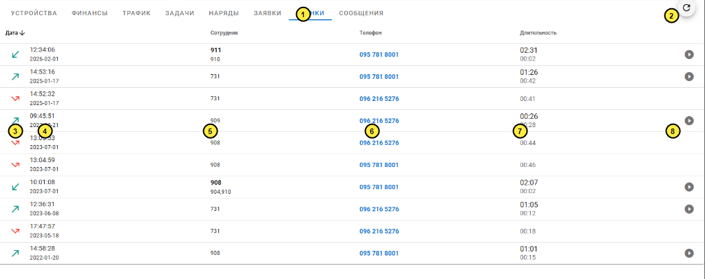

---
layout:
  width: wide
  outline:
    visible: false
---

# Опис інтерфейсу: Картка абонента — Дзвінки (`ui_users_cdr.md`)

Цей документ містить стислий та структурований опис екранної форми картки абонента у розділі «Звонки» (історія телефонних дзвінків через Asterisk PBX, CDR, прив'язка до операторів, тривалість та аудіозаписи розмов):
- **URL сторінки:** `https://a.iport.net.ua/#/user/40030/cdr` *(маршрут у SPA: `/#/user/:mid/cdr`)*
- **Основний запит:** `GET https://a.iport.net.ua/aster/cdr/phones/0503315779`
- **Компонент Vue:** [`Cdr.vue`](file:///c:/Projects/icrm/ui.2.1/src/components/Cdr.vue)
- **Контролер бекенда:** [`routes/aster.js`](file:///c:/Projects/icrm/test-mysql/icrm-server/routes/aster.js)

---

## 1. Карта нумерації елементів на скріншоті



---

## 2. Таблиця мапінгу елементів на дані API та БД

| № | Елемент на екрані | Значення на скріншоті | Поле в API `/aster/cdr/phones/...` | Таблиця та колонка в БД | Логіка формування / обчислення |
| :-: | :--- | :--- | :--- | :--- | :--- |
| **1** | **Вкладка «ЗВОНКИ»** | `ЗВОНКИ` (активна) | Проп `:params.phones` | Маршрутизатор SPA (`router/index.js`), [`UserDetails.vue:179-184`](file:///c:/Projects/icrm/ui.2.1/src/components/UserDetails.vue#L179-L184) | Активна вкладка підкреслена синьою лінією. Відображає таблицю всіх дзвінків (вхідних та вихідних), пов'язаних з номерами телефонів абонента (`bill.phones.phone`). |
| **2** | **Кнопка оновлення списку** | Кругла кнопка `↻` | Проп `:ver` | Метод `reload()` у `Cdr.vue` | Змінює параметр версії та повторно запитує список дзвінків з бекенда. |
| **3** | **Напрямок та статус дзвінка** | Іконки зі стрілками (`call_received`, `call_made`, `call_missed_outgoing`) | `disposition_description`, `disposition` | `asteriskcdrdb.cdr.dcontext`, `asteriskcdrdb.cdr.disposition` | **Зелена стрілка вниз-вліво (`call_received`):** вхідний прийнятий (`dcontext = 'ext-local'`, `disposition = 'ANSWERED'`).<br>**Зелена стрілка вгору-вправо (`call_made`):** вихідний прийнятий (`dcontext = 'from-internal'`, `disposition = 'ANSWERED'`).<br>**Червона стрілка з хрестиком (`call_missed_outgoing`):** вихідний без відповіді/скинутий (`NO ANSWER` / `BUSY`). |
| **4** | **Час та дата дзвінка** | `12:34:06`<br>`2026-02-01` | `calldate` | `asteriskcdrdb.cdr.calldate` | Верхній жирний рядок — точний час початку дзвінка (`HH:mm:ss`), нижній дрібний сірий рядок — дата (`YYYY-MM-DD`). За замовчуванням список відсортований за спаданням дати. |
| **5** | **Співробітник (оператор/черга)** | `911`<br>`910` (або `731`, `909`, `908`) | `localParsed.answered`, `localParsed.missed`, `local` | `asteriskcdrdb.cdr.dstchannel`, `asteriskcdrdb.cdr.dst_fixed` | Внутрішній SIP-номер оператора контакт-центру. Верхній жирний номер — оператор, що відповів на виклик (`answered`). Нижній дрібний сірий номер — оператори, які дзвонили в черзі, але не відповіли (`missed`). |
| **6** | **Телефон (номер контакту)** | `095 781 8001`, `096 216 5276` | `remote` | `asteriskcdrdb.cdr.src_fixed` / `dst_fixed` | Зовнішній номер телефону абонента (без префікса `+38`, відформатований із пробілами: `XXX XXX XXXX`). Клік викликає `callHistory(phone)` та переводить оператора до пошуку всіх дзвінків за цим номером (`/cdr-search/:phone`). |
| **7** | **Тривалість розмови та очікування** | `02:31`<br>`00:02` | `billsec`, `duration - billsec` | `asteriskcdrdb.cdr.billsec`, `asteriskcdrdb.cdr.duration` | **Верхній рядок:** чистий час розмови з оператором (`billsec`, конвертований у `mm:ss`). Якщо `billsec = 0` — рядок порожній.<br>**Нижній рядок:** час очікування відповіді на лінії або IVR (`duration - billsec`). |
| **8** | **Прослуховування аудіозапису** | Кругла іконка програвача `play_circle_filled` | `recordingfile` | `asteriskcdrdb.cdr.recordingfile` | З'являється, лише якщо для дзвінка є записаний аудіофайл. Клік відкриває вбудований медіаплеєр у нижній шторці (`v-bottom-sheet`). |

---

## 3. Серверні запити та бізнес-логіка бекенда

### 3.1. Запит дзвінків за номерами телефонів (`GET /aster/cdr/phones/:phones`)
- **Маршрут:** [`routes/aster.js:181-185`](file:///c:/Projects/icrm/test-mysql/icrm-server/routes/aster.js#L181-L185) $\to$ функція `getInbound(params)`.
- **Формування фільтра:** телефони абонента беруться з пропса `this.address.phones` у [`UserDetails.vue:179-184`](file:///c:/Projects/icrm/ui.2.1/src/components/UserDetails.vue#L179-L184) та перетворюються на SQL-список із міжнародним префіксом:
  ```sql
  WHERE (dstchannel LIKE 'PJSIP%' OR dstchannel LIKE 'SIP%' OR dstchannel LIKE 'IAX2%')
    AND (src_fixed IN ('+380957818001', '+380962165276') OR dst_fixed IN ('+380957818001', '+380962165276'))
  ```
- **Агрегація дзвінків у складних чергах Asterisk:**
  Оскільки один дзвінок через чергу створює декілька CDR-записів (виклик декількох операторів, переводи, IVR), бекенд виконує двошарову SQL-агрегацію за `uniqueid` (або `linkedid`):
  ```sql
  SELECT c.uniqueid, MIN(c.calldate) calldate,
      GROUP_CONCAT(c.dst_fixed SEPARATOR '~') dst_fixed, 
      GROUP_CONCAT(c.src_fixed SEPARATOR '~') src_fixed, 
      GROUP_CONCAT(c.disposition SEPARATOR '~') disposition, 
      GROUP_CONCAT(c.billsec SEPARATOR '~') billsec, 
      GROUP_CONCAT(c.duration SEPARATOR '~') duration,
      GROUP_CONCAT(c.recordingfile SEPARATOR '~') recordingfile,
      GROUP_CONCAT(c.dstchannel SEPARATOR '~') dstchannel,
      GROUP_CONCAT(c.dcontext SEPARATOR '~') dcontext
  FROM (
      SELECT cj.disposition, cj.uniqueid, MIN(cj.calldate) calldate, 
          GROUP_CONCAT(cj.dst_fixed SEPARATOR '|') dst_fixed, 
          GROUP_CONCAT(cj.src_fixed SEPARATOR '|') src_fixed, 
          MAX(cj.billsec) billsec, 
          MAX(cj.duration) duration,
          GROUP_CONCAT(cj.recordingfile SEPARATOR '|') recordingfile,
          GROUP_CONCAT(cj.dstchannel SEPARATOR '|') dstchannel,
          GROUP_CONCAT(cj.dcontext SEPARATOR '|') dcontext
      FROM (
          SELECT IF(uniqueid = linkedid, uniqueid, linkedid) uniqueid, src_fixed, dst_fixed, calldate, billsec, duration, 
              IF(disposition = 'BUSY', 'NO ANSWER' , disposition) disposition, 
              dstchannel, recordingfile, 
              IF(dcontext = 'from-queue-exten-internal', 'ext-local', dcontext) dcontext
          FROM cdr 
          WHERE (dstchannel LIKE 'PJSIP%' OR dstchannel LIKE 'SIP%' OR dstchannel LIKE 'IAX2%') AND ...
      ) cj 
      GROUP BY cj.uniqueid, cj.disposition ORDER BY cj.uniqueid, cj.disposition
  ) c GROUP BY c.uniqueid ORDER BY c.calldate DESC;
  ```
- **Обробка в Node.js (`routes/aster.js:82-114`):**
  - Пріоритет віддається статусу `ANSWERED`. Якщо на дзвінок відповіли, з рядка каналу `dstchannel` витягується номер внутрішнього SIP-абонента (наприклад `PJSIP/911-00000a12` ➔ `local = '911'`).
  - Визначається напрямок: якщо `dcontext === 'ext-local'` — дзвінок вхідний (`remote = src_fixed`, `local = dst_fixed`), інакше вихідний (`remote = dst_fixed`, `local = src_fixed`).

---

### 3.2. Відтворення та копіювання аудіозапису (`Cdr.vue:304-317`)
- При натисканні на кнопку програвача (елемент 8) формується посилання на медіафайл:
  ```text
  GET https://a.iport.net.ua/audio/YYYY/MM/DD/{recordingfile}
  ```
- **Нижня панель плеєра (`v-bottom-sheet`):**
  - Відображає ім'я абонента, номер телефону та стандартний HTML5 `<audio controls>`.
  - Кнопка з іконкою `link` викликає `copyAudio()` — копіює пряме посилання на запис у буфер обміну для передачі у Jira або колегам.
