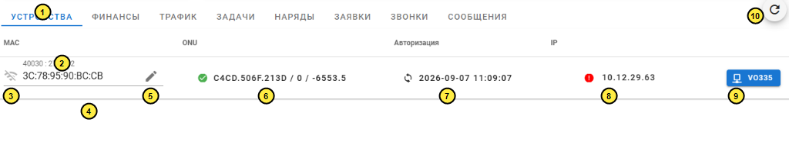
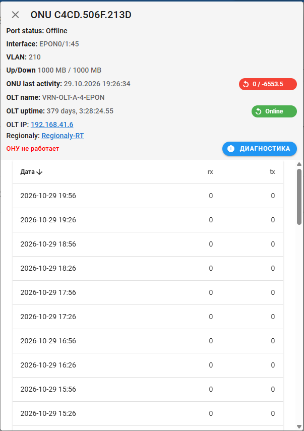

---
layout:
  width: wide
  outline:
    visible: false
---

# Опис інтерфейсу: Картка абонента — Пристрої (`ui_users_devices.md`)

Цей документ містить стислий та структурований опис екранної форми картки абонента у розділі «Устройства» (мережеве обладнання, ONU, авторизація FreeRADIUS та прив'язка до топології PON):
- **URL сторінки:** `https://a.iport.net.ua/#/user/40030/devices` *(маршрут у SPA: `/#/user/:mid/devices`)*
- **Основний запит:** `GET https://a.iport.net.ua/users/devices/40030`
- **Компонент Vue:** [`UserDevices.vue`](file:///c:/Projects/icrm/ui.2.1/src/components/UserDevices.vue)
- **Модель стану:** [`models/devices.js`](file:///c:/Projects/icrm/ui.2.1/src/models/devices.js)

---

## 1. Карта нумерації елементів на скріншоті



---

## 2. Таблиця мапінгу елементів на дані API та БД

| № | Елемент на екрані | Значення на скріншоті | Поле в API `/users/devices/:mid` | Таблиця та колонка в БД | Логіка формування / обчислення |
| :-: | :--- | :--- | :--- | :--- | :--- |
| **1** | **Вкладка «УСТРОЙСТВА»** | `УСТРОЙСТВА` (активна) | Проп `:mid` | Маршрутизатор SPA (`router/index.js`) | Активна вкладка підкреслена синьою лінією. Відображає таблицю прив'язаних мережевих пристроїв клієнта (роутери, ONU, IP, статуси сесій). |
| **2** | **Номер запису / Договір** | `40030 : 274.232` | `item.id`, `item.name` (або `contract`) | `bill.users.id`, `bill.users.name`, `bill.users.contract` | Заголовок поля MAC: `label="{id} : {name}"`. Якщо у клієнта декілька підключень/послуг (наприклад, інтернет і окремий сервіс), у таблиці відображається кілька рядків з їхніми ID у `users`. |
| **3** | **Статус мережевої активності** | Сіра перекреслена іконка `wifi_off` | `item.auth` | `bill.users.auth` | Показує поточну активність трафіку абонента. Якщо `auth === 'on'` — зелена іконка `wifi` («Активен»), якщо `auth !== 'on'` — сіра перекреслена іконка `wifi_off` («Не активен (нет трафика)»). |
| **4** | **MAC-адреса обладнання** | `3C:78:95:90:BC:CB` | `item.mac` | `bill.users.mac` | Фізична MAC-адреса роутера або комп'ютера абонента, за якою FreeRADIUS авторизує клієнта у мережі та перевіряє відповідність IP-пулу. |
| **5** | **Кнопка редагування MAC-адреси** | Іконка олівця `edit` | Метод `editMac(item)` | Збережена процедура `bill.icrm_update_dop_field(mid, mac, 4, 1, nodeny_id)` | Клік активує режим редагування. Дозволяє ввести MAC вручну, або (якщо є ONU) автоматично зчитати FDB-таблицю маків з порту ONU через `GET /pon/onu-fdb/:mac_onu` (кнопка `mdi-sync`). Збереження виконує `POST /users/mac`. |
| **6** | **Статус та параметри ONU** | `✓ C4CD.506F.213D / 0 / -6553.5` | `mac_onu`, `onu.state_onu`, `onu.rx`, `onu.tx` | `bill.users.mac_onu` ➔ Моніторинг NOC Zabbix (`/api/pon/zabbix.php`) | Зелена галочка `check_circle` означає, що ONU онлайн. Текст містить MAC/серійний номер ONU (`C4CD.506F.213D`), оптичний рівень на прийом `rx` (`0 dBm`) та на передачу `tx` (`-6553.5 dBm`). Клік відкриває діалог моніторингу рівнів сигналу (`SignalDialog.vue`). |
| **7** | **Моніторинг авторизації у FreeRADIUS** | `🔄 2026-09-07 11:09:07` | `item.auth_time` | `rad.radpostauth_log.time` (`db.rad`, `db.radSecond`) | Відображає дату і точний час останньої успішної авторизації через RADIUS. Клік вмикає циклічний моніторинг `toggleAuthPoling` (запити `GET /users/rad-auth-time/:ip` щосекунди протягом 30 сек). Використовується, коли техпідтримка просить клієнта перезавантажити роутер: час автоматично оновлюється зеленим кольором при першому ж пакеті. |
| **8** | **IP-адреса та статус блокування** | `! 10.12.29.63` (червоний) | `item.ip`, `item.state`, `block_reason`, `block_date` | `bill.users.ip`, `bill.users.state`, лог блокувань `bill.pays` (`category = 423`) | Якщо `state === 'off'` — червона іконка `error` (доступ заблоковано). При наведенні курсору показується спливаюча підказка з датою блокування та причиною з таблиці `pays` (заборгованість). Якщо `state === 'on'` — зелена іконка `check_circle` («Доступ разрешен»). |
| **9** | **Вузол мережі / PON-бокс** | Синя кнопка `[💻 VO335]` | `map_object.remote.local_id` | CouchDB `network` (документ `ponbox.*`) | Локальний ідентифікатор оптичної муфти/PON-бокса (`VO335` — Вороньків бокс 335), до якого підключено кабель абонента. Клік відкриває меню переходів: «Карта» (`/imap/#/map/network/:id`) або «PON» (`/imap/#/signals/contracts/:contract`). |
| **10** | **Оновлення секції** | Кругла кнопка `↻` | Проп `:ver` | Метод `devices.methods.load(mid)` | Перезавантажує параметри пристроїв, актуальні оптичні сигнали ONU та історію блокувань з сервера. |

---

## 3. Серверні запити та бізнес-логіка бекенда

### 3.1. Основний запит отримання списку пристроїв (`GET /users/devices/:mid`)
- **Маршрут:** [`routes/users.js:294`](file:///c:/Projects/icrm/test-mysql/icrm-server/routes/users.js#L294) $\to$ [`libs/user.js:devices`](file:///c:/Projects/icrm/test-mysql/icrm-server/libs/user.js#L451-L469).
- **Виконує SQL-запит до білінгу:**
  ```sql
  SELECT u.id, u.mid, u.ip, u.name, u.state, u.auth, u.comment, u.lstate, u.mac, u.mac_onu, u.contract
  FROM users u
  WHERE u.id = 40030 OR u.mid = 40030;
  ```
- **Паралельно збирає дані з трьох джерел:**
  1. **Час авторизації у FreeRADIUS (`getLastAuth`):**
     ```sql
     SELECT MAX(time) auth_time, username 
     FROM radpostauth_log 
     WHERE username IN ("3C:78:95:90:BC:CB") 
     GROUP BY username;
     ```
     Запитується одночасно на двох серверах FreeRADIUS (`db.rad` та `db.radSecond`) з об'єднанням за максимальною датою.
  2. **Топологія мережі (`boxes`):** звернення до CouchDB `network` (в'ю `box/contract`), звідки дістається батьківський об'єкт `ponbox.*` з ідентифікатором муфти `local_id = 'VO335'`.
  3. **Прив'язка до контрактів PON (`onuInPon`):** перевірка наявності зареєстрованої ONU в базі PON-моніторингу.

---

### 3.2. Отримання деталей блокування (`GET /users/devices/history/:ids`)
Якщо у пристрою абонента `state === 'off'`, SPA викликає цей запит для вилучення причини та дати блокування:
```sql
SELECT u.id, u.mid, p.reason, FROM_UNIXTIME(p.time) date 
FROM (
    SELECT MAX(id) id, mid 
    FROM bill.pays 
    WHERE category = 423 AND mid IN (40030) 
    GROUP BY mid
) u 
LEFT JOIN pays p ON u.id = p.id;
```
Повертає рядок причини, наприклад `198.18.0.165:0.00:350` (дата `2026-09-01 06:07:00`), що виводиться у спливаючій підказці біля червоної іконки IP.

---

### 3.3. Отримання оптичних рівнів ONU (`GET /users/onu-details/:macs`)
- **Маршрут:** [`routes/users.js:297`](file:///c:/Projects/icrm/test-mysql/icrm-server/routes/users.js#L297) $\to$ [`libs/user.js:507-517`](file:///c:/Projects/icrm/test-mysql/icrm-server/libs/user.js#L507-L517).
- Викликає NOC/Zabbix API провайдера:
  ```http
  GET http://noc.iport.net.ua/api/pon/zabbix.php?cmd=getPonDetails&mac_onu=C4:CD:50:6F:21:3D
  ```
- **Відповідь:**
  ```json
  [
    {
      "mac_onu": "C4:CD:50:6F:21:3D",
      "state_onu": true,
      "rx": 0,
      "tx": -6553.5,
      "message": null
    }
  ]
  ```

---

### 3.4. Збереження нової MAC-адреси (`POST /users/mac`)
- **Маршрут:** [`routes/users.js:309-317`](file:///c:/Projects/icrm/test-mysql/icrm-server/routes/users.js#L309-L317).
- **Тіло запиту:** `{ "mid": 40030, "mac": "3C:78:95:90:BC:CB" }`.
- **Дія в БД:** викликає збережену процедуру білінгу:
  ```sql
  CALL icrm_update_dop_field(40030, '3C:78:95:90:BC:CB', 4, 1, 100);
  ```
  Де `4` — код додаткового поля MAC-адреси в NoDeny, `1` — тип операції, `100` — `nodeny_id` оператора, що здійснює дію.

---

### 3.5. Опитування MAC-адрес з порту ONU через FDB (`GET /pon/onu-fdb/:mac_onu`)
- **Маршрут:** [`routes/pon.js`](file:///c:/Projects/icrm/test-mysql/icrm-server/routes/pon.js).
- Виконує опитування OLT через Telnet/SNMP для виявлення всіх MAC-адрес обладнання (роутерів, ноутбуків), які наразі підключені до Ethernet-порту клієнтської ONU. Результат повертається у випадаючий список вибору MAC без необхідності вводити його вручну.

---

## 4. Модальне вікно моніторингу ONU, історії загасання та діагностики (`SignalMonitor.vue`)

При натисканні на кнопку або текст оптичного термінала (елемент 6 у таблиці пристроїв) відкривається спеціалізоване діалогове вікно поглибленої діагностики лінії:



### 4.1. Елементи інтерфейсу та параметри діагностики

1. **Заголовок:** `ONU C4CD.506F.213D` — формат MAC-адреси оптичного термінала (перетворюється з двокрапкового формату у стандартний вигляд OLT: `C4CD.506F.213D`).
2. **Параметри оптичного інтерфейсу на OLT:**
   - **`Port status: Offline`** — статус порту комутатора OLT. Отримується через SNMP-запит `GET /pon/onu-rx/:ip/:snmp/:typepon/operstatus` (якщо `operstatus = 1` та `admin_status = 1` ➔ `Online`, інакше `Offline` або `Disabled`).
   - **`Interface: EPON0/1:45`** — фізичний порт лінійної карти OLT та логічний номер ONU на сплітерній гілці.
   - **`VLAN: 210`** — сервісний абонементський VLAN на комутаторі.
   - **`Up/Down: 1000 MB / 1000 MB`** — налаштована швидкість порту (1 Гбіт/с).
   - **`ONU last activity: 29.10.2026 19:26:34`** — час останньої зареєстрованої активності ONU в системі Zabbix (`lastclock`).
   - **Червоний чіп реального часу (`🔄 0 / -6553.5`):** відображає поточні значення оптичного сигналу `rx / tx`. Клік активує щосекундне живе оновлення через `GET /pon/onu-rx/:ip/:snmp/:typepon` протягом 10 секунд.
3. **Статус вузлового комутатора (OLT):**
   - **`OLT name: VRN-OLT-A-4-EPON`** — ідентифікатор головного комутатора станції (Вороньків OLT A-4 EPON).
   - **`OLT uptime: 379 days, 3:28:24.55`** — час безперервної роботи шасі OLT.
   - **Зелений чіп `🔄 Online`:** статус зв'язку з OLT. Клік оновлює стан через виклик `GET /pon/olt-status/:hostid`.
   - **`OLT IP: 192.168.41.6`:** внутрішня адреса комутатора. Клік відкриває посилання виду `zurl://telnet_192.168.41.6` для миттєвого підключення інженера через локальний Telnet-термінал.
   - **`Regionaly: Regionaly-RT`:** посилання на агрегуючий маршрутизатор регіону.
4. **Автоматична діагностика лінії (компонент [`OnuTest.vue`](file:///c:/Projects/icrm/ui.2.1/src/components/OnuTest.vue)):**
   - Червоний напис **`ОНУ не работает`**: результат комплексної автоматичної перевірки бекенда (`POST /pon/onu-status-full`).
   - Кнопка **`🛈 ДИАГНОСТИКА`**: повторний ручний запуск діагностики ланцюжка. Бекенд опитує OLT через Telnet/SNMP:
     - чи живий OLT (`testOlt`);
     - чи є сигнал оптичного лазера (`testRx`);
     - статус неактивної ONU по Telnet (`show epon inactive-onu mac ...` ➔ перевіряє `power-off` — вимкнення живлення у абонента, або `wire-down` — фізичний обрив кабелю);
     - чи бачить ONU клієнтський роутер на порту (`testFdb`);
     - чи пройшла реєстрація у білінгу / FreeRADIUS (`radpostauth_log`).
5. **Таблиця історії загасання оптичного сигналу (`rx` / `tx`):**
   - Запитує історію з бекенда: `GET /pon/history/:hostid/:mac_onu` ➔ повертає до 350 точок вимірювань із Zabbix API (`getPonRxTxDetils`).
   - Показує журнал зміни рівнів оптичної сили кожні 30 хвилин.
   - На скріншоті зафіксовано значення `0` на прийом (`rx`) та `0` на передачу (`tx`) за весь період спостереження з 15:26 до 19:56 29.10.2026, що вказує на відсутність оптичного лінку.
