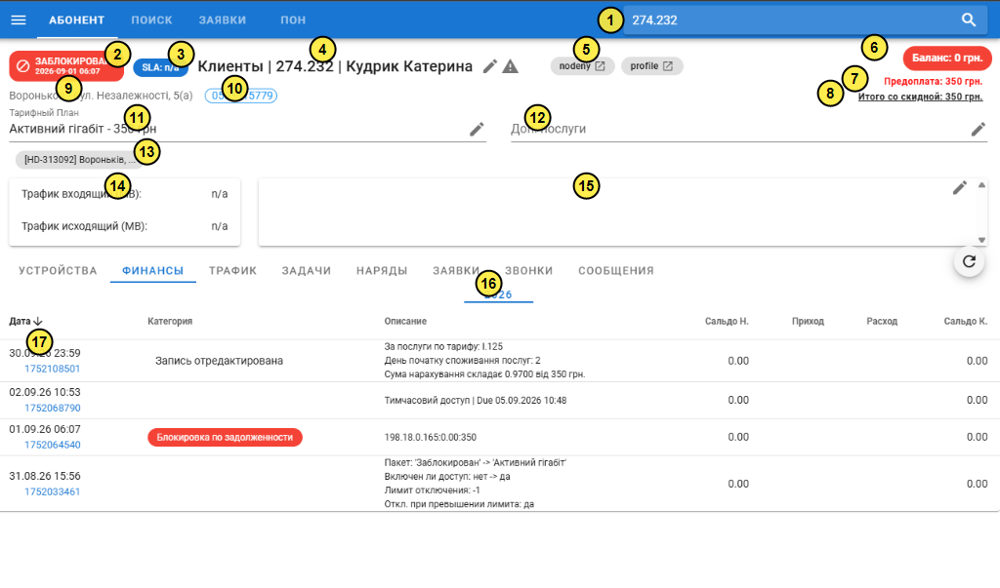
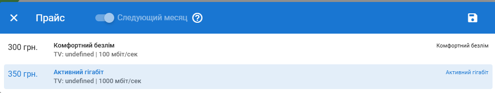

---
layout:
  width: wide
  outline:
    visible: false
---

# Опис інтерфейсу: Картка абонента — Фінанси (`ui_users_fin.md`)

Цей документ містить стислий та структурований опис екранної форми картки абонента у розділі «Фінанси»:
- **URL сторінки:** `https://a.iport.net.ua/#/user/40030/payments` *(маршрут у SPA: `/#/user/:mid/payments`)*
- **Основний запит даних картки:** `GET https://a.iport.net.ua/users/info/40030`
- **Запит таблиці операцій:** `GET https://a.iport.net.ua/pays/list/40030`

---

## 1. Карта нумерації елементів на скріншоті



---

## 2. Шапка картки абонента (запит `GET /users/info/40030`)

| № | Елемент на екрані | Значення на скріншоті | Поле в API `/users/info/:mid` | Таблиця та колонка в БД | Логіка формування / обчислення |
| :-: | :--- | :--- | :--- | :--- | :--- |
| **1** | **Пошук / Поточний договір** | `274.232` | `contract` | `bill.users.contract` | При завантаженні картки номер договору записується у Vuex-стан `COMMON.selected` і підставляється в поле швидкого пошуку. |
| **2** | **Статус блокування** | `ЗАБЛОКИРОВАН 2026-09-01 06:07` | `state`, `state_date` | `bill.users.state`, `bill.users.state_date` | Червоний чіп виводиться, якщо `state !== 'on'`. Текст дати формується з Unix-timestamp `state_date` (момент блокування доступу). |
| **3** | **Рівень SLA** | `SLA: n/a` | `sla` | `bill.users.sla` | Якщо `sla IS NULL`, виводиться `n/a`. Клік відкриває модальне вікно вибору рівня моніторингу `0..4` (`GET /users/update-sla/:mid/:sla`). |
| **4** | **Заголовок абонента** | `Клиенты \| 274.232 \| Кудрик Катерина` | `grp_name`, `contract`, `fio` | `bill.user_grp.grp_name`, `bill.users.contract`, `bill.users.fio` | Формується як `{grp_name} \| {contract} \| {fio}`. Іконка олівця відкриває вікно редагування контактів (`ContactsDialog.vue`). Іконка `mdi-alert` — опитування клієнта. |
| **5** | **Швидкі переходи** | `nodeny`, `profile` | `contract` (і `mid`) | `bill.users.contract` | `nodeny` — перехід в адмінку NoDeny (`...&id=40030`). `profile` — перехід в особистий кабінет абонента (`/redirect/274.232/:token`). |
| **6** | **Баланс** | `Баланс: 0 грн.` | `balance`, `refill` | `bill.users.balance` | Поточний залишок коштів. Стає **червоним**, якщо `refill > 0` (баланс нижчий за ліміт відключення), **помаранчевим** при переплаті > 3 місяців, інакше **зеленим**. |
| **7** | **Предоплата / Ліміт** | `Предоплата: 350 грн.` | `limit_balance`, `block_if_limit` | `bill.users.limit_balance`, `bill.users.block_if_limit` | Якщо `block_if_limit == 1`: при `limit_balance > 0` виводить червоним **Предоплата** (сума для роботи тарифу), при `limit_balance <= 0` — **Лимит**. |
| **8** | **Разом зі знижкою** | `Итого со скидной: 350 грн.` | `due` | Розрахунок у `libs/money.js` | `money.due(p_price, srvs, discount, start_day)`: планова місячна абонплата з урахуванням знижки `users.discount` та дня активації `users.start_day`. |
| **9** | **Адреса підключення** | `Вороньков - вул. Незалежності, 5(а)` | `name_street`, `building`, `block`, `room` | `bill.p_street.name_street`, `bill.users.building`, `bill.users.block`, `bill.users.room` | Рядок `{street}, {building}({block}) кв. {room}`. |
| **10** | **Основний телефон** | `0503315779` | `phones` (об'єкт з `prime = 1`) | `bill.phones.phone`, `bill.phones.prime` | Список активних номерів із таблиці `phones`. Номер з прапорцем `prime = 1` обрамляється синьою рамкою. |
| **11** | **Тарифний план** | `Активний гігабіт - 350 грн` | `paket` ➔ назва у `$store` | `bill.users.paket` ➔ `bill.plans2.name` | Поточний тариф. Клік по олівцю відкриває діалог `Tariff.vue` для зміни тарифу (з 1-го числа наступного місяця або з перерахунком). |
| **12** | **Додаткові послуги** | `Доп. послуги` *(порожньо)* | `services`, `srvs` | `bill.users.srvs` ➔ `bill.srvs` | Бітова маска платних опцій (статичний IP тощо). Олівець відкриває діалог підключення/відключення послуг (`POST /users/set-srvs`). |
| **13** | **Відкриті задачі Jira** | `[HD-313092] Вороньків, ...` | `user.state.opened` | Зовнішнє API Jira (`GET /jira/opened/274.232`) | Активні заявки/інциденти по договору. Клік відкриває задачу в Jira або запускає перемикання тарифу, якщо в описі задачі є JSON зміни. |
| **14** | **Зведений трафік** | `Трафик входящий/исходящий: n/a` | `in1`, `out1` | `bill.users_trf.in1`, `bill.users_trf.out1` | Трафік поточного місяця по всіх точках договору (`users.id = mid OR mid = mid`). Якщо 0 байт — показує `n/a`, інакше переводить у МБ (`/ 1024 / 1024`). |
| **15** | **Коментар** | *(порожнє поле)* | `comment` | `bill.comments.comment` (по `id = mid`) | Текстова службова примітка щодо абонента. Іконка олівця зберігає зміни через `POST /users/change-comment`. |

---

## 3. Вкладка «Фінанси» (запит `GET /pays/list/40030`)

| № | Елемент на екрані | Значення на скріншоті | Поле в API `/pays/list/:mid` | Таблиця та колонка в БД | Логіка формування / обчислення |
| :-: | :--- | :--- | :--- | :--- | :--- |
| **16** | **Фільтр за роками** | `2026` | `year` | `YEAR(FROM_UNIXTIME(pays.time))` | Вкладки над таблицею. Збирає всі унікальні роки операцій клієнта й фільтрує таблицю за обраний рік. |
| **17** | **Таблиця операцій** | 4 рядки журналу | Масив об'єктів `payments` | `bill.pays` (плюс `bill.bonus_cards`) | Завантажується через `GET /pays/list/40030`. Сервер розраховує хронологічне накопичувальне сальдо, після чого сортує за спаданням часу (нові зверху). |

### Розбір рядків фінансової таблиці (17):

1. **Рядок 1 (`30.09.26 23:59`, ID `1752108501`):**
   - **Категорія:** `Запись отредактирована` ➔ колонка `pays.category = 109`.
   - **Опис:** `За послуги по тарифу: I.125 ...` ➔ колонка `pays.coment`.
   - **Суть:** Щомісячне нарахування абонплати за вересень, яке було перераховано оператором (при перерахунку через вікно `UserPayTrans.vue` категорія автоматично змінюється зі `110` на `109`, що блокує повторне редагування).
2. **Рядок 2 (`02.09.26 10:53`, ID `1752068790`):**
   - **Категорія:** `410` (технічний лог дій оператора/системи, назва категорії прихована).
   - **Опис:** `Тимчасовий доступ \| Due 05.09.2026 10:48` ➔ колонка `pays.reason`.
   - **Суть:** Лог видачі тимчасового доступу на 3 дні (`type = 50, cash = 0, category = 410`), створений функцією `addTempAccess` у `libs/bill.js`.
3. **Рядок 3 (`01.09.26 06:07`, ID `1752064540`):**
   - **Категорія:** червоний бейдж `Блокировка по задолженности` ➔ `pays.category = 423`.
   - **Опис:** `198.18.0.165:0.00:350` ➔ колонка `pays.reason` (формат `IP : баланс : ліміт`).
   - **Суть:** Запис автоматичного блокування абонента роботом білінгу на початку місяця, оскільки баланс `0.00` виявився меншим за необхідну передоплату `350 грн`. Дата цього запису дублюється у верхньому бейджі (2).
4. **Рядок 4 (`31.08.26 15:56`, ID `1752033461`):**
   - **Категорія:** `410` (технічний лог).
   - **Опис:** `Пакет: 'Заблокирован' -> 'Активний гігабіт' ...` ➔ колонка `pays.reason`.
   - **Суть:** Лог первинної активації договору (`cstate: 9 -> 0`, `state: 'off' -> 'on'`) зі зміною стартового технічного пакета на робочий тариф та встановленням ліміту передоплати.

---

## 4. Швидка довідка по модальних вікнах

- **Клік по SLA (3):** відкриває вікно [`Sla.vue`](file:///c:/Projects/icrm/ui.2.1/src/components/Sla.vue) ➔ викликає `GET /users/update-sla/:mid/:sla` ➔ оновлює `users.sla` та пише лог `category = 410` у `pays`.
- **Клік по олівцю в заголовку (4):** відкриває вікно [`ContactsDialog.vue`](file:///c:/Projects/icrm/ui.2.1/src/components/ContactsDialog.vue) ➔ викликає `POST /users/contacts` ➔ оновлює таблиці `phones` та `users` (`email`, `fio`).
- **Клік по олівцю тарифу (11):** відкриває модальне вікно [`Tariff.vue`](file:///c:/Projects/icrm/ui.2.1/src/components/Tariff.vue) для зміни тарифного плану (детально розібрано у розділі 5 нижче).
- **Клік по олівцю послуг (12):** відкриває вікно [`Services.vue`](file:///c:/Projects/icrm/ui.2.1/src/components/Services.vue) ➔ викликає `POST /users/set-srvs` ➔ змінює бітову маску `users.srvs`.
- **Клік по олівцю коментаря (15):** відкриває діалог коментаря ➔ викликає `POST /users/change-comment` ➔ зберігає текст у `bill.comments.comment`.
- **Клік по олівцю в рядку таблиці (17):** відкриває вікно [`UserPayTrans.vue`](file:///c:/Projects/icrm/ui.2.1/src/components/UserPayTrans.vue):
  - якщо це абонплата (`category = 110`) ➔ режим **перерахунку абонплати** за фактичні дні споживання трафіку (`POST /pays/recalc`);
  - якщо це платіж (`category` поповнення) ➔ режим **переносу платежу** на інший договір (`POST /pays/trans`).

---

## 5. Зміна тарифного плану з фільтрацією по регіону абонента

При натисканні на іконку олівця біля рядка **«Тарифний План»** (елемент 11) відкривається модальне вікно вибору доступних тарифів:



### 5.1. Елементи керування модального вікна ([`Tariff.vue`](file:///c:/Projects/icrm/ui.2.1/src/components/Tariff.vue))

1. **Перемикач «Следующий месяц» (`opts = ['nextm']`):**
   - Для діючих абонентів (`start_day === 0`) перемикач неактивний і зафіксований в положенні «увімкнено»: перехід на новий тариф відбувається з 1-го числа наступного розрахункового місяця (записується в поле `bill.users.next_paket`).
2. **Перемикач «Пересчет» (`opts = ['recalc']`):**
   - Доступний лише для нових клієнтів, підключених у поточному місяці (`start_day > 0`). Дозволяє пропорційно списати дні за старим тарифом та активувати новий починаючи з поточної дати.
3. **Список тарифів, доступних у регіоні клієнта:**
   - Кожен рядок відображає вартість (`item.price`), комерційну назву (`item.descr.title`), технічний пакет білінгу (`item.name`), параметри швидкості та ТБ (`item.descr.world`, `item.descr.tv`).
   - На скріншоті обрано активний тариф абонента — **«Активний гігабіт» (350 грн/міс, 1000 мбіт/сек)**, альтернатива — **«Комфортний безлім» (300 грн/міс, 100 мбіт/сек)**.
4. **Кнопка збереження (іконка дискети):**
   - Розраховує зміни через `POST /users/change-tariff`, запитує підтвердження у співробітника та застосовує їх викликом `POST /users/do-actions` ([`models/user.js:134-141`](file:///c:/Projects/icrm/ui.2.1/src/models/user.js#L134-L141)).

---

### 5.2. Запит отримання тарифів для регіону абонента (`POST /users/prices`)

Під час відкриття діалогу фронтенд надсилає ID абонента (або географічні координати/вулицю) на бекенд:

```http
POST https://a.iport.net.ua/users/prices
Authorization: Bearer <token>
Content-Type: application/json

{
  "user": 40030
}
```

#### Серверна бізнес-логіка фільтрації ([`libs/user.js`](file:///c:/Projects/icrm/test-mysql/icrm-server/libs/user.js#L264-L293)):
1. **Визначення географічного регіону та типу підключення абонента (`regionByUser`):**
   ```sql
   SELECT u.room, u.name AS login, s.street, s.name_street, s.region 
   FROM users u 
   LEFT JOIN p_street s ON u.street = s.street 
   WHERE u.id = 40030;
   ```
   - Якщо назва вулиці містить `СТ` (садове товариство) — призначається спеціальний `regionId = 53`, інакше береться `s.region` (для Воронькова `regionId = 5`).
   - Категорія житла: якщо `room > 0` (квартира) $\to$ `'kv'`, якщо `room = 0` (приватний будинок) $\to$ `'private'`, якщо логін містить `.business` $\to$ `'business'`.
2. **Вибірка тарифів із таблиці `plans2` (`pricesByRegion`):**
   ```sql
   SELECT p.id, SUBSTRING(p.name, 7) AS name, p.price, p.regions, p.descr, p.info 
   FROM plans2 p 
   WHERE p.name <> '' AND p.regions IS NOT NULL;
   ```
3. **Фільтрація у пам'яті Node.js:**
   Тариф потрапляє у видачу, лише якщо:
   - Масив `regions` тарифу містить ID регіону абонента: `p.regions.indexOf(region.id) > -1`.
   - Опис тарифу відповідає категорії абонента: `p.descr.category.includes(region.category)`.
   - Результат сортується за зростанням вартості: `a.price - b.price`.

#### Приклад відповіді бекенда:
```json
[
  {
    "id": 124,
    "name": "Комфортний безлім",
    "price": 300,
    "regions": [5, 12, 18, 24],
    "descr": {
      "title": "Комфортний безлім",
      "speed": 100,
      "world": "100 мбіт/сек",
      "tv": "undefined",
      "category": ["private"]
    },
    "info": null
  },
  {
    "id": 125,
    "name": "Активний гігабіт",
    "price": 350,
    "regions": [5, 12, 18, 24],
    "descr": {
      "title": "Активний гігабіт",
      "speed": 1000,
      "world": "1000 мбіт/сек",
      "tv": "undefined",
      "category": ["private"]
    },
    "info": null
  }
]
```
