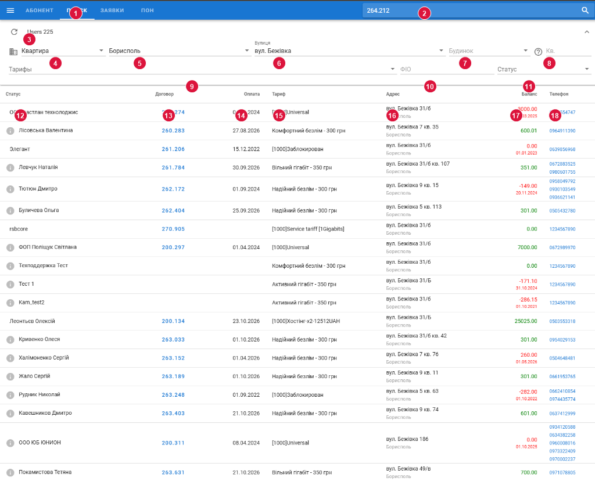
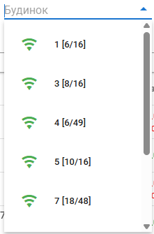

---
layout:
  width: wide
  outline:
    visible: false
---

# Опис інтерфейсу: Пошук абонентів (`ui_users_search.md`)

Цей документ містить стислий та структурований опис екранної форми глобального пошуку абонентів:
- **URL сторінки:** `https://a.iport.net.ua/#/users` *(маршрут у SPA: `/#/users`)*
- **Основний запит пошуку:** `POST https://a.iport.net.ua/search/users`
- **Допоміжний запит багатоквартирних будинків:** `GET https://a.iport.net.ua/coverage/apartments/:city/:street/:source`
- **Допоміжний запит тарифів міста:** `GET https://a.iport.net.ua/search/city-prices/:city`
- **Компоненти Vue:** [`Users.vue`](file:///c:/Projects/icrm/ui.2.1/src/components/Users.vue), [`AddrSelector.vue`](file:///c:/Projects/icrm/ui.2.1/src/components/AddrSelector.vue)
- **Модель стану:** [`models/users.js`](file:///c:/Projects/icrm/ui.2.1/src/models/users.js)
- **Контролер бекенда:** [`routes/search.js`](file:///c:/Projects/icrm/test-mysql/icrm-server/routes/search.js)

---

## 1. Карта нумерації елементів на скріншоті



---

## 2. Таблиця мапінгу елементів на дані API та БД

| № | Елемент на екрані | Значення на скріншоті | Поле в API / Vuex | Таблиця та колонка в БД | Логіка формування / обчислення |
| :-: | :--- | :--- | :--- | :--- | :--- |
| **1** | **Вкладка «ПОИСК»** | `ПОИСК` (активна) | Маршрут `users` | Маршрутизатор SPA (`router/index.js`) | Активна вкладка підкреслена білою смужкою. Відкриває екран розширеного пошуку абонентів за адресою, тарифами, ПІБ та статусом. |
| **2** | **Швидкий пошук договору** | `264.212` | `COMMON.selected` | `bill.users.contract` | Поле швидкого вводу договору/телефону у шапці ([`SearchUser.vue`](file:///c:/Projects/icrm/ui.2.1/src/components/SearchUser.vue)). Клік по лупі або Enter виконує миттєвий перехід до картки відповідного абонента (`/contract/:contract`). |
| **3** | **Оновлення та лічильник знайдених** | `Users 225` | `filterHeader`, `state.items.length` | `COUNT(*)` з результату SQL | Кнопка `refresh` перезапускає пошук за поточними фільтрами (`load()`). Лічильник виводить кількість знайдених записів. Якщо знайдено `limit` (1000 записів), виводиться попередження про необхідність звузити критерії. |
| **4** | **Тип сектору / об'єкта** | `Квартира` | `filter.regionType = 3` | `p_street.name_street`, `users.building`, `users.block` | `1` — Село/Приватний сектор, `2` — Садове товариство (`name_street LIKE '%- СТ%'`), `3` — **Багатоквартирний будинок («Квартира»)**. **Ключова особливість:** вибір режиму `Квартира` активує фільтрацію за конкретними багатоквартирними будинками, список яких динамічно завантажується з карти PON-боксів CouchDB. |
| **5** | **Населений пункт / Регіон** | `Борисполь` | `filter.city`, `filter.region` | `p_street.region`, `p_street.region_id` | Випадаючий список населених пунктів із довідника [`address.js`](file:///c:/Projects/icrm/ui.2.1/src/libs/address.js). При зміні міста автоматично підвантажує список тарифів через `GET /search/city-prices/:city`. |
| **6** | **Вулиця** | `вул. Бежівка` | `filter.street`, `filter.type` | `p_street.street_name` (або `name_street`) | Автокомпліт вулиць обраного населеного пункту. Якщо обрана точна назва зі списку — `type = 'exact'` (`street_name = "вул. Бежівка"`), якщо введено довільний текст — `type = 'like'` (`street_name LIKE "%...%"`). |
| **7** | **Будинок** | `Будинок` (не вказано) | `filter.building` | `bill.users.building`, `bill.users.block` | Для режиму `Квартира` показує випадаючий список підключених багатоквартирних будинків з PON-карти з індикацією портів (`1 [6/16]`) та статусу підключення (Wi-Fi іконка). При виборі абоненти фільтруються строго по обраному будинку (для дробів `31/Б` $\to$ `building = '31'`, `block = 'б'`). У приватному секторі це звичайне поле пошуку `LIKE '%...%'`. |
| **8** | **Квартира** | `Кв.` (не вказано) | `filter.room` | `bill.users.room` | Поле вводу номера квартири/офісу (активне для багатоквартирних будинків). |
| **9** | **Тарифні плани** | `Тарифы` (всі) | `filter.prices` | `bill.users.paket` ➔ `bill.plans2.id` | Мультиселект (`v-autocomplete`). Якщо місто вибране, показує лише тарифи, які діють у цьому регіоні (отримані через `city-prices`), інакше весь довідник. Формує умову `u.paket IN (...)`. |
| **10** | **ПІБ / Назва абонента** | `ФІО` (порожньо) | `filter.fio` | `bill.users.fio` | Текстовий пошук за підрядком: `fio LIKE '%...%'` (регістронезалежний у MySQL). |
| **11** | **Статус абонента** | `Статус` (всі) | `filter.state` | `bill.users.state` | Вибір стану облікового запису: `'Заблок.'` $\to$ `u.state != 'on'`, `'Разблок.'` $\to$ `u.state = 'on'`. |
| **12** | **Статус / ПІБ абонента** | `ООО Фастлан технолоджис`, `(i) Лісовська Валентина` | `item.fio`, `item.user_status` | `bill.users.fio`, `bill.comments.comment` | Виводить ПІБ/назву компанії. Якщо для абонента є коментар у таблиці `comments` (`id = u.id`), ліворуч відображається сіра іконка `(i)` з тултіпом тексту коментаря. |
| **13** | **Номер договору** | `200.274`, `260.283` | `item.contract`, `item.id` | `bill.users.contract`, `bill.users.id` | Синє клікабельне посилання. Клік викликає `selectUser(item)`: записує абонента в `COMMON.selected` і здійснює перехід до його пристроїв (`/#/user/:id/devices`). Для тестових записів без договору поле порожнє. |
| **14** | **Остання оплата** | `04.04.2024`, `27.08.2026` | `item.lpd` | `FROM_UNIXTIME(u.pay_time, '%d.%m.%Y')` | Дата останнього зарахованого платежу або списання абонплати у форматі `ДД.ММ.РРРР`. |
| **15** | **Тарифний план** | `[1000]Universal`, `Комфортний безлім - 300 грн` | `item.p_name` | `bill.plans2.name`, `bill.plans2.descr`, `bill.plans2.price` | Якщо у `plans2.descr` є валідний JSON із полем `title`, формується рядок `{title} - {price} грн`. Для службових/старих тарифів виводиться системна назва `plans2.name`. |
| **16** | **Адреса підключення** | `вул. Бежівка 31/6`<br>`Борисполь` | `item.address`, `item.region` | `p_street.name_street`, `users.building`, `users.block`, `users.room` | Дворівневий блок: зверху відформатована адреса `address` (`{street} {building}/{block} кв. {room}`), знизу дрібним сірим шрифтом населений пункт `region` (`p_street.name_street`). |
| **17** | **Баланс та дата блокування** | `3000.00`<br>`25.03.2025` (або `-149.00`, `351.00`) | `item.balance`, `item.state`, `item.std` | `bill.users.balance`, `bill.users.state`, `FROM_UNIXTIME(u.state_date, '%d.%m.%Y')` | Сума балансу `balance.toFixed(2)`. Якщо `state === 'on'` — колір **зелений**, якщо `state !== 'on'` — колір **червоний**. Для заблокованих абонентів (`state === 'off'`) під балансом червоним шрифтом виводиться дата зміни статусу `std` (`state_date`). |
| **18** | **Контактні телефони** | `0675554747`, `0958049792...` | `item.phone` | `bill.users.phone` | Номери телефонів абонента з таблиці `users`, розділені комами. У таблиці кожен номер виводиться як клікабельне посилання `tel:{phone}`. |

---

## 3. Серверні запити та бізнес-логіка бекенда

### 3.1. Основний пошуковий запит (`POST /search/users`)
- **Маршрут:** [`routes/search.js:41-76`](file:///c:/Projects/icrm/test-mysql/icrm-server/routes/search.js#L41-L76).
- **Вхідний JSON-об'єкт `req.body`:**
  ```json
  {
    "regionType": 3,
    "city": "Борисполь",
    "street": "вул. Бежівка",
    "region": 1,
    "type": "exact",
    "building": null,
    "prices": null,
    "fio": null,
    "state": null
  }
  ```

#### Формування динамічних умов `WHERE` (`routes/search.js:15-40`):
1. **Садові товариства:** `regionType === 2` $\to$ додається `name_street LIKE '%- СТ%'`.
2. **Тарифи:** `prices && prices.length > 0` $\to$ `u.paket IN (...)`.
3. **Регіон:** `region` $\to$ `region_id = {region}`.
4. **Будинок:**
   - Для квартир (`regionType === 3`): розбиває символи `/` та `-`. Якщо є номер і літера/корпус: `building = '{bld[0]}' AND LOWER(block) = '{bld[1]}'`.
   - Для приватного сектору: `building LIKE '%{building}%'`.
5. **ПІБ:** `fio` $\to$ `fio LIKE '%{fio}%'`.
6. **Вулиця:**
   - Якщо `type === 'exact'`: `{searchField} = "{street}"`.
   - Якщо `type === 'like'`: `{searchField} LIKE "%{street}%"`.
   - Де `searchField`: `name_street` для СТ або `street_name` для решти.
7. **Статус блокування:**
   - `'Заблок.'` $\to$ `u.state != 'on'`.
   - `'Разблок.'` $\to$ `u.state = 'on'`.

#### Виконуваний SQL-запит у MySQL (`db.bro`):
```sql
SELECT 
    u.id, 
    u.mid, 
    FROM_UNIXTIME(u.pay_time, '%d.%m.%Y') AS lpd, 
    FROM_UNIXTIME(u.state_date, '%d.%m.%Y') AS std,  
    u.contract, 
    u.fio, 
    u.balance, 
    u.limit_balance, 
    u.block_if_limit, 
    u.state, 
    u.srvs, 
    u.email, 
    u.mac_onu, 
    u.mac, 
    u.auth, 
    u.phone, 
    u.building,
    p.name AS p_name, 
    p.price AS p_price, 
    p.descr,
    u.name, 
    u.cstate, 
    t.submoney, 
    u.discount, 
    t.startmoney, 
    t.in1, 
    t.out1, 
    t.traf1,
    s.region, 
    s.region_id, 
    s.street_name,
    us.comment AS user_status,
    CONCAT(
        s.name_street, " ", 
        IFNULL(building, ''), 
        IF(LENGTH(block) > 0, CONCAT('/', block), ''), 
        IF(room > 0, CONCAT(' кв. ', room), '')
    ) AS address
FROM users u 
    INNER JOIN (
        SELECT name, id, price, descr 
        FROM plans2
    ) p ON u.paket = p.id
    INNER JOIN (
        SELECT 
            name_street, 
            TRIM(SUBSTRING_INDEX(name_street, '-', 1)) AS region, 
            street AS id, 
            region AS region_id, 
            name AS street_name 
        FROM p_street
    ) s ON u.street = s.id
    LEFT JOIN users_trf t ON u.id = t.uid
    LEFT JOIN comments us ON u.id = us.id
WHERE u.mid = 0 
  AND s.name_street IS NOT NULL 
  AND s.street_name = "вул. Бежівка"
ORDER BY u.id DESC
LIMIT 1000;
```

#### Пост-обробка даних у Node.js (`routes/search.js:65-74`):
Після отримання результатів з БД сервер перевіряє наявність поля `descr` у тарифному плані:
```javascript
ds.forEach(_ => {
    try {
        if (_.descr) {
            const descr = JSON.parse(_.descr);
            _.p_name = `${descr.title} - ${_.p_price} грн`;
        }
    } catch (e) { }
});
```
Це формує читабельну назву тарифу (наприклад, `Вільний гігабіт - 350 грн` замість внутрішньої службової назви з `plans2.name`).

---

### 3.2. Допоміжний запит тарифів міста (`GET /search/city-prices/:city`)
- **Маршрут:** [`routes/search.js:9-13`](file:///c:/Projects/icrm/test-mysql/icrm-server/routes/search.js#L9-L13).
- **Призначення:** визначає, які тарифи доступні для підключення у вибраному місті/регіоні, виключаючи тестові групи (`grp != 1`):
  ```sql
  SELECT DISTINCT u.paket 
  FROM p_street s 
      LEFT JOIN users u ON s.street = u.street 
  WHERE u.grp != 1 
    AND s.region = 1;
  ```
- **Результат:** масив ID тарифів `[125, 140, 155, ...]`, за якими фільтрується випадаючий список у полі «Тарифы» (елемент 9).

---

### 3.3. Фільтрація за багатоквартирними будинками (інтеграція з PON-картою CouchDB)

> [!IMPORTANT]
> **Ключова архітектурна особливість:** коли у першому селекторі адреси обрано тип **«Квартира»** (`regionType = 3`), система надає можливість точної фільтрації абонентів за конкретним **багатоквартирним будинком**. Довідник цих будинків не є простим текстовим полем з білінгу, а динамічно формується на основі **карти розташування PON-боксів / оптичних муфт у CouchDB (`network`) за ознакою багатоквартирного фонду**.



#### 1. Ланцюжок отримання списку будинків (`AddrSelector.vue:90-106`):
Коли користувач вибирає тип «Квартира», місто та вулицю, компонент [`AddrSelector.vue`](file:///c:/Projects/icrm/ui.2.1/src/components/AddrSelector.vue) відправляє запит:
```http
GET /coverage/apartments/:city/:street/:source
```
- Для міста Бориспіль: `source = 'couch'`, `street` мапиться на ідентифікатор вулиці з кешу `streetsWithAparmentsCouch`.
- Для інших міст: `source = 'mysql'`.

#### 2. Обробка на бекенді ([`routes/coverage.js:20-32`](file:///c:/Projects/icrm/test-mysql/icrm-server/routes/coverage.js#L20-L32) та [`libs/coverage.js`](file:///c:/Projects/icrm/test-mysql/icrm-server/libs/coverage.js)):
При запиті через CouchDB сервер звертається до в'юшки `streets/buildings` бази `network`:
```javascript
let boxes = await couch.getView('network', 'streets', 'buildings', {
    key: `${req.params.city}.${req.params.street}`,
    include_docs: true
}).then(({data}) => data.rows);
```
Для кожного знайденого PON-бокса виконується агрегація мережевих параметрів:
1. **Перевірка статусу монтажу/підключення (`coverage.assignStatuses`):**
   - Перевіряються задачі у Jira через CouchDB `crm` (`jc.getPonboxIssues(box.doc.id)`).
   - Якщо бокс встановлено (`box.doc.installed`) або задачу завершено (`status === '10001'`) $\to$ `status = 1` (**підключений**, зелена іконка Wi-Fi).
   - Якщо задача в роботі/планується (`status === '10000'` або `'3'`) $\to$ `status = 2` (**планується підключення**, помаранчева іконка).
   - Якщо будинок не підключений $\to$ `status = 0` (червона іконка).
2. **Підрахунок портів для абонентів (`coverage.countUsersPorts`):**
   - Обчислюються тільки клієнтські порти комутатора/сплітера: `doc.o[port].dir === 'user'`.
3. **Підрахунок зайнятих портів (`coverage.countOccupiedPorts`):**
   - Робиться запит до CouchDB в'ю `network/chld/users` за ключем `box.doc.id` (`occupiedPorts = data.rows.length`).
4. **Об'єднання за будинками (`coverage.countAllPorts`):**
   - Якщо в одному багатоквартирному будинку встановлено декілька PON-боксів або комутаторів, їхня ємність та зайняті порти підсумовуються.

#### 3. Візуальне представлення у випадаючому списку:
Компонент формує рядок через функцію `formatBuildingPorts(item)`:
$$\text{Текст} = \text{Номер\_будинку } [\text{Зайняті\_порти} / \text{Загальна\_ємність}]$$
- Наприклад (як на скріншоті):
  - `1 [6/16]` — будинок 1, зайнято 6 портів з 16 доступних.
  - `3 [8/16]` — будинок 3, зайнято 8 портів з 16.
  - `4 [6/49]` — будинок 4, зайнято 6 портів з 49.
  - `5 [10/16]` — будинок 5, зайнято 10 портів з 16.
  - `7 [18/48]` — будинок 7, зайнято 18 портів з 48.
- Якщо є порти у статусі планування, додається суфікс: `(+{plannedPorts})`.
- Тултіп елемента пояснює значення оператору:
  `"Номер будинку [Зайняті порти / Загальна кількість портів (+Заплановані порти)]"`.

#### 4. Застосування вибору будинку до SQL-пошуку абонентів (`routes/search.js:21-29`):
Коли оператор обирає конкретний багатоквартирний будинок, у пошуковий `POST /search/users` передається `building`. Бекенд автоматично розпізнає дробові та корпусні номери (наприклад, `31/Б` чи `31-Б`):
```javascript
if (body.building) {
    if (body.regionType === 3) {
        const bld = body.building.replace('-', '/').split('/');
        where.push(`building = '${bld[0]}'`);
        if (bld.length > 1) where.push(`lower(block) = '${bld[1].toLowerCase()}'`);
    } else {
        where.push(`building like '%${body.building.trim()}%'`);
    }
}
```
Це дозволяє відфільтрувати абонентів саме цього будинку (і конкретного корпусу/літери), гарантуючи точний збіг без помилкових захоплень схожих номерів.

---

## 4. Поведінка інтерфейсу та навігація (UX-логіка)

1. **Перехід до картки абонента:**
   - При кліку на номер договору (елемент 13) викликається метод `selectUser(item)`:
     ```javascript
     await this.$store.commit('COMMON_SET', { selected: user });
     this.$router.push({ path: `/user/${user.id}/devices` });
     ```
   - Номер договору автоматично фіксується у глобальному стані `COMMON.selected`, а користувач перенаправляється на вкладку «УСТРОЙСТВА» знайденого абонента.

2. **Індикація фінансового стану:**
   - Колір тексту балансу розраховується динамічно:
     ```html
     <div :style="{'color': (item.state === 'on' ? 'green' : 'red')}">{{item.balance.toFixed(2)}}</div>
     <div style="font-size: 11px; color: red;" v-if="item.state === 'off'">{{item.std}}</div>
     ```
   - Заблоковані користувачі відразу помітні завдяки червоному тексту та даті вимкнення.

3. **Створення нової заявки в Jira:**
   - Рожева плаваюча FAB-кнопка з плюсом `+` унизу праворуч (елемент `openJira()`) викликає глобальну подію шини `this.$bus.$emit('OPEN_JIRA', null)` для швидкого створення звернення без втрати поточного контексту пошуку.
