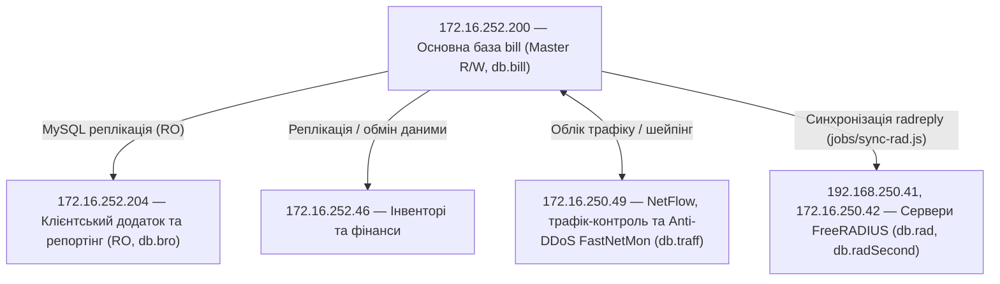

---
layout:
  width: wide
  outline:
    visible: false
---

# Опис абонентських даних (`bill` / `bro` / `ibill`)

Цей документ описує структуру абонентських даних у білінговій базі даних (**NoDeny** — підключення `db.bill`, `db.bro`, `db.ibill` у [`db.js`](file:///c:/Projects/icrm/test-mysql/icrm-server/db.js) та [`env.js`](file:///c:/Projects/icrm/test-mysql/icrm-server/env.js)).

> **Важливо:** Для кожної таблиці наведено **виключно ті поля, які реально використовуються в коді `icrm-server`** (у `SELECT`, `WHERE`, `JOIN`, `INSERT`, `UPDATE`, `GROUP BY`, `ORDER BY` або при обробці результатів у JS).
> *Примітка:* У базі `db.icrm` також існує однойменна таблиця `icrm.users` (облікові записи співробітників CRM, див. [`auth.js`](file:///c:/Projects/icrm/test-mysql/icrm-server/auth.js) та [`routes/system.js`](file:///c:/Projects/icrm/test-mysql/icrm-server/routes/system.js)), яка не відноситься до абонентів білінгу й у цьому документі не розглядається.

---

## 0. Реплікація бази `bill` та пов'язані підсистеми

Абонентські дані формуються в центральній (Master) базі білінгу **`bill`** та реплікуються або синхронізуються на спеціалізовані вузли інфраструктури для розподілу навантаження, обліку трафіку, фінансів та мережевої авторизації:



| IP-адреса вузла | Роль та призначення підсистеми | Підключення в [`env.js`](file:///c:/Projects/icrm/test-mysql/icrm-server/env.js) / [`db.js`](file:///c:/Projects/icrm/test-mysql/icrm-server/db.js) та використання в коді |
| :--- | :--- | :--- |
| **`172.16.252.200`** | **Основна база білінгу (`bill`, Master R/W)** | Підключення **`db.bill`** (`user: bill_icrm`). Приймає всі операції запису (`INSERT`, `UPDATE`, `DELETE`): створення та редагування абонентів ([`libs/user.js`](file:///c:/Projects/icrm/test-mysql/icrm-server/libs/user.js), [`routes/users.js`](file:///c:/Projects/icrm/test-mysql/icrm-server/routes/users.js)), проведення платежів та тимчасового доступу ([`libs/bill.js`](file:///c:/Projects/icrm/test-mysql/icrm-server/libs/bill.js), [`routes/pays.js`](file:///c:/Projects/icrm/test-mysql/icrm-server/routes/pays.js)), закриття місяця ([`jobs/new_month.js`](file:///c:/Projects/icrm/test-mysql/icrm-server/jobs/new_month.js)). |
| **`172.16.252.204`** | **Клієнтський додаток та репортінг (Read-Only репліка)** | Підключення **`db.bro`** (`database: bill`, `user: bill_icrm_ro`). Використовується для розвантаження основної бази під час читання: обслуговування особистого кабінету та мобільного додатку абонента ([`libs/profile.js`](file:///c:/Projects/icrm/test-mysql/icrm-server/libs/profile.js), [`libs/content.js`](file:///c:/Projects/icrm/test-mysql/icrm-server/libs/content.js)), глобального пошуку ([`routes/search.js`](file:///c:/Projects/icrm/test-mysql/icrm-server/routes/search.js)), важких аналітичних звітів ([`routes/reports.js`](file:///c:/Projects/icrm/test-mysql/icrm-server/routes/reports.js)) та вибірок для розсилок ([`routes/sending.js`](file:///c:/Projects/icrm/test-mysql/icrm-server/routes/sending.js)). *(Примітка: метод `db.bro.m` у [`db.js:34`](file:///c:/Projects/icrm/test-mysql/icrm-server/db.js#L34) для мультизапитів примусово спрямований на майстер `.200`)*. |
| **`172.16.252.46`** | **Інвенторі та фінанси** | Вузол підсистеми складського/майнового обліку (Inventory) та фінансових операцій, куди реплікуються білінгові дані (також фігурує в [`env.js:9-15`](file:///c:/Projects/icrm/test-mysql/icrm-server/env.js#L9-L15)). |
| **`172.16.250.49`** | **NetFlow, трафік-контроль та Anti-DDoS (`FastNetMon`)** | Підключення **`db.traff`** (`database: billtrf`, `user: billtrf`). Збирає статистику NetFlow та деталізацію трафіку по днях/місяцях (таблиці `s_detail`, `Z_YYYY_MM_DD`), яка читається в особистому кабінеті ([`libs/profile.js:75-103`](file:///c:/Projects/icrm/test-mysql/icrm-server/libs/profile.js#L75-L103)) та використовується модулями контролю перевищення трафіку й шейпінгу ([`libs/speed-limit.js:24`](file:///c:/Projects/icrm/test-mysql/icrm-server/libs/speed-limit.js#L24), [`libs/onu-speed-limit.js:32`](file:///c:/Projects/icrm/test-mysql/icrm-server/libs/onu-speed-limit.js#L32)). На цьому ж вузлі працює система виявлення та захисту від DDoS-атак **FastNetMon**. |
| **`192.168.250.41`, `172.16.250.42`** *(та `172.16.250.41`)* | **Сервери FreeRADIUS (`radius`)** | Підключення **`db.rad`** та **`db.radSecond`** (`database: radius`). Забезпечують авторизацію абонентських пристроїв за MAC-адресою, видачу IP та параметрів швидкості (`radreply`), облік активних сесій (`radacct`) та журнал авторизацій (`radpostauth_log` у [`libs/pon.js:76-84`](file:///c:/Projects/icrm/test-mysql/icrm-server/libs/pon.js#L76-L84)). Реплікація/синхронізація станів (`users.state`), IP, MAC та швидкостей (`plans2.speed` / `users.speed`) у таблицю `radreply` і скидання сесій по CoA/Disconnect (порт `3799`) виконуються фоновим процесом [`jobs/sync-rad.js`](file:///c:/Projects/icrm/test-mysql/icrm-server/jobs/sync-rad.js). |

---

## 1. Схема зв'язків між таблицями (ER-діаграма)

Центральною сутністю є таблиця **`users`**, яка має рекурсивний зв'язок сама на себе через **`users.id = users.mid`** (головний договір ↔ додаткові пристрої/точки підключення).

```mermaid
erDiagram
    users ||--o{ users : "id = mid (головний акаунт -> пристрої/аліаси)"
    users ||--o| users_trf : "id = uid"
    users }o--|| user_grp : "grp = grp_id"
    users }o--|| plans2 : "paket = id / next_paket = id"
    users }o--|| p_street : "street = street"
    p_street }o--|| regions : "region = id"
    users ||--o{ phones : "id = mid"
    users ||--o| comments : "id = id"
    users ||--o{ pays : "id = mid"
    pays }o--o| plans2 : "paket = id"
    pays ||--o| pb_trans : "id = pay_id"
    pays ||--o| c24_trans : "id = pay_id (через реєстри/призначення)"

    users {
        int id PK "ID запису (для mid=0 це основний ID абонента)"
        int mid FK "0 = головний акаунт, >0 = users.id головного"
        string contract "Номер договору (на mid=0)"
        string name "Логін"
        int grp FK "user_grp.grp_id"
        int paket FK "plans2.id (поточний тариф)"
        int next_paket FK "plans2.id (наступний тариф)"
        int street FK "p_street.street"
        decimal balance "Поточний баланс"
        string state "'on' | 'off'"
    }

    users_trf {
        int uid PK,FK "users.id"
        bigint in1 "Вхідний трафік 1 класу"
        bigint out1 "Вихідний трафік 1 класу"
        bigint traf1 "Сумарний трафік"
        decimal submoney "Сума абонплати до списання"
        decimal startmoney "Стартовий баланс"
    }

    user_grp {
        int grp_id PK "ID групи"
        string grp_name "Назва групи"
        string grp_property "Прапорці (містить '1' -> без абонплати)"
        text grp_nets "Підмережі групи (через \\n)"
    }

    plans2 {
        int id PK "ID тарифу"
        string name "Назва (з префіксом [1000])"
        decimal price "Вартість (грн)"
        int speed "Швидкість (кбіт/с)"
        json descr "Опис та категорії тарифу"
        json regions "Доступні regions.id"
        json speed_limit "Ліміт трафіку {mb, speed}"
    }

    p_street {
        int street PK "ID вулиці"
        string name_street "Місто - Вулиця"
        string name "Назва вулиці"
        int region FK "regions.id"
        int district "ID району"
        int provider_id "ID ФОП/провайдера"
    }

    regions {
        int id PK "ID населеного пункту"
        string name "Назва населеного пункту"
        string alias "Короткий аліас"
        string district "Район"
        string jira "Мітки Jira"
    }

    phones {
        int mid FK "users.id"
        string phone "Телефон (0XXXXXXXXX) або email"
        tinyint active "1 = активний, 0 = архівний"
        tinyint prime "1 = основний"
        tinyint sms "1 = отримує SMS"
        int viber "Статус Viber (-2..2)"
        string type "'email' тощо"
        string category "'phone' | 'fin'"
    }

    comments {
        int id PK,FK "users.id"
        text comment "Коментар/статус абонента"
        json props "JSON-налаштування ($.pb24_rec)"
        string gdoc "Посилання Google Docs"
        int notification_opened "Timestamp перегляду сповіщень"
    }

    pays {
        int id PK "ID операції"
        int mid FK "users.id"
        decimal cash "Сума (+ поповнення, - списання, 0 лог)"
        int time "Unix timestamp"
        int period "Період YYYYMM"
        int type "10=гроші, 20=тимчасовий, 50=лог"
        int category "Код категорії (7, 110, 410, 600, 1000...)"
        int provider_id "ID ФОП/провайдера"
    }

    pb_trans {
        string trans_id PK "ID транзакції Приват24"
        int pay_id FK "pays.id"
        int provider_id "ID провайдера"
        string stm_ref "Референс у реєстрі ПБ"
        int fin_stm_pk "Зв'язок з fin.statements.pk"
    }

    c24_trans {
        int id PK "PK"
        string trans_id "ID транзакції City24"
        int pay_id "ID платежу для звірки"
        decimal cash "Сума"
        int fin_stm_pk "Зв'язок з fin.statements.pk"
    }
```



---

## 2. Таблиця `users` та механізм самозв'язку `id = mid`

### 2.1. Логіка зв'язку `users.id = users.mid`
У білінгу NoDeny один абонентський договір може мати кілька точок підключення, пристроїв або додаткових IP-адрес. Усі вони зберігаються в одній таблиці `users`:

1. **Головний (майстер) запис абонента (`mid = 0`)**:
   - Поле `mid` завжди дорівнює `0`.
   - Поле `id` є головним ідентифікатором абонента (у бізнес-логіці та пов'язаних таблицях `phones`, `pays`, `comments` його називають **`mid`**).
   - Саме на головному записі (`mid = 0`) зберігаються: номер договору (`contract`), ПІБ (`fio`), баланс (`balance`, `limit_balance`), тариф (`paket`, `next_paket`), адреса (`street`, `building`, `room`) та основний контакт.
   - Створення нового абонента виконується в [`libs/user.js:278-281`](file:///c:/Projects/icrm/test-mysql/icrm-server/libs/user.js#L278-L281) (`addUser`) із `mid = 0`.

2. **Дочірні записи / додаткові пристрої / аліаси (`mid > 0`)**:
   - Поле `mid` містить `id` головного запису абонента (`child.mid = master.id`).
   - Створення додаткового пристрою виконується в [`libs/user.js:183-189`](file:///c:/Projects/icrm/test-mysql/icrm-server/libs/user.js#L183-L189) (`addDevice`), де в `INSERT INTO users` передається `mid` власника, логін формується як `${contract}.${n}`, `grp = 50`, а `ip`, `sortip`, `mac`, `mac_onu` індивідуальні для цього пристрою.

3. **Типові патерни запитів у коді**:
   - **Вибірка всіх пристроїв/записів абонента** ([`libs/user.js:34-48`](file:///c:/Projects/icrm/test-mysql/icrm-server/libs/user.js#L34-L48), [`routes/users.js:103`](file:///c:/Projects/icrm/test-mysql/icrm-server/routes/users.js#L103)):
     ```sql
     SELECT id, ip, mac, mac_onu, name, state, auth, lstate
     FROM users WHERE id = :mid OR mid = :mid
     ```
   - **Нормалізація до головного акаунта** (коли пошук міг знайти дочірній запис за IP, MAC або `mac_onu`):
     - `IF(mid = 0, id, mid)` — наприклад, у [`routes/search.js:121`](file:///c:/Projects/icrm/test-mysql/icrm-server/routes/search.js#L121), [`libs/onu-speed-limit.js:39`](file:///c:/Projects/icrm/test-mysql/icrm-server/libs/onu-speed-limit.js#L39), [`jobs/sync-rad.js:34`](file:///c:/Projects/icrm/test-mysql/icrm-server/jobs/sync-rad.js#L34).
     - `IF(mid > 0, mid, id)` — наприклад, при скануванні ONU в [`routes/pon.js:172`](file:///c:/Projects/icrm/test-mysql/icrm-server/routes/pon.js#L172) та в [`libs/user.js:495`](file:///c:/Projects/icrm/test-mysql/icrm-server/libs/user.js#L495).
   - **Агрегація трафіку та зовнішніх IP з усіх під-акаунтів на головний акаунт**:
     - Підрахунок кількості додаткових точок `sub_acc` та додаткових зовнішніх IP (`ip LIKE '91%'`) у щомісячному білінгу ([`jobs/new_month.js:105-110`](file:///c:/Projects/icrm/test-mysql/icrm-server/jobs/new_month.js#L105-L110)):
       ```sql
       SELECT mid, COUNT(*) sub_acc, SUM(IF(ip LIKE '91%', 1, 0)) ext_ip
       FROM users WHERE mid > 0 AND state = 'on' GROUP BY mid
       ```
     - Підрахунок сумарного трафіку абонента за всіма його записами ([`libs/user.js:116`](file:///c:/Projects/icrm/test-mysql/icrm-server/libs/user.js#L116), [`jobs/new_month.js:132-136`](file:///c:/Projects/icrm/test-mysql/icrm-server/jobs/new_month.js#L132-L136)):
       ```sql
       SELECT IF(u.mid = 0, u.id, u.mid) id, SUM(t.in1 + t.out1) traf
       FROM users u LEFT JOIN users_trf t ON u.id = t.uid GROUP BY id
       ```
   - **Синхронна зміна стану (`state`) або `sla`** на головному та всіх дочірніх записах ([`libs/user.js:19`](file:///c:/Projects/icrm/test-mysql/icrm-server/libs/user.js#L19), [`routes/users.js:158`](file:///c:/Projects/icrm/test-mysql/icrm-server/routes/users.js#L158)):
     ```sql
     UPDATE users SET state = 'on', state_date = UNIX_TIMESTAMP() WHERE id = :mid OR mid = :mid
     ```

---

### 2.2. Поля таблиці `users`, що використовуються в коді

| Поле | Тип / Формат | Опис, можливі значення та бізнес-логіка | Де використовується в коді |
| :--- | :--- | :--- | :--- |
| **`id`** | `INT` (PK) | Первинний ключ запису. Для записів із `mid = 0` це основний ідентифікатор абонента (`mid`). | Повсюдно: [`libs/user.js`](file:///c:/Projects/icrm/test-mysql/icrm-server/libs/user.js), [`routes/users.js`](file:///c:/Projects/icrm/test-mysql/icrm-server/routes/users.js), [`libs/bill.js`](file:///c:/Projects/icrm/test-mysql/icrm-server/libs/bill.js) |
| **`mid`** | `INT` (FK → `users.id`) | `0` — основний запис договору; `> 0` — посилання на `users.id` головного запису для додаткових пристроїв/точок. | [`libs/user.js:34-48,116,185,280`](file:///c:/Projects/icrm/test-mysql/icrm-server/libs/user.js#L34-L48), [`jobs/new_month.js:108,133`](file:///c:/Projects/icrm/test-mysql/icrm-server/jobs/new_month.js#L108-L133), [`routes/search.js:121`](file:///c:/Projects/icrm/test-mysql/icrm-server/routes/search.js#L121) |
| **`contract`** | ` VARCHAR` | Номер договору / особового рахунку абонента (напр., `'105.012'`). Генерується функцією БД `new_contract_num(region)` при створенні ([`libs/user.js:230`](file:///c:/Projects/icrm/test-mysql/icrm-server/libs/user.js#L230)). Заповнений лише у головного запису (`mid = 0`). | [`libs/user.js:116,230,278`](file:///c:/Projects/icrm/test-mysql/icrm-server/libs/user.js#L116), [`libs/bill.js:75`](file:///c:/Projects/icrm/test-mysql/icrm-server/libs/bill.js#L75), [`routes/pb24.js`](file:///c:/Projects/icrm/test-mysql/icrm-server/routes/pb24.js), [`routes/ipay.js`](file:///c:/Projects/icrm/test-mysql/icrm-server/routes/ipay.js) |
| **`contract_type`** | `VARCHAR` | Тип договору:<ul><li>`'oferta'` — публічна оферта (фізособи);</li><li>`'contract'` — письмовий договір (зокрема юрособи/ФОП, яким виставляються рахунки в [`jobs/inv-mail-send.js:75`](file:///c:/Projects/icrm/test-mysql/icrm-server/jobs/inv-mail-send.js#L75));</li><li>`'postpay'` — післяплата (для них ліміт відключення множиться на `2` у [`jobs/new_month.js:319-325`](file:///c:/Projects/icrm/test-mysql/icrm-server/jobs/new_month.js#L319-L325)).</li></ul> | [`libs/user.js:117,278`](file:///c:/Projects/icrm/test-mysql/icrm-server/libs/user.js#L117), [`routes/users.js:173-179`](file:///c:/Projects/icrm/test-mysql/icrm-server/routes/users.js#L173-L179), [`jobs/new_month.js:319`](file:///c:/Projects/icrm/test-mysql/icrm-server/jobs/new_month.js#L319), [`jobs/inv-mail-send.js:75`](file:///c:/Projects/icrm/test-mysql/icrm-server/jobs/inv-mail-send.js#L75) |
| **`contract_date`** | `INT` (Unix time) | Дата укладання договору (оновлюється в [`routes/users.js:183`](file:///c:/Projects/icrm/test-mysql/icrm-server/routes/users.js#L183)). | [`libs/user.js:117`](file:///c:/Projects/icrm/test-mysql/icrm-server/libs/user.js#L117), [`routes/users.js:183`](file:///c:/Projects/icrm/test-mysql/icrm-server/routes/users.js#L183) |
| **`name`** | `VARCHAR` | Системний логін запису в NoDeny:<ul><li>для оферти збігається з `contract`;</li><li>при зміні `contract_type` на `'contract'` доповнюється суфіксом `.contract` ([`routes/users.js:175`](file:///c:/Projects/icrm/test-mysql/icrm-server/routes/users.js#L175));</li><li>суфікси `.business` та `.contract` визначають бізнес-категорію тарифів ([`libs/user.js:141,164`](file:///c:/Projects/icrm/test-mysql/icrm-server/libs/user.js#L141));</li><li>підрядок `.vid.` у `name` означає послугу «Відеоспостереження» ([`routes/profile/pay.js:15`](file:///c:/Projects/icrm/test-mysql/icrm-server/routes/profile/pay.js#L15));</li><li>префікси/суфікси `.ipt%` використовуються для службових хостів ([`routes/map-network.js:16`](file:///c:/Projects/icrm/test-mysql/icrm-server/routes/map-network.js#L16)).</li></ul> | [`libs/user.js:34,116,141,185,278`](file:///c:/Projects/icrm/test-mysql/icrm-server/libs/user.js#L34), [`routes/users.js:175`](file:///c:/Projects/icrm/test-mysql/icrm-server/routes/users.js#L175), [`routes/profile/pay.js:9-15`](file:///c:/Projects/icrm/test-mysql/icrm-server/routes/profile/pay.js#L9-L15) |
| **`fio`** | `VARCHAR` | ПІБ абонента або назва компанії/контрагента. | [`libs/user.js:117,278`](file:///c:/Projects/icrm/test-mysql/icrm-server/libs/user.js#L117), [`routes/users.js:295`](file:///c:/Projects/icrm/test-mysql/icrm-server/routes/users.js#L295), [`routes/search.js:121`](file:///c:/Projects/icrm/test-mysql/icrm-server/routes/search.js#L121), [`libs/products.js:145`](file:///c:/Projects/icrm/test-mysql/icrm-server/libs/products.js#L145) |
| **`passwd`** | `BLOB / VARCHAR` | Зашифрований пароль до особистого кабінету. Шифрується/дешифрується в MySQL через `AES_ENCRYPT(?, env.secrets.nodeny)` та `AES_DECRYPT(passwd, env.secrets.nodeny)`. | [`libs/user.js:116,280`](file:///c:/Projects/icrm/test-mysql/icrm-server/libs/user.js#L116), [`libs/profile.js:244`](file:///c:/Projects/icrm/test-mysql/icrm-server/libs/profile.js#L244), [`routes/auth-jwt.js:12,35`](file:///c:/Projects/icrm/test-mysql/icrm-server/routes/auth-jwt.js#L12) |
| **`grp`** | `INT` (FK → `user_grp.grp_id`) | Група абонента в білінгу. Спеціальні значення в коді:<ul><li>`1` — «На видалення» / видалені (ігноруються майже у всіх вибірках: `grp != 1`);</li><li>`51` — група за замовчуванням при створенні нового абонента (`addUser`);</li><li>`50` — група при додаванні додаткового пристрою (`addDevice`);</li><li>`36, 55, 56` — спецгрупи (VIP/службові), виключені зі списань та обмежень швидкості ([`jobs/new_month.js:114`](file:///c:/Projects/icrm/test-mysql/icrm-server/jobs/new_month.js#L114), [`libs/speed-limit.js:21`](file:///c:/Projects/icrm/test-mysql/icrm-server/libs/speed-limit.js#L21)).</li></ul> | [`libs/user.js:117,185,278`](file:///c:/Projects/icrm/test-mysql/icrm-server/libs/user.js#L117), [`routes/users.js:119,179`](file:///c:/Projects/icrm/test-mysql/icrm-server/routes/users.js#L119), [`jobs/new_month.js:114`](file:///c:/Projects/icrm/test-mysql/icrm-server/jobs/new_month.js#L114) |
| **`balance`** | `DECIMAL` | Поточний грошовий баланс абонента (грн). Збільшується при платежах/тимчасових платежах, зменшується при списанні абонплати та послуг. | [`libs/user.js:117`](file:///c:/Projects/icrm/test-mysql/icrm-server/libs/user.js#L117), [`libs/bill.js:14,19,21`](file:///c:/Projects/icrm/test-mysql/icrm-server/libs/bill.js#L14-L21), [`jobs/new_month.js:211`](file:///c:/Projects/icrm/test-mysql/icrm-server/jobs/new_month.js#L211) |
| **`balance_start`** | `DECIMAL` | Баланс абонента на початок розрахункового місяця (фіксується в [`jobs/new_month.js:278`](file:///c:/Projects/icrm/test-mysql/icrm-server/jobs/new_month.js#L278): `SET balance_start = balance`). | [`jobs/new_month.js:278`](file:///c:/Projects/icrm/test-mysql/icrm-server/jobs/new_month.js#L278), [`tests/new-month.js:34`](file:///c:/Projects/icrm/test-mysql/icrm-server/tests/new-month.js#L34) |
| **`limit_balance`** | `DECIMAL` | Ліміт відключення (мінімально допустимий баланс, зазвичай `-1` або від'ємна сума вартості пакету/послуг для кредитних/postpay абонентів). Якщо `balance < limit_balance`, абонент блокується. | [`libs/user.js:117,280`](file:///c:/Projects/icrm/test-mysql/icrm-server/libs/user.js#L117), [`libs/bill.js:75`](file:///c:/Projects/icrm/test-mysql/icrm-server/libs/bill.js#L75), [`jobs/new_month.js:278,319-326`](file:///c:/Projects/icrm/test-mysql/icrm-server/jobs/new_month.js#L278), [`routes/users.js:167`](file:///c:/Projects/icrm/test-mysql/icrm-server/routes/users.js#L167) |
| **`block_if_limit`** | `TINYINT` | Прапорець автоматичного блокування при досягненні `limit_balance` (при створенні встановлюється `1`). | [`libs/user.js:279`](file:///c:/Projects/icrm/test-mysql/icrm-server/libs/user.js#L279) |
| **`state`** | `VARCHAR` | Поточний стан доступу до мережі: `'on'` (активний) або `'off'` (відключений/заблокований). | [`libs/user.js:19,34,117`](file:///c:/Projects/icrm/test-mysql/icrm-server/libs/user.js#L19), [`routes/users.js:158`](file:///c:/Projects/icrm/test-mysql/icrm-server/routes/users.js#L158), [`sql/rad_reply.sql:19`](file:///c:/Projects/icrm/test-mysql/icrm-server/sql/rad_reply.sql#L19) |
| **`state_date`** | `INT` (Unix time) | Час останньої зміни поля `state`. | [`libs/user.js:19,116`](file:///c:/Projects/icrm/test-mysql/icrm-server/libs/user.js#L19), [`routes/users.js:158`](file:///c:/Projects/icrm/test-mysql/icrm-server/routes/users.js#L158) |
| **`next_state`** | `VARCHAR` | Запланований стан на початок наступного місяця (`'on'`, `'off'` або `NULL`). Обробляється та очищується в [`jobs/new_month.js:285-315`](file:///c:/Projects/icrm/test-mysql/icrm-server/jobs/new_month.js#L285-L315). | [`libs/user.js:117`](file:///c:/Projects/icrm/test-mysql/icrm-server/libs/user.js#L117), [`libs/profile.js:222,226`](file:///c:/Projects/icrm/test-mysql/icrm-server/libs/profile.js#L222), [`routes/users.js:162`](file:///c:/Projects/icrm/test-mysql/icrm-server/routes/users.js#L162), [`jobs/new_month.js:285-315`](file:///c:/Projects/icrm/test-mysql/icrm-server/jobs/new_month.js#L285-L315) |
| **`paket`** | `INT` (FK → `plans2.id`) | ID поточного тарифного плану. Спеціальні ID у коді: `43` («Призупинення постачання послуги»), `61` («Військовий»), `4` та `7` (спецтарифи, де додаткові під-акаунти не тарифікуються за стандартною ціною 50 грн у [`libs/money.js:58`](file:///c:/Projects/icrm/test-mysql/icrm-server/libs/money.js#L58)). | [`libs/user.js:117,278`](file:///c:/Projects/icrm/test-mysql/icrm-server/libs/user.js#L117), [`libs/money.js:34,58`](file:///c:/Projects/icrm/test-mysql/icrm-server/libs/money.js#L34), [`jobs/new_month.js:114,280`](file:///c:/Projects/icrm/test-mysql/icrm-server/jobs/new_month.js#L114) |
| **`next_paket`** | `INT` (FK → `plans2.id`) | ID тарифного плану, запланованого на наступний місяць (`0` — без змін). При переході на новий місяць (`next_paket > 0`) копіюється в `paket`, а `next_paket` скидається в `0` ([`jobs/new_month.js:280`](file:///c:/Projects/icrm/test-mysql/icrm-server/jobs/new_month.js#L280)). | [`libs/user.js:112,117`](file:///c:/Projects/icrm/test-mysql/icrm-server/libs/user.js#L112), [`libs/profile.js:186-210`](file:///c:/Projects/icrm/test-mysql/icrm-server/libs/profile.js#L186-L210), [`routes/users.js:128`](file:///c:/Projects/icrm/test-mysql/icrm-server/routes/users.js#L128), [`jobs/new_month.js:280`](file:///c:/Projects/icrm/test-mysql/icrm-server/jobs/new_month.js#L280) |
| **`srvs`** | `INT` (Bitmask) | Бітова маска підключених платних додаткових послуг (розшифровується через довідник `srvs` за умовою `(idx & u.srvs) > 0` у [`libs/money.js:15-17,34`](file:///c:/Projects/icrm/test-mysql/icrm-server/libs/money.js#L15-L17), напр. статична зовнішня IP, додаткові сервіси). | [`libs/user.js:117`](file:///c:/Projects/icrm/test-mysql/icrm-server/libs/user.js#L117), [`libs/money.js:34`](file:///c:/Projects/icrm/test-mysql/icrm-server/libs/money.js#L34), [`routes/users.js:123`](file:///c:/Projects/icrm/test-mysql/icrm-server/routes/users.js#L123), [`jobs/new_month.js:114,209`](file:///c:/Projects/icrm/test-mysql/icrm-server/jobs/new_month.js#L114) |
| **`discount`** | `INT` | Персональна знижка абонента на тариф та додаткові послуги у відсотках (`0..100`). Враховується як `cost * (100 - discount) / 100`. | [`libs/user.js:117`](file:///c:/Projects/icrm/test-mysql/icrm-server/libs/user.js#L117), [`libs/money.js:34,47,60`](file:///c:/Projects/icrm/test-mysql/icrm-server/libs/money.js#L34), [`jobs/new_month.js:114,193`](file:///c:/Projects/icrm/test-mysql/icrm-server/jobs/new_month.js#L114) |
| **`start_day`** | `INT` | День початку користування послугою в поточному місяці:<ul><li>`-1` — новий/ще не активований абонент (абонплата не списується, при `new_month` не скидається в `0`);</li><li>`0` — повний розрахунковий місяць (коефіцієнт `k = 1`);</li><li>`1..31` — день активації у поточному місяці; пропорційний коефіцієнт у [`jobs/new_month.js:192`](file:///c:/Projects/icrm/test-mysql/icrm-server/jobs/new_month.js#L192): `k = (32 - start_day) / 31` (або в [`libs/money.js:38`](file:///c:/Projects/icrm/test-mysql/icrm-server/libs/money.js#L38): `(daysInMonth - start_day + 1) / daysInMonth`). Після списання скидається в `0`.</li></ul> | [`libs/user.js:23,117,280`](file:///c:/Projects/icrm/test-mysql/icrm-server/libs/user.js#L23), [`libs/money.js:34,37-39`](file:///c:/Projects/icrm/test-mysql/icrm-server/libs/money.js#L34), [`routes/users.js:154`](file:///c:/Projects/icrm/test-mysql/icrm-server/routes/users.js#L154), [`jobs/new_month.js:114,187-192,278`](file:///c:/Projects/icrm/test-mysql/icrm-server/jobs/new_month.js#L114) |
| **`ip`** | `VARCHAR` | IPv4-адреса пристрою абонента. Зовнішні реальні IP визначаються за маскою `ip LIKE '91%'`. При зміні IP стара сесія скидається через CoA/Disconnect або в `radacct`. | [`libs/user.js:34,117,185,278`](file:///c:/Projects/icrm/test-mysql/icrm-server/libs/user.js#L34), [`routes/users.js:41,103`](file:///c:/Projects/icrm/test-mysql/icrm-server/routes/users.js#L41), [`libs/net.js:15,43`](file:///c:/Projects/icrm/test-mysql/icrm-server/libs/net.js#L15), [`sql/rad_reply.sql:10`](file:///c:/Projects/icrm/test-mysql/icrm-server/sql/rad_reply.sql#L10) |
| **`sortip`** | `INT` | Числовий індекс IP для сортування: `oct[1]*65536 + oct[2]*256 + oct[3]` ([`libs/net.js:24`](file:///c:/Projects/icrm/test-mysql/icrm-server/libs/net.js#L24)). | [`libs/user.js:185,278`](file:///c:/Projects/icrm/test-mysql/icrm-server/libs/user.js#L185), [`routes/users.js:33`](file:///c:/Projects/icrm/test-mysql/icrm-server/routes/users.js#L33), [`libs/net.js:24`](file:///c:/Projects/icrm/test-mysql/icrm-server/libs/net.js#L24) |
| **`mac`** | `VARCHAR` | MAC-адреса клієнтського маршрутизатора/пристрою (використовується як `username` у FreeRADIUS `radreply` / `radacct`). | [`libs/user.js:34,185`](file:///c:/Projects/icrm/test-mysql/icrm-server/libs/user.js#L34), [`routes/users.js:41,103`](file:///c:/Projects/icrm/test-mysql/icrm-server/routes/users.js#L41), [`sql/rad_reply.sql:8,13`](file:///c:/Projects/icrm/test-mysql/icrm-server/sql/rad_reply.sql#L8) |
| **`mac_onu`** | `VARCHAR` | MAC-адреса або серійний номер оптичного термінала (ONU). Використовується для діагностики PON, прив'язки до OLT та керування портами. | [`libs/user.js:34,185`](file:///c:/Projects/icrm/test-mysql/icrm-server/libs/user.js#L34), [`routes/users.js:41,103`](file:///c:/Projects/icrm/test-mysql/icrm-server/routes/users.js#L41), [`libs/pon.js:198`](file:///c:/Projects/icrm/test-mysql/icrm-server/libs/pon.js#L198), [`routes/pon.js:172`](file:///c:/Projects/icrm/test-mysql/icrm-server/routes/pon.js#L172) |
| **`olt_id`** | `INT` | Ідентифікатор OLT-комутатора (Zabbix `hostid`), до якого підключена ONU абонента. | [`libs/onu-speed-limit.js:44`](file:///c:/Projects/icrm/test-mysql/icrm-server/libs/onu-speed-limit.js#L44) |
| **`hostid`** | `INT` | ID хоста OLT у Zabbix (використовується для гео-прив'язки абонентів до OLT на карті). | [`libs/visicom.js:197-199`](file:///c:/Projects/icrm/test-mysql/icrm-server/libs/visicom.js#L197-L199) |
| **`pontype`** | `VARCHAR` | Технологія PON на порту абонента (`GPON` / `EPON`). | [`libs/visicom.js:197`](file:///c:/Projects/icrm/test-mysql/icrm-server/libs/visicom.js#L197) |
| **`speed`** | `VARCHAR / INT` | Індивідуальна швидкість на записі абонента (кбіт/с). Якщо `'0'` або `0`, використовується швидкість тарифу `plans2.speed`. Синхронізується з `dopvalues` (`dopfield_id = 1`) у [`jobs/sync-rad.js:24-39`](file:///c:/Projects/icrm/test-mysql/icrm-server/jobs/sync-rad.js#L24-L39). | [`jobs/sync-rad.js:24-39`](file:///c:/Projects/icrm/test-mysql/icrm-server/jobs/sync-rad.js#L24-L39), [`sql/rad_reply.sql:10`](file:///c:/Projects/icrm/test-mysql/icrm-server/sql/rad_reply.sql#L10) |
| **`speed_onu_state`** | `INT` | Статус застосування обмеження швидкості на порту ONU (`1` — обмежено, `0` — штатна швидкість). | [`libs/onu-speed-limit.js:44,50,70`](file:///c:/Projects/icrm/test-mysql/icrm-server/libs/onu-speed-limit.js#L44) |
| **`speed_onu_date`** | `DATETIME` | Час останньої зміни `speed_onu_state` на ONU. | [`libs/onu-speed-limit.js:50,70`](file:///c:/Projects/icrm/test-mysql/icrm-server/libs/onu-speed-limit.js#L50) |
| **`auth`** | `VARCHAR / INT` | Прапорець/статус авторизації пристрою в мережі (`'no'` при створенні нового абонента в `addUser`, перевіряється `auth > 0` при пошуку). | [`libs/user.js:34,279`](file:///c:/Projects/icrm/test-mysql/icrm-server/libs/user.js#L34), [`routes/users.js:103`](file:///c:/Projects/icrm/test-mysql/icrm-server/routes/users.js#L103), [`routes/search.js:116`](file:///c:/Projects/icrm/test-mysql/icrm-server/routes/search.js#L116) |
| **`cstate`** | `INT` | Клієнтський/операційний статус запису в NoDeny:<ul><li>`0` — штатний стан (встановлюється після першої активації [`libs/user.js:23`](file:///c:/Projects/icrm/test-mysql/icrm-server/libs/user.js#L23));</li><li>`6` — послугу тимчасово призупинено клієнтом з кабінету ([`libs/profile.js:222`](file:///c:/Projects/icrm/test-mysql/icrm-server/libs/profile.js#L222));</li><li>`9` — нове підключення (до першого включення сесії в [`libs/user.js:18,280`](file:///c:/Projects/icrm/test-mysql/icrm-server/libs/user.js#L18));</li><li>`10` — неактуальні контактні дані (`cstate != 10` у розсилках [`routes/sending.js:73`](file:///c:/Projects/icrm/test-mysql/icrm-server/routes/sending.js#L73)).</li></ul> | [`libs/user.js:18,23,117,280`](file:///c:/Projects/icrm/test-mysql/icrm-server/libs/user.js#L18), [`libs/profile.js:222,226`](file:///c:/Projects/icrm/test-mysql/icrm-server/libs/profile.js#L222), [`routes/users.js:285`](file:///c:/Projects/icrm/test-mysql/icrm-server/routes/users.js#L285), [`routes/sending.js:73`](file:///c:/Projects/icrm/test-mysql/icrm-server/routes/sending.js#L73) |
| **`cstate_time`** | `INT` (Unix time) | Час останньої зміни `cstate`. | [`libs/user.js:116`](file:///c:/Projects/icrm/test-mysql/icrm-server/libs/user.js#L116), [`routes/users.js:285`](file:///c:/Projects/icrm/test-mysql/icrm-server/routes/users.js#L285), [`jobs/notinuse-followup.js:15`](file:///c:/Projects/icrm/test-mysql/icrm-server/jobs/notinuse-followup.js#L15) |
| **`lstate`** | `INT` | Логічний стан лінії/запису (`1` при створенні в `addUser`, виводиться у списку пристроїв `devices`). | [`libs/user.js:34,279`](file:///c:/Projects/icrm/test-mysql/icrm-server/libs/user.js#L34), [`routes/users.js:103`](file:///c:/Projects/icrm/test-mysql/icrm-server/routes/users.js#L103) |
| **`detail_traf`** | `INT` | Прапорець деталізації трафіку (`0` при створенні в `addUser`). | [`libs/user.js:279`](file:///c:/Projects/icrm/test-mysql/icrm-server/libs/user.js#L279) |
| **`modify_time`** | `INT` (Unix time) | Час останньої модифікації картки абонента (`UNIX_TIMESTAMP()`). | [`libs/user.js:116,279`](file:///c:/Projects/icrm/test-mysql/icrm-server/libs/user.js#L116), [`routes/users.js:183`](file:///c:/Projects/icrm/test-mysql/icrm-server/routes/users.js#L183) |
| **`use_time`** | `INT` (Unix time) | Час останнього щомісячного білінгового списання (оновлюється в [`jobs/new_month.js:211`](file:///c:/Projects/icrm/test-mysql/icrm-server/jobs/new_month.js#L211)). | [`jobs/new_month.js:211`](file:///c:/Projects/icrm/test-mysql/icrm-server/jobs/new_month.js#L211) |
| **`pay_time`** | `INT` (Unix time) | Час останнього платежу абонента (`0` при створенні). | [`libs/user.js:280`](file:///c:/Projects/icrm/test-mysql/icrm-server/libs/user.js#L280) |
| **`tariff_freeze_date`** | `INT` (Unix time) | Дата початку дії заморозки тарифу (захист від авто-зміни тарифу). | [`libs/user.js:116`](file:///c:/Projects/icrm/test-mysql/icrm-server/libs/user.js#L116), [`routes/users.js:138-149`](file:///c:/Projects/icrm/test-mysql/icrm-server/routes/users.js#L138-L149) |
| **`tariff_freeze_period`**| `INT` | Період заморозки тарифу (кількість місяців). | [`libs/user.js:117`](file:///c:/Projects/icrm/test-mysql/icrm-server/libs/user.js#L117), [`routes/users.js:138-149`](file:///c:/Projects/icrm/test-mysql/icrm-server/routes/users.js#L138-L149) |
| **`sla`** | `INT` | Рівень пріоритету обслуговування (SLA) абонента (оновлюється для `id = mid OR mid = mid`). | [`libs/user.js:117,450`](file:///c:/Projects/icrm/test-mysql/icrm-server/libs/user.js#L117), [`libs/pon-export.js:25`](file:///c:/Projects/icrm/test-mysql/icrm-server/libs/pon-export.js#L25) |
| **`street`** | `INT` (FK → `p_street.street`) | ID вулиці з довідника `p_street`. | [`libs/user.js:117,278`](file:///c:/Projects/icrm/test-mysql/icrm-server/libs/user.js#L117), [`routes/users.js:203,295`](file:///c:/Projects/icrm/test-mysql/icrm-server/routes/users.js#L203), [`jobs/new_month.js:117`](file:///c:/Projects/icrm/test-mysql/icrm-server/jobs/new_month.js#L117) |
| **`building`** | `VARCHAR` | Номер будинку. | [`libs/user.js:117,279`](file:///c:/Projects/icrm/test-mysql/icrm-server/libs/user.js#L117), [`routes/users.js:295`](file:///c:/Projects/icrm/test-mysql/icrm-server/routes/users.js#L295), [`libs/visicom.js:158`](file:///c:/Projects/icrm/test-mysql/icrm-server/libs/visicom.js#L158) |
| **`block`** | `VARCHAR` | Корпус / літера будинку. | [`libs/user.js:117,279`](file:///c:/Projects/icrm/test-mysql/icrm-server/libs/user.js#L117), [`routes/users.js:295`](file:///c:/Projects/icrm/test-mysql/icrm-server/routes/users.js#L295), [`libs/content.js:11`](file:///c:/Projects/icrm/test-mysql/icrm-server/libs/content.js#L11) |
| **`room`** | `VARCHAR / INT` | Номер квартири або офісу. Визначає категорію підключення: якщо `room > 0` (або вулиця має `type = 'block'`) — багатоквартирний сектор (`'kv'`), інакше приватний сектор (`'private'`) ([`libs/user.js:164`](file:///c:/Projects/icrm/test-mysql/icrm-server/libs/user.js#L164), [`routes/users.js:203`](file:///c:/Projects/icrm/test-mysql/icrm-server/routes/users.js#L203)). | [`libs/user.js:117,164,279`](file:///c:/Projects/icrm/test-mysql/icrm-server/libs/user.js#L117), [`routes/users.js:203,295`](file:///c:/Projects/icrm/test-mysql/icrm-server/routes/users.js#L203) |
| **`phone`** | `VARCHAR` | Рядок контактних телефонів (через кому або пробіл) безпосередньо в `users`. Синхронізується в таблицю `phones` скриптом [`sms-phone-process.js`](file:///c:/Projects/icrm/test-mysql/icrm-server/sms-phone-process.js) та дублюється при оновленні контактів у [`routes/users.js:85`](file:///c:/Projects/icrm/test-mysql/icrm-server/routes/users.js#L85). | [`libs/user.js:279`](file:///c:/Projects/icrm/test-mysql/icrm-server/libs/user.js#L279), [`routes/users.js:85`](file:///c:/Projects/icrm/test-mysql/icrm-server/routes/users.js#L85), [`sms-phone-process.js:4`](file:///c:/Projects/icrm/test-mysql/icrm-server/sms-phone-process.js#L4), [`jobs/sync-tables.js:5`](file:///c:/Projects/icrm/test-mysql/icrm-server/jobs/sync-tables.js#L5) |
| **`email`** | `VARCHAR` | Електронна пошта абонента (використовується у кабінеті та при відправці інвойсів/актів). | [`libs/user.js:117`](file:///c:/Projects/icrm/test-mysql/icrm-server/libs/user.js#L117), [`routes/profile/index.js:26`](file:///c:/Projects/icrm/test-mysql/icrm-server/routes/profile/index.js#L26), [`routes/users.js:295`](file:///c:/Projects/icrm/test-mysql/icrm-server/routes/users.js#L295) |
| **`comment`** | `TEXT` | Вбудований коментар у таблиці `users` (використовується поряд із таблицею `comments`). | [`libs/user.js:454`](file:///c:/Projects/icrm/test-mysql/icrm-server/libs/user.js#L454), [`routes/sending.js:74`](file:///c:/Projects/icrm/test-mysql/icrm-server/routes/sending.js#L74), [`routes/survey.js:38`](file:///c:/Projects/icrm/test-mysql/icrm-server/routes/survey.js#L38) |
| **`provider_id`** | `INT` (FK → `plat_providers.id`) | Індивідуально закріплений за абонентом провайдер/ФОП. Має вищий пріоритет над провайдером вулиці: `IF(u.provider_id > 0, u.provider_id, s.provider_id)`. | [`libs/products.js:145,253`](file:///c:/Projects/icrm/test-mysql/icrm-server/libs/products.js#L145), [`libs/jira.js:206`](file:///c:/Projects/icrm/test-mysql/icrm-server/libs/jira.js#L206), [`tests/pdv-export.js:16`](file:///c:/Projects/icrm/test-mysql/icrm-server/tests/pdv-export.js#L16) |

---

## 3. Таблиця `users_trf` (Поточний трафік та розрахункові суми)

Таблиця оперативного обліку спожитого трафіку та планових нарахувань за поточний місяць.
**Зв'язок:** `users_trf.uid = users.id` (для кожного запису в `users`, включаючи дочірні пристрої `mid > 0`).

| Поле | Тип / Формат | Опис та роль у коді | Де використовується в коді |
| :--- | :--- | :--- | :--- |
| **`uid`** | `INT` (PK, FK → `users.id`) | ID запису в `users`. При агрегації трафіку на головний договір джойниться через `users.id = users_trf.uid` і групується по `IF(u.mid = 0, u.id, u.mid)`. | [`libs/user.js:116`](file:///c:/Projects/icrm/test-mysql/icrm-server/libs/user.js#L116), [`jobs/new_month.js:135`](file:///c:/Projects/icrm/test-mysql/icrm-server/jobs/new_month.js#L135), [`routes/search.js:122`](file:///c:/Projects/icrm/test-mysql/icrm-server/routes/search.js#L122) |
| **`in1`** | `BIGINT` | Вхідний трафік 1-го напрямку (в байтах) за поточний місяць. Скидається в `0` при закритті місяця (`new_month.js`). | [`libs/user.js:116`](file:///c:/Projects/icrm/test-mysql/icrm-server/libs/user.js#L116), [`jobs/new_month.js:134,276`](file:///c:/Projects/icrm/test-mysql/icrm-server/jobs/new_month.js#L134) |
| **`out1`** | `BIGINT` | Вихідний трафік 1-го напрямку (в байтах) за поточний місяць. Скидається в `0` при закритті місяця (`new_month.js`). | [`libs/user.js:116`](file:///c:/Projects/icrm/test-mysql/icrm-server/libs/user.js#L116), [`jobs/new_month.js:134,276`](file:///c:/Projects/icrm/test-mysql/icrm-server/jobs/new_month.js#L134) |
| **`in2`, `out2`, `in3`, `out3`, `in4`, `out4`** | `BIGINT` | Лічильники вхідного/вихідного трафіку напрямків 2, 3, 4. Обнуляються на початку нового місяця. | [`jobs/new_month.js:276`](file:///c:/Projects/icrm/test-mysql/icrm-server/jobs/new_month.js#L276) |
| **`traf1`** | `BIGINT` | Сумарний трафік за поточний місяць. Використовується для:<ul><li>перевірки ліміту безкоштовного трафіку при запиті компенсації або тимчасового платежу (`CONST.TRAFFIC_LIMIT = 300 * 1024 * 1024` байт у [`libs/bill.js:76,204,242`](file:///c:/Projects/icrm/test-mysql/icrm-server/libs/bill.js#L76));</li><li>фільтрації активних/неактивних абонентів у розсилках та пошуку (`traf1 > 0`, `traf1 > 1000000`).</li></ul> | [`libs/bill.js:76,204`](file:///c:/Projects/icrm/test-mysql/icrm-server/libs/bill.js#L76), [`routes/search.js:121`](file:///c:/Projects/icrm/test-mysql/icrm-server/routes/search.js#L121), [`routes/sending.js:68,75`](file:///c:/Projects/icrm/test-mysql/icrm-server/routes/sending.js#L68), [`sql/sending.sql:33,47`](file:///c:/Projects/icrm/test-mysql/icrm-server/sql/sending.sql#L33) |
| **`submoney`** | `DECIMAL` | Розрахункова сума щомісячної абонплати до списання. Відображається в пошуку як `price` та використовується у вибірках розсилок боржникам (`startmoney - submoney < 0`). | [`routes/search.js:121`](file:///c:/Projects/icrm/test-mysql/icrm-server/routes/search.js#L121), [`routes/sending.js:68,75`](file:///c:/Projects/icrm/test-mysql/icrm-server/routes/sending.js#L68), [`sql/sending.sql:16,32`](file:///c:/Projects/icrm/test-mysql/icrm-server/sql/sending.sql#L16) |
| **`startmoney`** | `DECIMAL` | Стартовий баланс абонента у розрахунковій таблиці `users_trf`. | [`routes/search.js:121`](file:///c:/Projects/icrm/test-mysql/icrm-server/routes/search.js#L121), [`routes/sending.js:75`](file:///c:/Projects/icrm/test-mysql/icrm-server/routes/sending.js#L75), [`sql/sending.sql:16,32`](file:///c:/Projects/icrm/test-mysql/icrm-server/sql/sending.sql#L16) |

---

## 4. Таблиця `user_grp` (Групи абонентів)

Довідник груп абонентів у білінгу.
**Зв'язок:** `users.grp = user_grp.grp_id`.

| Поле | Тип / Формат | Опис та роль у коді | Де використовується в коді |
| :--- | :--- | :--- | :--- |
| **`grp_id`** | `INT` (PK) | Унікальний ідентифікатор групи. | [`libs/user.js:118`](file:///c:/Projects/icrm/test-mysql/icrm-server/libs/user.js#L118), [`routes/users.js:12`](file:///c:/Projects/icrm/test-mysql/icrm-server/routes/users.js#L12), [`jobs/new_month.js:116`](file:///c:/Projects/icrm/test-mysql/icrm-server/jobs/new_month.js#L116), [`libs/net.js:34`](file:///c:/Projects/icrm/test-mysql/icrm-server/libs/net.js#L34) |
| **`grp_name`** | `VARCHAR` | Назва групи абонентів (відображається в картці клієнта як `group_name` та у випадаючих списках CRM). | [`libs/user.js:116`](file:///c:/Projects/icrm/test-mysql/icrm-server/libs/user.js#L116), [`routes/users.js:12`](file:///c:/Projects/icrm/test-mysql/icrm-server/routes/users.js#L12), [`routes/search.js:110`](file:///c:/Projects/icrm/test-mysql/icrm-server/routes/search.js#L110) |
| **`grp_property`**| `VARCHAR` | Рядок прапорців налаштувань групи. У [`jobs/new_month.js:114,122`](file:///c:/Projects/icrm/test-mysql/icrm-server/jobs/new_month.js#L114): якщо `grp_property` містить символ `'1'` (або `grp IN (36, 55, 56)`), абоненту встановлюється `no_submoney = 1` (щомісячна абонплата не списується). | [`jobs/new_month.js:114,122`](file:///c:/Projects/icrm/test-mysql/icrm-server/jobs/new_month.js#L114) |
| **`grp_nets`** | `TEXT` | Список IP-підмереж, доступних для видачі абонентам цієї групи (розділені переносом рядка `\n`). Парситься у [`libs/net.js:34-36`](file:///c:/Projects/icrm/test-mysql/icrm-server/libs/net.js#L34-L36) для пошуку вільної IP-адреси. | [`libs/net.js:34-36`](file:///c:/Projects/icrm/test-mysql/icrm-server/libs/net.js#L34-L36) |

---

## 5. Таблиця `regions` (Населені пункти / Регіони)

Довідник населених пунктів присутності провайдера.
**Зв'язок:** `p_street.region = regions.id` (також у старих скриптах іноді використовується мапінг за назвою міста до дефісу в `p_street.name_street` через `regions.alias`).

| Поле | Тип / Формат | Опис та роль у коді | Де використовується в коді |
| :--- | :--- | :--- | :--- |
| **`id`** | `INT` (PK) | Унікальний ID населеного пункту. Спеціальні значення в коді:<ul><li>`53` — садові товариства (СТ), де назва населеного пункту формується з частини `p_street.name_street` після дефісу ([`routes/call-center/model.js:205`](file:///c:/Projects/icrm/test-mysql/icrm-server/routes/call-center/model.js#L205));</li><li>`58` — регіон, що виключається при автоматичному перерахунку `limit_balance` у [`jobs/new_month.js:322`](file:///c:/Projects/icrm/test-mysql/icrm-server/jobs/new_month.js#L322).</li></ul> | [`libs/user.js:116-118`](file:///c:/Projects/icrm/test-mysql/icrm-server/libs/user.js#L116-L118), [`routes/call-center/model.js:205-208`](file:///c:/Projects/icrm/test-mysql/icrm-server/routes/call-center/model.js#L205-L208), [`jobs/new_month.js:322`](file:///c:/Projects/icrm/test-mysql/icrm-server/jobs/new_month.js#L322) |
| **`name`** | `VARCHAR` | Офіційна назва населеного пункту (напр., м. Бровари, с. Княжичі тощо). | [`libs/user.js:116`](file:///c:/Projects/icrm/test-mysql/icrm-server/libs/user.js#L116), [`libs/content.js:11`](file:///c:/Projects/icrm/test-mysql/icrm-server/libs/content.js#L11), [`routes/call-center/model.js:205`](file:///c:/Projects/icrm/test-mysql/icrm-server/routes/call-center/model.js#L205) |
| **`alias`** | `VARCHAR` | Коротка назва / аліас населеного пункту (використовується як префікс у `p_street.name_street` до символу `-`). | [`routes/users.js:16`](file:///c:/Projects/icrm/test-mysql/icrm-server/routes/users.js#L16), [`routes/search.js:111`](file:///c:/Projects/icrm/test-mysql/icrm-server/routes/search.js#L111), [`libs/addr.js:5-6`](file:///c:/Projects/icrm/test-mysql/icrm-server/libs/addr.js#L5-L6) |
| **`district`** | `VARCHAR` | Назва району (використовується при генерації договорів у `libs/content.js`, заявках на підключення та звітах). | [`libs/content.js:11`](file:///c:/Projects/icrm/test-mysql/icrm-server/libs/content.js#L11), [`libs/join-request.js:40`](file:///c:/Projects/icrm/test-mysql/icrm-server/libs/join-request.js#L40), [`tests/vega-export.js:20`](file:///c:/Projects/icrm/test-mysql/icrm-server/tests/vega-export.js#L20) |
| **`jira`** | `VARCHAR` | Мітки (labels) у Jira, закріплені за населеним пунктом (можуть містити кілька значень через кому, напр. перший елемент `SUBSTRING_INDEX(r.jira, ',', 1)`). | [`routes/call-center/model.js:206`](file:///c:/Projects/icrm/test-mysql/icrm-server/routes/call-center/model.js#L206), [`libs/map.js:9`](file:///c:/Projects/icrm/test-mysql/icrm-server/libs/map.js#L9), [`libs/jira.js:244`](file:///c:/Projects/icrm/test-mysql/icrm-server/libs/jira.js#L244) |
| **`info`** | `JSON / TEXT` | Інформаційний опис регіону для публічного сайту (`WHERE info IS NOT NULL`). | [`routes/content.js:6`](file:///c:/Projects/icrm/test-mysql/icrm-server/routes/content.js#L6) |

---

## 6. Таблиця `p_street` (Довідник вулиць)

Містить перелік вулиць з прив'язкою до населеного пункту (`regions`), району (`districts`), обслуговуючого ФОП/провайдера (`plat_providers`) та геометрії Visicom.
**Зв'язок:** `users.street = p_street.street`, `p_street.region = regions.id`.

| Поле | Тип / Формат | Опис та роль у коді | Де використовується в коді |
| :--- | :--- | :--- | :--- |
| **`street`** | `INT` (PK) | Унікальний ID вулиці. | [`libs/user.js:118`](file:///c:/Projects/icrm/test-mysql/icrm-server/libs/user.js#L118), [`routes/users.js:191,203`](file:///c:/Projects/icrm/test-mysql/icrm-server/routes/users.js#L191), [`libs/visicom.js:115`](file:///c:/Projects/icrm/test-mysql/icrm-server/libs/visicom.js#L115) |
| **`name_street`** | `VARCHAR` | Повна назва у форматі `"Населений пункт - вул. Назва"`. У багатьох запитах розбивається по `-` на місто (`city`) та вулицю (`street`). | [`libs/user.js:116`](file:///c:/Projects/icrm/test-mysql/icrm-server/libs/user.js#L116), [`routes/users.js:15,191`](file:///c:/Projects/icrm/test-mysql/icrm-server/routes/users.js#L15), [`routes/search.js:121`](file:///c:/Projects/icrm/test-mysql/icrm-server/routes/search.js#L121), [`libs/addr.js:5`](file:///c:/Projects/icrm/test-mysql/icrm-server/libs/addr.js#L5) |
| **`name`** | `VARCHAR` | Чиста назва вулиці без префікса населеного пункту. | [`libs/content.js:11`](file:///c:/Projects/icrm/test-mysql/icrm-server/libs/content.js#L11), [`routes/call-center/model.js:206`](file:///c:/Projects/icrm/test-mysql/icrm-server/routes/call-center/model.js#L206), [`libs/visicom.js:115,158`](file:///c:/Projects/icrm/test-mysql/icrm-server/libs/visicom.js#L115) |
| **`alias`** | `VARCHAR` | Альтернативна/скорочена назва вулиці для пошуку. | [`routes/call-center/model.js:206`](file:///c:/Projects/icrm/test-mysql/icrm-server/routes/call-center/model.js#L206), [`libs/visicom.js:115`](file:///c:/Projects/icrm/test-mysql/icrm-server/libs/visicom.js#L115) |
| **`region`** | `INT` (FK → `regions.id`) | ID населеного пункту, до якого належить вулиця. | [`libs/user.js:116,118`](file:///c:/Projects/icrm/test-mysql/icrm-server/libs/user.js#L116), [`routes/users.js:191,203`](file:///c:/Projects/icrm/test-mysql/icrm-server/routes/users.js#L191), [`jobs/new_month.js:322`](file:///c:/Projects/icrm/test-mysql/icrm-server/jobs/new_month.js#L322) |
| **`district`** | `INT` (FK → `districts.id`) | ID мікрорайону/району мережі (джойниться з таблицею `districts`). | [`routes/users.js:191`](file:///c:/Projects/icrm/test-mysql/icrm-server/routes/users.js#L191), [`routes/call-center/model.js:206-209`](file:///c:/Projects/icrm/test-mysql/icrm-server/routes/call-center/model.js#L206-L209), [`libs/jira.js:244`](file:///c:/Projects/icrm/test-mysql/icrm-server/libs/jira.js#L244) |
| **`provider_id`** | `INT` (FK → `plat_providers.id`) | ID суб'єкта господарювання (ФОП/ТОВ), який обслуговує вулицю за замовчуванням (використовується для вибору мерчанта Приват24/iPay та формування рахунків, якщо `users.provider_id = 0`). | [`jobs/new_month.js:115,117`](file:///c:/Projects/icrm/test-mysql/icrm-server/jobs/new_month.js#L115), [`routes/call-center/model.js:206`](file:///c:/Projects/icrm/test-mysql/icrm-server/routes/call-center/model.js#L206), [`libs/products.js:145`](file:///c:/Projects/icrm/test-mysql/icrm-server/libs/products.js#L145) |
| **`provider_id_next`**| `INT` | Запланований ID провайдера на вулиці (при переведенні вулиці на інший ФОП). | [`routes/call-center/model.js:206`](file:///c:/Projects/icrm/test-mysql/icrm-server/routes/call-center/model.js#L206) |
| **`type`** | `VARCHAR` | Тип забудови вулиці (напр., `'block'` — багатоквартирна забудова, що автоматично відносить абонента до категорії тарифів `'kv'` у [`routes/users.js:203`](file:///c:/Projects/icrm/test-mysql/icrm-server/routes/users.js#L203)). | [`routes/users.js:191,203`](file:///c:/Projects/icrm/test-mysql/icrm-server/routes/users.js#L191) |
| **`address`** | `VARCHAR` | Додатковий адресний опис вулиці. | [`routes/users.js:191`](file:///c:/Projects/icrm/test-mysql/icrm-server/routes/users.js#L191) |
| **`visicom_props`** | `JSON` | Гео-метадані вулиці, отримані з API Visicom. | [`libs/visicom.js:118`](file:///c:/Projects/icrm/test-mysql/icrm-server/libs/visicom.js#L118) |
| **`visicom_geometry`**| `JSON` | Координати геометрії вулиці з API Visicom. | [`libs/visicom.js:118`](file:///c:/Projects/icrm/test-mysql/icrm-server/libs/visicom.js#L118) |

---

## 7. Таблиця `plans2` (Тарифні плани)

Довідник тарифних планів доступу до Інтернет.
**Зв'язок:** `users.paket = plans2.id` (поточний тариф), `users.next_paket = plans2.id` (наступний тариф), `pays.paket = plans2.id` (тариф у списанні).

| Поле | Тип / Формат | Опис та структура даних | Де використовується в коді |
| :--- | :--- | :--- | :--- |
| **`id`** | `INT` (PK) | Унікальний ID тарифного плану. | [`libs/user.js:118,139`](file:///c:/Projects/icrm/test-mysql/icrm-server/libs/user.js#L118), [`libs/money.js:35`](file:///c:/Projects/icrm/test-mysql/icrm-server/libs/money.js#L35), [`jobs/new_month.js:117`](file:///c:/Projects/icrm/test-mysql/icrm-server/jobs/new_month.js#L117) |
| **`name`** | `VARCHAR` | Системна назва тарифу в білінгу. Часто містить технічний префікс `[1000]`, який у запитах очищується через `SUBSTRING(name, 7)` або `REPLACE(name, '[1000]', '')`. | [`libs/user.js:110,111,139`](file:///c:/Projects/icrm/test-mysql/icrm-server/libs/user.js#L110), [`routes/users.js:13`](file:///c:/Projects/icrm/test-mysql/icrm-server/routes/users.js#L13), [`libs/profile.js:46`](file:///c:/Projects/icrm/test-mysql/icrm-server/libs/profile.js#L46) |
| **`price`** | `DECIMAL` | Щомісячна абонплата за тарифом (грн). | [`libs/user.js:110,111,139`](file:///c:/Projects/icrm/test-mysql/icrm-server/libs/user.js#L110), [`libs/money.js:34`](file:///c:/Projects/icrm/test-mysql/icrm-server/libs/money.js#L34), [`jobs/new_month.js:114`](file:///c:/Projects/icrm/test-mysql/icrm-server/jobs/new_month.js#L114) |
| **`speed`** | `INT` | Швидкість доступу за тарифом у **кбіт/с** (напр., `100000` = 100 Мбіт/с, `1000000` = 1 Гбіт/с; ділиться на `1000` для отримання Мбіт/с). Передається на RADIUS та використовується для налаштування портів ONU (`SetGigabit`). | [`libs/user.js:112,139`](file:///c:/Projects/icrm/test-mysql/icrm-server/libs/user.js#L112), [`libs/pon.js:198`](file:///c:/Projects/icrm/test-mysql/icrm-server/libs/pon.js#L198), [`jobs/check-gig.js:6`](file:///c:/Projects/icrm/test-mysql/icrm-server/jobs/check-gig.js#L6), [`sql/rad_reply.sql:10`](file:///c:/Projects/icrm/test-mysql/icrm-server/sql/rad_reply.sql#L10) |
| **`descr`** | `JSON` | JSON-об'єкт з параметрами та публічним описом тарифу:<ul><li>`$.title` — маркетингова назва тарифу;</li><li>`$.description` — текстовий опис;</li><li>`$.category` — JSON-масив категорій абонентів, яким доступний тариф (`"kv"`, `"private"`, `"business"`, `"contract"`); перевіряється через `JSON_CONTAINS(descr->'$.category', ...)` у [`libs/user.js:140`](file:///c:/Projects/icrm/test-mysql/icrm-server/libs/user.js#L140);</li><li>`$.uaix`, `$.min`, `$.average`, `$.packet_loss`, `$.trafic`, `$.changes`, `$.num_changes` — параметри якості/умов для публічного сайту ([`routes/content.js:24-39`](file:///c:/Projects/icrm/test-mysql/icrm-server/routes/content.js#L24-L39)).</li></ul> | [`libs/user.js:112,139-142`](file:///c:/Projects/icrm/test-mysql/icrm-server/libs/user.js#L112), [`routes/users.js:193-214`](file:///c:/Projects/icrm/test-mysql/icrm-server/routes/users.js#L193-L214), [`routes/content.js:24-39`](file:///c:/Projects/icrm/test-mysql/icrm-server/routes/content.js#L24-L39) |
| **`regions`** | `JSON` | JSON-масив ID населених пунктів (`regions.id`), у яких діє тариф. Перевіряється через `JSON_CONTAINS(p.regions, CAST(:region AS JSON), '$')`. | [`libs/user.js:139`](file:///c:/Projects/icrm/test-mysql/icrm-server/libs/user.js#L139), [`routes/users.js:193-214`](file:///c:/Projects/icrm/test-mysql/icrm-server/routes/users.js#L193-L214), [`routes/content.js:40`](file:///c:/Projects/icrm/test-mysql/icrm-server/routes/content.js#L40) |
| **`plan_change_01_05`**| `VARCHAR / INT`| Службове поле з інформацією про планову зміну тарифу. | [`libs/user.js:111`](file:///c:/Projects/icrm/test-mysql/icrm-server/libs/user.js#L111) |
| **`speed_limit`** | `JSON` | Налаштування шейпера при перевищенні добового порогу трафіку: `{"mb": <ліміт_МБ>, "speed": <обмежена_швидкість>}`. Використовується у [`libs/speed-limit.js:20`](file:///c:/Projects/icrm/test-mysql/icrm-server/libs/speed-limit.js#L20) та [`libs/onu-speed-limit.js:40`](file:///c:/Projects/icrm/test-mysql/icrm-server/libs/onu-speed-limit.js#L40). | [`libs/speed-limit.js:20`](file:///c:/Projects/icrm/test-mysql/icrm-server/libs/speed-limit.js#L20), [`libs/onu-speed-limit.js:40`](file:///c:/Projects/icrm/test-mysql/icrm-server/libs/onu-speed-limit.js#L40) |
| **`script`** | `TEXT` | Додатковий скрипт/правило тарифу, що передається у формування атрибутів FreeRADIUS `radreply`. | [`sql/rad_reply.sql:16`](file:///c:/Projects/icrm/test-mysql/icrm-server/sql/rad_reply.sql#L16) |

---

## 8. Таблиця `phones` (Контактні телефони та фінансові Email)

Зберігає нормалізовані контактні номери телефонів абонентів (для авторизації, дзвінків Asterisk, IVR, SMS та Viber-розсилок), а також фінансові email-адреси для розсилки рахунків.
**Зв'язок:** `phones.mid = users.id` (де `users.id` — головний акаунт).

| Поле | Тип / Формат | Опис та можливі значення | Де використовується в коді |
| :--- | :--- | :--- | :--- |
| **`mid`** | `INT` (FK → `users.id`) | ID головного запису абонента. | [`libs/user.js:115,342`](file:///c:/Projects/icrm/test-mysql/icrm-server/libs/user.js#L115), [`routes/users.js:83`](file:///c:/Projects/icrm/test-mysql/icrm-server/routes/users.js#L83), [`routes/auth-jwt.js:14`](file:///c:/Projects/icrm/test-mysql/icrm-server/routes/auth-jwt.js#L14) |
| **`phone`** | `VARCHAR` | Десятизначний номер телефону (напр. `'0501234567'`, іноді перевіряється через `RIGHT(phone, 9)`) або email-адреса (якщо `type = 'email'`). | [`libs/user.js:115,281`](file:///c:/Projects/icrm/test-mysql/icrm-server/libs/user.js#L115), [`libs/aster.js:7`](file:///c:/Projects/icrm/test-mysql/icrm-server/libs/aster.js#L7), [`routes/ivr.js:14`](file:///c:/Projects/icrm/test-mysql/icrm-server/routes/ivr.js#L14), [`jobs/inv-mail-send.js:76`](file:///c:/Projects/icrm/test-mysql/icrm-server/jobs/inv-mail-send.js#L76) |
| **`active`** | `TINYINT` | Ознака актуальності контакту: `1` — активний, `0` — видалений/неактивний (при оновленні контактів у [`routes/users.js:82`](file:///c:/Projects/icrm/test-mysql/icrm-server/routes/users.js#L82) старі записи переводяться в `active = 0`). | [`libs/user.js:115,281,342`](file:///c:/Projects/icrm/test-mysql/icrm-server/libs/user.js#L115), [`routes/users.js:82-83`](file:///c:/Projects/icrm/test-mysql/icrm-server/routes/users.js#L82-L83), [`routes/sending.js:69`](file:///c:/Projects/icrm/test-mysql/icrm-server/routes/sending.js#L69) |
| **`prime`** | `TINYINT` | Ознака основного фінансового/контактного номера: `1` — основний, `0` — додатковий. | [`libs/user.js:115,281`](file:///c:/Projects/icrm/test-mysql/icrm-server/libs/user.js#L115), [`routes/users.js:83`](file:///c:/Projects/icrm/test-mysql/icrm-server/routes/users.js#L83), [`libs/content.js:12`](file:///c:/Projects/icrm/test-mysql/icrm-server/libs/content.js#L12) |
| **`sms`** | `TINYINT` | Дозвіл на отримання SMS-повідомлень (`1` — дозволено, `0` — ні). | [`libs/user.js:115,281`](file:///c:/Projects/icrm/test-mysql/icrm-server/libs/user.js#L115), [`routes/users.js:83`](file:///c:/Projects/icrm/test-mysql/icrm-server/routes/users.js#L83), [`routes/sending.js:69`](file:///c:/Projects/icrm/test-mysql/icrm-server/routes/sending.js#L69) |
| **`viber`** | `INT` | Статус доступності Viber на номері (оновлюється за результатами доставки у [`routes/sending.js:145-156`](file:///c:/Projects/icrm/test-mysql/icrm-server/routes/sending.js#L145-L156)):<ul><li>`2` — повідомлення прочитано (`Read`);</li><li>`1` — повідомлення доставлено (`Delivered`), Viber активний;</li><li>`0` — статус невідомий або `Expired` (у розсилки беруться номери з `viber >= 0`);</li><li>`-1` — `SRVC_NOT_VIBER_USER` (немає Viber);</li><li>`-2` — `SRVC_USER_BLOCKED` або інша помилка доставки.</li></ul> | [`libs/user.js:115,281`](file:///c:/Projects/icrm/test-mysql/icrm-server/libs/user.js#L115), [`routes/sending.js:69,145-156`](file:///c:/Projects/icrm/test-mysql/icrm-server/routes/sending.js#L69), [`sql/sending.sql:19,35`](file:///c:/Projects/icrm/test-mysql/icrm-server/sql/sending.sql#L19) |
| **`owner`** | `VARCHAR` | Автор створення/редагування запису (ім'я оператора з `req.user.name` або `'sender-DD.MM.YYYY HH:mm'` при автооновленні статусу розсилки). | [`libs/user.js:281`](file:///c:/Projects/icrm/test-mysql/icrm-server/libs/user.js#L281), [`routes/users.js:83`](file:///c:/Projects/icrm/test-mysql/icrm-server/routes/users.js#L83), [`routes/sending.js:156`](file:///c:/Projects/icrm/test-mysql/icrm-server/routes/sending.js#L156) |
| **`date`** | `DATETIME` | Час останньої зміни запису (`NOW()`). | [`routes/sending.js:156`](file:///c:/Projects/icrm/test-mysql/icrm-server/routes/sending.js#L156) |
| **`type`** | `VARCHAR` | Тип контакту (напр., `'email'` для відправки рахунків безготівковим абонентам у [`jobs/inv-mail-send.js:76`](file:///c:/Projects/icrm/test-mysql/icrm-server/jobs/inv-mail-send.js#L76)). | [`jobs/inv-mail-send.js:76`](file:///c:/Projects/icrm/test-mysql/icrm-server/jobs/inv-mail-send.js#L76) |
| **`category`** | `VARCHAR` | Категорія контакту:<ul><li>`'phone'` — стандартний телефонний контакт ([`routes/users.js:83`](file:///c:/Projects/icrm/test-mysql/icrm-server/routes/users.js#L83));</li><li>`'fin'` — фінансовий контакт для отримання рахунків ([`jobs/inv-mail-send.js:76`](file:///c:/Projects/icrm/test-mysql/icrm-server/jobs/inv-mail-send.js#L76)).</li></ul> | [`routes/users.js:83`](file:///c:/Projects/icrm/test-mysql/icrm-server/routes/users.js#L83), [`jobs/inv-mail-send.js:76`](file:///c:/Projects/icrm/test-mysql/icrm-server/jobs/inv-mail-send.js#L76) |

---

## 9. Таблиця `comments` (Коментарі та додаткові властивості абонента)

Розширює картку абонента текстовими нотатками, посиланнями на документи та JSON-налаштуваннями (відношення `1:1` до головного запису `users`).
**Зв'язок:** `comments.id = users.id`.

| Поле | Тип / Формат | Опис та структура даних | Де використовується в коді |
| :--- | :--- | :--- | :--- |
| **`id`** | `INT` (PK, FK → `users.id`) | ID головного запису абонента (`mid`). Підтримує `INSERT ... ON DUPLICATE KEY UPDATE`. | [`libs/user.js:118`](file:///c:/Projects/icrm/test-mysql/icrm-server/libs/user.js#L118), [`routes/users.js:108`](file:///c:/Projects/icrm/test-mysql/icrm-server/routes/users.js#L108), [`libs/profile.js:120,144`](file:///c:/Projects/icrm/test-mysql/icrm-server/libs/profile.js#L120) |
| **`comment`** | `TEXT` | Текстовий коментар оператора щодо абонента (у картці клієнта та пошуку повертається як `user_status`). | [`libs/user.js:115`](file:///c:/Projects/icrm/test-mysql/icrm-server/libs/user.js#L115), [`routes/users.js:108`](file:///c:/Projects/icrm/test-mysql/icrm-server/routes/users.js#L108), [`routes/search.js:121-122`](file:///c:/Projects/icrm/test-mysql/icrm-server/routes/search.js#L121-L122), [`libs/pon-export.js:24-27`](file:///c:/Projects/icrm/test-mysql/icrm-server/libs/pon-export.js#L24-L27) |
| **`props`** | `JSON` | Додаткові налаштування абонента у форматі JSON. У [`libs/user.js:110`](file:///c:/Projects/icrm/test-mysql/icrm-server/libs/user.js#L110) об'єднується з налаштуваннями провайдера: `JSON_MERGE_PATCH(pp.props, COALESCE(c.props, '{}'))`. Ключі, що використовуються в коді:<ul><li>`$.pb24_rec` — об'єкт налаштувань регулярного авто-інвойсу Приват24 `{"phone": "...", "refill": <сума>, "day": <день>}` ([`libs/profile.js:132-160`](file:///c:/Projects/icrm/test-mysql/icrm-server/libs/profile.js#L132-L160), [`jobs/osi-inv.js:8`](file:///c:/Projects/icrm/test-mysql/icrm-server/jobs/osi-inv.js#L8), [`libs/campaign.js:35`](file:///c:/Projects/icrm/test-mysql/icrm-server/libs/campaign.js#L35));</li><li>`$.pb24_bill` — прапорець виставлення рахунків у Приват24 ([`tests/cc-p24-inv.js:15`](file:///c:/Projects/icrm/test-mysql/icrm-server/tests/cc-p24-inv.js#L15)).</li></ul> | [`libs/user.js:110`](file:///c:/Projects/icrm/test-mysql/icrm-server/libs/user.js#L110), [`libs/profile.js:132-160`](file:///c:/Projects/icrm/test-mysql/icrm-server/libs/profile.js#L132-L160), [`jobs/osi-inv.js:8`](file:///c:/Projects/icrm/test-mysql/icrm-server/jobs/osi-inv.js#L8), [`libs/campaign.js:35`](file:///c:/Projects/icrm/test-mysql/icrm-server/libs/campaign.js#L35) |
| **`gdoc`** | `VARCHAR` | Ідентифікатор або посилання на документ Google Docs/Drive у картці клієнта. | [`libs/user.js:117`](file:///c:/Projects/icrm/test-mysql/icrm-server/libs/user.js#L117) |
| **`notification_opened`**| `INT` (Unix time) | Час останнього відкриття/перегляду сповіщень абонентом в особистому кабінеті (використовується для фільтрації нових сповіщень `created > notification_opened`). | [`libs/profile.js:111,120`](file:///c:/Projects/icrm/test-mysql/icrm-server/libs/profile.js#L111) |

---

## 10. Таблиця `pays` (Платежі, списання абонплати та системний лог)

Єдина таблиця в NoDeny для обліку всіх рухів коштів (поповнення, щомісячні списання абонплати, розстрочки за обладнання, тимчасові платежі) та історії подій по абоненту.
**Зв'язок:** `pays.mid = users.id`, `pays.paket = plans2.id`, `pays.provider_id = plat_providers.id`, `pays.category = pay_categories.category`.

### 10.1. Поля таблиці `pays`, що використовуються в коді

| Поле | Тип / Формат | Опис та бізнес-логіка | Де використовується в коді |
| :--- | :--- | :--- | :--- |
| **`id`** | `INT` (PK) | Унікальний ID запису в `pays`. | [`routes/pays.js:13-53`](file:///c:/Projects/icrm/test-mysql/icrm-server/routes/pays.js#L13-L53), [`routes/refund.js:9-12`](file:///c:/Projects/icrm/test-mysql/icrm-server/routes/refund.js#L9-L12), [`jobs/new_month.js:244`](file:///c:/Projects/icrm/test-mysql/icrm-server/jobs/new_month.js#L244) |
| **`mid`** | `INT` (FK → `users.id`) | ID головного запису абонента. | Повсюдно: [`libs/bill.js`](file:///c:/Projects/icrm/test-mysql/icrm-server/libs/bill.js), [`libs/profile.js`](file:///c:/Projects/icrm/test-mysql/icrm-server/libs/profile.js), [`routes/pays.js`](file:///c:/Projects/icrm/test-mysql/icrm-server/routes/pays.js), [`jobs/new_month.js`](file:///c:/Projects/icrm/test-mysql/icrm-server/jobs/new_month.js) |
| **`cash`** | `DECIMAL` | Сума операції (грн):<ul><li>`cash > 0` — поповнення рахунку, компенсація або тимчасовий платіж;</li><li>`cash < 0` — списання абонплати або вартості замовлення/обладнання;</li><li>`cash = 0` — інформаційний/системний лог (`type = 50`).</li></ul> | [`libs/bill.js:13-22`](file:///c:/Projects/icrm/test-mysql/icrm-server/libs/bill.js#L13-L22), [`libs/money.js:50`](file:///c:/Projects/icrm/test-mysql/icrm-server/libs/money.js#L50), [`jobs/new_month.js:209`](file:///c:/Projects/icrm/test-mysql/icrm-server/jobs/new_month.js#L209), [`routes/1c.js:21-38`](file:///c:/Projects/icrm/test-mysql/icrm-server/routes/1c.js#L21-L38) |
| **`time`** | `INT` (Unix time) | Час проведення операції (`UNIX_TIMESTAMP()`). **Особливість:** для тимчасових платежів (`type = 20, category = 1000`) у `time` записується **майбутній час закінчення дії** тимчасового платежу ([`libs/bill.js:22`](file:///c:/Projects/icrm/test-mysql/icrm-server/libs/bill.js#L22)). | [`libs/bill.js:13-22`](file:///c:/Projects/icrm/test-mysql/icrm-server/libs/bill.js#L13-L22), [`libs/profile.js:46`](file:///c:/Projects/icrm/test-mysql/icrm-server/libs/profile.js#L46), [`jobs/new_month.js:140,209`](file:///c:/Projects/icrm/test-mysql/icrm-server/jobs/new_month.js#L140) |
| **`period`** | `INT` (`YYYYMM`) | Розрахунковий період у форматі `YYYYMM` (напр., `202503`), у якому проведено нарахування абонплати чи розстрочки. | [`libs/monthly.js:19`](file:///c:/Projects/icrm/test-mysql/icrm-server/libs/monthly.js#L19), [`jobs/new_month.js:209,227`](file:///c:/Projects/icrm/test-mysql/icrm-server/jobs/new_month.js#L209), [`routes/1c.js:35`](file:///c:/Projects/icrm/test-mysql/icrm-server/routes/1c.js#L35), [`routes/products.js:43`](file:///c:/Projects/icrm/test-mysql/icrm-server/routes/products.js#L43) |
| **`type`** | `INT` | Тип запису (див. таблицю кодів нижче): `10` (грошова операція), `20` (тимчасовий платіж), `50` (системний лог). | [`libs/bill.js:13-22`](file:///c:/Projects/icrm/test-mysql/icrm-server/libs/bill.js#L13-L22), [`libs/money.js:50`](file:///c:/Projects/icrm/test-mysql/icrm-server/libs/money.js#L50), [`libs/profile.js:46-64`](file:///c:/Projects/icrm/test-mysql/icrm-server/libs/profile.js#L46-L64) |
| **`category`** | `INT` | Код категорії операції (див. детальний довідник кодів нижче). | [`libs/bill.js:13-22`](file:///c:/Projects/icrm/test-mysql/icrm-server/libs/bill.js#L13-L22), [`routes/pays.js:16,43`](file:///c:/Projects/icrm/test-mysql/icrm-server/routes/pays.js#L16), [`jobs/new_month.js:209`](file:///c:/Projects/icrm/test-mysql/icrm-server/jobs/new_month.js#L209) |
| **`reason`** | `TEXT / JSON` | Технічна підстава або JSON-метадані операції:<ul><li>при списанні в `new_month.js`: JSON `{"mb": ..., "paket": ..., "cost": ..., "k": ...}` або доповнений `{"inv": <id_рахунку>}` ([`jobs/new_month.js:204,244`](file:///c:/Projects/icrm/test-mysql/icrm-server/jobs/new_month.js#L204));</li><li>при зміні тарифу з кабінету: JSON `{"cmd": "next_paket:change", "prev_value": ..., "new_value": ...}` ([`libs/profile.js:208`](file:///c:/Projects/icrm/test-mysql/icrm-server/libs/profile.js#L208));</li><li>при готівкових розрахунках бригад: `'cash:<worker>'` ([`routes/install.js:78`](file:///c:/Projects/icrm/test-mysql/icrm-server/routes/install.js#L78), [`routes/products.js:32`](file:///c:/Projects/icrm/test-mysql/icrm-server/routes/products.js#L32)).</li></ul> | [`libs/bill.js:13-22`](file:///c:/Projects/icrm/test-mysql/icrm-server/libs/bill.js#L13-L22), [`libs/profile.js:46,208`](file:///c:/Projects/icrm/test-mysql/icrm-server/libs/profile.js#L46), [`jobs/new_month.js:204,244`](file:///c:/Projects/icrm/test-mysql/icrm-server/jobs/new_month.js#L204) |
| **`coment`** | `TEXT` | Коментар до операції (відображається в історії платежів у CRM та в особистому кабінеті абонента). *Зверніть увагу на написання з однією `m` у схемі БД.* | [`libs/bill.js:13-22`](file:///c:/Projects/icrm/test-mysql/icrm-server/libs/bill.js#L13-L22), [`libs/profile.js:46`](file:///c:/Projects/icrm/test-mysql/icrm-server/libs/profile.js#L46), [`routes/pays.js:32,43`](file:///c:/Projects/icrm/test-mysql/icrm-server/routes/pays.js#L32), [`jobs/new_month.js:209`](file:///c:/Projects/icrm/test-mysql/icrm-server/jobs/new_month.js#L209) |
| **`admin_id`** | `INT` | ID оператора в NoDeny (`req.user.nodeny_id`), який виконав операцію, або `0` для автоматичних процесів. | [`libs/bill.js:13-22`](file:///c:/Projects/icrm/test-mysql/icrm-server/libs/bill.js#L13-L22), [`routes/users.js:140,159`](file:///c:/Projects/icrm/test-mysql/icrm-server/routes/users.js#L140), [`routes/pays.js:18,43`](file:///c:/Projects/icrm/test-mysql/icrm-server/routes/pays.js#L18) |
| **`admin_ip`** | `INT` | IP-адреса адміністратора у числовому вигляді (`0` або константа `1541602571` у `new_month.js`). | [`libs/bill.js:13-22`](file:///c:/Projects/icrm/test-mysql/icrm-server/libs/bill.js#L13-L22), [`jobs/new_month.js:209`](file:///c:/Projects/icrm/test-mysql/icrm-server/jobs/new_month.js#L209) |
| **`office`** | `INT` | Код офісу (`0` або `1`). | [`libs/bill.js:13-22`](file:///c:/Projects/icrm/test-mysql/icrm-server/libs/bill.js#L13-L22), [`jobs/new_month.js:209`](file:///c:/Projects/icrm/test-mysql/icrm-server/jobs/new_month.js#L209) |
| **`provider_id`** | `INT` (FK → `plat_providers.id`) | ID ФОП/компанії-провайдера, на яку віднесено платіж або списання абонплати. | [`jobs/new_month.js:209,227`](file:///c:/Projects/icrm/test-mysql/icrm-server/jobs/new_month.js#L209), [`routes/1c.js:21,36`](file:///c:/Projects/icrm/test-mysql/icrm-server/routes/1c.js#L21), [`libs/cash.js:6`](file:///c:/Projects/icrm/test-mysql/icrm-server/libs/cash.js#L6) |
| **`paket`** | `INT` (FK → `plans2.id`) | ID тарифного плану абонента на момент щомісячного списання. | [`libs/profile.js:46`](file:///c:/Projects/icrm/test-mysql/icrm-server/libs/profile.js#L46), [`jobs/new_month.js:209`](file:///c:/Projects/icrm/test-mysql/icrm-server/jobs/new_month.js#L209) |
| **`srvs`** | `INT` | Бітова маска підключених додаткових послуг на момент щомісячного списання. | [`jobs/new_month.js:209`](file:///c:/Projects/icrm/test-mysql/icrm-server/jobs/new_month.js#L209) |
| **`hash`** | `VARCHAR` | Унікальний ключ для ідемнотентності та зв'язку операцій (напр., `'orders.<order_id>.<YYYYMM>'` — захист від повторного списання за розстрочку/замовлення з `user_orders`). | [`libs/monthly.js:16-20`](file:///c:/Projects/icrm/test-mysql/icrm-server/libs/monthly.js#L16-L20), [`routes/products.js:43`](file:///c:/Projects/icrm/test-mysql/icrm-server/routes/products.js#L43) |
| **`ref`** | `VARCHAR` | Референс масової акції/кампанії (напр. `'war-2022-03'` у [`jobs/tmp-pay.js:4`](file:///c:/Projects/icrm/test-mysql/icrm-server/jobs/tmp-pay.js#L4)). | [`jobs/tmp-pay.js:4`](file:///c:/Projects/icrm/test-mysql/icrm-server/jobs/tmp-pay.js#L4) |

### 10.2. Довідник значень `pays.type` та `pays.category` у коді

| `type` | `category` | Значення та призначення в системі | Де формується / перевіряється |
| :---: | :---: | :--- | :--- |
| **`10`** | **`7`** | Безготівковий платіж за банківськими реквізитами (IBAN / юрособи). Наявність платежу з `category = 7` позначає абонента як `wire_payer`. | [`jobs/new_month.js:116`](file:///c:/Projects/icrm/test-mysql/icrm-server/jobs/new_month.js#L116), [`jobs/inv-mail-send.js:75`](file:///c:/Projects/icrm/test-mysql/icrm-server/jobs/inv-mail-send.js#L75) |
| **`10`** | **`9`** | Перенесення платежу з одного договору на інший (`Перенос средств с/на счет`). | [`routes/pays.js:43`](file:///c:/Projects/icrm/test-mysql/icrm-server/routes/pays.js#L43) |
| **`10`** | **`13`** | Коригування балансу при автоматичному апгрейді тарифного плану. | [`jobs/tariff-upgrade.js:61`](file:///c:/Projects/icrm/test-mysql/icrm-server/jobs/tariff-upgrade.js#L61) |
| **`10`** | **`96`** | Платіжна категорія (використовується для фільтрації нещодавніх оплат перед виставленням інвойсу П24). | [`tests/cc-p24-inv.js:9,28`](file:///c:/Projects/icrm/test-mysql/icrm-server/tests/cc-p24-inv.js#L9) |
| **`10`** | **`105`** | Щомісячне списання за додаткові сервіси / розстрочку на обладнання (`user_orders`). | [`libs/monthly.js:19`](file:///c:/Projects/icrm/test-mysql/icrm-server/libs/monthly.js#L19), [`libs/profile.js:48`](file:///c:/Projects/icrm/test-mysql/icrm-server/libs/profile.js#L48) |
| **`10`** | **`109`** | Абонплата, по якій вже було нараховано компенсацію (щоб унеможливити повторну компенсацію за той самий місяць). | [`routes/pays.js:16`](file:///c:/Projects/icrm/test-mysql/icrm-server/routes/pays.js#L16) |
| **`10`** | **`110`** | **Основне списання абонплати** (`cash < 0`). Формується в `bill.sql.pay` та під час переходу на новий місяць (`new_month.js`), експортується в 1С. | [`libs/bill.js:13`](file:///c:/Projects/icrm/test-mysql/icrm-server/libs/bill.js#L13), [`jobs/new_month.js:209`](file:///c:/Projects/icrm/test-mysql/icrm-server/jobs/new_month.js#L209), [`routes/1c.js:35`](file:///c:/Projects/icrm/test-mysql/icrm-server/routes/1c.js#L35) |
| **`10`** | **`600`** | Готівковий платіж / поповнення рахунку / компенсація за невикористані дні (`bill.sql.cash`). | [`libs/bill.js:18`](file:///c:/Projects/icrm/test-mysql/icrm-server/libs/bill.js#L18), [`routes/pays.js:20`](file:///c:/Projects/icrm/test-mysql/icrm-server/routes/pays.js#L20), [`routes/install.js:78`](file:///c:/Projects/icrm/test-mysql/icrm-server/routes/install.js#L78) |
| **`20`** | **`1000`** | **Тимчасовий («обіцяний») платіж** (`bill.sql.temp`). Додає суму до `users.balance`, але при розрахунку реальної суми до сплати (`refill`) віднімається: `balance - temp` ([`libs/money.js:49-56`](file:///c:/Projects/icrm/test-mysql/icrm-server/libs/money.js#L49-L56)). Прострочені записи (`time < UNIX_TIMESTAMP()`) видаляються із відніманням суми з `users.balance` у [`jobs/new_month.js:140-156`](file:///c:/Projects/icrm/test-mysql/icrm-server/jobs/new_month.js#L140-L156). | [`libs/bill.js:21-22`](file:///c:/Projects/icrm/test-mysql/icrm-server/libs/bill.js#L21-L22), [`libs/money.js:50`](file:///c:/Projects/icrm/test-mysql/icrm-server/libs/money.js#L50), [`jobs/new_month.js:140`](file:///c:/Projects/icrm/test-mysql/icrm-server/jobs/new_month.js#L140) |
| **`50`** | **`410`** | Запис системного логу (`bill.sql.log`, `cash = 0`): логування дій оператора (зміна тарифу, стану, SLA) або дій абонента з особистого кабінету. | [`libs/bill.js:16`](file:///c:/Projects/icrm/test-mysql/icrm-server/libs/bill.js#L16), [`libs/profile.js:209,221`](file:///c:/Projects/icrm/test-mysql/icrm-server/libs/profile.js#L209), [`routes/users.js:159`](file:///c:/Projects/icrm/test-mysql/icrm-server/routes/users.js#L159) |
| **`50`** | **`423`** | Історія технічних подій / автоматичних блокувань пристрою (`category IN (410, 423)`). | [`libs/user.js:44`](file:///c:/Projects/icrm/test-mysql/icrm-server/libs/user.js#L44), [`libs/profile.js:64`](file:///c:/Projects/icrm/test-mysql/icrm-server/libs/profile.js#L64), [`routes/users.js:302`](file:///c:/Projects/icrm/test-mysql/icrm-server/routes/users.js#L302) |
| **`50`** | **`900`** | Лог активації послуги «Тимчасовий платіж» (використовується для лічильника `promise_pays` у поточному місяці). | [`libs/user.js:116`](file:///c:/Projects/icrm/test-mysql/icrm-server/libs/user.js#L116), [`libs/bill.js:253`](file:///c:/Projects/icrm/test-mysql/icrm-server/libs/bill.js#L253) |

---

## 11. Таблиця `pb_trans` (Транзакції ПриватБанку / Приват24)

Зберігає онлайн-транзакції ПриватБанку та результати їхньої автоматичної звірки з поштовими реєстрами (`stm_*`) і банківськими виписками (`fin_stm_*` із таблиці `fin.statements`).
**Зв'язок:** `pb_trans.pay_id = pays.id`, `pb_trans.provider_id = plat_providers.id`, `pb_trans.fin_stm_pk = fin.statements.pk`.

| Поле | Тип / Формат | Опис та роль у коді | Де використовується в коді |
| :--- | :--- | :--- | :--- |
| **`trans_id`** | `VARCHAR` (PK) | Унікальний ідентифікатор транзакції ПриватБанку. | [`routes/pb24.js:11`](file:///c:/Projects/icrm/test-mysql/icrm-server/routes/pb24.js#L11), [`routes/refund.js:5`](file:///c:/Projects/icrm/test-mysql/icrm-server/routes/refund.js#L5), [`jobs/pb-reg-stm-comparison.js:48`](file:///c:/Projects/icrm/test-mysql/icrm-server/jobs/pb-reg-stm-comparison.js#L48) |
| **`pay_id`** | `INT` (FK → `pays.id`) | ID створеного платежу в таблиці `pays` (при поверненні коштів у [`routes/refund.js:9-12`](file:///c:/Projects/icrm/test-mysql/icrm-server/routes/refund.js#L9-L12) відповідний запис у `pays` видаляється). | [`routes/refund.js:9-12`](file:///c:/Projects/icrm/test-mysql/icrm-server/routes/refund.js#L9-L12) |
| **`date`** | `DATETIME` | Дата та час проведення транзакції. | [`jobs/pb-reg-stm-comparison.js:48`](file:///c:/Projects/icrm/test-mysql/icrm-server/jobs/pb-reg-stm-comparison.js#L48), [`jobs/statements-registers-report.js:33`](file:///c:/Projects/icrm/test-mysql/icrm-server/jobs/statements-registers-report.js#L33) |
| **`provider_id`** | `INT` (FK → `plat_providers.id`) | ID провайдера/ФОП, на рахунок якого надійшов платіж. | [`jobs/pb-reg-stm-comparison.js:48`](file:///c:/Projects/icrm/test-mysql/icrm-server/jobs/pb-reg-stm-comparison.js#L48), [`jobs/statements-registers-report.js:36`](file:///c:/Projects/icrm/test-mysql/icrm-server/jobs/statements-registers-report.js#L36) |
| **`req`** | `TEXT / JSON` | Сирі дані запиту від платіжного шлюзу (видаляються з відповіді API в [`routes/refund.js:8`](file:///c:/Projects/icrm/test-mysql/icrm-server/routes/refund.js#L8)). | [`routes/refund.js:8`](file:///c:/Projects/icrm/test-mysql/icrm-server/routes/refund.js#L8) |
| **`stm_ref`** | `VARCHAR` | Банківський референс транзакції, за яким запис у `pb_trans` зіставляється з рядком текстового реєстру ПриватБанку (`reestr_*.txt`). | [`jobs/payments-statement-reader.js:89`](file:///c:/Projects/icrm/test-mysql/icrm-server/jobs/payments-statement-reader.js#L89) |
| **`stm_doc`** | `VARCHAR` | Ім'я файлу реєстру ПриватБанку, з якого завантажено дані. | [`jobs/payments-statement-reader.js:88`](file:///c:/Projects/icrm/test-mysql/icrm-server/jobs/payments-statement-reader.js#L88), [`jobs/pb-reg-stm-comparison.js:48`](file:///c:/Projects/icrm/test-mysql/icrm-server/jobs/pb-reg-stm-comparison.js#L48), [`jobs/cash-stm-reg-comparison.js:8`](file:///c:/Projects/icrm/test-mysql/icrm-server/jobs/cash-stm-reg-comparison.js#L8) |
| **`stm_date`** | `DATE` | Дата формування звіту/реєстру ПриватБанку. | [`jobs/payments-statement-reader.js:88`](file:///c:/Projects/icrm/test-mysql/icrm-server/jobs/payments-statement-reader.js#L88) |
| **`stm_order_num`** | `VARCHAR` | Номер платіжного доручення з реєстру (використовується для пошуку відповідної банківської виписки у `fin.statements`). | [`jobs/payments-statement-reader.js:88`](file:///c:/Projects/icrm/test-mysql/icrm-server/jobs/payments-statement-reader.js#L88), [`jobs/pb-reg-stm-comparison.js:48,55`](file:///c:/Projects/icrm/test-mysql/icrm-server/jobs/pb-reg-stm-comparison.js#L48) |
| **`stm_order_date`**| `DATE` | Дата платіжного доручення з реєстру. | [`jobs/payments-statement-reader.js:88`](file:///c:/Projects/icrm/test-mysql/icrm-server/jobs/payments-statement-reader.js#L88), [`jobs/pb-reg-stm-comparison.js:48`](file:///c:/Projects/icrm/test-mysql/icrm-server/jobs/pb-reg-stm-comparison.js#L48) |
| **`stm_contract`** | `VARCHAR` | Номер договору абонента, вказаний у реєстрі банку. | [`jobs/payments-statement-reader.js:88`](file:///c:/Projects/icrm/test-mysql/icrm-server/jobs/payments-statement-reader.js#L88) |
| **`stm_refill`** | `DECIMAL` | Сума платежу за конкретною транзакцією згідно з реєстром. | [`jobs/payments-statement-reader.js:88`](file:///c:/Projects/icrm/test-mysql/icrm-server/jobs/payments-statement-reader.js#L88), [`jobs/cash-stm-reg-comparison.js:6`](file:///c:/Projects/icrm/test-mysql/icrm-server/jobs/cash-stm-reg-comparison.js#L6) |
| **`stm_total`** | `DECIMAL` | Загальна підсумкова сума «До перерахування» за всім реєстром. | [`jobs/payments-statement-reader.js:89`](file:///c:/Projects/icrm/test-mysql/icrm-server/jobs/payments-statement-reader.js#L89), [`jobs/pb-reg-stm-comparison.js:48`](file:///c:/Projects/icrm/test-mysql/icrm-server/jobs/pb-reg-stm-comparison.js#L48) |
| **`fin_stm_pk`** | `INT` (FK → `fin.statements.pk`) | Первинний ключ знайденого рядка банківської виписки у базі `fin.statements`. | [`jobs/pb-reg-stm-comparison.js:35,48`](file:///c:/Projects/icrm/test-mysql/icrm-server/jobs/pb-reg-stm-comparison.js#L35), [`jobs/cash-stm-reg-comparison.js:8`](file:///c:/Projects/icrm/test-mysql/icrm-server/jobs/cash-stm-reg-comparison.js#L8) |
| **`fin_stm_total`** | `DECIMAL` | Сума надходження згідно з банківською випискою (`statements.amount_amt`). | [`jobs/pb-reg-stm-comparison.js:35`](file:///c:/Projects/icrm/test-mysql/icrm-server/jobs/pb-reg-stm-comparison.js#L35), [`jobs/cash-stm-reg-comparison.js:6`](file:///c:/Projects/icrm/test-mysql/icrm-server/jobs/cash-stm-reg-comparison.js#L6) |
| **`fin_stm_date`** | `DATE` | Дата проведення за банківською випискою (`statements.postdate`). | [`jobs/pb-reg-stm-comparison.js:35`](file:///c:/Projects/icrm/test-mysql/icrm-server/jobs/pb-reg-stm-comparison.js#L35) |
| **`fin_sum_match`** | `TINYINT` | Прапорець (`1` / `0`), чи збігається сума транзакцій реєстру `SUM(stm_refill)` із сумою банківської виписки `fin_stm_total`. | [`jobs/cash-stm-reg-comparison.js:11`](file:///c:/Projects/icrm/test-mysql/icrm-server/jobs/cash-stm-reg-comparison.js#L11), [`jobs/statements-registers-report.js:40`](file:///c:/Projects/icrm/test-mysql/icrm-server/jobs/statements-registers-report.js#L40) |

---

## 12. Таблиця `c24_trans` (Транзакції платіжної системи City24)

Зберігає транзакції терміналів/шлюзу **City24** (`/_p/c24`), дані з CSV-реєстрів City24 (`stm_*`) та результати звірки з банківськими виписками (`fin_stm_*`).
**Зв'язок:** `c24_trans.stm_prov_code = plat_providers.code`, `c24_trans.fin_stm_pk = fin.statements.pk`.

| Поле | Тип / Формат | Опис та роль у коді | Де використовується в коді |
| :--- | :--- | :--- | :--- |
| **`id`** | `INT` (PK) | Первинний ключ запису в `c24_trans`. | [`jobs/trans-stm-comparison.js:11,34`](file:///c:/Projects/icrm/test-mysql/icrm-server/jobs/trans-stm-comparison.js#L11), [`jobs/statements-registers-report.js:8`](file:///c:/Projects/icrm/test-mysql/icrm-server/jobs/statements-registers-report.js#L8) |
| **`trans_id`** | `VARCHAR` | Зовнішній ідентифікатор транзакції у платіжній системі City24. | [`jobs/trans-stm-comparison.js:11`](file:///c:/Projects/icrm/test-mysql/icrm-server/jobs/trans-stm-comparison.js#L11) |
| **`pay_id`** | `INT` | Ідентифікатор платежу/чека. Використовується для прив'язки рядка CSV-реєстру City24 (`WHERE pay_id = ?` у [`jobs/payments-statement-reader.js:120`](file:///c:/Projects/icrm/test-mysql/icrm-server/jobs/payments-statement-reader.js#L120)) та для прямого пошуку в призначенні платежу банківської виписки (`statements.purpose` закінчується на `pay_id` у [`jobs/trans-stm-comparison.js:11,17`](file:///c:/Projects/icrm/test-mysql/icrm-server/jobs/trans-stm-comparison.js#L11)). | [`jobs/payments-statement-reader.js:120`](file:///c:/Projects/icrm/test-mysql/icrm-server/jobs/payments-statement-reader.js#L120), [`jobs/trans-stm-comparison.js:11,17,34`](file:///c:/Projects/icrm/test-mysql/icrm-server/jobs/trans-stm-comparison.js#L11) |
| **`date`** | `DATETIME` | Дата та час транзакції. | [`jobs/trans-stm-comparison.js:11`](file:///c:/Projects/icrm/test-mysql/icrm-server/jobs/trans-stm-comparison.js#L11), [`jobs/statements-registers-report.js:12`](file:///c:/Projects/icrm/test-mysql/icrm-server/jobs/statements-registers-report.js#L12) |
| **`cash`** | `DECIMAL` | Сума платежу (грн). Порівнюється з `statements.amount_amt` для виставлення `fin_sum_match`. | [`jobs/trans-stm-comparison.js:11,29`](file:///c:/Projects/icrm/test-mysql/icrm-server/jobs/trans-stm-comparison.js#L11), [`jobs/statements-registers-report.js:8`](file:///c:/Projects/icrm/test-mysql/icrm-server/jobs/statements-registers-report.js#L8) |
| **`provider_id`** | `INT` (FK → `plat_providers.id`) | ID провайдера/ФОП (проставляється при матчингу з банківською випискою). | [`jobs/trans-stm-comparison.js:11,33`](file:///c:/Projects/icrm/test-mysql/icrm-server/jobs/trans-stm-comparison.js#L11) |
| **`stm_doc`** | `VARCHAR` | Ім'я CSV-файлу реєстру City24, отриманого поштою. | [`jobs/payments-statement-reader.js:119`](file:///c:/Projects/icrm/test-mysql/icrm-server/jobs/payments-statement-reader.js#L119) |
| **`stm_doc_num`** | `VARCHAR` | Номер документа/реєстру з теми листа (`Doc # ...`). | [`jobs/payments-statement-reader.js:119`](file:///c:/Projects/icrm/test-mysql/icrm-server/jobs/payments-statement-reader.js#L119) |
| **`stm_order_date`**| `DATE` | Дата реєстру/операції з CSV-файлу. | [`jobs/payments-statement-reader.js:119`](file:///c:/Projects/icrm/test-mysql/icrm-server/jobs/payments-statement-reader.js#L119) |
| **`stm_contract`** | `VARCHAR` | Номер договору абонента з CSV-реєстру. | [`jobs/payments-statement-reader.js:119`](file:///c:/Projects/icrm/test-mysql/icrm-server/jobs/payments-statement-reader.js#L119) |
| **`stm_refill`** | `DECIMAL` | Сума операції згідно з CSV-реєстром. | [`jobs/payments-statement-reader.js:119`](file:///c:/Projects/icrm/test-mysql/icrm-server/jobs/payments-statement-reader.js#L119) |
| **`stm_prov_code`** | `VARCHAR` | Код ЄДРПОУ/ІПН отримувача з реєстру (напр., `'45826772'`; використовується для `LEFT JOIN plat_providers pp ON c24_trans.stm_prov_code = pp.code`). | [`jobs/payments-statement-reader.js:120`](file:///c:/Projects/icrm/test-mysql/icrm-server/jobs/payments-statement-reader.js#L120), [`jobs/statements-registers-report.js:11`](file:///c:/Projects/icrm/test-mysql/icrm-server/jobs/statements-registers-report.js#L11) |
| **`stm_total`** | `DECIMAL` | Загальна сума за CSV-реєстром. | [`jobs/payments-statement-reader.js:120`](file:///c:/Projects/icrm/test-mysql/icrm-server/jobs/payments-statement-reader.js#L120) |
| **`fin_stm_pk`** | `INT` (FK → `fin.statements.pk`) | Первинний ключ відповідного запису банківської виписки у `fin.statements`. | [`jobs/trans-stm-comparison.js:11,33`](file:///c:/Projects/icrm/test-mysql/icrm-server/jobs/trans-stm-comparison.js#L11), [`jobs/statements-registers-report.js:23`](file:///c:/Projects/icrm/test-mysql/icrm-server/jobs/statements-registers-report.js#L23) |
| **`fin_stm_total`** | `DECIMAL` | Сума за банківською випискою (`statements.amount_amt`). | [`jobs/trans-stm-comparison.js:33`](file:///c:/Projects/icrm/test-mysql/icrm-server/jobs/trans-stm-comparison.js#L33), [`jobs/statements-registers-report.js:8`](file:///c:/Projects/icrm/test-mysql/icrm-server/jobs/statements-registers-report.js#L8) |
| **`fin_stm_date`** | `DATE` | Дата проведення за банківською випискою (`statements.postdate`). | [`jobs/trans-stm-comparison.js:33`](file:///c:/Projects/icrm/test-mysql/icrm-server/jobs/trans-stm-comparison.js#L33) |
| **`fin_sum_match`** | `TINYINT` | Прапорець (`1` / `0`), чи збігається сума транзакції `cash` із сумою банківської виписки `fin_stm_total`. | [`jobs/trans-stm-comparison.js:33`](file:///c:/Projects/icrm/test-mysql/icrm-server/jobs/trans-stm-comparison.js#L33), [`jobs/statements-registers-report.js:19`](file:///c:/Projects/icrm/test-mysql/icrm-server/jobs/statements-registers-report.js#L19) |
